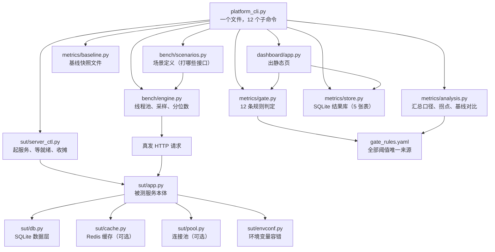

# 初学者完全入门：这个仓库是怎么转起来的

> **写给谁**：会写一点 Python，知道 `def` 和 `import`，但没做过性能压测、也没写过质量门禁的人。
> **读完你会知道**：一条 `python platform_cli.py run` 命令敲下去之后，从"起一个被测服务"到"打印一行 `[PASS] R3`"再到"退出码 1"，中间到底经过了哪些文件、哪些函数，以及**为什么非要拆成这么多层**。
>
> 这份文档不教你"怎么用这个仓库"（那看 [README](../README.md)），也不讲"为什么门禁要这么设计"（那看 [度量口径](./度量口径.md) 与 [诚实边界](./诚实边界.md)）。它只回答一个问题：**这些文件彼此之间是怎么连起来的。**

---

## 目录

- [第 0 章 先建立一张地图](#第-0-章-先建立一张地图)
- [第 1 章 一条压测的完整一生](#第-1-章-一条压测的完整一生)
- [第 2 章 被测服务是怎么被拉起来的](#第-2-章-被测服务是怎么被拉起来的)
- [第 3 章 请求是怎么发出去的、耗时是怎么记下来的](#第-3-章-请求是怎么发出去的耗时是怎么记下来的)
- [第 4 章 一堆原始数字怎么变成一句判决](#第-4-章-一堆原始数字怎么变成一句判决)
- [第 5 章 门禁的 12 条规则是怎么判的](#第-5-章-门禁的-12-条规则是怎么判的)
- [第 6 章 结果存哪儿、基线怎么活下来](#第-6-章-结果存哪儿基线怎么活下来)
- [第 7 章 另外两个入口：看板与 pytest 插件](#第-7-章-另外两个入口看板与-pytest-插件)
- [第 8 章 文件与文件之间的依赖关系](#第-8-章-文件与文件之间的依赖关系)
- [第 9 章 常见困惑逐个拆解](#第-9-章-常见困惑逐个拆解)
- [第 10 章 自己动手改一处，看它怎么传导](#第-10-章-自己动手改一处看它怎么传导)
- [附录 A 名词对照表](#附录-a-名词对照表)
- [附录 B 文件速查](#附录-b-文件速查)
- [附录 C 推荐阅读顺序](#附录-c-推荐阅读顺序)

---

## 第 0 章 先建立一张地图

### 0.1 这个仓库到底在干什么

初学者最容易卡住的第一个问题是：「仓库名字里有 `quality-gate`，那它守的是什么门？」

答案分两层：

**第一层，它是一个「性能压测 + 对比基线」的工具。**
你对一个 Web 服务打压力，它告诉你 P95 是多少毫秒、每秒能扛多少请求。
但这本身不稀奇，`ab`、`wrk`、`Locust` 都能干。

**第二层，也是它真正想做的事：把"变慢了"这件事变成一条会自动变红、并且说得出理由的流水线检查。**
也就是说，它不只报数字，它给出**判决**：

```
[PASS] R1-error-rate: 错误率 0.00%（阈值 1.00%）
[PASS] R2-p95-absolute: P95 38.9ms（绝对阈值 300.0ms）
[SKIP] R3-baseline-degradation: 未设置基线，跳过劣化对比（首次运行请显式设置基线）
[WARNING] R4-sample-size: 采样 340 次（建议 ≥ 2000）
[PASS] R5-tail-jitter: P99/P95 = 1.48（阈值 4.0）

判定：✅ 放行
```

这段输出是本仓库自己跑出来的（第 1 章会带你完整复现一次）。注意三件事：

1. 每条规则都有名字（`R1`~`R5`）、有观测值、有阈值；
2. `R3` 是 `[SKIP]` 而不是 `[PASS]` —— **「没判定」和「判定为没问题」在报告里长得必须不一样**；
3. 最后有一行 `判定`，而 `platform_cli.py` 的**退出码**就是这句话的机器可读版本（放行 = 0，拦住 = 1）。

### 0.2 六个目录，六种角色

```
sut/          被测服务（被压的那个 Web 服务，FastAPI + SQLite）
bench/        压测引擎（自己写的，不是 Locust）
metrics/      口径与判决（分位数、拐点、基线对比、门禁规则、结果库）
dashboard/    看板（一个网页，外加几个 JSON API）
scripts/      外围脚本（演示、覆盖率、依赖检查、探针）
tests/        平台自己的测试
```

一句话概括每个目录的性格：

| 目录 | 一句话 | 关键问题它负责回答 |
|---|---|---|
| `sut/` | **当靶子的** | "我打的那个服务长什么样？它的慢是可归因的吗？" |
| `bench/` | **开枪的** | "压力是怎么施加的？耗时是怎么记的？" |
| `metrics/` | **判案的** | "这些数字说明什么？跟上次比是变好了还是变坏了？" |
| `dashboard/` | **展示的** | "没看 CI 日志的人，怎么知道最近在变慢？" |
| `scripts/` | **杂役** | "演示、覆盖率、依赖一致性这些一次性的事情" |
| `tests/` | **自保的** | "我自己会不会写错？改了以后还是对的吗？" |

**关键认知**：`sut/` 里的代码是**被测对象**，`tests/` 里的代码是**测试代码**。这两类代码在同一个仓库里，但角色完全相反。`sut/` 出错是"被测服务坏了"，`tests/` 出错是"量错了"，后者更危险。

### 0.3 为什么非要自己写一个被测服务

这是一个非常合理的疑问：「既然要压测，为什么不压我们公司自己的服务？」

因为压测的结论只有在**每一个百分点都能解释**的时候才有价值。打公网或者打别人的服务，量到 P99 抖了一下，你无法判断是：

- 网络抖了？
- 对面限流了？
- 我的脚本自己卡了？
- 还是真的代码变慢了？

四种可能，四种处置方式，而你手里只有一个数字。

所以这个仓库自己带了一个被测服务 `sut/app.py`（556 行），它有三个刻意的性质：

1. **端口由系统分配**，不是写死的 8000 —— 避免和本机其它服务打架，也避免"我明明起了服务却连到别人的"这种事；
2. **数据落在临时目录**，跑完就删 —— 绝不污染你的开发库；
3. **内置了可切换的性能缺陷**（见 0.4）。

### 0.4 最重要的一个设计：把缺陷做成"可以随时复现的开关"

`sut/app.py` 里有一个接口，报表「按供应商统计」：

```
GET /api/reports/slow-by-supplier?mode=agg   # 好实现：一条 SQL GROUP BY
GET /api/reports/slow-by-supplier?mode=n1    # 坏实现：先查供应商，再逐个查物料（N+1）
```

`mode=agg` 是"修好之后的样子"，`mode=n1` 是"出事故时的样子"。同一个接口、同一个数据库、同一批数据，只换实现方式。

为什么要这样设计？因为**你要证明"门禁真的能拦住缺陷"**。如果缺陷只存在于传说里（"我们线上曾经有过 N+1"），你就永远无法演示门禁会不会红。把缺陷固化成开关之后：

- 想演示门禁能红？切到 `n1`；
- 想演示门禁能绿？切回 `agg`；
- 想证明门禁的阈值是有效的？两个都跑一遍，看 `P1-n1-probe` 这条规则到底有没有反应。

这一整套思路（**缺陷由清单跟踪，探针负责让"门禁能拦住它"这件事可被反复证明**）在 `docs/已知问题.md` 里被写成 P-1~P-26 共 26 条台账。

### 0.5 谁调用谁

先看一张全局图。箭头表示"调用"或"读取"，**箭头只允许单向走**：



这张图里有一条**贯穿全仓库的纪律**，后面会反复出现：

> **同一条口径只允许有一个实现，其余地方一律 `import` 它。**

最典型的例子是 `metrics/analysis.py:445 merge_step_rows()` —— 它是"整轮汇总"的唯一出口。`platform_cli.py` 的 `run` / `gate` / `probe` / `trend` 全都要调它，看板也要调它。为什么？因为历史上它曾经有三份复制粘贴的实现，三份算出来的 P95 不一样，于是"报告说没超阈值，流水线却红了"。这个坑在第 4、第 9 章会详细拆。

---

## 第 1 章 一条压测的完整一生

我们拿仓库里最典型的一条命令走一遍：

```bash
python platform_cli.py run --label demo --items 20000 --step-users 10 20
```

它做的事情（按时间顺序）：

1. 建/打开结果库 `quality.db`；
2. 记一条 `runs` 记录，状态 `running`；
3. 起一个被测服务（分配端口、灌 20000 条数据、等它真能返回 200）；
4. 对 10 并发、20 并发两级分别压 8 秒，每级产出一份 `Stats`；
5. 把两级结果写进 `steps` 表；
6. 把两级汇总成"这一轮"的数字（`merge_step_rows`）；
7. 找拐点（`find_knee`）；
8. 读基线（`store.get_baseline`），算出"跟上次比变了多少"（`compare_to_baseline`）；
9. 检查两轮是否可比（`check_comparability`）；
10. 跑 12 条规则里属于性能的那 5 条（`evaluate_perf`）；
11. 把判定写进 `gate_results` 表，把 `runs` 状态改成 `passed`/`failed`；
12. 生成一份 Markdown 报告文件，打印到屏幕；
13. **退出码 = 门禁结论**（0 或 1）。

这 13 步全部住在 `platform_cli.py:208 cmd_run()` 里。我们逐段拆。

### 1.1 入口：`main()` 只做三件事

`platform_cli.py:1401`：

```python
def main(argv: list[str] | None = None) -> int:
    _make_stdout_utf8()
    # 先套档案再解析 argv：档案决定的是**环境**（会被 SUT 子进程继承），
    # 而 argparse 只决定这一次调用的参数。顺序反过来的话，
    # `--help` 之类的路径也会先把档案套上 —— 没必要，也更容易误伤。
    apply_env_profile(argv)
    args = build_parser().parse_args(argv)
    return args.func(args)
```

三件事，每件都有理由：

**① `_make_stdout_utf8()`** —— Windows 的默认控制台编码是 GBK，报告里有中文，不强制 UTF-8 就会在 CI 日志里变成乱码。这一个调用曾经救过一次真实的线上事故（`docs/incident-encoding-20261010/` 里存着当时的损坏文件）。

**② `apply_env_profile(argv)`** —— 这是"环境分层"（`dev` / `staging` / `prod` 三份 `.env` 档案）。注意它**先于 argparse**：因为档案改的是 `os.environ`，而 `os.environ` 会被后面起的 SUT 子进程继承；`argparse` 只影响这一次调用的参数。

**③ `return args.func(args)`** —— 每个子命令在 `build_parser()` 里用 `set_defaults(func=cmd_xxx)` 绑定了自己的处理函数。所以 `main()` 不知道也不关心你跑的是 `run` 还是 `probe`，它只负责"解析完就执行"。返回值就是进程退出码。

### 1.2 第一段：把"这一轮是什么"记下来

`platform_cli.py:208` 开头：

```python
def cmd_run(args: argparse.Namespace) -> int:
    """跑一轮压测：梯度加压 → 入库 → 与基线比 → 门禁判定 → 出报告。"""
    store.init_db()
    label = args.label or f"{args.report_mode}-{args.items // 1000}k"
    run_id = new_run_id("perf")
    rules = gate.load_rules(args.rules)
    info = platform_info()
    config = {
        "items": args.items,
        "report_mode": args.report_mode,
        "scenario": args.scenario or "(mix)",
        "step_users": args.step_users,
        "step_duration_s": args.step_duration,
        "think_time_s": args.think_time,
    }
    store.upsert_run(
        run_id, "perf", label, config=config, platform_info=info, git_sha=git_sha(), ci=bool(os.environ.get("CI"))
    )
```

逐个说：

- **`run_id`**（`platform_cli.py:52`）形如 `perf-20261025-234300-7f0ee3` = 前缀 + 时间戳 + 6 位随机 hex。为什么要随机后缀？因为同一秒内跑两次不能撞 ID（撞了就会覆盖入库记录）。有一条用例专门测这个：`tests/test_cli.py::test_new_run_id_is_prefixed_and_unique`。

- **`config`** —— 这一段是后面"可比性判定"的输入。记住它包含四样东西：**数据量 `items`、报表实现 `report_mode`、场景 `scenario`、并发梯度 `step_users`**。第 4 章会讲为什么这四样一旦变了，劣化百分比就没有意义。

- **`platform_info()`**（`platform_cli.py:40`）—— 记下 Python 版本、操作系统、CPU 核数、FastAPI/uvicorn/requests 版本。注意它**只记录，不参与判定**（`docs/度量口径.md` 里有论证：如果"机器不同"就判不可比，那 CI 上的 R3 永远是 SKIP，因为 runner 和开发机必然不同）。

- **`upsert_run(...)`**（`metrics/store.py:154`）—— 写一条 `runs` 记录，状态默认 `running`。

**这里有一个很重要的细节**：`upsert_run` 刻意**不更新** `config_json` / `kind` / `label`（如果记录已存在）。也就是说，一轮跑起来之后，它的"身份"就固定了。这是一个防篡改设计：不允许后面某个环节悄悄改掉"这轮到底是什么配置"，否则可比性判定就成了摆设。

### 1.3 第二段：起被测服务

```python
    print(f"[run] run_id={run_id} label={label}")
    print(f"[run] 配置 {json.dumps(config, ensure_ascii=False)}")
    handle = start_sut(report_mode=args.report_mode, items=args.items)
    print(f"[run] 被测服务 {handle.base_url} db={handle.db_path}")
```

`start_sut` 是 `sut/server_ctl.py:129`，第 2 章整章讲它。这里只要知道它返回一个 `SutHandle`，里面握着：

- `base_url`：形如 `http://127.0.0.1:3492`（端口是系统分的）；
- `db_path`：临时目录里的 `sut.db`；
- `proc`：那个 uvicorn 子进程的句柄；
- `tmp_dirs`：自己建的临时目录列表（**只有自己建的才会被删**）。

紧接着下面这一段注释非常关键：

```python
    # 让场景按**实际灌入的物料条数**取随机 ID。不设置的话，
    # `--items` 小于默认的 20 000 时会有大批点查打到不存在的 ID，
    # 压测脚本自己凭空造出高错误率（实测 5 000 条时报出 28%）。
    configure_item_range(args.items)
```

这是 `bench/scenarios.py:47` 的函数。为什么必须调用它？因为场景要随机挑一个物料 ID 去查，取值范围必须等于**实际灌进去的条数**。早先这里写死 `randint(1, 20_000)`，于是 `--items 5000` 时约 75% 的点查打到不存在的 ID，拿 404。

后果是什么？门禁 `R1-error-rate` 报「错误率 28.02%（阈值 1.00%）→ 判定：拦住」。而这个 28% 没有任何业务含义，纯粹是**压测脚本自己发错了请求**。

> **一句话教训**：一个压测工具凭空造出 28% 的错误率，比它测不出问题更危险 —— 因为它会让人去查被测服务。

### 1.4 第三段：逐梯度加压

```python
    try:
        stats_by_step = []
        for users in args.step_users:
            if args.scenario:
                mix = engine_single(handle.base_url, args.scenario, timeout_s=args.timeout)
            else:
                mix = build_engine_mix(handle.base_url, timeout_s=args.timeout)
            runner = Runner(
                base_url=handle.base_url,
                scenarios=mix,
                users=users,
                duration_s=args.step_duration,
                think_time_s=args.think_time,
                ramp_up_s=min(2.0, args.step_duration / 4),
                warmup_drop_s=args.warmup_drop,
            )
            st = runner.run()
            stats_by_step.append(st)
```

三个概念：

**① `mix`（场景组合）** —— 就是"打哪些接口、各自占多少比例"。默认配比在 `bench/scenarios.py:25`：

```python
DEFAULT_MIX = {
    "items_list": 40,          # 列表查询 40%
    "item_detail": 30,         # 详情查询 30%
    "stock_by_category": 15,   # 分类统计 15%
    "slow_report": 10,         # 报表（就是那个带 N+1 的）10%
    "stock_write": 5,          # 写库存 5%
}
```

这个配比不是随便拍的，它模仿的是"线上真实的读写配比"：查询是高频只读，报表是低频但重，写是少量。只压读接口的结论会过于乐观，因为真实系统里把 CPU 打满的往往是写路径的锁竞争。

**② `Runner`**（`bench/engine.py:189`）—— 定并发压测执行器。`ramp_up_s=min(2.0, duration/4)` 的意思是"2 秒内把并发从 0 加到目标值，但最多花掉整个梯度的四分之一"。为什么要爬坡而不是瞬间全上？因为瞬间全上会有一个巨大的连接建立尖峰，那个尖峰的耗时不是稳态性能。

**③ `warmup_drop_s`** —— 丢掉前 N 秒的样本。理由见 `bench/engine.py` 里的注释：TCP 冷启动、SQLite 页缓存、模块首次导入都会把 P99 抬高一大截，而真实用户感受到的不是第一秒。

每级跑完打印一行：

```
[step]    5u    1.0s  n=340    rps=  330.08  p95=   38.95ms  p99=   57.58ms  err=0.00%  inflight=5
```

注意最后的 `inflight=5` —— 配置并发是 5，实际在途也是 5，说明压力真打出去了。如果配置 50 而 inflight 只有 12，那说明瓶颈在**压测机**，不在被测服务。第 3 章会讲这个数字是怎么采的。

### 1.5 第四段：把多级汇总成一轮

```python
        store.add_steps(run_id, stats_by_step)
        step_dicts = [s.as_dict() for s in stats_by_step]
        merged = _merge_from_rows(step_dicts)
```

`_merge_from_rows` 在 `platform_cli.py:708`，但它**只有一行**：

```python
def _merge_from_rows(rows: list[dict]) -> dict:
    """整轮汇总 —— 实现只有一处，在 `metrics.analysis.merge_step_rows`。"""
    return analysis.merge_step_rows(rows)
```

为什么不直接调 `analysis.merge_step_rows`，要多一层别名？因为调用点（`run` / `gate` / `probe` / `trend`）都习惯了 `_merge_from_rows` 这个名字，把实现搬走的时候不想让所有调用点都改一遍。

**但关键在于 docstring 里那句话**：「**别名不是第二份实现**：它没有自己的逻辑，改口径只需要改 `analysis.py` 那一处。」

这句话是在防什么？防的是一种非常常见的"善意重构"：某天有人觉得"多一跳函数调用"，就在 `platform_cli.py` 里重新写一遍汇总逻辑。那一刻起，仓库里就有两份口径了。第 4 章会讲这个坑当初真的发生过。

### 1.6 第五段：算劣化、判可比性、跑门禁

```python
        knee = analysis.find_knee(step_dicts)
        baseline = store.get_baseline("perf", label)
        run_metrics = merged
        deltas = analysis.compare_to_baseline(run_metrics, baseline["metrics"], rules) if baseline else []
        comparability = analysis.check_comparability(config, baseline.get("config"), rules) if baseline else None

        report = gate.evaluate_perf(run_metrics, baseline, deltas, rules, comparability, r3_advisory=args.r3_advisory)
```

四步，每步一个问题：

| 步骤 | 函数 | 回答的问题 |
|---|---|---|
| 找拐点 | `analysis.find_knee` (`metrics/analysis.py:286`) | "加到多少人，加人就不管用了？" |
| 读基线 | `store.get_baseline` (`metrics/store.py:252`) | "上次的基准是什么？" |
| 算劣化 | `analysis.compare_to_baseline` (`metrics/analysis.py:252`) | "每个指标涨/跌了几个百分点？" |
| 判可比性 | `analysis.check_comparability` (`metrics/analysis.py:198`) | "这两轮量的是同一件事吗？" |

注意顺序：**先判可比性，再跑门禁**。因为可比性判不过时，`R3` 会走 `[SKIP]`（"无法判定"），而不是拿两个不可比的数字算出一个百分比。这个顺序不能反。

还有个小细节：`store.get_baseline("perf", label)` 这里写死了 `"perf"`，因为它就在 `cmd_run` 里，而 `cmd_run` 只产 `kind='perf'` 的运行。但 `cmd_gate`（`platform_cli.py:636`，作用是对一个**已经入库**的 run 重新判定）就不一样了：它必须按 run 自己的 `kind` 取基线。这里曾经写死过 `"perf"`，导致 `probe` 轮的 R3 永远是 `[SKIP]` —— 详见 `docs/已知问题.md` 的 P-20。

### 1.7 第六段：落库、出报告、定退出码

```python
        store.add_gate_results(run_id, [r.as_dict() for r in report.results])
        status = "failed" if report.blocked else "passed"
        store.finish_run(run_id, status, {"knee": knee, **run_metrics})

        text = analysis.render_perf_report(...)
        text += "\n\n" + report.render() + "\n"
        REPORTS_DIR.mkdir(exist_ok=True)
        out_path = REPORTS_DIR / f"{run_id}.md"
        out_path.write_text(text, encoding="utf-8")
        ...
        return 1 if report.blocked else 0
    finally:
        handle.stop()
```

四件事：

1. **两条判定结果都入库**：`gate_results` 表存 12 条规则的逐条结论，`runs.metrics_json` 存整轮汇总。为什么两处都存？因为看板要画趋势（需要 metrics），复盘要逐条看理由（需要 gate_results）。

2. **`status` 分两种，都要入库**。`failed` 的轮次照样落库 —— `metrics/store.py` 的模块 docstring 专门写了这一点：「只存成功记录的度量平台，给出的通过率是假的（分母被美化过）」。

3. **Markdown 报告写文件**，路径打进 stdout。CI 里直接当 artifact 上传，人不用去数据库里翻。报告长这样（真实输出）：

```markdown
# 压测报告 · doc-demo

- run_id: `perf-20261025-234300-7f0ee3`
- 平台: Python 3.12.10 / Windows-11 / CPU 16 核
- 被测服务: FastAPI 0.143.0 + uvicorn 0.54.0 + SQLite(WAL)，数据量 400 条物料
- 报表实现: `agg`（agg = 单条 SQL 聚合；n1 = 逐供应商查询，N+1）

## 各梯度结果
| 并发 | 时长(s) | 请求数 | 错误率 | RPS | 每用户吞吐 | P50 | P95 | P99 | Max | 实际在途 |
|---:|---:|---:|---:|---:|---:|---:|---:|---:|---:|---:|
| 5 | 1.0 | 340 | 0.00% | 330.1 | 66.016 | 6.9 | 38.9 | 57.6 | 72.8 | 5 |
...
```

4. **`return 1 if report.blocked else 0`** —— 这一行就是"门禁"这两个字的技术含义。CI 不需要解析任何文本，它只看退出码。

最后一个 `finally: handle.stop()`：无论中间抛什么异常，被测服务和临时目录都必须收掉。**这里踩过的坑**：早期没有 `finally`，异常路径漏掉的临时目录在系统 Temp 下累积了 289 组 `perf-sut-db-*` / `perf-sut-log-*`。

### 1.8 整条命令的时间线

```
你敲命令
  │
  ├─ main()                                     platform_cli.py:1401
  │   ├─ 强制 UTF-8 输出
  │   ├─ 套 PERF_ENV 档案（如果有）
  │   └─ argparse 解析 → args.func = cmd_run
  │
  ├─ cmd_run()                                  platform_cli.py:208
  │   ├─ store.init_db()                        建 5 张表
  │   ├─ store.upsert_run()                     插 runs 记录（running）
  │   ├─ start_sut()                            sut/server_ctl.py:129
  │   │   ├─ free_port()                        bind(0) 让系统分配端口
  │   │   ├─ subprocess: python -m sut.seed    灌 20000 条数据（先灌数据后起服务）
  │   │   ├─ subprocess: uvicorn sut.app:app   起服务
  │   │   └─ wait_ready()                       轮询 /healthz 直到真返回 200
  │   ├─ configure_item_range(20000)            告诉场景真实数据量
  │   │
  │   ├─ for users in [10, 20]:                 每级
  │   │   ├─ build_engine_mix() → 场景闭包
  │   │   ├─ Runner(...).run()                  bench/engine.py:313
  │   │   │   ├─ 起 sampler 线程采 inflight
  │   │   │   ├─ 线程池提交 users 个 _worker
  │   │   │   │   └─ 每个 worker: 循环取场景 → 发请求 → 记 Sample
  │   │   │   ├─ sleep(duration_s) 然后 _stop.set()
  │   │   │   ├─ 丢热身样本
  │   │   │   └─ summarize() → Stats（P50/P90/P95/P99/max/rps）
  │   │   └─ 打印 [step] 行
  │   │
  │   ├─ store.add_steps()                      每级一行写进 steps 表
  │   ├─ analysis.merge_step_rows()             整轮汇总（唯一出口）
  │   ├─ analysis.find_knee()                   拐点
  │   ├─ store.get_baseline("perf", label)      基线
  │   ├─ analysis.compare_to_baseline()         逐指标劣化
  │   ├─ analysis.check_comparability()         两轮可比吗
  │   ├─ gate.evaluate_perf()                   5 条规则
  │   ├─ store.add_gate_results()               12 条逐条入库
  │   ├─ store.finish_run()                     runs 状态定稿
  │   ├─ analysis.render_perf_report()          写 reports/<run_id>.md
  │   └─ return 1 if blocked else 0             ← 门禁结论
  │
  └─ finally: handle.stop()                     杀进程、删自己建的临时目录
```

> **一条容易被忽略的纪律**：`cmd_run` 从头到尾**没有任何一处写基线**。基线只能由 `--set-baseline` 或 `baseline set` 显式写入。这条是硬规矩，原因在第 6 章。

---

## 第 2 章 被测服务是怎么被拉起来的

很多人第一次看到"测试代码要负责启动被测服务"会觉得别扭：测试就测试，为什么还要管起服务？

因为**压测报告里必须能写清"打的是哪个进程、端口几号、库在哪"**。随手 `uvicorn sut.app:app` 起的服务，端口靠猜、库落在仓库里、跑完不回收 —— 这是压测结论不可信的常见起点。所以这件事必须在代码里堵死。

`sut/server_ctl.py`（234 行）就干这一件事，它的模块 docstring 列出了四条硬规矩：

1. **端口由系统分配**（`bind 0`），不是写死的 8000；
2. **数据库落在临时目录**，跑完即弃；
3. **临时目录由 `SutHandle.stop()` 收回**，调用方传进来的路径一律不碰；
4. **就绪探针等真返回 200**，不用 `sleep 2` 赌它起没起来。

### 2.1 端口为什么要让系统分配

`sut/server_ctl.py:32`：

```python
def free_port() -> int:
    with socket.socket(socket.AF_INET, socket.SOCK_STREAM) as s:
        s.bind(("127.0.0.1", 0))
        return s.getsockname()[1]
```

`bind(("127.0.0.1", 0))` 里的 `0` 意思是"随便给我一个空闲端口"，然后 `getsockname()` 把系统实际分配的那个端口读回来。

好处有两条：

- **不会撞端口**。写死 8000 的仓库，只要有另一个服务占了 8000，所有用例都会莫名其妙失败；
- **可以并行跑**。两个进程同时跑压测，各自拿到不同端口，互不干扰。

> 注意 `s.close()` 之后到 uvicorn 真正 `bind` 之间存在一个极短的窗口（TIME_WAIT 级别的竞争）。这是这类"先探测再使用"方案的固有缺陷，在单机 CI 上概率极低。它不是没意识到，是权衡之后的接受。

### 2.2 `start_sut()` 的完整流程

`sut/server_ctl.py:129`：

```python
    port = free_port()
    base_url = f"http://127.0.0.1:{port}"

    tmp_dirs: list[str] = []
    if db_path is None:
        tmp = Path(tempfile.mkdtemp(prefix="perf-sut-db-"))
        tmp_dirs.append(str(tmp))
        db_path = str(tmp / "sut.db")
    if log_dir is None:
        log_dir = tempfile.mkdtemp(prefix="perf-sut-log-")
        tmp_dirs.append(str(log_dir))
```

**注意 `tmp_dirs.append` 的条件**：只有在"调用方没传"的时候，本函数才自己 `mkdtemp`，并且只把**自己建的**目录记进 `tmp_dirs`。`stop()` 只会删 `tmp_dirs` 里的东西。

为什么要这么绕？因为调用方传进来的 `db_path` 可能是：

- 仓库里的 `quality.db`（删了就是数据事故）；
- 另一个测试还要复用的目录；
- 用户自己指定想保留的调试目录。

**"谁建的谁删"是一条比"跑完就清"更安全的规则。**

然后是灌数据：

```python
    env = os.environ.copy()
    env.update({
        "PERF_SUT_DB": db_path,
        "PERF_SUT_REPORT_MODE": report_mode,
        "PYTHONIOENCODING": "utf-8",
        "PYTHONPATH": str(ROOT),
    })
    if extra_env:
        env.update(extra_env)

    # 先灌数据再起服务：避免"第一个请求撞上建表"这种热身噪声混进基线。
    seed = subprocess.run(
        [sys.executable, "-m", "sut.seed", str(items)],
        cwd=str(ROOT), env=env, capture_output=True, text=True, encoding="utf-8", errors="replace",
    )
    if seed.returncode != 0:
        _discard_tmp()
        raise RuntimeError(f"seed 失败：{seed.stdout}\n{seed.stderr}")
```

三个要点：

**① 为什么用子进程灌数据，不直接 `import sut.seed`？**
因为 `sut.seed` 会 `import sut.db`，而 `sut.db` 的连接池、`QUALITY_DB` 之类的模块级状态会被父进程继承下来。用子进程 = 一个干净的、只做一件事的进程，跑完就退，父进程状态零污染。

**② 为什么先灌数据再起服务？**
如果反过来，第一个请求会撞上"还没建表"或者"索引还没建完"，那一次请求的耗时会非常难看，而且这个难看会混进热身窗口之外。**压测的数字里不该有"初始化成本"**。

**③ 失败路径也收摊（`_discard_tmp()`）。**
这是 `sut/server_ctl.py:166` 那个内部函数：

```python
    def _discard_tmp() -> None:
        # 起服务失败时也要收拾：失败路径漏掉的临时目录最难被发现。
        for d in tmp_dirs:
            shutil.rmtree(d, ignore_errors=True)
```

失败路径的资源泄漏是最难发现的，因为没人会去看"一次失败的运行留下了什么"。

### 2.3 就绪探针为什么不 `sleep 2`

```python
def _direct_get(url: str, timeout: float) -> requests.Response:
    """GET，且不读 `HTTP_PROXY` / `HTTPS_PROXY` / `ALL_PROXY`。"""
    with requests.Session() as session:
        session.trust_env = False
        return session.get(url, timeout=timeout)


def wait_ready(base_url: str, timeout_s: float = 40.0) -> bool:
    deadline = time.perf_counter() + timeout_s
    while time.perf_counter() < deadline:
        try:
            if _direct_get(f"{base_url}/healthz", timeout=1.0).status_code == 200:
                return True
        except requests.RequestException:
            time.sleep(0.15)
    return False
```

两个设计点，各自对应一个真实的坑：

**① 轮询而不是 `sleep`。**
`sleep 2` 的问题是：机器快的时候浪费 2 秒（每轮压测都浪费），机器慢的时候 2 秒不够（于是第一个请求失败，被记成错误率）。轮询是"好了就走，没好就等"，两头都对。

**② `session.trust_env = False`。**
这一条是"性能测试跑出假失败"的经典原因。`requests` 默认会读 `HTTP_PROXY` / `HTTPS_PROXY` 环境变量。如果你的机器配了代理，`http://127.0.0.1:3492/healthz` 会先发给代理 —— 代理可能：

- 回一个 502/503（于是 `wait_ready` 拿到一个**不属于被测服务的状态码**，把没起来的服务判成"起来了但有问题"）；
- 或者干脆超时（于是你以为服务起不来）。

后面所有压力数据和门禁结论都建在这个误判上。所以探测必须绕过代理。

### 2.4 `SutHandle.stop()`：为什么要分三段

`sut/server_ctl.py:55`：

```python
    def stop(self) -> None:
        if self.proc.poll() is None:
            self.proc.terminate()
            try:
                self.proc.wait(timeout=10)
            except subprocess.TimeoutExpired:
                self.proc.kill()
                self.proc.wait(timeout=5)
        # 先关日志句柄再删目录：Windows 上被占用的文件删不掉。
        if self.log_file is not None:
            try:
                self.log_file.close()
            except OSError:
                pass
            self.log_file = None
        self.cleanup_tmp()
```

三段，按顺序：

**① `terminate()` → 等 10 秒 → `kill()`。**
为什么不一上来就 `kill()`？因为 `SIGKILL` 不给进程清理的机会（uvicorn 来不及关套接字、来不及 flush 日志）。先温和再暴力，是标准的进程收尾流程。

**② 先关日志句柄再删目录。**
这是 Windows 特有的坑：**被进程占用的文件删不掉**。如果不先 `close()` 那个 `open(log_path, "w")` 拿到的句柄，`shutil.rmtree` 会报 `PermissionError`。

**③ `cleanup_tmp()` 返回"没删成功"的路径。**

```python
    def cleanup_tmp(self) -> list[str]:
        """删掉自己建的临时目录，返回**没删成功**的路径列表。

        尽力而为：uvicorn 刚退出时 Windows 可能还短暂占着句柄，重试几次即可；
        仍然失败就返回路径，由调用方/测试决定要不要抱怨 —— 清理失败不该
        把一次成功的压测变成失败。
        """
```

这个"返回而不是抛异常"的选择很有意思：**清理失败不该让一次成功的压测变红**。但它也不能静默 —— 所以返回给调用方，让测试去决定怎么处理。有一条用例专门测这个：`tests/test_sut_api.py::TestTempDirCleanup`。

### 2.5 `stop()` 之后，被测服务留下了什么

答案是：**什么也没留下**。端口释放、进程杀掉、临时目录删掉。

但有三样东西是**故意保留**的：

| 保留下来的 | 在哪 | 为什么 |
|---|---|---|
| 结果库里的记录 | `quality.db`（或 `QUALITY_DB` 指定的路径） | 这是"这一轮发生过"的证据，删了趋势就断了 |
| Markdown 报告 | `reports/<run_id>.md` | 人读的东西，要能进 artifact |
| uvicorn 日志 | 临时目录里（**已随目录删除**） | 只在失败时被 `tail()` 捞出来打进异常消息 |

最后一条要特别注意顺序 —— `sut/server_ctl.py:228`：

```python
    if not wait_ready(base_url):
        # 先取日志再收摊：stop() 会把日志目录删掉，之后再 tail 就只剩空字符串，
        # 而这行日志正是排查"服务为什么没起来"的唯一线索。
        tail = handle.tail()
        handle.stop()
        raise RuntimeError(f"被测服务未就绪（{base_url}）：\n{tail}")
```

**先 `tail()` 再 `stop()`**。反过来的话，异常消息里就只有一行空字符串，而那一行日志正是你唯一的线索。这类"顺序反了就丢信息"的 bug，是排查类代码里最常见的一种。

---

## 第 3 章 请求是怎么发出去的、耗时是怎么记下来的

`bench/` 目录只有 4 个文件：

```
bench/engine.py       389 行   压测引擎（线程池 + 采样 + 分位数）
bench/scenarios.py    362 行   场景定义（打哪些接口、怎么取参数）
bench/distributed.py  486 行   分布式压测（1 个 coordinator + N 个 worker）
bench/__init__.py
```

### 3.1 三层结构：场景 → 绑定 → 引擎

一个"场景"就是一个函数，签名统一是：

```python
def items_list(session: requests.Session, base_url: str, timeout_s: float = 10.0) -> Sample:
```

但引擎要的是 `(session) -> Sample`（只有一个参数）。所以中间有一层 `bind`（`bench/scenarios.py:333`）：

```python
def bind(fn, base_url: str, timeout_s: float = 10.0):
    """把 (session, base_url, timeout) 场景适配成引擎要的 (session) -> Sample。

    场景函数写成显式传参而不是闭包捕获 base_url，是为了**能被单独调用做冒烟**：
    拐点定位出错时，第一件事就是"把那个场景手工跑一次看看"，
    闭包会让这一步变得别扭。
    """
    name = getattr(fn, "__name__", "scenario")

    def bound(session: requests.Session) -> Sample:
        return fn(session, base_url, timeout_s=timeout_s)

    bound.__name__ = name
    return bound
```

为什么要 bind 而不是让场景自己用全局变量记住 `base_url`？

- 全局变量在测试里没法改（你没法为每条用例起一套不同的 base_url）；
- 显式传参的场景函数可以**单独调用做冒烟**：`items_list(session, "http://127.0.0.1:1234")`，一行就能验证"这个场景本身对不对"。

这说明 `bind` 还顺手做了一件小事：把 `bound.__name__` 设回原名。因为 `Sample.scenario` 字段要用它，如果不管，所有场景的 `__name__` 都会是 `"bound"`。

### 3.2 一个场景长什么样

`bench/scenarios.py:114`：

```python
def items_list(session: requests.Session, base_url: str, timeout_s: float = 10.0) -> Sample:
    r = _rnd()
    if r.random() < 0.5:
        path = f"/api/items?limit={r.choice([10, 20, 50])}&offset={r.choice([0, 100, 1000])}"
    else:
        path = f"/api/items?category_id={r.randint(1, 10)}&limit=20"
    return run_api_call(session, base_url, "GET", path, scenario="items_list", timeout_s=timeout_s)
```

结构极其简单：**取随机参数 → 拼路径 → 交给 `run_api_call`**。

注意它**不做断言**。这是压测和功能测试最大的区别：

| | 功能测试 | 压测场景 |
|---|---|---|
| 关心 | "业务对不对" | "响应码是否符合预期 + 耗时" |
| 断言 | 响应体字段、数据库状态 | `status in expect_status` + 记一笔耗时 |
| 失败时 | 用例红，指出哪里不对 | 记一个错误样本，继续压 |

压测里如果一条请求失败就中断，你测的就不是"服务在压力下的表现"，而是"第一个错误什么时候出现"。

### 3.3 `run_api_call()`：所有请求的唯一出口

`bench/engine.py:355`：

```python
def run_api_call(
    session: requests.Session, base_url: str, method: str, path: str,
    expect_status: int | tuple[int, ...] = 200, timeout_s: float = 10.0,
    scenario: str = "", **kwargs,
) -> Sample:
    """发一次请求并产出样本。所有压测场景都用它，保证口径一致。"""
    url = f"{base_url.rstrip('/')}{path}"
    expect = (expect_status,) if isinstance(expect_status, int) else expect_status
    t0 = time.perf_counter()
    try:
        resp = session.request(method, url, timeout=timeout_s, **kwargs)
        elapsed = (time.perf_counter() - t0) * 1000.0
        ok = resp.status_code in expect
        err = "" if ok else f"HTTP {resp.status_code}"
        return Sample(scenario=scenario or f"{method} {path}", status=resp.status_code,
                      elapsed_ms=elapsed, ok=ok, error=err)
    except Exception as exc:
        elapsed = (time.perf_counter() - t0) * 1000.0
        return Sample(scenario=scenario or f"{method} {path}", status=0,
                      elapsed_ms=elapsed, ok=False, error=f"{type(exc).__name__}")
```

四个关键选择：

**① 用 `time.perf_counter()` 而不是 `time.time()`。**
`perf_counter` 是单调时钟，不受系统时间被调整（NTP 同步、夏令时）的影响。压测里算耗时必须用它，否则你会量到"负的耗时"。

**② 计时只包住 `session.request()`。**
不包 `url` 拼接、不包 `Sample` 构造。因为那些是压测脚本自己的成本，混进去就不是"服务有多快"了。

**③ `except Exception` 吞掉一切，返回一个失败样本。**
这不是偷懒，是压测引擎的本分：**任何一条请求出问题都不能让整轮压测崩掉**。哪怕场景函数自己写错了（抛 `TypeError`），也记成一个失败样本继续压。`raise` 的后果是"压测跑了 3 秒就异常退出"，而你会误以为"服务在 3 秒时挂了"。

**④ `status=0` 表示"没拿到 HTTP 响应"。**
超时、连接被拒、DNS 失败都是这一类。`status=0` + `error="TimeoutError"` 这个组合，在错误分布里能一眼看出是"网络层失败"还是"HTTP 5xx"。

### 3.4 `Sample` 和 `Stats`：数据是怎么流动的

```python
@dataclass
class Sample:
    scenario: str
    status: int
    elapsed_ms: float
    ok: bool
    error: str = ""
    at: float = 0.0  # 相对本次运行开始的秒数
```

`Sample` = **一次请求**的完整记录。`at` 字段是"这次请求发生在本次运行的第几秒"，它只为一件事服务：**丢掉热身窗口**（第 3.6 节）。

```python
@dataclass
class Stats:
    label: str = ""
    users: int = 0
    duration_s: float = 0.0
    total: int = 0
    ok_count: int = 0
    error_count: int = 0
    error_breakdown: dict[str, int] = field(default_factory=dict)
    status_breakdown: dict[str, int] = field(default_factory=dict)
    rps: float = 0.0
    mean_ms: float = 0.0
    p50_ms: float = 0.0
    p90_ms: float = 0.0
    p95_ms: float = 0.0
    p99_ms: float = 0.0
    max_ms: float = 0.0
    error_rate: float = 0.0
    rps_per_user: float = 0.0
    samples: list[Sample] = field(default_factory=list)
```

`Stats` = **一个梯度**的汇总。注意它**同时保留了 `samples`**：这是有代价的（内存），但它换来两件事：

1. `merge_stats` 能把多个梯度的样本池化重算（虽然现在这个函数被限制使用，见第 4 章）；
2. 排查问题时能拿到原始数据，而不只是一个分位数。

`summarize()`（`bench/engine.py:102`）把 `list[Sample]` 变成 `Stats`：

```python
def summarize(samples, label="", users=0, duration_s=0.0) -> Stats:
    samples = list(samples)
    st = Stats(label=label, users=users, duration_s=round(duration_s, 3))
    st.total = len(samples)
    if not samples:
        return st

    latencies = [s.elapsed_ms for s in samples]
    st.ok_count = sum(1 for s in samples if s.ok)
    st.error_count = st.total - st.ok_count
    st.error_rate = round(st.error_count / st.total, 6)
    st.rps = round(st.total / duration_s, 3) if duration_s > 0 else 0.0
    st.rps_per_user = round(st.rps / users, 4) if users else 0.0
    st.mean_ms = round(sum(latencies) / len(latencies), 3)
    st.p50_ms = round(percentile(latencies, 50), 3)
    st.p90_ms = round(percentile(latencies, 90), 3)
    st.p95_ms = round(percentile(latencies, 95), 3)
    st.p99_ms = round(percentile(latencies, 99), 3)
    st.max_ms = round(max(latencies), 3)
    ...
```

有一个容易忽略的点：`error_count = total - ok_count`，也就是说 **"错误"= "所有不是 200 的响应" + "所有没拿到响应的"**。而 `error_breakdown` 按异常类型分桶（`s.error.split(":", 1)[0]`），这让你能区分"20% 是超时"和"20% 是 500"。

### 3.5 `percentile()`：为什么用 nearest-rank，不用插值

这是本章最重要的一个函数。`bench/engine.py:43`：

```python
def percentile(values: Sequence[float], q: float) -> float:
    """nearest-rank 分位数（q 取 0~100）。

    选 nearest-rank 而不是线性插值，是因为它**永远返回一个真实观测到的值**。
    报告里写"P95 = 12.3ms"，这个 12.3ms 是某一类用户身上真发生过的延迟，
    而不是两个样本插出来的数字。面试被追问"你的 P95 怎么算的"时，
    这个选择本身就是能讲的东西。
    """
    if not values:
        return 0.0
    ordered = sorted(values)
    if q <= 0:
        return float(ordered[0])
    idx = math.ceil(q / 100.0 * len(ordered)) - 1
    idx = max(0, min(idx, len(ordered) - 1))
    return float(ordered[idx])
```

举个具体例子。假设 100 个样本，P95：

```
idx = ceil(0.95 × 100) - 1 = ceil(95) - 1 = 95 - 1 = 94
→ 返回 sorted(ordered)[94]，即第 95 个样本
```

也就是说"P95"是"第 95 个最慢的样本"。这个值一定是真实观测到的。

**但这里有一个必须知道的推论**：当样本数 `N < 20` 时，P95 取的是 `ceil(0.95N) - 1`，而 `0.95N < 19`，`ceil(0.95N)` 最多等于 `N`，所以索引最大是 `N-1` —— **P95 就是最大值**。

这个推论不是学术问题，它真的坑过人。CI 日志里的现场（`ci_logs/` 里存着）：

```
[probe] mode=n1 rps=1.32 p95=3828.6ms p99=3828.6ms err=0.00%
```

`p95` 和 `p99` 打印出**同一个数字**。这不是"长尾很集中"，这是**分位数在样本不足时退化成了最大值**。

n1 是慢查询，4 并发 × 8 秒只跑出约 10 个样本。而 `P1-n1-probe` 是一条 **blocking** 规则 —— 也就是说，一条会拦人合并的规则，拿着 10 个样本的"P95"在下判决。结论方向恰好是对的（3828.6ms 确实远超 150ms），但那个数字不配叫 P95。

处置方式不是把规则改掉，而是**补一条规则把这件事说出来**：`P3-probe-sample-size`（WARNING）。这个思路值得记住：**发现"判定依据不够硬"时，先让它可见，再决定要不要改判据。**

### 3.6 `Runner.run()`：一次梯度到底发生了什么

`bench/engine.py:313`：

```python
    def run(self) -> Stats:
        try:
            self._samples = []
            self._inflight_samples = []
            self._stop.clear()
            self._start = time.perf_counter()

            sampler = threading.Thread(target=self._sampler, daemon=True)
            sampler.start()

            spawn_step = self.ramp_up_s / self.users if self.ramp_up_s and self.users else 0.0
            with ThreadPoolExecutor(max_workers=self.users) as pool:
                for i in range(self.users):
                    pool.submit(self._worker, i, i * spawn_step)
                time.sleep(self.duration_s)
                self._stop.set()

            elapsed = time.perf_counter() - self._start
            self._stop.set()
            sampler.join(timeout=1.0)
        finally:
            self._stop.set()
```

按顺序读：

**① 起一个 sampler 线程**（`_sampler`，`bench/engine.py:306`）：

```python
    def _sampler(self) -> None:
        while not self._stop.is_set():
            with self._lock:
                self._inflight_samples.append(self._inflight)
            self._stop.wait(0.1)
```

每 0.1 秒记一次"当前有多少请求在途"。这个序列最后变成 `Stats.max_inflight`。

**为什么需要它**？因为"配置 50 并发但实测只有 12 在途"意味着瓶颈在压测端（GIL 争用、线程调度），不在被测服务。这时候你看到的所有数字都偏乐观，而且偏得没有规律。压测报告里必须能看穿这一点。

**② 起线程池，提交 `users` 个 worker**，每个 worker 的启动延迟是 `i * spawn_step`。

`spawn_step = ramp_up_s / users`，所以 users 个 worker 会在 `ramp_up_s` 秒内均匀启动完。这就是"爬坡"。

**③ 睡 `duration_s` 秒，然后 `_stop.set()`。**

注意这是在**主线程**里睡的。所以整轮的时长是精确的 `duration_s`，不会因为某个 worker 卡住而延长。

**④ `finally: self._stop.set()`。**

为什么 `try` 里已经 set 过，`finally` 里还要再 set 一次？因为 `ThreadPoolExecutor` 的 `__exit__` 会等所有 worker 退出。如果某个 worker 因为异常卡住了（比如 `session` 没关、某个场景死循环），主线程会一直等下去。`finally` 里的 set 是一个兜底。

然后处理样本：

```python
        samples = self._samples
        if self.warmup_drop_s > 0:
            # 丢掉热身窗口：TCP 冷启动、SQLite 页缓存、JIT 式的首次导入
            # 都会把 P99 抬高一大截。真实系统里用户感受到的也不是第一秒。
            cutoff = self.warmup_drop_s
            kept = [s for s in samples if s.at >= cutoff]
            if kept:
                samples = kept
                elapsed = max(0.001, elapsed - cutoff)
```

**注意 `if kept:`** —— 如果丢完之后一个都不剩（比如 `warmup_drop_s` 比整轮时长还长），就**退回去用全部样本**。这个兜底的写法很关键：不加的话，你会拿到一个 `Stats.total == 0` 的结果，而下游所有分位数都是 0 —— 一个"看起来极快"的假结果。

最后：

```python
        stats = summarize(samples, label=f"{self.users}u", users=self.users, duration_s=elapsed)
        with self._lock:
            measured = self._inflight_samples[1:] or [0]
        stats.max_inflight = max(measured)
        stats.mean_inflight = round(sum(measured) / len(measured), 2)
        stats.configured_users = self.users
        return stats
```

`self._inflight_samples[1:]` 里的 `[1:]` 是为了丢掉第一个采样点（因为 sampler 线程刚起来时读到的是 0，那个 0 会让 `min` 毫无意义）。`or [0]` 是空列表兜底。

### 3.7 `_worker()`：每个线程在干什么

`bench/engine.py:266`：

```python
    def _worker(self, worker_id: int, spawn_delay: float) -> None:
        if spawn_delay:
            time.sleep(spawn_delay)
        session = requests.Session()
        # 压测打的是本机 SUT。代理会把它变成"代理的性能"：延迟里混进代理
        # 转发的开销，而 P95/尾比这些数字正是本仓全部结论的来源。
        session.trust_env = False
        session.headers.update({"User-Agent": "perf-baseline-platform/1.0", "Connection": "keep-alive"})
        # 每个 worker 独立的随机源：种子由 (seed, worker_id) 决定，
        # 所以"同样的配置 + 同样的并发数"是真的可复现，而不是取决于线程调度。
        pick = build_picker(self.weights, random.Random(self.seed + worker_id))
        try:
            while not self._stop.is_set():
                fn = self.scenarios[pick()][0]
                with self._lock:
                    self._inflight += 1
                try:
                    sample = fn(session)
                except Exception as exc:
                    sample = Sample(scenario=..., status=0, elapsed_ms=0.0, ok=False,
                                    error=f"{type(exc).__name__}: {exc}", at=...)
                finally:
                    with self._lock:
                        self._inflight -= 1
                sample.at = time.perf_counter() - self._start
                self._record(sample)
                if self.think_time_s:
                    self._stop.wait(self.think_time_s)
        finally:
            session.close()
```

五个设计点：

**① 每个 worker 一个 `requests.Session()`。**
`Session` 会复用底层 TCP 连接（keep-alive）。如果每次请求新建 session，你量的就是三次握手而不是被测服务。同理，共享一个 session 又必须加锁，那等于人为制造串行点。

**② `session.trust_env = False`。**
和第 2 章的就绪探针同一个理由，但在压测里更致命：整轮的压力数字里会混进代理转发的开销。

**③ 每个 worker 一个 `random.Random(seed + worker_id)`。**

这里有一段被写进 docstring 的"翻车史"：

> 场景选择的随机源是**每个 worker 一个** `random.Random(seed + worker_id)`，不是所有 worker 共享一个。这里曾经写的是共享实例并注释「同样的配置，同样的场景选择序列」——那句话是假的：谁先拿到 GIL 谁先取随机数，线程调度变了序列就变了；顺带还让随机数生成在 GIL 下变成串行点之一，把压测端自己的争用混进了"服务变慢"的数字里。

这个教训的通用形式：**注释里写的性质，必须有代码保证；否则注释就是一句谎话**。

**④ 在途计数用 `try/finally` 包住。**
`self._inflight += 1` 和 `self._inflight -= 1` 必须配对，哪怕中间抛异常。不配对的话，`inflight` 会单调上涨，你会在报告里看到"配置 5 并发，实测在途 47"这种鬼数字。

**⑤ `sample.at` 在**引擎这一层**盖时间戳，不是让每个场景自己记。**

docstring 里的理由：

> 场景作者忘一次，热身窗口就会静默失效（样本 `at` 全是 0，全被当成热身丢掉，过滤逻辑又会因为"丢完没剩"而整体回退）。

这句话拆开看有两层：

- 如果让场景自己记 `at`，那么新写一个场景忘了记，这个场景的所有样本 `at` 都是 0；
- `at=0 < cutoff`，所以它们会被判定为"热身样本"全部丢掉；
- 而一旦丢完不剩，`if kept:` 这个兜底会**整体回退**到用全部样本 —— 于是热身过滤静默失效，你拿到的是"包含冷启动"的数字。

**一个被人遗忘的字段 → 一个静默失效的过滤 → 一组偏高的数字**。这条链路没有任何报错，这就是为什么这类 bug 值得写进 docstring。

### 3.8 `Runner` 为什么刻意**没有** `timeout_s` 参数

这可能是全仓最值得读的一段 docstring（`bench/engine.py:189` 起）：

> ## 为什么这里没有 `timeout_s` 参数
>
> 因为它曾经有，而且**是个完全不起作用的参数**：`__init__` 把它存进 `self.timeout_s`，然后整个类里再没有任何一处读过它。真正生效的超时来自场景闭包 —— `scenarios.bind(fn, base_url, timeout_s)` 和 `engine_single(..., timeout_s)` 在**构造场景时**就把超时烘进了闭包，`_worker` 只是调 `fn(session)`，看不到 `Runner` 的任何超时设置。
>
> 于是每个调用点都把同一个超时值写了两遍：
>
> ```
> scenarios=build_engine_mix(base_url, timeout_s=args.timeout),   # 这个生效
> ...
> timeout_s=args.timeout,                                        # 这个不生效
> ```
>
> 危害不是"超时没设上"（设上了），而是**读代码的人会以为它是被 `Runner` 统一管的**。哪天有人为了排查偶发超时，把 `Runner(..., timeout_s=1)` 调到 1 秒，然后发现「还是一条超时都没有」—— 接着开始怀疑引擎、怀疑被测服务，而真正的原因是这个参数从来没接线。这类"看起来能配、实际不归它管"的配置，比不存在的配置更容易浪费排查时间。

这段是**"删掉一个看起来有用的参数"比"留着它"更负责**的示范。而且它有个后遗症：`scripts/distributed_run.py` 里还在传这个参数，被 `mypy` 抓出来了（`Unexpected keyword argument "timeout_s" for "Runner"`）—— 这正好说明静态检查的价值。

### 3.9 `_rnd()`：场景内部的随机源

`bench/scenarios.py:69`。这个函数也有一段翻车史：

> 原先写成 `return random.Random()` —— 每次调用新建一个、且不带种子。而它上面那行注释写的是「每个线程各自持有一个 Random，避免共享实例被 GIL 打断成串行」。**注释描述的性质一条都不成立**：
>
> - 不是"每个线程持有"，是"每次调用新建"；
> - 不带种子，所以每次试验的场景参数序列都不一样 —— 而 `bench/engine.py` 的 `Runner` 专门论证过「每个 worker 一个 `Random(seed + worker_id)`」才叫可复现，同一份代码里两套随机性口径。

修复之后：

```python
_BASE_SEED = 42
_threads = threading.local()
_thread_seq = itertools.count()

def _rnd() -> random.Random:
    rnd = getattr(_threads, "rnd", None)
    if rnd is None:
        rnd = random.Random(_BASE_SEED + next(_thread_seq))
        _threads.rnd = rnd
    return rnd
```

`threading.local()` 让每个线程各有一份 `rnd`，`itertools.count()` 给每个新线程发一个递增编号，于是种子是 `(42, 线程序号)`。

**但 docstring 老实承认了做不到的事**：

> 做不到：**跨轮次的精确序列仍然不可复现**，因为线程序号取决于 `ThreadPoolExecutor` 什么时候真正启动第 N 个线程，而那不是确定性的。真正要"连场景参数都逐次可复现"，得把 Random 从引擎一路传进场景函数（改 `(session) -> Sample` 这个全部场景共用的签名）。那是一次更大的改动，本阶段不做 —— 所以这里不宣称做到了。

这种"**清楚地写明做到了什么、没做到什么**"的写法，是这个仓库最值得学的风格。因为含糊的"已修复"比明确的"部分修复"危险得多。

### 3.10 分布式压测：为什么分位数不能合并

`bench/distributed.py`（486 行）不是本章主线，但里面有一个**所有做过压测的人都该知道**的错误。模块 docstring：

> ### 2. 分位不可合并：回传原始样本，池化重算
>
> 这是分布式压测最容易写错、也最难被发现的一步。
>
> ```
> 1000 个样本全 10ms 的 worker + 100 个样本全 900ms 的 worker
> 各自 p95 = 10ms / 900ms
> 加权平均 → 91ms        ← 错得最厉害
> 池化重算 → 900ms       ← 真相
> ```
>
> 分位数是**顺序统计量**，不是可加量：既不能取 max（保守但答非所问），也不能按样本数加权平均（会把尾部抹平）。所以协议里回传的是**原始耗时数组**，合并后统一走 `engine.summarize`（nearest-rank），与单机口径逐位一致。

而 `naive_tail_p95()`（`bench/distributed.py:148`）这个函数**故意保留**了错误的算法：

> `naive_tail_p95()` 特意保留在这个模块里：它是错的算法，但它是个**可测的对照组**，`tests/test_distributed.py` 用它证明"合并方式会改变结论"。

**把错误算法留在代码里当对照组** —— 这个做法非常聪明：它让"为什么不能用加权平均"这件事从一句口头结论变成了一个可以被测试证明的断言。

---

## 第 4 章 一堆原始数字怎么变成一句判决

这一章是整份文档最硬的部分。前面拿到了每级的 `Stats`，现在要回答三个问题：

1. 多级梯度怎么汇总成"这一轮"的一个数字？
2. "这一轮"和"上次"比，变好了还是变坏了？
3. 这个对比成立吗（两轮量的是同一件事吗）？

### 4.1 `merge_step_rows()`：整轮汇总的唯一出口

`metrics/analysis.py:445`。这是全仓**最重要的一个函数**，因为它是"报告上的数字"和"门禁据以拦人的数字"能不能对上的唯一保证。

它的 docstring 有三段，每段都是一个真实的坑。

#### 坑一：尾比必须成对来自同一梯度

> `p95_ms` / `p99_ms` **不是**各自取各梯度的最大值，而是「P99/P95 比值最大的那一级」的**成对**取值。
>
> 这条是踩出来的。门禁 R5 判的是 `P99/P95` 这个**比值**，而"各自取 max"在比值上不是保守方向，是**系统性掩盖**：
>
> ```
> 梯度1  P95=50   P99=300  → 该级真实比值 6.00（应当拦住）
> 梯度2  P95=200  P99=210  → 该级真实比值 1.05
> 各自取 max → P95=200 P99=300 → 比值 1.50 → R5 判 passed
> ```
>
> 两个分位数来自两个不同的梯度，比值就不再对应任何一次真实测量：它把"某一级有长尾"和"另一级整体偏慢"拼成了一个从未发生过的组合，结果是把 6.00 的抖动稀释成 1.50 —— 漏报。

这个例子值得盯住看：**"各自取最差值"听起来是最保守的，但在比值类判定上它是最不保守的**。因为 ratio 是"两个数一起看"，拆开取极值会造出一个从未存在过的组合。

代码实现：

```python
    worst_tail = (
        max(((r["p99_ms"] / r["p95_ms"]) if r["p95_ms"] > 0 else 0.0, r["p95_ms"], r["p99_ms"]) for r in rows)
        if rows
        else None
    )
    p95_worst = worst_tail[1] if worst_tail else 0
    p99_worst = worst_tail[2] if worst_tail else 0
```

用元组 `(比值, p95, p99)` 做 `max`，于是"比值最大"自动成为第一排序键，打平时再比 `p95`、`p99`。这样一次 `max` 就同时拿到"哪一级"和"那一级的两个值"。

#### 坑二：两个口径都要输出

> 绝对值最大的一级 —— 与上面的"比值最大那一级"是**两个不同口径**。
>
> 为什么必须两个都留：R5（尾比）要成对取自同一梯度，R2（绝对 P95）要的是"最慢的那一级"。用同一个数喂两条规则，必然有一条不保守：
>
> ```
> 梯度1  P95=110  P99=145  比值 1.32
> 梯度2  P95=74   P99=110  比值 1.49  ← 比值最大，被 p95_ms 选中
> R2 看到 74ms < 300ms 判过，而实际有一级已经 110ms。
> ```

所以返回字典里同时有四个字段：

| 字段 | 口径 | 给谁用 |
|---|---|---|
| `p95_ms` / `p99_ms` | 尾比最大的那一级 | R5（尾比判定）、报告展示 |
| `p95_abs_max_ms` / `p99_abs_max_ms` | 各自的最大值 | R2（绝对阈值） |

而 R2 的判定代码（`metrics/gate.py:376` 附近）是：

```python
        tail_p95 = run_metrics.get("p95_ms", 0.0)
        abs_p95 = run_metrics.get("p95_abs_max_ms", tail_p95)
        observed = max(tail_p95, abs_p95)
```

`max` 两者取大 —— 对绝对阈值而言，"最慢的那一级"才是保守方向。

注意 `.get("p95_abs_max_ms", tail_p95)` 这个默认值：老基线（`baselines/ci-perf.json` 那种）没有这个字段，用 `tail_p95` 退化处理，**不强制重建基线**。这类"向后兼容的退化"在度量系统里很重要，否则改个字段名就会让所有历史基线全部失效。

#### 坑三：RPS 不是各梯度相加

> ## RPS 是"总请求数 / 总时长"
>
> 不是各梯度相加。相加会把两梯度各约 370 RPS 的同一轮汇总成 740。这个错误能活很久，是因为门禁只在 RPS **下跌**时判劣化，而"凭空翻倍"方向朝上，正好躲过检查。

代码：

```python
    total = sum(r["total"] for r in rows)
    duration = sum(r.get("duration_s") or 0.0 for r in rows)
    weighted_mean = (sum(r["mean_ms"] * r["total"] for r in rows) / total) if total else 0.0
    if duration > 0:
        rps = total / duration
    else:
        # 没有时长信息（老数据）时退化为均值，至少不凭空翻倍。
        rps = (sum(r["rps"] for r in rows) / len(rows)) if rows else 0.0
```

为什么这个错误能活很久？因为它**只在方向朝上时出错，而门禁只在一个方向判劣化**。这是一个非常典型的"错误与检查方向正交"的例子 —— 值得警惕：**你的检查只覆盖一个方向时，反方向的错误就永远不会被发现。**

#### 这个函数为什么必须只有一个实现

docstring 的最后一段：

> `run`、`gate`、看板、`probe` 全都必须走它。**这条纪律是踩出来的：**
>
> 曾经 `run` 手里还有原始样本，于是用 `bench.engine.merge_stats` 把所有梯度的样本**池化**后重算分位数；而 `gate` 拿不到样本，只能取最差一级。同一个 run 于是有两个不同的 P95：
>
> ```
> 各梯度 p95 = [83.8, 128.9]
> 池化（merge_stats）  → 105.9 ms
> 取最差一级（本函数） → 128.9 ms
> ```
>
> **报告上的数字和门禁据以拦人的数字对不上。** 它不会报错、不会变红，只会在某天有人问"报告说没超阈值，为什么这条流水线红了"的时候，没人能解释。
>
> 看板里也曾经有**第三份**复制粘贴的实现，并且把 RPS 写成了 `sum(r["rps"])`（各梯度相加，凭空翻倍）。

这段值得反复读。它的核心不是"要复用代码"（那是句正确的废话），而是：**当一个数字既被用来展示、又被用来判决时，两者必须是同一个数。** 否则系统会出现一种"没有报错的矛盾"——而这类矛盾是最难排查的，因为没有任何东西是"坏"的，只是两处算得不一样。

`bench/engine.py:131 merge_stats` 还留着，但 docstring 已经明确限制了用途：

> 现在整轮汇总统一走 `_merge_from_rows`，本函数只保留给**单轮内的多次运行合并**（例如同一配置重复 N 次取总账），不要把它用在"报告 vs 门禁"这条链路上。

### 4.2 `find_knee()`：加人不管用的那个点在哪

`metrics/analysis.py:286`：

```python
def find_knee(steps: list[dict]) -> dict | None:
    """在一个并发梯度序列里找拐点。

    判据（两个，命中任一即算）：
      1. 每用户吞吐较全程峰值掉 20%，且这一下降持续到最后一级 —— 这是"加人不再换来产能"的定义；
      2. 错误率超过 1% —— 这是"系统开始拒客"的定义。

    为什么用 `rps / users` 而不是 `rps`：RPS 通常会一直小幅上涨，
    永远不"掉"，看不出饱和。而**每用户吞吐**是先平后塌的，
    它的拐点就是系统的容量边界。
    """
```

为什么 `rps / users` 比 `rps` 好用？画个图就明白了：

```
RPS:              ↗↗↗↗↗↗↗↗ (一直涨，看起来永远没到上限)
每用户吞吐 (rps/users):  →→→→→↘↘ (先平后塌，塌的地方就是拐点)
```

RPS 一直涨是因为"加人总会多干一点活"，但它涨得越来越慢。而"每个人干多少活"会先持平（线性扩展区）、然后下滑（争抢区）。**下滑的那个点是容量边界的直接观察。**

而且注意 `KNEE_RPS_PER_USER_DROP = 0.20`（`metrics/analysis.py:65`）和 `KNEE_ERROR_RATE = 0.01`（`:66`）这两个常量写在模块里，不是从 `gate_rules.yaml` 读的。为什么？因为它们不是"门禁阈值"，是"拐点定义"。这个区分很重要：

| | 门禁阈值（`gate_rules.yaml`） | 拐点定义（模块常量） |
|---|---|---|
| 性质 | 团队协商的工程标准 | 一个数学定义 |
| 该不该换机器就改 | 该 | 不该 |
| 改了的后果 | 判定松紧变了 | 就不是同一个"拐点"了 |

`find_knee` 里还有一个非常讲究的细节：

```python
    # 判据 1 的落点：最后一次"仍在峰值附近"之后的那一级。从后往前定，
    # 才不会把中间抖一下就恢复的那一级当成容量边界。
    threshold = peak_rps_per_user * (1.0 - KNEE_RPS_PER_USER_DROP)
    last_healthy = 0
    for i, value in enumerate(per_user):
        if value >= threshold:
            last_healthy = i
    declined_at = last_healthy + 1 if last_healthy + 1 < len(steps) else None
```

**"最后一次仍在峰值附近"** 这个定义，等价于"从这个位置之后再没恢复过"。为什么必须这样？docstring 说：

> 为什么要额外要求"持续到最后一级"：容量梯度是爬坡测出来的，低并发的头几级天然偏低（线程池预热、连接建立、页面缓存未热）。只看"比峰值低 20%"就判定，会让一个 10→20→40→80 全程线性扩展的健康梯度，因为第 1 级每用户吞吐偏低而在**最低并发**处报出拐点。中途抖一下又回到峰值，说明那不是容量边界。

换成一句白话：**"掉下去"和"掉下去再没起来"是两件事。** 前者可能只是抖动，后者才是容量上限。

### 4.3 `compare_to_baseline()`：涨了和跌了不能用同一个公式

`metrics/analysis.py:252`：

```python
def compare_to_baseline(current: dict, baseline: dict, rules: dict | None = None) -> list[Delta]:
    """P95/P99/错误率看"涨了没"，RPS 看"掉了没"（方向相反，不能一个公式套）。

    `rules` 传入时用其中的 `perf.tolerance` 覆盖容忍带 —— 门禁规则文件里
    写的那个数才是生效的，模块常量只是后备。
    """
```

这个"方向相反"听起来显然，但实现上必须显式分开：

```python
    tol_delay, tol_rps = tolerance_from_rules(rules)
    out: list[Delta] = []
    for metric in ("p95_ms", "p99_ms", "mean_ms", "max_ms"):
        ...
```

- **延迟类指标**（P95/P99/mean/max）：`current > baseline × (1 + tol)` → 变慢了，是坏事；
- **RPS**：`current < baseline × (1 - tol)` → 变少了，是坏事；
- **错误率**：`current > baseline + tol`（注意是绝对值差，不是百分比）→ 变差了。

`tolerance_from_rules`（`metrics/analysis.py:127`）这个函数很小心：

```python
def tolerance_from_rules(rules: dict | None) -> tuple[float, float]:
```

为什么要有这层？因为容忍带必须**只有一个来源**（`gate_rules.yaml`），但模块常量（`DEGRADATION_TOLERANCE = 0.10`）也要保留 —— 因为单元测试里构造的极小 `rules` 字典可能没有这个键。所以规则是"YAML 有就用 YAML 的，没有就退回常量，且两者数值默认一致"。有一条用例专门守这个：`tests/test_rules_single_source.py`。

### 4.4 `check_comparability()`：这两个百分比有意义吗

`metrics/analysis.py:198`。这是**最容易被跳过、但跳过之后所有结论都不可信**的一步。

> 比的是**被测配置**，不是指标值：items（数据量）、并发梯度（step_users）、report_mode、scenario。实测出现过 baseline `items=5254 / users=20` 与 current `items=900 / users=80` 比出 "p95 +40.0% 劣化" —— 那个百分比没有意义，因为两轮量的根本不是一回事。

四种判定结果：

| verdict | 含义 | R3 的表现 |
|---|---|---|
| `ok` | 可比 | 正常算劣化 |
| `incomparable` | 明显不可比（配置差太多） | `[SKIP]`，不给百分比 |
| `unknown` | 判不了（老基线没存配置） | `[SKIP]`，不给百分比 |
| （不传 `current_config`） | 老调用路径 | 保持原行为，不校验 |

代码：

```python
    if current_config is None:
        return Comparability("ok", [])
    if not current_config:
        return Comparability("unknown", ["本轮没有留下配置快照（老数据），无从比对"])
    if not baseline_config:
        return Comparability("unknown", ["基线建立时未记录 items / 并发等配置"])

    tol = comparability_tolerance_from_rules(rules)
    reasons: list[str] = []
    verdict = "ok"

    for key, label in (("report_mode", "报表实现"), ("scenario", "场景")):
        b, c = baseline_config.get(key), current_config.get(key)
        if b is not None and c is not None and b != c:
            verdict = "incomparable"
            reasons.append(f"{label} 从 `{b}` 变成 `{c}`")
```

注意 `report_mode` 和 `scenario` 是**精确相等**判定（不走容忍带），而 `items` 和 `step_users` 走 5% 的容忍带：

```python
    b_items, c_items = baseline_config.get("items"), current_config.get("items")
    if b_items is not None and c_items is not None and _rel_diff(float(b_items), float(c_items)) > tol:
        verdict = "incomparable"
        reasons.append(f"数据量 items 从 {b_items} 变成 {c_items}")
```

为什么这两类处理方式不同？

- `items` 从 5000 变成 5100 是同一个实验（差 2%），从 5254 变成 900 是另一个实验（差 83%）。所以用百分比容忍带；
- `report_mode` 从 `agg` 变成 `n1`，哪怕只是改了一个字母，都是换了一个实现 —— 没有任何"差不多"的余地。所以精确相等。

还有一条很细的设计：

```python
        elif list(b_users) != list(c_users):
            # 最高并发相同但梯度不同：量级可比，只是密度不同 —— 记录一句，不判不可比。
            reasons.append(f"并发梯度不同（{b_users} → {c_users}），最高并发一致")
```

`[10, 20]` 和 `[10, 20, 40]` 的最高并发不同 → 不可比。但 `[10, 20]` 和 `[15, 20]` 最高并发都是 20 → 可比，只是记一句"梯度密度不同"。这个区分很实用：改梯度密度不应该让整轮判定作废，但改最高并发应该。

### 4.5 `Comparability` 和 `Delta`：为什么用 dataclass 而不是 dict

```python
@dataclass
class Comparability:
    verdict: str
    reasons: list[str]

    def describe(self) -> str:
        ...
```

```python
@dataclass
class Delta:
    metric: str
    baseline: float
    current: float
    delta_pct: float
    tolerance_pct: float
    degraded: bool
    improved: bool

    def describe(self) -> str: ...
    def pct_text(self) -> str: ...
```

两个理由：

1. **`describe()` 把"给人看"和"给机器看"分开**。`verdict` 是机器读的，`describe()` 是报告里贴的那句话。如果只有一个字符串，两边迟早打架。
2. **`pct_text()` 处理了 `float("inf")`**。如果基线是 0 而本轮不是 0，涨幅是数学上的无穷大。`_delta_dicts`（`platform_cli.py:191`）里专门有 `None if d.delta_pct == float("inf") else d.delta_pct` —— 因为 `json.dumps(float("inf"))` 会产出 `Infinity`，那不是合法 JSON，下游解析器会炸。

**基线是 0 的时候怎么办**：`docs/度量口径.md` 里专门有一节讲这个（这节曾经在文件里**逐字重复了两遍**，是文档漂移的一个真实案例）。

### 4.6 一条数字的完整旅程

把本章串起来，一个 P95 从"某次请求的耗时"到"报告上的一个数字"，经过了这些变换：

```
1 次请求
  └─ run_api_call()            记 elapsed_ms（perf_counter，不含拼 URL 的成本）
       │
       ├─ 如果是前 warmup_drop_s 秒 → 被 Runner.run() 丢掉
       │
  N 次请求（一个梯度）
  └─ summarize()               nearest-rank 算 P50/P90/P95/P99/max，算 rps = total/duration
       │
       └─ Stats（含原始 samples 列表）
            │
  多级梯度（一"轮"）
  └─ merge_step_rows()         尾比成对取比值最大的那级；绝对值另算 max
       │
       └─ 一个 dict：{p95_ms, p99_ms, p95_abs_max_ms, ..., rps, total, error_rate}
            │
  与基线比
  └─ compare_to_baseline()     延迟看涨、RPS 看跌，各自容忍带
       │
       └─ list[Delta]（含 degraded / improved 标记）
            │
  判决
  └─ evaluate_perf()           R2 取 max(尾比口径, 绝对值口径)；R5 用成对值算比值
       │
       └─ GateReport → 退出码
```

每一层都可能出错，而每一层的错误都会静默传播到最后一层。这就是为什么这个仓库把每一层的"为什么"都写进了 docstring —— 因为**在下游看到一个奇怪的数字时，你唯一的线索就是上游的那段注释**。

---

## 第 5 章 门禁的 12 条规则是怎么判的

### 5.1 先看规则清单

阈值全部集中在 `gate_rules.yaml`（73 行），改标准改这里，不改进代码。

| 规则 | 级别 | 判据 | 在哪个子命令里生效 |
|---|---|---|---|
| `R1-error-rate` | blocking | 错误率 > 1% | `run` |
| `R2-p95-absolute` | blocking | P95 > 300 ms | `run` |
| `R3-baseline-degradation` | blocking（CI 上降为 warning） | 相对基线劣化 > 10% | `run` / `gate` |
| `R4-sample-size` | warning | 样本 < 2000 | `run` |
| `R5-tail-jitter` | warning | P99/P95 > 4 | `run` |
| `P0-probe-data-equivalence` | blocking | `agg` 与 `n1` 返回的数据不一致 | `probe` |
| `P1-n1-probe` | blocking | N+1 报表 P95 > 150 ms | `probe` |
| `P2-n1-agg-ratio` | warning | n1/agg > 10× | `probe` |
| `P3-probe-sample-size` | warning | 某模式样本 < 2000 | `probe` |
| `S1-pass-rate` | blocking | 通过率 < 100% | `suite` |
| `S2-flaky-budget` | warning | flaky > 2 条 | `suite` |
| `S3-pytest-exit` | blocking | pytest 退出码不是 0/1，或退 1 但账本没失败 | `suite` |

三组各自对应三个 CI job：`perf-gate` / `n1-probe` / `platform-tests`。

### 5.2 `RuleResult`：一条规则必须能解释自己

`metrics/gate.py:36`：

```python
@dataclass
class RuleResult:
    rule_id: str
    passed: bool
    severity: str
    message: str
    observed: object = ""
    expected: object = ""
    action: str = ""
    skipped: bool = False
```

模块 docstring 讲的道理：

> 一个只会 `exit 1` 的门禁，在团队里的寿命大约是两周：第一次拦住人时，没人知道该改代码还是改阈值，于是阈值被放宽，再拦几次就被 `continue-on-error` 掉。所以这里的每条规则都产出结构化结果：
>
> ```
> rule_id / severity / observed / expected / message
> ```
>
> `message` 是**给人看的行动指引**（"把 N+1 改成聚合查询"，而不是"p95 超标"），`severity` 决定它拦不拦流水线。

`action` 字段有一个专门的用例守着：`test_every_rule_carries_an_action`。这条用例的存在意味着：**新加一条规则如果忘了写行动指引，测试会红**。

举一个 `action` 写得好的例子（`metrics/gate.py:454`，R3 的）：

```python
                    action="定位这一步的提交：先用 `--scenario slow_report` 单场景复压，"
                    "排除其它场景的干扰，再对照两次的 SQL 与索引。",
```

它不是"P95 超标了请处理"，而是给了**具体的第一步动作**（单场景复压）和**具体要看什么**（两次的 SQL 与索引）。这个区别就是"有行动指引"和"没有"的区别。

### 5.3 `severity` 的三档，以及为什么不能全是 blocking

`metrics/gate.py` 模块 docstring：

> * `blocking` —— 拦住合并（P95 相对基线劣化、错误率超限、N+1 探针复活）；
> * `warning`  —— 只报告不拦（P99 抖动、样本量不足）；
> * `info`     —— 记录事实（本轮容量落在哪一级）。
>
> 分档的意义是让 blocking 只保留**真的能让生产出事故**的那几条。全部门禁都是 blocking，等于没有门禁。

"全部门禁都是 blocking，等于没有门禁" —— 这句话值得停一下。它的机制是：

1. 如果 `P99 抖动` 是 blocking，那么每次机器抖一下流水线就红；
2. 红了几次之后，团队会得出"这个门禁很吵"的结论；
3. 于是给它加 `continue-on-error`；
4. 加完之后，**同一个 job 里所有规则都不再拦人**，包括真正重要的那条。

所以 R5（尾比）和 R4（样本量）是 warning 不是"不重要的规则"，而是"**把它们设成 blocking 会间接废掉 blocking 机制本身**"。

### 5.4 最重要的一个字段：`skipped`

这是我在这个仓库里觉得最值得学的一个设计。`metrics/gate.py:36` 那段注释：

```python
    # 「这条规则本轮没被真正判定过」——例如取不到数据、或 0 个用例根本算不出通过率。
    #
    # 为什么需要一个独立字段而不是"不产出这条结果"：
    # 一条**无声消失**的规则和一条**通过**的规则在报告里长得一样，
    # 而它们的意思正好相反 —— 前者是"没校验"，后者是"校验过了、没问题"。
    # 本项目最值钱的发现（P-4 聚合扇出，SUM(stock) 虚高 2.23 倍）就靠
    # P0-probe-data-equivalence 抓；这条规则一旦静默消失，报告仍然全绿。
    #
    # 语义约定：skipped=True 的结果**永远不进 blocked / failed**，
    # severity 一律给 warning（而不是 blocking）—— 存进 gate_results 表后
    # 只看 severity 的读者不该把"没判定"误读成"拦住了"。
    skipped: bool = False
```

三句话拆开：

**① 为什么不能"不产出这条结果"。**
如果取不到数据就不产出结果，那么报告里连 `P0` 这个名字都不出现。而读者看到"报告里有 R1 PASS、R2 PASS、R3 PASS"会认为"全都检查过了"。**缺席的规则和被通过的规则，在读者的认知里是同一件事** —— 这是个灾难。

**② 为什么 `skipped=True` 不进 `blocked`。**
`GateReport.blocked` 的实现（`metrics/gate.py:85`）：

```python
    @property
    def blocked(self) -> bool:
        # skipped 的规则一律不算拦住：它表示"本轮没判定"，不是"判定为坏"。
        return any((not r.passed) and r.severity == BLOCKING and not r.skipped for r in self.results)
```

"没判定"不等于"判定为坏"。首次运行（没基线）不该拦住任何人，但它必须在报告里显形。

**③ 为什么 `severity` 一律给 warning。**
因为这个字段会**单独被读**。`gate_results` 表里存的就是 `severity` 字段，看板只看 `severity`。如果把 skipped 的 severity 设成 blocking，看板会显示"有 blocking 未通过"，而实际上那只是"没判定"。

`describe()` 里的三态渲染（`metrics/gate.py:69`）：

```python
    def describe(self) -> str:
        if self.skipped:
            mark = "SKIP"
        else:
            mark = "PASS" if self.passed else ("FAIL" if self.severity == BLOCKING else self.severity.upper())
        line = f"[{mark}] {self.rule_id}: {self.message}"
        if self.action and not self.passed:
            line += f"\n         处理建议：{self.action}"
        return line
```

注意 `[WARNING]` 和 `[SKIP]` 是两个不同的标记 —— 前者是"判定了，但不拦"，后者是"根本没判定"。这两个必须区分。

### 5.5 R1~R5 的代码长什么样

`evaluate_perf()` 从 `metrics/gate.py:306` 开始，一共 190 行，五段各一条规则。我们挑两段看。

**R1 错误率**（第一条，因为它最硬）：

```python
    max_err = thresholds.get("error_rate_max")
    if max_err is not None:
        observed = run_metrics.get("error_rate", 0.0)
        report.results.append(
            RuleResult(
                rule_id="R1-error-rate",
                passed=observed <= max_err,
                severity=BLOCKING,
                message=f"错误率 {observed:.2%}（阈值 {max_err:.2%}）",
                observed=observed,
                expected=max_err,
                action="先看报告里的错误类型分布：超时/连接被拒通常是容量问题，"
                "HTTP 5xx 是代码缺陷——两者的处理方式完全不同，别混在一起改阈值。",
            )
        )
```

注意 `if max_err is not None` —— 如果 YAML 里没配这一项，就不产出这条规则。这和前面"不能静默消失"矛盾吗？不矛盾：**YAML 里显式删掉一项**是"我不想检查这个"，那是显式决定；而**取不到数据**是"我本该检查但没做到"。前者的缺席是设计，后者必须显形。

这个 `if X is not None` 的模式在整份 `gate.py` 里出现了十几次，它让"配置驱动"和"必须显形"这两件事能共存。

**R2 绝对 P95**（第 4 章讲过的 `max(尾比, 绝对值)`）：

```python
        message = f"P95 {observed:.1f}ms（绝对阈值 {max_p95}ms）"
        if abs_p95 > tail_p95:
            message += f"；取自绝对值最大的梯度（尾比口径 {tail_p95:.1f}ms）"
```

这两个 `message` 的区别很讲究：如果两个口径一致，就只说一个数字；如果不一致，**把两个都印出来**并说明用的是哪个。这样读者不会疑惑"为什么 gate 说 P95 是 128.9 而报告里写 105.9"。

### 5.6 P0：本项目最讽刺的一条规则

`evaluate_probe_data()`（`metrics/gate.py:111`）。这是全仓我最喜欢的一段 docstring：

> ## 为什么这条规则必须存在（本项目最讽刺的一处疏漏）
>
> 这个平台最有价值的发现（`docs/已知问题.md` 的 P-4，聚合扇出缺陷）正是靠"把 agg 和 n1 的输出逐字段比对"抓出来的：旧写法 `SUM(stock)` 虚高 2.23 倍（113194 对 50697），而它**不报错、不慢、功能用例全绿** —— 只有交叉校验能发现。
>
> 平台甚至把这条提炼成了第一条方法论写进 README：「性能对比必须先证明两种实现语义等价」。结果 `probe` 主路径上**从来没有验证过这个前提** —— 它只取耗时不取响应体。于是这个前提只在单测里成立，跑压测时是不设防的。

读一遍这个故事：

1. 平台靠"比对两套实现的输出"发现了最值钱的 bug（聚合扇出，`SUM(stock)` 虚高 2.23 倍）；
2. 平台把这件事写成了自己的**第一条方法论**；
3. 但平台的压测主路径**从来没有实现这条方法论** —— 它只比速度，不比数据。

这就是典型的"说的和做的分家"。P0 这条规则就是补上这个缺口。

而且它自己的历史也很有意思：原来写的是

```python
    if agg_rows is None or n1_rows is None:
        return report   # 返回一个空报告，理由是"由别的规则去报错"
```

docstring 承认：

> 问题是没有任何别的规则会替它报错：`report.results` 里连 `P0-probe-data-equivalence` 这个名字都不会出现，报告照样全绿。**一条无声消失的规则，和一条通过的规则长得一模一样**，而前者是"没校验"、后者是"校验过了"。本项目三份真实 probe 报告里，这一行都是缺席的。

"三份真实报告里这一行都是缺席的" —— 这句话说明它不是理论风险，是已经发生过的沉默失败。

### 5.7 S1 / S3：0 个用例不是 100% 通过

`evaluate_suite()`（`metrics/gate.py:602`）：

> ## 0 个用例不能算 100% 通过
>
> 从前这里是 `rate = (passed / total) if total else 1.0`：一个用例都没跑到（环境缺依赖全跳过、pytest 收集失败、目标路径写错）时，报告打印 `通过率 100.00%（0/0）` 并放行 —— **最难发现的失败被写成了满分**。0/0 既不是 100% 也不是 0%，它是"无法判定"。

"最难发现的失败被写成了满分" —— 这句话可以当座右铭。

但只修 S1 还不够，因为 `passed/failed/errors` 是从 `cases` 表里数出来的，而写表的是 pytest 插件。如果插件没生效，表里全是 0，S1 会走 `[SKIP]`（正确），但**跳过也不该放行**。所以有了 S3：

> `passed/failed/errors` 是从 `cases` 表里数出来的，而写表的是 pytest 插件 —— 插件没装上、`-p` 参数写错、收集阶段就崩了，表里都会是 0，门禁会安静地放行。所以子进程的退出码必须进判定：pytest 的 0/1 分别对应"全过/有用例失败"（已由 S1 覆盖），2/3/4/5 是中断、内部错误、用法错误、**没收集到任何用例** —— 都不该放行。

代码：

```python
        ledger_says_clean = (failed + errors) == 0
        broken = exit_code not in (0, 1) or (exit_code == 1 and ledger_says_clean)
```

第二个条件（`exit_code == 1 且 账本说干净`）精妙：pytest 说自己有用例失败，但库里一条失败都没记下来 —— **账本坏了**。这也是不能放行的。

还有个小细节：`total = passed + failed + errors`，**`skipped` 不进分母**。为什么？

- 如果 `skipped` 进分母，那么在没装 Redis/MySQL 的机器上跑，通过率会莫名其妙低于 100%（因为一部分用例被 skip 了），于是 S1 误红；
- 而 `error` **要**进分母，因为 `error` 是"用例执行时出错了"（比如 fixture 起不来），那是有意义的失败信号。

> 注意这条规则的前提：`skipped` 必须是**真的因为环境缺失而跳过**，不能是"用 `skip` 把不想跑的用例糊过去"。这是一个约定，不是技术保证。

### 5.8 R3 与 `--r3-advisory`：一个诚实的降级

这是全仓最值得学的一个"工程折中"。

容忍带 10% 是在**开发机**上按 P95 的轮间波动定的（`gate_rules.yaml` 里那段推导：5 轮 P95 `[128.5, 127.5, 137.9, 130.8, 132.2]`，均值 131.4ms、标准差 4.09ms、CV=3.11%，两轮差值的 CV_diff = √2 × 3.11% ≈ 4.40%，10% / 4.40% ≈ 2.27σ）。

但 CI runner 上不一样。`evaluate_perf` 的 docstring：

> 为什么需要它：容忍带 10% 是在开发机上按 P95 的轮间波动定的。CI runner 上同一份配置连跑几轮，实测 P95 稳、**p99 / max 的轮间波动远大于容忍带**（数字见 `docs/已知问题.md` P-16）。于是 R3 在 CI 上会随噪声随机变红，而"会随机变红的门禁"唯一的结果是训练所有人忽略红灯。
>
> 诚实做法不是放宽阈值（那是调参直到它说 PASS），而是：**照实打印判定，同时说清这条判据在这里不足以区分劣化与噪声。**

实现：

```python
            report.results.append(
                RuleResult(
                    rule_id="R3-baseline-degradation",
                    passed=not degraded,
                    severity=WARNING if r3_advisory else BLOCKING,
                    message=message,
                    ...
```

注意三件事都没变：

1. `passed` 还是 `not degraded`（劣化照样判为"未通过"）；
2. `message` 还是打印劣化项和百分比（照样说话）；
3. 照样入库（`add_gate_results` 不看 severity）。

**只变了 `severity`。** 也就是说：这条判据在这个环境里"不算数"，但它的观测结果一字不改地保留。

这是"降级"和"关掉"的区别。关掉的话，你就失去了数据；降级的话，你只是不拿它拦人。

`--r3-advisory` 的默认值是 `False`（本机、单测保持原行为）。CI 里显式传它（`quality-gate.yml` 的 `perf-gate` job）。

### 5.9 门禁的判定顺序为什么重要

`evaluate_perf` 的顺序是 R1 → R2 → R3 → R4 → R5。这个顺序不是随意的：

- **R1 第一**，因为"接口都错了，快也没用"；
- **R2 第二**，因为它是兜底线（防止"基线自己已经烂了还一路绿灯"）；
- **R3 第三**，因为它是核心价值（抓"慢慢变慢"），但它需要 R1/R2 的前提成立；
- **R4/R5 最后**，因为它们只是 warning，不影响结论。

`probe` 的顺序是 **P3 → P1/P2**，`suite` 的顺序是 **S1 → S3 → S2**。这三套顺序各自都对应一个"先看什么"的判断。

---

## 第 6 章 结果存哪儿、基线怎么活下来

### 6.1 五张表

`metrics/store.py` 的 `SCHEMA`（一个 SQL 字符串）：

```sql
CREATE TABLE IF NOT EXISTS runs (
    run_id          TEXT PRIMARY KEY,
    kind            TEXT NOT NULL,            -- perf | suite | flaky | gate
    label           TEXT NOT NULL,
    git_sha         TEXT,
    ci              INTEGER NOT NULL DEFAULT 0,
    started_at      TEXT NOT NULL,
    finished_at     TEXT,
    status          TEXT NOT NULL DEFAULT 'running',
    config_json     TEXT NOT NULL DEFAULT '{}',
    metrics_json    TEXT NOT NULL DEFAULT '{}',
    platform_json   TEXT NOT NULL DEFAULT '{}'
);
CREATE INDEX IF NOT EXISTS idx_runs_kind_label ON runs(kind, label, started_at);

CREATE TABLE IF NOT EXISTS steps (
    id          INTEGER PRIMARY KEY,
    run_id      TEXT NOT NULL REFERENCES runs(run_id) ON DELETE CASCADE,
    name        TEXT NOT NULL,
    users       INTEGER NOT NULL DEFAULT 0,
    ...
    p95_ms      REAL NOT NULL DEFAULT 0,
    ...
);
CREATE INDEX IF NOT EXISTS idx_steps_run ON steps(run_id);

CREATE TABLE IF NOT EXISTS cases (
    id           INTEGER PRIMARY KEY,
    run_id       TEXT NOT NULL REFERENCES runs(run_id) ON DELETE CASCADE,
    nodeid       TEXT NOT NULL,
    outcome      TEXT NOT NULL,               -- passed | failed | error | skipped
    duration_s   REAL NOT NULL DEFAULT 0,
    fail_message TEXT,
    markers      TEXT
);

CREATE TABLE IF NOT EXISTS baselines (
    kind, label, run_id, set_at, metrics_json, config_json
);

CREATE TABLE IF NOT EXISTS gate_results (...);
```

五个关系：

```
runs (一轮)
 ├── steps (每个并发梯度一行)          1:N
 ├── cases (每条 pytest 用例一行)      1:N
 └── gate_results (每条规则一行)       1:N

baselines (kind + label 唯一)  ──指向──>  runs.run_id
```

**`baselines` 的主键是 `(kind, label)`**，这一点至关重要 —— 第 9 章会讲一个因为这个复合键而活了很久的 bug。

### 6.2 两条"会红的纪律"

`metrics/store.py` 的模块 docstring 只有两条，但都是硬纪律：

> ## 一条会红的纪律：基线不许被"顺手更新"
>
> 基线表 `baselines` 只由 `--set-baseline` 显式写入。跑一次压测不会自动把基线刷成最新值 —— 否则"劣化检测"永远显示绿色，这正是很多团队的性能门禁最后没人信的原因：**它自己会跟着劣化一起长大**。

这句话是整份门禁设计的根。想一想：如果每次 `run` 都顺手把基线更新成最新值，那么第 N 次跑的时候，基线永远是第 N-1 次的值 —— 于是"劣化"永远是 0%。门禁永远绿，而系统慢慢烂掉。

> ## 另一条：失败也要入库
>
> `runs.status != 'passed'` 的记录照样落库。只存成功记录的度量平台，给出的通过率是假的（分母被美化过）。

这条听起来显然，但实现上很容易出问题：大多数人会在"有异常就 return"的时候顺手把入库也跳过了。

### 6.3 为什么基线需要"离开本机"

`metrics/baseline.py`（131 行）解决的是这个问题：

> `baselines` 表是本机 SQLite 里的一行。CI 是干净环境 —— runner 上那个 `quality.db` 是它自己从零建的，**拿不到人在这台机器上设的基线**。于是流水线上的 R3 一直是「未设置基线，跳过劣化对比」：门禁的核心价值（抓住"慢慢变慢"）在 CI 里从未生效过。

三条路，作者选了第三条：

| 方案 | 为什么不行 |
|---|---|
| artifact 下载 | `quality-db-and-reports` 由**同一个 run 自己**上传，跨 job 下载拿到的是本轮刚建的库，`baselines` 表恒空 |
| 存储分支 | 要 `contents: write`，等于给 CI 一个"改基线"的能力，违反"基线只能由人显式设置" |
| **提交一个 JSON 快照** | 走普通提交，`git log` / `git blame` 能回答"谁、在哪次提交里动了基线" |

快照长这样（`baselines/ci-perf.json`）：

```json
{
  "schema": 1,
  "kind": "perf",
  "label": "ci-perf",
  "run_id": "perf-20261016-161127-180f9d",
  "set_at": "2026-10-16T14:47:09+00:00",
  "metrics": { "rps": 433.3996, "p95_ms": 53.926, ... },
  "config": { "items": 20000, "report_mode": "agg", ... },
  "platform": { "python": "3.12.15", "platform": "Linux-6.17.0-1022-azure", "cpu_count": 4, ... }
}
```

`schema` 是版本号，`metrics/baseline.py:91`：

```python
        if schema != SCHEMA_VERSION:
            raise SnapshotError(f"快照格式版本不认识：schema={schema!r}（本工具只认 {SCHEMA_VERSION}）；不要猜着读一条基线")
```

**拒绝不认识的版本，而不是猜着读。** 为什么？因为一条被误读的基线会**安静地**比出假的"没劣化"。宁可报错让人修，也不要给出一个看起来正常的结果。

### 6.4 `platform` 字段：记录，但不参与判定

这是一个很微妙的决定。`metrics/baseline.py` 的 docstring：

> 快照里记了基线是在哪台机器上量的。**它不参与 `check_comparability`**：`README` 自己写过"换机器后绝对数字全线不同"（runner 上 10 并发 P95 70.62ms / 本机 79.99ms）。如果拿机器不同就把 R3 判成不可比，这条规则在 CI 上会永远是 `[SKIP]` —— 那正是本次要修的病。
>
> 所以机器的处理方式是**印出来给人看**（`baseline import` 会打印它），由人决定要不要重设基线；而不是替人下结论。

"由人决定要不要重设基线，而不是替人下结论" —— 这个边界划得很清楚。

### 6.5 `merge_from()`：为什么合的规则这么小心

`metrics/store.py:375`：

> ## 合并规则
>
> * **只补本地没有的轮次**（按 `run_id`）。同名轮次以本地为准：本地那份是这一轮刚从 runner 上量出来的，源库那份是旧的。
> * **基线不动**。`baselines` 的权威副本在仓库里（`baselines/*.json` 快照），库里的基线是给人看的缓存；合并把它覆盖掉，等于让"上一轮的基线"悄悄替换掉"这一轮的基线"。
> * 缺列时取目标表默认值，所以新旧库可以互合。

为什么需要它？因为 CI 每步都是全新检出，`quality.db` 里只有本轮那几行，趋势图永远只有一个点。要画出"慢慢变慢"的形状，必须把历史带过来。

**"基线不动"这一条是关键**。合并历史数据是"补充信息"，改基线是"改判定标准" —— 这两件事不能混在一次操作里。

### 6.6 `QUALITY_DB` 与 `tests/conftest.py`

最后一个关于"库"的事情：测试绝不能碰你的开发库。

`tests/conftest.py`（38 行，全文）：

```python
"""平台自身测试的公共装置。

## 最重要的一条：测试绝不碰开发者的结果库

`QUALITY_DB` 在每个用例里指向 pytest 的临时目录。没有这一条，
"跑一次单测"就会往你自己的 `quality.db` 里灌几十条假运行记录，
把看板上的趋势线彻底弄脏 —— 而且没人会立刻发现。

这类"测试污染了真实数据"的事故，在度量平台上比在生产代码上更隐蔽：
生产代码写坏数据会被业务发现，度量平台写坏数据只会让人觉得"最近怎么有点抖"。
"""

ROOT = Path(__file__).resolve().parent.parent
if str(ROOT) not in sys.path:
    sys.path.insert(0, str(ROOT))


@pytest.fixture(autouse=True)
def isolated_quality_db(tmp_path, monkeypatch):
    """每个用例一个独立的结果库。"""
    monkeypatch.setenv("QUALITY_DB", str(tmp_path / "quality.db"))
```

`autouse=True` 意味着**每条用例**都会自动用上它，不需要在用例里写 `def test_x(isolated_quality_db)`。这是"默认安全"的设计：新写一条用例，你不需要记得防污染，因为防污染是默认行为。

> **这条 fixture 曾经救过一次**：某次改动之后，如果不隔离，一套测试跑下来会往库里灌 300 多条 `perf-` 记录，看板的趋势线会变成一根"全是测试数据"的直线。

---

## 第 7 章 另外两个入口：看板与 pytest 插件

### 7.1 pytest 插件：把用例结果写进同一个库

`metrics/pytest_plugin.py`（84 行）。它的设计只有一个原则：**没被明确要求，就一个字都不写。**

```python
_RUN_ID = os.environ.get("QUALITY_RUN_ID")
_RESULTS: list[dict] = []
```

模块级读一次环境变量。没设就永远静默：

```python
def pytest_runtest_logreport(report):
    if not _RUN_ID:
        return
    ...
```

docstring 说：

> 没设 `QUALITY_RUN_ID` 时插件完全静默：开发者日常 `pytest` 不会往库里写东西。这是刻意的 —— **度量平台最忌讳"顺手记一笔"**，日常开发跑的单测不是质量记录，混进去只会稀释信号。

"顺手记一笔"为什么忌讳？因为一旦混进去，flaky 分析的样本里就混了"你本机跑过的半条用例"和"CI 上完整跑的用例"，前者的通过率天然更高（你本机通常环境齐全），于是 flaky 会被低估。

第二个设计：**只记一条"最终结论"**。

```python
    if report.when == "call":
        outcome = report.outcome
    elif report.when in ("setup", "teardown") and report.failed:
        outcome = "error" if report.when == "setup" else "failed"
    else:
        return  # 成功的 setup/teardown 不是一条结果
```

pytest 对每条用例会发三条 `logreport`：setup、call、teardown。如果三条都记，那一个用例在库里有三条记录，于是：

- `total` 变成三倍，通过率算错；
- flaky 分析会看到"同一个用例在同一次运行里出现两条相反的结果"。

`teardown` 失败记成 `failed` 是刻意的：**资源没清理干净是有意义的失败**。

第三个设计：**不引 `pytest-json-report`**。

> 那是个好插件，但为它在依赖里加一项，就等于把"结果格式"交给了外部项目：它改一次字段名，平台的 flaky 分析就静默失效（读到 None 又不报错）。

"读到 None 又不报错" —— 这是这类依赖最危险的失效模式。而用自己的插件，格式变了会直接 `KeyError`。

### 7.2 看板：零前端构建链

`dashboard/app.py`（441 行）。docstring：

> 页面上刻意不引入任何前端构建链（没有 npm、没有 CDN）：一个内部看板为了画三条折线而要求装 node_modules，是它最后没人维护的常见原因。这里用手写 SVG。

手工 SVG 的代码在 `_sparkline()`（`dashboard/app.py:282`）。手写一个折线图的思路：把数值列表归一化成坐标，然后拼 `<polyline points="...">`。

看板提供四个 API：

| 路由 | 干什么 |
|---|---|
| `GET /api/runs` | 最近 N 轮（可按 kind/label 过滤） |
| `GET /api/runs/{run_id}` | 单轮详情（含 steps 与 gate 结果） |
| `GET /api/trend?label=X` | 趋势序列（给画线用） |
| `GET /api/gate?run_id=X` | 门禁 JSON（CI 可以调它，不用解析 stdout） |

`/api/gate` 的存在理由：

> 这是"度量平台"和"CI 插件"的区别 —— 判定逻辑留在服务端，CI 只负责问一次、拿结论、决定回滚还是合并。

第三个设计原则：**看板和 CLI 必须读同一份规则**。

```python
def _load_rules(rules: str | None = None) -> dict:
    """加载门禁规则：看板上的所有口径都必须来自同一个文件。

    看板不是"另一套标准"：它显示的方向标、flaky 判据、劣化百分比
    全部和 CLI 门禁读同一份 `gate_rules.yaml`，否则页面和流水线
    会对同一个事实给出两种说法。
    """
    return gate.load_rules(rules or DEFAULT_RULES)
```

而且看板也走 `merge_step_rows`（`dashboard/app.py:266`）：

```python
def _merge(step_dicts: list[dict]) -> dict:
    ...
```

这是第 4 章那条"唯一出口"纪律的第三个受益者（前两个是 CLI 的 `run` 和 `gate`）。

### 7.3 静态页导出：`render_snapshot()`

`dashboard/app.py:196`。它把当前库里的所有数据渲染成一个**自包含的 HTML 字符串**，CI 的 `pages` job 把这个 HTML 推到 `gh-pages` 分支。

为什么需要它？因为 CI 的 runner 是一次性的，`serve` 起的服务器在 job 结束后就没了。要有一个"永远在线"的看板，只能把页面变成静态文件。

这也解释了 `quality-gate.yml` 的第 6 个 job（`pages`）为什么是 `continue-on-error`：**门禁红了也要更新看板**。如果看板更新依赖门禁通过，那么"系统在变慢"这件事恰恰会在最需要看见的时候看不见。

---

## 第 8 章 文件与文件之间的依赖关系

### 8.1 依赖图（按"能不能反向依赖"分组）

```
                        ┌──────────────────┐
                        │ platform_cli.py  │  唯一的入口
                        └────────┬─────────┘
              ┌──────────┬───────┼─────────┬──────────┐
              ▼          ▼       ▼         ▼          ▼
        server_ctl   bench/   metrics/  dashboard   scripts/（被 CLI 调或独立跑）
              │      engine     gate       app
              │        │         │         │
              ▼        ▼         ▼         ▼
         sut/app   scenarios   analysis   store
              │        │         │         │
   ┌──────┬───┴──┐     │         │         │
   ▼      ▼      ▼     │         │         │
  db   cache   pool    │         │         │
   │      │      │     │         │         │
   └──────┴──────┴─────┴─────────┴─────────┘
              │
              ▼
        gate_rules.yaml（阈值）
        quality.db（结果）
        baselines/*.json（基线快照）
```

### 8.2 三条铁律

**铁律一：`bench/` 不许 `import metrics/` 的判定逻辑。**

`bench/` 只负责"产生样本"和"把样本变成 Stats"。它不知道什么叫"劣化"，不知道什么是阈值。这是分层：

- `bench/` 的 bug → 数字错了；
- `metrics/` 的 bug → 判断错了。

两者混在一起时，一个数字错了你都不知道该怀疑哪一边。

**铁律二：`metrics/gate.py` 不许算分位数。**

它只接收已经算好的 `run_metrics` 和 `deltas`。为什么？因为分位数的算法（nearest-rank）必须只有一处，而 gate 是"判决"，不是"测量"。

这也是为什么 `evaluate_perf` 的签名里 `run_metrics` 是一个普通的 dict —— 它对"这个数字怎么来的"一无所知，这是特性不是缺陷。

**铁律三：`sut/` 不许 `import` 仓库里除 `sut/` 以外的任何东西。**

被测服务必须是"一个可以被单独部署的东西"。如果 `sut/app.py` 里 `import metrics.gate`，那这个服务就不再是"一个 Web 服务"，它是"这个仓库的一部分"，于是你没法把它单独扔到 Docker 里。

验证方法：`docker-compose.yml` 里的服务只挂载整个仓库，但 `sut/` 的依赖列表（fastapi / uvicorn / requests / PyMySQL / PyYAML）里没有任何 `metrics` / `bench` / `dashboard`。

### 8.3 一个具体的跨界案例：`configure_item_range`

`bench/scenarios.py:47`：

```python
_ITEM_ID_MAX = 20_000

def configure_item_range(item_count: int) -> None:
    """告诉场景实际有多少条物料，供随机取 ID 用。

    由 `platform_cli` 在启动 SUT 之后调用。不调用时退回默认的 20 000，
    这样单独 import 场景函数做冒烟测试仍然可用。
    """
    global _ITEM_ID_MAX
    _ITEM_ID_MAX = max(1, int(item_count))
```

这是一个**模块级可变状态**，通常被认为是不好的设计。为什么这里可以接受？

因为它是"配置"而不是"业务状态"：

- 它在每轮压测开始时被设置一次；
- 它不影响任何判定逻辑；
- 它有默认值，所以单独 import 也能用（第 3 章说的"能单独调用做冒烟"）。

而 `max(1, int(item_count))` 里的 `max(1, ...)` 是因为：如果传 0，`randint(1, 0)` 会抛 `ValueError`。所以 0 被夹成 1（"至少有一个 ID 可以取"）。

> **注意这个 `max(1, ...)` 后来成了另一个 bug 的证据**：`sut/seed.py` 里 `seed(items=0)` 会因为 `0` 是 falsy 而静默灌 20000 条。作者在 `configure_item_range` 里处理了 0 这个边界，说明**他知道 0 是个特殊值**，只是在 `seed` 里漏了。这类"同一个作者在 A 处处理了、在 B 处漏了"的 bug，是最能说明"为什么代码审查要看边界值"的例子。

### 8.4 依赖关系的验证方式

这里没有依赖注入框架，也没有 import-linter。怎么保证铁律不被违反？

答案是**代码审查 + 一个特定的测试**。`tests/test_rules_single_source.py`（10 条用例）专门验证"阈值只有一个来源"：

- `gate_rules.yaml` 里改一个值，所有用到它的地方都跟着变；
- 代码里没有硬编码的阈值。

这个测试的存在意味着：如果有人图方便在 `gate.py` 里写 `if p95 > 300:`，测试会红。

---

## 第 9 章 常见困惑逐个拆解

### 9.1「为什么基线要存成 JSON 文件，不直接放数据库里？」

因为 CI 是干净环境。runner 上那个 `quality.db` 是从零建的，拿不到你在本机设的基线。而 JSON 文件走普通提交，`git log` 能回答"谁、在哪次提交里动了基线"。

### 9.2「`quality.db` 为什么不进 git？」

看 `.gitignore` 里有一行 `quality.db`。因为它是"本机跑出来的数据"，会随每次跑变化。进 git 的后果是每次跑完都有一个巨大的 diff，而且没有人会看。

进 git 的是 `baselines/*.json`（基线快照），因为那是**人的决定**，需要被 review。

### 9.3「为什么 `[SKIP]` 不算通过？」

这是 `skipped` 字段存在的全部理由。三种状态必须区分：

| 标记 | 意思 | 下一步 |
|---|---|---|
| `[PASS]` | 判定过了，没问题 | 不用管 |
| `[FAIL]` / `[WARNING]` | 判定过了，有问题 | 看 `action` |
| `[SKIP]` | **没判定** | 先搞清为什么没判定 |

把 `[SKIP]` 当通过，就等于"没检查也算检查过"。R3 在 CI 上曾经一辈子是 `[SKIP]`，而所有人都以为它在工作。

### 9.4「`[WARNING]` 和 `[SKIP]` 有什么区别？」

`[WARNING]` 是"判定了，但严重程度不够拦人"（比如 R4 样本量不足、R5 尾比偏高）。
`[SKIP]` 是"根本没判定"（比如没基线、取不到数据、0 个用例）。

一个是"我看了，问题不大"；一个是"我没看"。

### 9.5「为什么有两套分位数口径（尾比 vs 绝对值）？」

因为两条规则问的是两个不同的问题：

- R5 问"这一轮里有没有哪一级的长尾特别长" → 需要成对取自同一梯度；
- R2 问"最慢的那一级慢到什么程度" → 需要绝对值最大的那一级。

用同一个数喂两条规则，必然有一条不保守（第 4.1 节有具体数字）。

### 9.6「为什么 `pip install` 之后 `fastapi` 版本和 `requirements.txt` 写的不一样？」

**因为你可能装的是 `pyproject.toml` 说的版本，而不是 `requirements.txt` 说的版本。** 这个仓库对这件事有专门检查：

```bash
python scripts/check_deps_sync.py
```

它按**规格字符串逐字比较**两份清单，不做版本号语义解析。为什么逐字比较？因为"两份文本表达同一件事"这件事，任何版本语义解析都可能给出"差不多算过"的结论，而这正是静默漂移的起点。

> **这个检查本身也抓到过真问题**：某次发现 `requirements.txt` 钉的是 `fastapi==0.143.2`，而实际虚拟环境里是 `0.143.0`，`requirements.lock` 与 `baselines/ci-perf.json` 里也是 `0.143.0`。三处不一致，而 CI 一直是绿的（因为 CI 装的是 `requirements.txt` 的版本，只是本地没重装）。

### 9.7「`conftest.py` 和普通模块有什么区别？」

`conftest.py` 是 pytest 自动加载的，而普通模块要显式 `import`。

具体区别：

| | `conftest.py` | 普通模块 |
|---|---|---|
| 加载时机 | pytest 自动扫描目录 | 被 import 时 |
| fixture 可见范围 | 该目录及子目录 | 手动 import 才能用 |
| 能不能被测试 | 不能（它不是用例） | 能 |

这个仓库只有一个 `tests/conftest.py`，因为只有一层测试目录。

### 9.8「`monkeypatch.setenv` 和直接 `os.environ[...] = ...` 有什么区别？」

`monkeypatch` 会在用例结束时**自动还原**。直接赋值则会把改动泄漏到后面的用例。

```python
@pytest.fixture(autouse=True)
def isolated_quality_db(tmp_path, monkeypatch):
    monkeypatch.setenv("QUALITY_DB", str(tmp_path / "quality.db"))
```

如果用 `os.environ["QUALITY_DB"] = ...`，那么第一条用例设的值会一直留到整个 session 结束 —— 而 `tmp_path` 早就被删了，于是后面的用例会挂在一个不存在的路径上。

### 9.9「为什么 `metrics/gate.py` 里那么多 `if x is not None`？」

因为那些值来自 YAML。从 YAML 读出来的 dict 里，**键不存在**和**值是 None** 是两件事：

- 键不存在 → "这个项目没配" → 不产出这条规则；
- 值是 None → "配了但没填" → 这是个错误，应该报出来。

而这第二种情况在 `dict.get()` 里被合并了。所以代码用 `if max_err is not None` 只能区分"没有这条规则"，不能区分"配错了"。这是一个已知的粗糙点，注释里没有假装它不存在。

### 9.10「为什么 `pyproject.toml` 里的 mypy overrides 精确到错误码，不是整个模块？」

`pyproject.toml` 的 `[[tool.mypy.overrides]]` 段有 5 条，每条只豁免一个模块的**一种错误码**：

```
metrics.gate      → assignment
metrics.analysis  → union-attr
dashboard.app     → arg-type
sut.server_ctl    → attr-defined
platform_cli      → assignment
```

为什么不用 `ignore_errors = true`？配置里的注释说得很直接：试过，它会掩盖真实的新错误。精确到错误码的后果是：同一个模块里如果出现**另一种**错误，mypy 照样会红。

这 5 条各自对应一个具体的报错原文（写在 README 的表里），可以自己验证：

```bash
# 造一份去掉 overrides 的临时配置（不要改 pyproject.toml 本身）
# → Found 5 errors in 5 files (checked 29 source files)
```

### 9.11「为什么有 19 条用例被 skip？」

因为它们需要真容器或本地进程：

- 12 条 `test_mysql_store.py` 需要 MySQL（`PERF_MYSQL_URL=127.0.0.1:3307`）；
- 7 条缓存用例需要 Redis（`PERF_REDIS_URL=127.0.0.1:6379`）。

**这些 skip 是设计，不是缺陷**：把"环境没准备好"记成失败，会让通过率变得不可信（第 5.7 节）。CI 里有 service container，所以那 19 条在 CI 上是真跑的。

### 9.12「为什么有些脚本连不上服务时退出码是 0？」

`scripts/mysql_probe.py`、`scripts/proxy_probe.py` 都是这样：

> MySQL 连不上时**不报错**，只打印一条怎么起的提示并以 0 退出 —— 和 `proxy_probe.py` 一样：这是附加证据，不该成为跑仓库的门槛。

"不该成为跑仓库的门槛"是这里的判断标准：这些探针是**附加证据**，它们连不上说明"你的机器上没装 MySQL"，不说明"这个仓库坏了"。

> 但要小心这个模式：**它会掩盖真正的 bug**。如果一个探针因为代码错误而连不上，它也会以 0 退出。所以这类脚本必须把"为什么连不上"打清楚，让读者能自己判断。

---

## 第 10 章 自己动手改一处，看它怎么传导

理论读完，最好的学习方式是亲手改坏一处，看它在哪一层被抓住。这一章给 4 个实验，每个都标注了"预期你会看到什么"和"它证明了什么"。

> **前置条件**：每个实验都建议先把 `QUALITY_DB` 指到一个临时目录，别污染你的开发库。
>
> ```powershell
> $env:QUALITY_DB = "$PWD\_exp\quality.db"
> ```
>
> 并且实验结束后 `git checkout -- <改过的文件>` 复原。

### 实验 1：把分位数算法换成插值

**改什么**：`bench/engine.py:43 percentile()`，把 nearest-rank 换成线性插值：

```python
# 改之前（nearest-rank）
idx = math.ceil(q / 100.0 * len(ordered)) - 1
idx = max(0, min(idx, len(ordered) - 1))
return float(ordered[idx])

# 改之后（线性插值）
pos = q / 100.0 * (len(ordered) - 1)
lo = math.floor(pos)
hi = min(lo + 1, len(ordered) - 1)
frac = pos - lo
return ordered[lo] * (1 - frac) + ordered[hi] * frac
```

**跑什么**：

```bash
python -m pytest tests/test_engine.py -q
```

**预期**：`test_percentile_*` 系列里会有一条红，报"返回的值不在原始样本里"或"P95 != 期望值"。

**它证明了什么**：分位数的算法有测试守着，不是"随便怎么写都行"。而这个测试的存在本身就是一种文档：它把"nearest-rank 必须返回真实样本"这条设计决定固化成了可执行的断言。

### 实验 2：让 `merge_step_rows` 各自取 max

**改什么**：`metrics/analysis.py:445`，把"尾比成对取"改回"各自取 max"：

```python
# 把这段
worst_tail = max(((r["p99_ms"] / r["p95_ms"]) if r["p95_ms"] > 0 else 0.0, r["p95_ms"], r["p99_ms"]) for r in rows)
p95_worst = worst_tail[1]
p99_worst = worst_tail[2]
# 改成
p95_worst = max(r["p95_ms"] for r in rows)
p99_worst = max(r["p99_ms"] for r in rows)
```

**跑什么**：

```bash
python -m pytest tests/test_platform.py -q -k "merge"
```

**预期**：会有一条用例红，报的应该是"两个分位数必须来自同一梯度"这类断言。

**它证明了什么**："各自取 max"是**看起来更保守、实际漏报**的经典错误。用第 4 章的那个例子：

```
梯度1  P95=50   P99=300  → 真实比值 6.00
梯度2  P95=200  P99=210  → 真实比值 1.05
各自取 max → 200 / 300 → 比值 1.50 → R5 判 PASS
```

如果你手边有真实数据，会发现这个 1.50 是个"从未发生过的组合"。

### 实验 3：把某个 warning 改成 blocking

**改什么**：`metrics/gate.py` 的 R5 段，把 `severity=WARNING` 改成 `severity=BLOCKING`。

**跑什么**：

```bash
python platform_cli.py run --label exp --items 2000 --step-users 5 --step-duration 2
```

**预期**：如果这一轮 P99/P95 > 4，退出码会变成 1（而原来是 0）。

**它证明了什么**：`severity` 字段是一行代码就能改的，但**这一行代码的后果是整个流水线的松紧**。所以它必须是单一来源、必须能被测试守住、必须写在文档里让人看见。

再进一步：把 R4（样本量）也改成 blocking。如果你用 `--step-duration 1` 跑，样本数会远低于 2000，于是每次跑都会红。这正是"全部门禁都是 blocking，等于没有门禁"的第一步 —— 你会开始想给它加 `continue-on-error`。

### 实验 4：让门禁在"没基线"时假装通过

**改什么**：`metrics/gate.py:306 evaluate_perf()` 里 R3 的"no baseline"分支，把 `skipped=True` 改成 `passed=True, skipped=False`：

```python
# 改之前
report.results.append(RuleResult(
    rule_id="R3-baseline-degradation", passed=False, severity=WARNING, skipped=True,
    message="未设置基线，跳过劣化对比（首次运行请显式设置基线）", ...
))

# 改之后
report.results.append(RuleResult(
    rule_id="R3-baseline-degradation", passed=True, severity=BLOCKING, skipped=False,
    message="未设置基线，跳过劣化对比", ...
))
```

**跑什么**：

```bash
python platform_cli.py run --label exp --items 1000 --step-users 5 --step-duration 1
```

**预期**：屏幕上会打出 `[PASS] R3-baseline-degradation: 未设置基线，跳过劣化对比`。

**然后问自己一个问题**：如果这一行是 `[PASS]`，你还会注意到"这台机器上没有基线"吗？

不会。而这正是这个仓库在 P-20 里记录的那个 bug：`gate --run-id` 把 kind 写死成 `perf`，于是 probe 轮的 R3 永远是 `[SKIP]`，而**看板早就按真实 kind 取到了基线**。同一份库，看板说有基线、CLI 说没有，谁都没错，因为没人注意到 `[SKIP]` 不是 `[PASS]`。

**它证明了什么**：`[SKIP]` 必须存在，而且必须长得和 `[PASS]` 不一样。这不是美观问题，是"沉默失败"和"成功"之间的区别。

### 实验 5（可选）：跑一遍完整的演示

```bash
python scripts/demo.py
```

它会做四幕（实测 12.4 秒）：

1. 起服务、跑一轮压测 → 门禁全绿；
2. 把这轮设成基线；
3. **把基线改快 10 倍** —— 模拟"上周的基线和今天的差距"；
4. 用 `gate --run-id` 重新判定**同一个 run** → R3 变红、退出码 1；
5. 把基线改回去 → 同一个 run 重新判定 → 绿。

**为什么第 4 幕用"重新判定"而不是"再跑一轮压测"**：

> 压测有噪声，再跑一轮可能因为抖动红在别的规则上，于是你无法确定是"注入的劣化被抓到了"还是"机器今天心情不好"。重新判定同一个 run，输入完全固定，输出必然确定 —— 这才是可复现的演示。

**为什么不改被测代码**：

> 改代码让服务变慢，测到的是"改完恰好红了"；改基线才是"门禁能拦住劣化"这件事本身。

这两句话可以作为"怎么写一个好演示"的标准：**控制变量到"只剩一个原因"**。

---

## 附录 A 名词对照表

| 名词 | 意思 | 在哪 |
|---|---|---|
| **SUT** | System Under Test，被测系统 | 整个 `sut/` 目录 |
| **梯度 / step** | 一个固定的并发档位（如 10 并发跑 8 秒） | `steps` 表的一行 |
| **一轮 / run** | 一次完整的压测（含多个梯度） | `runs` 表的一行 |
| **样本 / Sample** | 一次 HTTP 请求的完整记录 | `bench/engine.py:65` |
| **Stats** | 一个梯度的汇总 | `bench/engine.py:75` |
| **P95** | 第 95 百分位：95% 的请求比它快 | `bench/engine.py:43` |
| **nearest-rank** | 不插值、直接取第 k 个观测值 | 同上 |
| **RPS** | Requests Per Second，每秒请求数 | `Stats.rps` |
| **在途 / inflight** | 当前正在等响应的请求数 | `Stats.max_inflight` |
| **拐点 / knee** | "加人不再换来产能"的那一级并发 | `metrics/analysis.py:286` |
| **基线 / baseline** | 用来对比的历史基准 | `baselines` 表 + `baselines/*.json` |
| **容忍带 / tolerance** | 超过多少算"劣化" | `gate_rules.yaml` 的 `perf.tolerance` |
| **可比性 / comparability** | 两轮是不是"同一套实验" | `metrics/analysis.py:198` |
| **flaky** | 时好时坏的用例 | `metrics/analysis.py:390` |
| **N+1** | 先查列表再逐条查详情，共 N+1 次查询 | `sut/app.py:321` 的 `mode=n1` |
| **探针 / probe** | 故意保留的、可复现的缺陷 | `sut/app.py` 的 `mode=n1` |
| **门禁 / gate** | 判定 + 退出码 | `metrics/gate.py` |
| **blocking** | 拦住合并 | `severity` 的一档 |
| **SKIP** | 没判定（不是通过，也不是失败） | `RuleResult.skipped` |
| **隔离 / isolation** | 测试不碰真实数据 | `tests/conftest.py` |

## 附录 B 文件速查

按"第一次读应该看哪个"排序：

| 顺序 | 文件 | 行数 | 一句话 |
|---|---|---|---|
| 1 | `platform_cli.py` | 1412 | 唯一入口，12 个子命令；`cmd_run` 在 `:208` |
| 2 | `gate_rules.yaml` | 73 | 全部阈值；读完就知道门禁在守什么 |
| 3 | `bench/engine.py` | 389 | 压测引擎；`percentile` 在 `:43`，`Runner` 在 `:189` |
| 4 | `metrics/analysis.py` | 718 | 口径；`merge_step_rows` 在 `:445` |
| 5 | `metrics/gate.py` | 702 | 12 条规则；`evaluate_perf` 在 `:306` |
| 6 | `metrics/store.py` | 448 | 5 张表；`SCHEMA` 在 `:33` 附近 |
| 7 | `sut/app.py` | 556 | 被测服务；`slow_by_supplier` 在 `:321` |
| 8 | `bench/scenarios.py` | 362 | 打哪些接口；`DEFAULT_MIX` 在 `:25` |
| 9 | `sut/server_ctl.py` | 234 | 起服务；`start_sut` 在 `:129` |
| 10 | `metrics/baseline.py` | 131 | 基线快照；`SCHEMA_VERSION` 在 `:53` |
| 11 | `sut/pool.py` | 270 | 连接池；`checkout` 在 `:126` |
| 12 | `dashboard/app.py` | 441 | 看板；零构建链 |
| 13 | `bench/distributed.py` | 486 | 分布式；`naive_tail_p95` 是故意的对照组 |
| 14 | `metrics/pytest_plugin.py` | 84 | 最短的一个文件，值得完整读完 |
| 15 | `sut/envconf.py` | 98 | 环境变量容错；也是短小好读 |
| 16 | `tests/conftest.py` | 38 | 38 行，讲了"为什么测试不能碰真实库" |

文档类：

| 文件 | 什么时候看 |
|---|---|
| `README.md` | 想快速了解这个仓库做了什么（1186 行，有 30 秒速览） |
| `docs/度量口径.md` | 想知道每个数字是怎么算的、为什么这么算 |
| `docs/诚实边界.md` | 想知道这套东西**不能**证明什么（很重要） |
| `docs/已知问题.md` | 20 条真实缺陷台账，每条都有机制、实测数字、修复、承重验证 |
| `docs/五分钟演示脚本.md` | 要现场演示给别人看 |
| `docs/evidence/README.md` | 想知道那些数字是怎么复现的 |
| `CONTRIBUTING.md` | 想改这个仓库 |

## 附录 C 推荐阅读顺序

### 路线 A：我想快速搞懂"压测是怎么做的"（半天）

1. 第 0 章（地图）
2. 第 1 章（一条压测的完整一生）—— 重点看 1.4 / 1.6 / 1.7
3. 第 3 章（引擎）—— 重点看 3.5 `percentile`
4. 第 4 章（口径）—— 重点看 4.1 三个坑
5. 跑一次 `python scripts/demo.py`

### 路线 B：我想搞懂"门禁怎么设计"（半天）

1. 第 5 章（12 条规则）—— 重点看 5.3 severity 三档、5.4 skipped
2. 第 6 章（基线怎么活下来）
3. `docs/度量口径.md` 第二节（容忍带 10% 的推导）
4. `docs/已知问题.md` 的 P-16（R3 在 CI 上被噪声淹没）
5. 第 10 章实验 3 和实验 4

### 路线 C：我要改这个仓库（一天）

1. 第 8 章（依赖关系与三条铁律）
2. `CONTRIBUTING.md`
3. 第 10 章全部五个实验
4. `docs/已知问题.md` 的「清单的维护约定」一节
5. `pyproject.toml` 的 `[tool.ruff]` / `[tool.mypy]` / `[tool.coverage]` 三段

### 路线 D：我是面试官，想知道候选人对这些问题的理解

按这个顺序问，每个问题都有"为什么"可以追问：

1. "P95 怎么算的？" → 为什么用 nearest-rank？N<20 时会发生什么？
2. "为什么要丢掉热身窗口？" → 丢完之后一个不剩怎么办？
3. "多级梯度怎么汇总？" → 尾比为什么不能各自取 max？RPS 为什么不能相加？
4. "基线怎么存的？" → 为什么不用 artifact？为什么不放数据库？
5. "门禁怎么让人不忽略红灯？" → severity 三档、`[SKIP]` 与 `[PASS]` 的区别、`--r3-advisory`
6. "如果让你重做，你会改什么？" → 这是真正的开放题

---

## 一句话总结

这个仓库的每一处设计，最后都可以归结成三句话：

1. **一个数字只允许有一个算法。** 报告上的数、门禁用的数、看板画的数，必须是同一个数 —— 否则系统会出现"没有报错的矛盾"，而那是最难排查的。
2. **"没判定"必须和"判定为通过"长得不一样。** `[SKIP]`、`skipped=True`、`passed=False` 这组设计，防的是"沉默的失败"。
3. **不知道的事要说不知道。** 分布式压测的边界、`_rnd()` 做不到跨轮次可复现、容忍带是工程折中不是统计保证 —— 这些都被写进了 docstring，而不是假装做到了。

第三句话最难的。因为写"已修复"比写"部分修复，边界在哪"容易得多，而前者会在某天让人踩到一个他以为不存在的坑。
