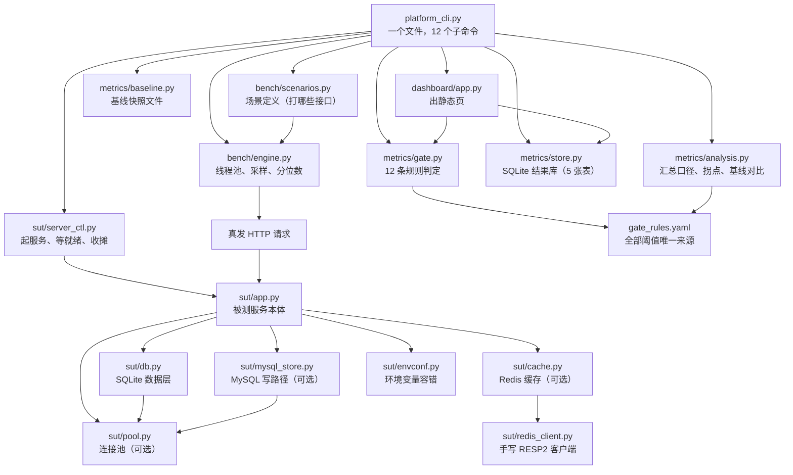

# 初学者完全入门：这个仓库是怎么转起来的

> **写给谁**：会写一点 Python，知道 `def` 和 `import`，但没做过性能压测、也没写过质量门禁的人。
> **读完你会知道**：一条 `python platform_cli.py run` 命令敲下去之后，从"起一个被测服务"到"打印一行 `[PASS] R3`"再到"退出码 1"，中间到底经过了哪些文件、哪些函数，以及**为什么非要拆成这么多层**。
>
> 这份文档不教你"怎么用这个仓库"（那看 [README](../README.md)），也不讲"为什么门禁要这么设计"（那看 [度量口径](./度量口径.md) 与 [诚实边界](./诚实边界.md)）。它只回答一个问题：**这些文件彼此之间是怎么连起来的。**

---

## 目录

- [第 0 章 先建立一张地图](#第-0-章-先建立一张地图)
- [第 1 章 一条压测的完整一生](#第-1-章-一条压测的完整一生)
- [第 2 章 被测服务是怎么被拉起来的](#第-2-章-被测服务是怎么被拉起来的)
- [第 3 章 请求是怎么发出去的、耗时是怎么记下来的](#第-3-章-请求是怎么发出去的耗时是怎么记下来的)
- [第 4 章 一堆原始数字怎么变成一句判决](#第-4-章-一堆原始数字怎么变成一句判决)
- [第 5 章 门禁的 12 条规则是怎么判的](#第-5-章-门禁的-12-条规则是怎么判的)
- [第 6 章 结果存哪儿、基线怎么活下来](#第-6-章-结果存哪儿基线怎么活下来)
- [第 7 章 另外两个入口：看板与 pytest 插件](#第-7-章-另外两个入口看板与-pytest-插件)
- [第 8 章 文件与文件之间的依赖关系](#第-8-章-文件与文件之间的依赖关系)
- [第 9 章 常见困惑逐个拆解](#第-9-章-常见困惑逐个拆解)
- [第 10 章 自己动手改一处，看它怎么传导](#第-10-章-自己动手改一处看它怎么传导)
- [第 11 章 12 个子命令：整个平台的控制面板](#第-11-章-12-个子命令整个平台的控制面板)
- [第 12 章 一次完整交付的全流程：从改一行代码到数字上墙](#第-12-章-一次完整交付的全流程从改一行代码到数字上墙)
- [第 13 章 配置系统全景：21 个环境变量怎么流进每一个进程](#第-13-章-配置系统全景21-个环境变量怎么流进每一个进程)
- [第 14 章 测试体系：398 条用例是怎么分层的](#第-14-章-测试体系398-条用例是怎么分层的)
- [第 15 章 时间线：一次失败从被发现到被定位](#第-15-章-时间线一次失败从被发现到被定位)
- [第 16 章 scripts 里的 9 个工具](#第-16-章-scripts-里的-9-个工具)
- [第 17 章 数据层总览：一条请求从路由到 SQL](#第-17-章-数据层总览一条请求从路由到-sql)
- [第 18 章 连接池：把「接不住」变成 503 而不是 500](#第-18-章-连接池把接不住变成-503-而不是-500)
- [第 19 章 缓存层：读穿、负缓存、降级，以及一个自写的 RESP 客户端](#第-19-章-缓存层读穿负缓存降级以及一个自写的-resp-客户端)
- [第 20 章 MySQL 写路径：把排队从进程内挪到行锁上](#第-20-章-mysql-写路径把排队从进程内挪到行锁上)
- [第 21 章 缺陷探针：怎么把「N+1」变成一条会拦人合并的规则](#第-21-章-缺陷探针怎么把n1变成一条会拦人合并的规则)
- [附录 A 名词对照表](#附录-a-名词对照表)
- [附录 B 文件速查](#附录-b-文件速查)
- [附录 C 推荐阅读顺序](#附录-c-推荐阅读顺序)

---

## 第 0 章 先建立一张地图

### 0.1 这个仓库到底在干什么

初学者最容易卡住的第一个问题是：「仓库名字里有 `quality-gate`，那它守的是什么门？」

答案分两层：

**第一层，它是一个「性能压测 + 对比基线」的工具。**
你对一个 Web 服务打压力，它告诉你 P95 是多少毫秒、每秒能扛多少请求。
但这本身不稀奇，`ab`、`wrk`、`Locust` 都能干。

**第二层，也是它真正想做的事：把"变慢了"这件事变成一条会自动变红、并且说得出理由的流水线检查。**
也就是说，它不只报数字，它给出**判决**：

```
[PASS] R1-error-rate: 错误率 0.00%（阈值 1.00%）
[PASS] R2-p95-absolute: P95 38.9ms（绝对阈值 300.0ms）
[SKIP] R3-baseline-degradation: 未设置基线，跳过劣化对比（首次运行请显式设置基线）
[WARNING] R4-sample-size: 采样 340 次（建议 ≥ 2000）
[PASS] R5-tail-jitter: P99/P95 = 1.48（阈值 4.0）

判定：✅ 放行
```

这段输出是本仓库自己跑出来的（第 1 章会带你完整复现一次）。注意三件事：

1. 每条规则都有名字（`R1`~`R5`）、有观测值、有阈值；
2. `R3` 是 `[SKIP]` 而不是 `[PASS]` —— **「没判定」和「判定为没问题」在报告里长得必须不一样**；
3. 最后有一行 `判定`，而 `platform_cli.py` 的**退出码**就是这句话的机器可读版本（放行 = 0，拦住 = 1）。

### 0.2 六个目录，六种角色

```
sut/          被测服务（被压的那个 Web 服务，FastAPI + SQLite）
bench/        压测引擎（自己写的，不是 Locust）
metrics/      口径与判决（分位数、拐点、基线对比、门禁规则、结果库）
dashboard/    看板（一个网页，外加几个 JSON API）
scripts/      外围脚本（演示、覆盖率、依赖检查、探针）
tests/        平台自己的测试
```

一句话概括每个目录的性格：

| 目录 | 一句话 | 关键问题它负责回答 |
|---|---|---|
| `sut/` | **当靶子的** | "我打的那个服务长什么样？它的慢是可归因的吗？" |
| `bench/` | **开枪的** | "压力是怎么施加的？耗时是怎么记的？" |
| `metrics/` | **判案的** | "这些数字说明什么？跟上次比是变好了还是变坏了？" |
| `dashboard/` | **展示的** | "没看 CI 日志的人，怎么知道最近在变慢？" |
| `scripts/` | **杂役** | "演示、覆盖率、依赖一致性这些一次性的事情" |
| `tests/` | **自保的** | "我自己会不会写错？改了以后还是对的吗？" |

**关键认知**：`sut/` 里的代码是**被测对象**，`tests/` 里的代码是**测试代码**。这两类代码在同一个仓库里，但角色完全相反。`sut/` 出错是"被测服务坏了"，`tests/` 出错是"量错了"，后者更危险。

### 0.3 为什么非要自己写一个被测服务

这是一个非常合理的疑问：「既然要压测，为什么不压我们公司自己的服务？」

因为压测的结论只有在**每一个百分点都能解释**的时候才有价值。打公网或者打别人的服务，量到 P99 抖了一下，你无法判断是：

- 网络抖了？
- 对面限流了？
- 我的脚本自己卡了？
- 还是真的代码变慢了？

四种可能，四种处置方式，而你手里只有一个数字。

所以这个仓库自己带了一个被测服务 `sut/app.py`（556 行），它有三个刻意的性质：

1. **端口由系统分配**，不是写死的 8000 —— 避免和本机其它服务打架，也避免"我明明起了服务却连到别人的"这种事；
2. **数据落在临时目录**，跑完就删 —— 绝不污染你的开发库；
3. **内置了可切换的性能缺陷**（见 0.4）。

### 0.4 最重要的一个设计：把缺陷做成"可以随时复现的开关"

`sut/app.py` 里有一个接口，报表「按供应商统计」：

```
GET /api/reports/slow-by-supplier?mode=agg   # 好实现：一条 SQL GROUP BY
GET /api/reports/slow-by-supplier?mode=n1    # 坏实现：先查供应商，再逐个查物料（N+1）
```

`mode=agg` 是"修好之后的样子"，`mode=n1` 是"出事故时的样子"。同一个接口、同一个数据库、同一批数据，只换实现方式。

为什么要这样设计？因为**你要证明"门禁真的能拦住缺陷"**。如果缺陷只存在于传说里（"我们线上曾经有过 N+1"），你就永远无法演示门禁会不会红。把缺陷固化成开关之后：

- 想演示门禁能红？切到 `n1`；
- 想演示门禁能绿？切回 `agg`；
- 想证明门禁的阈值是有效的？两个都跑一遍，看 `P1-n1-probe` 这条规则到底有没有反应。

这一整套思路（**缺陷由清单跟踪，探针负责让"门禁能拦住它"这件事可被反复证明**）在 `docs/已知问题.md` 里被写成 P-1~P-32 共 32 条台账。

### 0.5 谁调用谁

先看一张全局图。箭头表示"调用"或"读取"，**箭头只允许单向走**：



这张图里有一条**贯穿全仓库的纪律**，后面会反复出现：

> **同一条口径只允许有一个实现，其余地方一律 `import` 它。**

最典型的例子是 `metrics/analysis.py:445 merge_step_rows()` —— 它是"整轮汇总"的唯一出口。`platform_cli.py` 的 `run` / `gate` / `probe` / `trend` 全都要调它，看板也要调它。为什么？因为历史上它曾经有三份复制粘贴的实现，三份算出来的 P95 不一样，于是"报告说没超阈值，流水线却红了"。这个坑在第 4、第 9 章会详细拆。

---

## 第 1 章 一条压测的完整一生

我们拿仓库里最典型的一条命令走一遍：

```bash
python platform_cli.py run --label demo --items 20000 --step-users 10 20
```

它做的事情（按时间顺序）：

1. 建/打开结果库 `quality.db`；
2. 记一条 `runs` 记录，状态 `running`；
3. 起一个被测服务（分配端口、灌 20000 条数据、等它真能返回 200）；
4. 对 10 并发、20 并发两级分别压 8 秒，每级产出一份 `Stats`；
5. 把两级结果写进 `steps` 表；
6. 把两级汇总成"这一轮"的数字（`merge_step_rows`）；
7. 找拐点（`find_knee`）；
8. 读基线（`store.get_baseline`），算出"跟上次比变了多少"（`compare_to_baseline`）；
9. 检查两轮是否可比（`check_comparability`）；
10. 跑 12 条规则里属于性能的那 5 条（`evaluate_perf`）；
11. 把判定写进 `gate_results` 表，把 `runs` 状态改成 `passed`/`failed`；
12. 生成一份 Markdown 报告文件，打印到屏幕；
13. **退出码 = 门禁结论**（0 或 1）。

这 13 步全部住在 `platform_cli.py:208 cmd_run()` 里。我们逐段拆。

### 1.1 入口：`main()` 只做三件事

`platform_cli.py:1401`：

```python
def main(argv: list[str] | None = None) -> int:
    _make_stdout_utf8()
    # 先套档案再解析 argv：档案决定的是**环境**（会被 SUT 子进程继承），
    # 而 argparse 只决定这一次调用的参数。顺序反过来的话，
    # `--help` 之类的路径也会先把档案套上 —— 没必要，也更容易误伤。
    apply_env_profile(argv)
    args = build_parser().parse_args(argv)
    return args.func(args)
```

三件事，每件都有理由：

**① `_make_stdout_utf8()`** —— Windows 的默认控制台编码是 GBK，报告里有中文，不强制 UTF-8 就会在 CI 日志里变成乱码。这一个调用曾经救过一次真实的线上事故（`docs/incident-encoding-20261010/` 里存着当时的损坏文件）。

**② `apply_env_profile(argv)`** —— 这是"环境分层"（`dev` / `staging` / `prod` 三份 `.env` 档案）。注意它**先于 argparse**：因为档案改的是 `os.environ`，而 `os.environ` 会被后面起的 SUT 子进程继承；`argparse` 只影响这一次调用的参数。

**③ `return args.func(args)`** —— 每个子命令在 `build_parser()` 里用 `set_defaults(func=cmd_xxx)` 绑定了自己的处理函数。所以 `main()` 不知道也不关心你跑的是 `run` 还是 `probe`，它只负责"解析完就执行"。返回值就是进程退出码。

### 1.2 第一段：把"这一轮是什么"记下来

`platform_cli.py:208` 开头：

```python
def cmd_run(args: argparse.Namespace) -> int:
    """跑一轮压测：梯度加压 → 入库 → 与基线比 → 门禁判定 → 出报告。"""
    store.init_db()
    label = args.label or f"{args.report_mode}-{args.items // 1000}k"
    run_id = new_run_id("perf")
    rules = gate.load_rules(args.rules)
    info = platform_info()
    config = {
        "items": args.items,
        "report_mode": args.report_mode,
        "scenario": args.scenario or "(mix)",
        "step_users": args.step_users,
        "step_duration_s": args.step_duration,
        "think_time_s": args.think_time,
    }
    store.upsert_run(
        run_id, "perf", label, config=config, platform_info=info, git_sha=git_sha(), ci=bool(os.environ.get("CI"))
    )
```

逐个说：

- **`run_id`**（`platform_cli.py:52`）形如 `perf-20261025-234300-7f0ee3` = 前缀 + 时间戳 + 6 位随机 hex。为什么要随机后缀？因为同一秒内跑两次不能撞 ID（撞了就会覆盖入库记录）。有一条用例专门测这个：`tests/test_cli.py::test_new_run_id_is_prefixed_and_unique`。

- **`config`** —— 这一段是后面"可比性判定"的输入。记住它包含四样东西：**数据量 `items`、报表实现 `report_mode`、场景 `scenario`、并发梯度 `step_users`**。第 4 章会讲为什么这四样一旦变了，劣化百分比就没有意义。

- **`platform_info()`**（`platform_cli.py:40`）—— 记下 Python 版本、操作系统、CPU 核数、FastAPI/uvicorn/requests 版本。注意它**只记录，不参与判定**（`docs/度量口径.md` 里有论证：如果"机器不同"就判不可比，那 CI 上的 R3 永远是 SKIP，因为 runner 和开发机必然不同）。

- **`upsert_run(...)`**（`metrics/store.py:154`）—— 写一条 `runs` 记录，状态默认 `running`。

**这里有一个很重要的细节**：`upsert_run` 刻意**不更新** `config_json` / `kind` / `label`（如果记录已存在）。也就是说，一轮跑起来之后，它的"身份"就固定了。这是一个防篡改设计：不允许后面某个环节悄悄改掉"这轮到底是什么配置"，否则可比性判定就成了摆设。

### 1.3 第二段：起被测服务

```python
    print(f"[run] run_id={run_id} label={label}")
    print(f"[run] 配置 {json.dumps(config, ensure_ascii=False)}")
    handle = start_sut(report_mode=args.report_mode, items=args.items)
    print(f"[run] 被测服务 {handle.base_url} db={handle.db_path}")
```

`start_sut` 是 `sut/server_ctl.py:129`，第 2 章整章讲它。这里只要知道它返回一个 `SutHandle`，里面握着：

- `base_url`：形如 `http://127.0.0.1:3492`（端口是系统分的）；
- `db_path`：临时目录里的 `sut.db`；
- `proc`：那个 uvicorn 子进程的句柄；
- `tmp_dirs`：自己建的临时目录列表（**只有自己建的才会被删**）。

紧接着下面这一段注释非常关键：

```python
    # 让场景按**实际灌入的物料条数**取随机 ID。不设置的话，
    # `--items` 小于默认的 20 000 时会有大批点查打到不存在的 ID，
    # 压测脚本自己凭空造出高错误率（实测 5 000 条时报出 28%）。
    configure_item_range(args.items)
```

这是 `bench/scenarios.py:47` 的函数。为什么必须调用它？因为场景要随机挑一个物料 ID 去查，取值范围必须等于**实际灌进去的条数**。早先这里写死 `randint(1, 20_000)`，于是 `--items 5000` 时约 75% 的点查打到不存在的 ID，拿 404。

后果是什么？门禁 `R1-error-rate` 报「错误率 28.02%（阈值 1.00%）→ 判定：拦住」。而这个 28% 没有任何业务含义，纯粹是**压测脚本自己发错了请求**。

> **一句话教训**：一个压测工具凭空造出 28% 的错误率，比它测不出问题更危险 —— 因为它会让人去查被测服务。

### 1.4 第三段：逐梯度加压

```python
    try:
        stats_by_step = []
        for users in args.step_users:
            if args.scenario:
                mix = engine_single(handle.base_url, args.scenario, timeout_s=args.timeout)
            else:
                mix = build_engine_mix(handle.base_url, timeout_s=args.timeout)
            runner = Runner(
                base_url=handle.base_url,
                scenarios=mix,
                users=users,
                duration_s=args.step_duration,
                think_time_s=args.think_time,
                ramp_up_s=min(2.0, args.step_duration / 4),
                warmup_drop_s=args.warmup_drop,
            )
            st = runner.run()
            stats_by_step.append(st)
```

三个概念：

**① `mix`（场景组合）** —— 就是"打哪些接口、各自占多少比例"。默认配比在 `bench/scenarios.py:25`：

```python
DEFAULT_MIX = {
    "items_list": 40,          # 列表查询 40%
    "item_detail": 30,         # 详情查询 30%
    "stock_by_category": 15,   # 分类统计 15%
    "slow_report": 10,         # 报表（就是那个带 N+1 的）10%
    "stock_write": 5,          # 写库存 5%
}
```

这个配比不是随便拍的，它模仿的是"线上真实的读写配比"：查询是高频只读，报表是低频但重，写是少量。只压读接口的结论会过于乐观，因为真实系统里把 CPU 打满的往往是写路径的锁竞争。

**② `Runner`**（`bench/engine.py:189`）—— 定并发压测执行器。`ramp_up_s=min(2.0, duration/4)` 的意思是"2 秒内把并发从 0 加到目标值，但最多花掉整个梯度的四分之一"。为什么要爬坡而不是瞬间全上？因为瞬间全上会有一个巨大的连接建立尖峰，那个尖峰的耗时不是稳态性能。

**③ `warmup_drop_s`** —— 丢掉前 N 秒的样本。理由见 `bench/engine.py` 里的注释：TCP 冷启动、SQLite 页缓存、模块首次导入都会把 P99 抬高一大截，而真实用户感受到的不是第一秒。

每级跑完打印一行：

```
[step]    5u    1.0s  n=340    rps=  330.08  p95=   38.95ms  p99=   57.58ms  err=0.00%  inflight=5
```

注意最后的 `inflight=5` —— 配置并发是 5，实际在途也是 5，说明压力真打出去了。如果配置 50 而 inflight 只有 12，那说明瓶颈在**压测机**，不在被测服务。第 3 章会讲这个数字是怎么采的。

### 1.5 第四段：把多级汇总成一轮

```python
        store.add_steps(run_id, stats_by_step)
        step_dicts = [s.as_dict() for s in stats_by_step]
        merged = _merge_from_rows(step_dicts)
```

`_merge_from_rows` 在 `platform_cli.py:708`，但它**只有一行**：

```python
def _merge_from_rows(rows: list[dict]) -> dict:
    """整轮汇总 —— 实现只有一处，在 `metrics.analysis.merge_step_rows`。"""
    return analysis.merge_step_rows(rows)
```

为什么不直接调 `analysis.merge_step_rows`，要多一层别名？因为调用点（`run` / `gate` / `probe` / `trend`）都习惯了 `_merge_from_rows` 这个名字，把实现搬走的时候不想让所有调用点都改一遍。

**但关键在于 docstring 里那句话**：「**别名不是第二份实现**：它没有自己的逻辑，改口径只需要改 `analysis.py` 那一处。」

这句话是在防什么？防的是一种非常常见的"善意重构"：某天有人觉得"多一跳函数调用"，就在 `platform_cli.py` 里重新写一遍汇总逻辑。那一刻起，仓库里就有两份口径了。第 4 章会讲这个坑当初真的发生过。

### 1.6 第五段：算劣化、判可比性、跑门禁

```python
        knee = analysis.find_knee(step_dicts)
        baseline = store.get_baseline("perf", label)
        run_metrics = merged
        deltas = analysis.compare_to_baseline(run_metrics, baseline["metrics"], rules) if baseline else []
        comparability = analysis.check_comparability(config, baseline.get("config"), rules) if baseline else None

        report = gate.evaluate_perf(run_metrics, baseline, deltas, rules, comparability, r3_advisory=args.r3_advisory)
```

四步，每步一个问题：

| 步骤 | 函数 | 回答的问题 |
|---|---|---|
| 找拐点 | `analysis.find_knee` (`metrics/analysis.py:286`) | "加到多少人，加人就不管用了？" |
| 读基线 | `store.get_baseline` (`metrics/store.py:252`) | "上次的基准是什么？" |
| 算劣化 | `analysis.compare_to_baseline` (`metrics/analysis.py:252`) | "每个指标涨/跌了几个百分点？" |
| 判可比性 | `analysis.check_comparability` (`metrics/analysis.py:198`) | "这两轮量的是同一件事吗？" |

注意顺序：**先判可比性，再跑门禁**。因为可比性判不过时，`R3` 会走 `[SKIP]`（"无法判定"），而不是拿两个不可比的数字算出一个百分比。这个顺序不能反。

还有个小细节：`store.get_baseline("perf", label)` 这里写死了 `"perf"`，因为它就在 `cmd_run` 里，而 `cmd_run` 只产 `kind='perf'` 的运行。但 `cmd_gate`（`platform_cli.py:636`，作用是对一个**已经入库**的 run 重新判定）就不一样了：它必须按 run 自己的 `kind` 取基线。这里曾经写死过 `"perf"`，导致 `probe` 轮的 R3 永远是 `[SKIP]` —— 详见 `docs/已知问题.md` 的 P-20。

### 1.7 第六段：落库、出报告、定退出码

```python
        store.add_gate_results(run_id, [r.as_dict() for r in report.results])
        status = "failed" if report.blocked else "passed"
        store.finish_run(run_id, status, {"knee": knee, **run_metrics})

        text = analysis.render_perf_report(...)
        text += "\n\n" + report.render() + "\n"
        REPORTS_DIR.mkdir(exist_ok=True)
        out_path = REPORTS_DIR / f"{run_id}.md"
        out_path.write_text(text, encoding="utf-8")
        ...
        return 1 if report.blocked else 0
    finally:
        handle.stop()
```

四件事：

1. **两条判定结果都入库**：`gate_results` 表存 12 条规则的逐条结论，`runs.metrics_json` 存整轮汇总。为什么两处都存？因为看板要画趋势（需要 metrics），复盘要逐条看理由（需要 gate_results）。

2. **`status` 分两种，都要入库**。`failed` 的轮次照样落库 —— `metrics/store.py` 的模块 docstring 专门写了这一点：「只存成功记录的度量平台，给出的通过率是假的（分母被美化过）」。

3. **Markdown 报告写文件**，路径打进 stdout。CI 里直接当 artifact 上传，人不用去数据库里翻。报告长这样（真实输出）：

```markdown
# 压测报告 · doc-demo

- run_id: `perf-20261025-234300-7f0ee3`
- 平台: Python 3.12.10 / Windows-11 / CPU 16 核
- 被测服务: FastAPI 0.143.0 + uvicorn 0.54.0 + SQLite(WAL)，数据量 400 条物料
- 报表实现: `agg`（agg = 单条 SQL 聚合；n1 = 逐供应商查询，N+1）

## 各梯度结果
| 并发 | 时长(s) | 请求数 | 错误率 | RPS | 每用户吞吐 | P50 | P95 | P99 | Max | 实际在途 |
|---:|---:|---:|---:|---:|---:|---:|---:|---:|---:|---:|
| 5 | 1.0 | 340 | 0.00% | 330.1 | 66.016 | 6.9 | 38.9 | 57.6 | 72.8 | 5 |
...
```

4. **`return 1 if report.blocked else 0`** —— 这一行就是"门禁"这两个字的技术含义。CI 不需要解析任何文本，它只看退出码。

最后一个 `finally: handle.stop()`：无论中间抛什么异常，被测服务和临时目录都必须收掉。**这里踩过的坑**：早期没有 `finally`，异常路径漏掉的临时目录在系统 Temp 下累积了 289 组 `perf-sut-db-*` / `perf-sut-log-*`。

### 1.8 整条命令的时间线

```
你敲命令
  │
  ├─ main()                                     platform_cli.py:1401
  │   ├─ 强制 UTF-8 输出
  │   ├─ 套 PERF_ENV 档案（如果有）
  │   └─ argparse 解析 → args.func = cmd_run
  │
  ├─ cmd_run()                                  platform_cli.py:208
  │   ├─ store.init_db()                        建 5 张表
  │   ├─ store.upsert_run()                     插 runs 记录（running）
  │   ├─ start_sut()                            sut/server_ctl.py:129
  │   │   ├─ free_port()                        bind(0) 让系统分配端口
  │   │   ├─ subprocess: python -m sut.seed    灌 20000 条数据（先灌数据后起服务）
  │   │   ├─ subprocess: uvicorn sut.app:app   起服务
  │   │   └─ wait_ready()                       轮询 /healthz 直到真返回 200
  │   ├─ configure_item_range(20000)            告诉场景真实数据量
  │   │
  │   ├─ for users in [10, 20]:                 每级
  │   │   ├─ build_engine_mix() → 场景闭包
  │   │   ├─ Runner(...).run()                  bench/engine.py:313
  │   │   │   ├─ 起 sampler 线程采 inflight
  │   │   │   ├─ 线程池提交 users 个 _worker
  │   │   │   │   └─ 每个 worker: 循环取场景 → 发请求 → 记 Sample
  │   │   │   ├─ sleep(duration_s) 然后 _stop.set()
  │   │   │   ├─ 丢热身样本
  │   │   │   └─ summarize() → Stats（P50/P90/P95/P99/max/rps）
  │   │   └─ 打印 [step] 行
  │   │
  │   ├─ store.add_steps()                      每级一行写进 steps 表
  │   ├─ analysis.merge_step_rows()             整轮汇总（唯一出口）
  │   ├─ analysis.find_knee()                   拐点
  │   ├─ store.get_baseline("perf", label)      基线
  │   ├─ analysis.compare_to_baseline()         逐指标劣化
  │   ├─ analysis.check_comparability()         两轮可比吗
  │   ├─ gate.evaluate_perf()                   5 条规则
  │   ├─ store.add_gate_results()               12 条逐条入库
  │   ├─ store.finish_run()                     runs 状态定稿
  │   ├─ analysis.render_perf_report()          写 reports/<run_id>.md
  │   └─ return 1 if blocked else 0             ← 门禁结论
  │
  └─ finally: handle.stop()                     杀进程、删自己建的临时目录
```

> **一条容易被忽略的纪律**：`cmd_run` 从头到尾**没有任何一处写基线**。基线只能由 `--set-baseline` 或 `baseline set` 显式写入。这条是硬规矩，原因在第 6 章。

---

## 第 2 章 被测服务是怎么被拉起来的

很多人第一次看到"测试代码要负责启动被测服务"会觉得别扭：测试就测试，为什么还要管起服务？

因为**压测报告里必须能写清"打的是哪个进程、端口几号、库在哪"**。随手 `uvicorn sut.app:app` 起的服务，端口靠猜、库落在仓库里、跑完不回收 —— 这是压测结论不可信的常见起点。所以这件事必须在代码里堵死。

`sut/server_ctl.py`（234 行）就干这一件事，它的模块 docstring 列出了四条硬规矩：

1. **端口由系统分配**（`bind 0`），不是写死的 8000；
2. **数据库落在临时目录**，跑完即弃；
3. **临时目录由 `SutHandle.stop()` 收回**，调用方传进来的路径一律不碰；
4. **就绪探针等真返回 200**，不用 `sleep 2` 赌它起没起来。

### 2.1 端口为什么要让系统分配

`sut/server_ctl.py:32`：

```python
def free_port() -> int:
    with socket.socket(socket.AF_INET, socket.SOCK_STREAM) as s:
        s.bind(("127.0.0.1", 0))
        return s.getsockname()[1]
```

`bind(("127.0.0.1", 0))` 里的 `0` 意思是"随便给我一个空闲端口"，然后 `getsockname()` 把系统实际分配的那个端口读回来。

好处有两条：

- **不会撞端口**。写死 8000 的仓库，只要有另一个服务占了 8000，所有用例都会莫名其妙失败；
- **可以并行跑**。两个进程同时跑压测，各自拿到不同端口，互不干扰。

> 注意 `s.close()` 之后到 uvicorn 真正 `bind` 之间存在一个极短的窗口（TIME_WAIT 级别的竞争）。这是这类"先探测再使用"方案的固有缺陷，在单机 CI 上概率极低。它不是没意识到，是权衡之后的接受。

### 2.2 `start_sut()` 的完整流程

`sut/server_ctl.py:129`：

```python
    port = free_port()
    base_url = f"http://127.0.0.1:{port}"

    tmp_dirs: list[str] = []
    if db_path is None:
        tmp = Path(tempfile.mkdtemp(prefix="perf-sut-db-"))
        tmp_dirs.append(str(tmp))
        db_path = str(tmp / "sut.db")
    if log_dir is None:
        log_dir = tempfile.mkdtemp(prefix="perf-sut-log-")
        tmp_dirs.append(str(log_dir))
```

**注意 `tmp_dirs.append` 的条件**：只有在"调用方没传"的时候，本函数才自己 `mkdtemp`，并且只把**自己建的**目录记进 `tmp_dirs`。`stop()` 只会删 `tmp_dirs` 里的东西。

为什么要这么绕？因为调用方传进来的 `db_path` 可能是：

- 仓库里的 `quality.db`（删了就是数据事故）；
- 另一个测试还要复用的目录；
- 用户自己指定想保留的调试目录。

**"谁建的谁删"是一条比"跑完就清"更安全的规则。**

然后是灌数据：

```python
    env = os.environ.copy()
    env.update({
        "PERF_SUT_DB": db_path,
        "PERF_SUT_REPORT_MODE": report_mode,
        "PYTHONIOENCODING": "utf-8",
        "PYTHONPATH": str(ROOT),
    })
    if extra_env:
        env.update(extra_env)

    # 先灌数据再起服务：避免"第一个请求撞上建表"这种热身噪声混进基线。
    seed = subprocess.run(
        [sys.executable, "-m", "sut.seed", str(items)],
        cwd=str(ROOT), env=env, capture_output=True, text=True, encoding="utf-8", errors="replace",
    )
    if seed.returncode != 0:
        _discard_tmp()
        raise RuntimeError(f"seed 失败：{seed.stdout}\n{seed.stderr}")
```

三个要点：

**① 为什么用子进程灌数据，不直接 `import sut.seed`？**
因为 `sut.seed` 会 `import sut.db`，而 `sut.db` 的连接池、`QUALITY_DB` 之类的模块级状态会被父进程继承下来。用子进程 = 一个干净的、只做一件事的进程，跑完就退，父进程状态零污染。

**② 为什么先灌数据再起服务？**
如果反过来，第一个请求会撞上"还没建表"或者"索引还没建完"，那一次请求的耗时会非常难看，而且这个难看会混进热身窗口之外。**压测的数字里不该有"初始化成本"**。

**③ 失败路径也收摊（`_discard_tmp()`）。**
这是 `sut/server_ctl.py:166` 那个内部函数：

```python
    def _discard_tmp() -> None:
        # 起服务失败时也要收拾：失败路径漏掉的临时目录最难被发现。
        for d in tmp_dirs:
            shutil.rmtree(d, ignore_errors=True)
```

失败路径的资源泄漏是最难发现的，因为没人会去看"一次失败的运行留下了什么"。

### 2.3 就绪探针为什么不 `sleep 2`

```python
def _direct_get(url: str, timeout: float) -> requests.Response:
    """GET，且不读 `HTTP_PROXY` / `HTTPS_PROXY` / `ALL_PROXY`。"""
    with requests.Session() as session:
        session.trust_env = False
        return session.get(url, timeout=timeout)


def wait_ready(base_url: str, timeout_s: float = 40.0) -> bool:
    deadline = time.perf_counter() + timeout_s
    while time.perf_counter() < deadline:
        try:
            if _direct_get(f"{base_url}/healthz", timeout=1.0).status_code == 200:
                return True
        except requests.RequestException:
            time.sleep(0.15)
    return False
```

两个设计点，各自对应一个真实的坑：

**① 轮询而不是 `sleep`。**
`sleep 2` 的问题是：机器快的时候浪费 2 秒（每轮压测都浪费），机器慢的时候 2 秒不够（于是第一个请求失败，被记成错误率）。轮询是"好了就走，没好就等"，两头都对。

**② `session.trust_env = False`。**
这一条是"性能测试跑出假失败"的经典原因。`requests` 默认会读 `HTTP_PROXY` / `HTTPS_PROXY` 环境变量。如果你的机器配了代理，`http://127.0.0.1:3492/healthz` 会先发给代理 —— 代理可能：

- 回一个 502/503（于是 `wait_ready` 拿到一个**不属于被测服务的状态码**，把没起来的服务判成"起来了但有问题"）；
- 或者干脆超时（于是你以为服务起不来）。

后面所有压力数据和门禁结论都建在这个误判上。所以探测必须绕过代理。

### 2.4 `SutHandle.stop()`：为什么要分三段

`sut/server_ctl.py:55`：

```python
    def stop(self) -> None:
        if self.proc.poll() is None:
            self.proc.terminate()
            try:
                self.proc.wait(timeout=10)
            except subprocess.TimeoutExpired:
                self.proc.kill()
                self.proc.wait(timeout=5)
        # 先关日志句柄再删目录：Windows 上被占用的文件删不掉。
        if self.log_file is not None:
            try:
                self.log_file.close()
            except OSError:
                pass
            self.log_file = None
        self.cleanup_tmp()
```

三段，按顺序：

**① `terminate()` → 等 10 秒 → `kill()`。**
为什么不一上来就 `kill()`？因为 `SIGKILL` 不给进程清理的机会（uvicorn 来不及关套接字、来不及 flush 日志）。先温和再暴力，是标准的进程收尾流程。

**② 先关日志句柄再删目录。**
这是 Windows 特有的坑：**被进程占用的文件删不掉**。如果不先 `close()` 那个 `open(log_path, "w")` 拿到的句柄，`shutil.rmtree` 会报 `PermissionError`。

**③ `cleanup_tmp()` 返回"没删成功"的路径。**

```python
    def cleanup_tmp(self) -> list[str]:
        """删掉自己建的临时目录，返回**没删成功**的路径列表。

        尽力而为：uvicorn 刚退出时 Windows 可能还短暂占着句柄，重试几次即可；
        仍然失败就返回路径，由调用方/测试决定要不要抱怨 —— 清理失败不该
        把一次成功的压测变成失败。
        """
```

这个"返回而不是抛异常"的选择很有意思：**清理失败不该让一次成功的压测变红**。但它也不能静默 —— 所以返回给调用方，让测试去决定怎么处理。有一条用例专门测这个：`tests/test_sut_api.py::TestTempDirCleanup`。

### 2.5 `stop()` 之后，被测服务留下了什么

答案是：**什么也没留下**。端口释放、进程杀掉、临时目录删掉。

但有三样东西是**故意保留**的：

| 保留下来的 | 在哪 | 为什么 |
|---|---|---|
| 结果库里的记录 | `quality.db`（或 `QUALITY_DB` 指定的路径） | 这是"这一轮发生过"的证据，删了趋势就断了 |
| Markdown 报告 | `reports/<run_id>.md` | 人读的东西，要能进 artifact |
| uvicorn 日志 | 临时目录里（**已随目录删除**） | 只在失败时被 `tail()` 捞出来打进异常消息 |

最后一条要特别注意顺序 —— `sut/server_ctl.py:228`：

```python
    if not wait_ready(base_url):
        # 先取日志再收摊：stop() 会把日志目录删掉，之后再 tail 就只剩空字符串，
        # 而这行日志正是排查"服务为什么没起来"的唯一线索。
        tail = handle.tail()
        handle.stop()
        raise RuntimeError(f"被测服务未就绪（{base_url}）：\n{tail}")
```

**先 `tail()` 再 `stop()`**。反过来的话，异常消息里就只有一行空字符串，而那一行日志正是你唯一的线索。这类"顺序反了就丢信息"的 bug，是排查类代码里最常见的一种。

---

## 第 3 章 请求是怎么发出去的、耗时是怎么记下来的

`bench/` 目录只有 4 个文件：

```
bench/engine.py       389 行   压测引擎（线程池 + 采样 + 分位数）
bench/scenarios.py    362 行   场景定义（打哪些接口、怎么取参数）
bench/distributed.py  486 行   分布式压测（1 个 coordinator + N 个 worker）
bench/__init__.py
```

### 3.1 三层结构：场景 → 绑定 → 引擎

一个"场景"就是一个函数，签名统一是：

```python
def items_list(session: requests.Session, base_url: str, timeout_s: float = 10.0) -> Sample:
```

但引擎要的是 `(session) -> Sample`（只有一个参数）。所以中间有一层 `bind`（`bench/scenarios.py:333`）：

```python
def bind(fn, base_url: str, timeout_s: float = 10.0):
    """把 (session, base_url, timeout) 场景适配成引擎要的 (session) -> Sample。

    场景函数写成显式传参而不是闭包捕获 base_url，是为了**能被单独调用做冒烟**：
    拐点定位出错时，第一件事就是"把那个场景手工跑一次看看"，
    闭包会让这一步变得别扭。
    """
    name = getattr(fn, "__name__", "scenario")

    def bound(session: requests.Session) -> Sample:
        return fn(session, base_url, timeout_s=timeout_s)

    bound.__name__ = name
    return bound
```

为什么要 bind 而不是让场景自己用全局变量记住 `base_url`？

- 全局变量在测试里没法改（你没法为每条用例起一套不同的 base_url）；
- 显式传参的场景函数可以**单独调用做冒烟**：`items_list(session, "http://127.0.0.1:1234")`，一行就能验证"这个场景本身对不对"。

这说明 `bind` 还顺手做了一件小事：把 `bound.__name__` 设回原名。因为 `Sample.scenario` 字段要用它，如果不管，所有场景的 `__name__` 都会是 `"bound"`。

### 3.2 一个场景长什么样

`bench/scenarios.py:114`：

```python
def items_list(session: requests.Session, base_url: str, timeout_s: float = 10.0) -> Sample:
    r = _rnd()
    if r.random() < 0.5:
        path = f"/api/items?limit={r.choice([10, 20, 50])}&offset={r.choice([0, 100, 1000])}"
    else:
        path = f"/api/items?category_id={r.randint(1, 10)}&limit=20"
    return run_api_call(session, base_url, "GET", path, scenario="items_list", timeout_s=timeout_s)
```

结构极其简单：**取随机参数 → 拼路径 → 交给 `run_api_call`**。

注意它**不做断言**。这是压测和功能测试最大的区别：

| | 功能测试 | 压测场景 |
|---|---|---|
| 关心 | "业务对不对" | "响应码是否符合预期 + 耗时" |
| 断言 | 响应体字段、数据库状态 | `status in expect_status` + 记一笔耗时 |
| 失败时 | 用例红，指出哪里不对 | 记一个错误样本，继续压 |

压测里如果一条请求失败就中断，你测的就不是"服务在压力下的表现"，而是"第一个错误什么时候出现"。

### 3.3 `run_api_call()`：所有请求的唯一出口

`bench/engine.py:355`：

```python
def run_api_call(
    session: requests.Session, base_url: str, method: str, path: str,
    expect_status: int | tuple[int, ...] = 200, timeout_s: float = 10.0,
    scenario: str = "", **kwargs,
) -> Sample:
    """发一次请求并产出样本。所有压测场景都用它，保证口径一致。"""
    url = f"{base_url.rstrip('/')}{path}"
    expect = (expect_status,) if isinstance(expect_status, int) else expect_status
    t0 = time.perf_counter()
    try:
        resp = session.request(method, url, timeout=timeout_s, **kwargs)
        elapsed = (time.perf_counter() - t0) * 1000.0
        ok = resp.status_code in expect
        err = "" if ok else f"HTTP {resp.status_code}"
        return Sample(scenario=scenario or f"{method} {path}", status=resp.status_code,
                      elapsed_ms=elapsed, ok=ok, error=err)
    except Exception as exc:
        elapsed = (time.perf_counter() - t0) * 1000.0
        return Sample(scenario=scenario or f"{method} {path}", status=0,
                      elapsed_ms=elapsed, ok=False, error=f"{type(exc).__name__}")
```

四个关键选择：

**① 用 `time.perf_counter()` 而不是 `time.time()`。**
`perf_counter` 是单调时钟，不受系统时间被调整（NTP 同步、夏令时）的影响。压测里算耗时必须用它，否则你会量到"负的耗时"。

**② 计时只包住 `session.request()`。**
不包 `url` 拼接、不包 `Sample` 构造。因为那些是压测脚本自己的成本，混进去就不是"服务有多快"了。

**③ `except Exception` 吞掉一切，返回一个失败样本。**
这不是偷懒，是压测引擎的本分：**任何一条请求出问题都不能让整轮压测崩掉**。哪怕场景函数自己写错了（抛 `TypeError`），也记成一个失败样本继续压。`raise` 的后果是"压测跑了 3 秒就异常退出"，而你会误以为"服务在 3 秒时挂了"。

**④ `status=0` 表示"没拿到 HTTP 响应"。**
超时、连接被拒、DNS 失败都是这一类。`status=0` + `error="TimeoutError"` 这个组合，在错误分布里能一眼看出是"网络层失败"还是"HTTP 5xx"。

### 3.4 `Sample` 和 `Stats`：数据是怎么流动的

```python
@dataclass
class Sample:
    scenario: str
    status: int
    elapsed_ms: float
    ok: bool
    error: str = ""
    at: float = 0.0  # 相对本次运行开始的秒数
```

`Sample` = **一次请求**的完整记录。`at` 字段是"这次请求发生在本次运行的第几秒"，它只为一件事服务：**丢掉热身窗口**（第 3.6 节）。

```python
@dataclass
class Stats:
    label: str = ""
    users: int = 0
    duration_s: float = 0.0
    total: int = 0
    ok_count: int = 0
    error_count: int = 0
    error_breakdown: dict[str, int] = field(default_factory=dict)
    status_breakdown: dict[str, int] = field(default_factory=dict)
    rps: float = 0.0
    mean_ms: float = 0.0
    p50_ms: float = 0.0
    p90_ms: float = 0.0
    p95_ms: float = 0.0
    p99_ms: float = 0.0
    max_ms: float = 0.0
    error_rate: float = 0.0
    rps_per_user: float = 0.0
    samples: list[Sample] = field(default_factory=list)
```

`Stats` = **一个梯度**的汇总。注意它**同时保留了 `samples`**：这是有代价的（内存），但它换来两件事：

1. `merge_stats` 能把多个梯度的样本池化重算（虽然现在这个函数被限制使用，见第 4 章）；
2. 排查问题时能拿到原始数据，而不只是一个分位数。

`summarize()`（`bench/engine.py:102`）把 `list[Sample]` 变成 `Stats`：

```python
def summarize(samples, label="", users=0, duration_s=0.0) -> Stats:
    samples = list(samples)
    st = Stats(label=label, users=users, duration_s=round(duration_s, 3))
    st.total = len(samples)
    if not samples:
        return st

    latencies = [s.elapsed_ms for s in samples]
    st.ok_count = sum(1 for s in samples if s.ok)
    st.error_count = st.total - st.ok_count
    st.error_rate = round(st.error_count / st.total, 6)
    st.rps = round(st.total / duration_s, 3) if duration_s > 0 else 0.0
    st.rps_per_user = round(st.rps / users, 4) if users else 0.0
    st.mean_ms = round(sum(latencies) / len(latencies), 3)
    st.p50_ms = round(percentile(latencies, 50), 3)
    st.p90_ms = round(percentile(latencies, 90), 3)
    st.p95_ms = round(percentile(latencies, 95), 3)
    st.p99_ms = round(percentile(latencies, 99), 3)
    st.max_ms = round(max(latencies), 3)
    ...
```

有一个容易忽略的点：`error_count = total - ok_count`，也就是说 **"错误"= "所有不是 200 的响应" + "所有没拿到响应的"**。而 `error_breakdown` 按异常类型分桶（`s.error.split(":", 1)[0]`），这让你能区分"20% 是超时"和"20% 是 500"。

### 3.5 `percentile()`：为什么用 nearest-rank，不用插值

这是本章最重要的一个函数。`bench/engine.py:43`：

```python
def percentile(values: Sequence[float], q: float) -> float:
    """nearest-rank 分位数（q 取 0~100）。

    选 nearest-rank 而不是线性插值，是因为它**永远返回一个真实观测到的值**。
    报告里写"P95 = 12.3ms"，这个 12.3ms 是某一类用户身上真发生过的延迟，
    而不是两个样本插出来的数字。面试被追问"你的 P95 怎么算的"时，
    这个选择本身就是能讲的东西。
    """
    if not values:
        return 0.0
    ordered = sorted(values)
    if q <= 0:
        return float(ordered[0])
    idx = math.ceil(q / 100.0 * len(ordered)) - 1
    idx = max(0, min(idx, len(ordered) - 1))
    return float(ordered[idx])
```

举个具体例子。假设 100 个样本，P95：

```
idx = ceil(0.95 × 100) - 1 = ceil(95) - 1 = 95 - 1 = 94
→ 返回 sorted(ordered)[94]，即第 95 个样本
```

也就是说"P95"是"第 95 个最慢的样本"。这个值一定是真实观测到的。

**但这里有一个必须知道的推论**：当样本数 `N < 20` 时，P95 取的是 `ceil(0.95N) - 1`，而 `0.95N < 19`，`ceil(0.95N)` 最多等于 `N`，所以索引最大是 `N-1` —— **P95 就是最大值**。

这个推论不是学术问题，它真的坑过人。CI 日志里的现场（`ci_logs/` 里存着）：

```
[probe] mode=n1 rps=1.32 p95=3828.6ms p99=3828.6ms err=0.00%
```

`p95` 和 `p99` 打印出**同一个数字**。这不是"长尾很集中"，这是**分位数在样本不足时退化成了最大值**。

n1 是慢查询，4 并发 × 8 秒只跑出约 10 个样本。而 `P1-n1-probe` 是一条 **blocking** 规则 —— 也就是说，一条会拦人合并的规则，拿着 10 个样本的"P95"在下判决。结论方向恰好是对的（3828.6ms 确实远超 150ms），但那个数字不配叫 P95。

处置方式不是把规则改掉，而是**补一条规则把这件事说出来**：`P3-probe-sample-size`（WARNING）。这个思路值得记住：**发现"判定依据不够硬"时，先让它可见，再决定要不要改判据。**

### 3.6 `Runner.run()`：一次梯度到底发生了什么

`bench/engine.py:313`：

```python
    def run(self) -> Stats:
        try:
            self._samples = []
            self._inflight_samples = []
            self._stop.clear()
            self._start = time.perf_counter()

            sampler = threading.Thread(target=self._sampler, daemon=True)
            sampler.start()

            spawn_step = self.ramp_up_s / self.users if self.ramp_up_s and self.users else 0.0
            with ThreadPoolExecutor(max_workers=self.users) as pool:
                for i in range(self.users):
                    pool.submit(self._worker, i, i * spawn_step)
                time.sleep(self.duration_s)
                self._stop.set()

            elapsed = time.perf_counter() - self._start
            self._stop.set()
            sampler.join(timeout=1.0)
        finally:
            self._stop.set()
```

按顺序读：

**① 起一个 sampler 线程**（`_sampler`，`bench/engine.py:306`）：

```python
    def _sampler(self) -> None:
        while not self._stop.is_set():
            with self._lock:
                self._inflight_samples.append(self._inflight)
            self._stop.wait(0.1)
```

每 0.1 秒记一次"当前有多少请求在途"。这个序列最后变成 `Stats.max_inflight`。

**为什么需要它**？因为"配置 50 并发但实测只有 12 在途"意味着瓶颈在压测端（GIL 争用、线程调度），不在被测服务。这时候你看到的所有数字都偏乐观，而且偏得没有规律。压测报告里必须能看穿这一点。

**② 起线程池，提交 `users` 个 worker**，每个 worker 的启动延迟是 `i * spawn_step`。

`spawn_step = ramp_up_s / users`，所以 users 个 worker 会在 `ramp_up_s` 秒内均匀启动完。这就是"爬坡"。

**③ 睡 `duration_s` 秒，然后 `_stop.set()`。**

注意这是在**主线程**里睡的。所以整轮的时长是精确的 `duration_s`，不会因为某个 worker 卡住而延长。

**④ `finally: self._stop.set()`。**

为什么 `try` 里已经 set 过，`finally` 里还要再 set 一次？因为 `ThreadPoolExecutor` 的 `__exit__` 会等所有 worker 退出。如果某个 worker 因为异常卡住了（比如 `session` 没关、某个场景死循环），主线程会一直等下去。`finally` 里的 set 是一个兜底。

然后处理样本：

```python
        samples = self._samples
        if self.warmup_drop_s > 0:
            # 丢掉热身窗口：TCP 冷启动、SQLite 页缓存、JIT 式的首次导入
            # 都会把 P99 抬高一大截。真实系统里用户感受到的也不是第一秒。
            cutoff = self.warmup_drop_s
            kept = [s for s in samples if s.at >= cutoff]
            if kept:
                samples = kept
                elapsed = max(0.001, elapsed - cutoff)
```

**注意 `if kept:`** —— 如果丢完之后一个都不剩（比如 `warmup_drop_s` 比整轮时长还长），就**退回去用全部样本**。这个兜底的写法很关键：不加的话，你会拿到一个 `Stats.total == 0` 的结果，而下游所有分位数都是 0 —— 一个"看起来极快"的假结果。

最后：

```python
        stats = summarize(samples, label=f"{self.users}u", users=self.users, duration_s=elapsed)
        with self._lock:
            measured = self._inflight_samples[1:] or [0]
        stats.max_inflight = max(measured)
        stats.mean_inflight = round(sum(measured) / len(measured), 2)
        stats.configured_users = self.users
        return stats
```

`self._inflight_samples[1:]` 里的 `[1:]` 是为了丢掉第一个采样点（因为 sampler 线程刚起来时读到的是 0，那个 0 会让 `min` 毫无意义）。`or [0]` 是空列表兜底。

### 3.7 `_worker()`：每个线程在干什么

`bench/engine.py:266`：

```python
    def _worker(self, worker_id: int, spawn_delay: float) -> None:
        if spawn_delay:
            time.sleep(spawn_delay)
        session = requests.Session()
        # 压测打的是本机 SUT。代理会把它变成"代理的性能"：延迟里混进代理
        # 转发的开销，而 P95/尾比这些数字正是本仓全部结论的来源。
        session.trust_env = False
        session.headers.update({"User-Agent": "perf-baseline-platform/1.0", "Connection": "keep-alive"})
        # 每个 worker 独立的随机源：种子由 (seed, worker_id) 决定，
        # 所以"同样的配置 + 同样的并发数"是真的可复现，而不是取决于线程调度。
        pick = build_picker(self.weights, random.Random(self.seed + worker_id))
        try:
            while not self._stop.is_set():
                fn = self.scenarios[pick()][0]
                with self._lock:
                    self._inflight += 1
                try:
                    sample = fn(session)
                except Exception as exc:
                    sample = Sample(scenario=..., status=0, elapsed_ms=0.0, ok=False,
                                    error=f"{type(exc).__name__}: {exc}", at=...)
                finally:
                    with self._lock:
                        self._inflight -= 1
                sample.at = time.perf_counter() - self._start
                self._record(sample)
                if self.think_time_s:
                    self._stop.wait(self.think_time_s)
        finally:
            session.close()
```

五个设计点：

**① 每个 worker 一个 `requests.Session()`。**
`Session` 会复用底层 TCP 连接（keep-alive）。如果每次请求新建 session，你量的就是三次握手而不是被测服务。同理，共享一个 session 又必须加锁，那等于人为制造串行点。

**② `session.trust_env = False`。**
和第 2 章的就绪探针同一个理由，但在压测里更致命：整轮的压力数字里会混进代理转发的开销。

**③ 每个 worker 一个 `random.Random(seed + worker_id)`。**

这里有一段被写进 docstring 的"翻车史"：

> 场景选择的随机源是**每个 worker 一个** `random.Random(seed + worker_id)`，不是所有 worker 共享一个。这里曾经写的是共享实例并注释「同样的配置，同样的场景选择序列」——那句话是假的：谁先拿到 GIL 谁先取随机数，线程调度变了序列就变了；顺带还让随机数生成在 GIL 下变成串行点之一，把压测端自己的争用混进了"服务变慢"的数字里。

这个教训的通用形式：**注释里写的性质，必须有代码保证；否则注释就是一句谎话**。

**④ 在途计数用 `try/finally` 包住。**
`self._inflight += 1` 和 `self._inflight -= 1` 必须配对，哪怕中间抛异常。不配对的话，`inflight` 会单调上涨，你会在报告里看到"配置 5 并发，实测在途 47"这种鬼数字。

**⑤ `sample.at` 在**引擎这一层**盖时间戳，不是让每个场景自己记。**

docstring 里的理由：

> 场景作者忘一次，热身窗口就会静默失效（样本 `at` 全是 0，全被当成热身丢掉，过滤逻辑又会因为"丢完没剩"而整体回退）。

这句话拆开看有两层：

- 如果让场景自己记 `at`，那么新写一个场景忘了记，这个场景的所有样本 `at` 都是 0；
- `at=0 < cutoff`，所以它们会被判定为"热身样本"全部丢掉；
- 而一旦丢完不剩，`if kept:` 这个兜底会**整体回退**到用全部样本 —— 于是热身过滤静默失效，你拿到的是"包含冷启动"的数字。

**一个被人遗忘的字段 → 一个静默失效的过滤 → 一组偏高的数字**。这条链路没有任何报错，这就是为什么这类 bug 值得写进 docstring。

### 3.8 `Runner` 为什么刻意**没有** `timeout_s` 参数

这可能是全仓最值得读的一段 docstring（`bench/engine.py:189` 起）：

> ## 为什么这里没有 `timeout_s` 参数
>
> 因为它曾经有，而且**是个完全不起作用的参数**：`__init__` 把它存进 `self.timeout_s`，然后整个类里再没有任何一处读过它。真正生效的超时来自场景闭包 —— `scenarios.bind(fn, base_url, timeout_s)` 和 `engine_single(..., timeout_s)` 在**构造场景时**就把超时烘进了闭包，`_worker` 只是调 `fn(session)`，看不到 `Runner` 的任何超时设置。
>
> 于是每个调用点都把同一个超时值写了两遍：
>
> ```
> scenarios=build_engine_mix(base_url, timeout_s=args.timeout),   # 这个生效
> ...
> timeout_s=args.timeout,                                        # 这个不生效
> ```
>
> 危害不是"超时没设上"（设上了），而是**读代码的人会以为它是被 `Runner` 统一管的**。哪天有人为了排查偶发超时，把 `Runner(..., timeout_s=1)` 调到 1 秒，然后发现「还是一条超时都没有」—— 接着开始怀疑引擎、怀疑被测服务，而真正的原因是这个参数从来没接线。这类"看起来能配、实际不归它管"的配置，比不存在的配置更容易浪费排查时间。

这段是**"删掉一个看起来有用的参数"比"留着它"更负责**的示范。而且它有个后遗症：`scripts/distributed_run.py` 里还在传这个参数，被 `mypy` 抓出来了（`Unexpected keyword argument "timeout_s" for "Runner"`）—— 这正好说明静态检查的价值。

### 3.9 `_rnd()`：场景内部的随机源

`bench/scenarios.py:69`。这个函数也有一段翻车史：

> 原先写成 `return random.Random()` —— 每次调用新建一个、且不带种子。而它上面那行注释写的是「每个线程各自持有一个 Random，避免共享实例被 GIL 打断成串行」。**注释描述的性质一条都不成立**：
>
> - 不是"每个线程持有"，是"每次调用新建"；
> - 不带种子，所以每次试验的场景参数序列都不一样 —— 而 `bench/engine.py` 的 `Runner` 专门论证过「每个 worker 一个 `Random(seed + worker_id)`」才叫可复现，同一份代码里两套随机性口径。

修复之后：

```python
_BASE_SEED = 42
_threads = threading.local()
_thread_seq = itertools.count()

def _rnd() -> random.Random:
    rnd = getattr(_threads, "rnd", None)
    if rnd is None:
        rnd = random.Random(_BASE_SEED + next(_thread_seq))
        _threads.rnd = rnd
    return rnd
```

`threading.local()` 让每个线程各有一份 `rnd`，`itertools.count()` 给每个新线程发一个递增编号，于是种子是 `(42, 线程序号)`。

**但 docstring 老实承认了做不到的事**：

> 做不到：**跨轮次的精确序列仍然不可复现**，因为线程序号取决于 `ThreadPoolExecutor` 什么时候真正启动第 N 个线程，而那不是确定性的。真正要"连场景参数都逐次可复现"，得把 Random 从引擎一路传进场景函数（改 `(session) -> Sample` 这个全部场景共用的签名）。那是一次更大的改动，本阶段不做 —— 所以这里不宣称做到了。

这种"**清楚地写明做到了什么、没做到什么**"的写法，是这个仓库最值得学的风格。因为含糊的"已修复"比明确的"部分修复"危险得多。

### 3.10 分布式压测：为什么分位数不能合并

`bench/distributed.py`（486 行）不是本章主线，但里面有一个**所有做过压测的人都该知道**的错误。模块 docstring：

> ### 2. 分位不可合并：回传原始样本，池化重算
>
> 这是分布式压测最容易写错、也最难被发现的一步。
>
> ```
> 1000 个样本全 10ms 的 worker + 100 个样本全 900ms 的 worker
> 各自 p95 = 10ms / 900ms
> 加权平均 → 91ms        ← 错得最厉害
> 池化重算 → 900ms       ← 真相
> ```
>
> 分位数是**顺序统计量**，不是可加量：既不能取 max（保守但答非所问），也不能按样本数加权平均（会把尾部抹平）。所以协议里回传的是**原始耗时数组**，合并后统一走 `engine.summarize`（nearest-rank），与单机口径逐位一致。

而 `naive_tail_p95()`（`bench/distributed.py:148`）这个函数**故意保留**了错误的算法：

> `naive_tail_p95()` 特意保留在这个模块里：它是错的算法，但它是个**可测的对照组**，`tests/test_distributed.py` 用它证明"合并方式会改变结论"。

**把错误算法留在代码里当对照组** —— 这个做法非常聪明：它让"为什么不能用加权平均"这件事从一句口头结论变成了一个可以被测试证明的断言。

---

## 第 4 章 一堆原始数字怎么变成一句判决

这一章是整份文档最硬的部分。前面拿到了每级的 `Stats`，现在要回答三个问题：

1. 多级梯度怎么汇总成"这一轮"的一个数字？
2. "这一轮"和"上次"比，变好了还是变坏了？
3. 这个对比成立吗（两轮量的是同一件事吗）？

### 4.1 `merge_step_rows()`：整轮汇总的唯一出口

`metrics/analysis.py:445`。这是全仓**最重要的一个函数**，因为它是"报告上的数字"和"门禁据以拦人的数字"能不能对上的唯一保证。

它的 docstring 有三段，每段都是一个真实的坑。

#### 坑一：尾比必须成对来自同一梯度

> `p95_ms` / `p99_ms` **不是**各自取各梯度的最大值，而是「P99/P95 比值最大的那一级」的**成对**取值。
>
> 这条是踩出来的。门禁 R5 判的是 `P99/P95` 这个**比值**，而"各自取 max"在比值上不是保守方向，是**系统性掩盖**：
>
> ```
> 梯度1  P95=50   P99=300  → 该级真实比值 6.00（应当拦住）
> 梯度2  P95=200  P99=210  → 该级真实比值 1.05
> 各自取 max → P95=200 P99=300 → 比值 1.50 → R5 判 passed
> ```
>
> 两个分位数来自两个不同的梯度，比值就不再对应任何一次真实测量：它把"某一级有长尾"和"另一级整体偏慢"拼成了一个从未发生过的组合，结果是把 6.00 的抖动稀释成 1.50 —— 漏报。

这个例子值得盯住看：**"各自取最差值"听起来是最保守的，但在比值类判定上它是最不保守的**。因为 ratio 是"两个数一起看"，拆开取极值会造出一个从未存在过的组合。

代码实现：

```python
    worst_tail = (
        max(((r["p99_ms"] / r["p95_ms"]) if r["p95_ms"] > 0 else 0.0, r["p95_ms"], r["p99_ms"]) for r in rows)
        if rows
        else None
    )
    p95_worst = worst_tail[1] if worst_tail else 0
    p99_worst = worst_tail[2] if worst_tail else 0
```

用元组 `(比值, p95, p99)` 做 `max`，于是"比值最大"自动成为第一排序键，打平时再比 `p95`、`p99`。这样一次 `max` 就同时拿到"哪一级"和"那一级的两个值"。

#### 坑二：两个口径都要输出

> 绝对值最大的一级 —— 与上面的"比值最大那一级"是**两个不同口径**。
>
> 为什么必须两个都留：R5（尾比）要成对取自同一梯度，R2（绝对 P95）要的是"最慢的那一级"。用同一个数喂两条规则，必然有一条不保守：
>
> ```
> 梯度1  P95=110  P99=145  比值 1.32
> 梯度2  P95=74   P99=110  比值 1.49  ← 比值最大，被 p95_ms 选中
> R2 看到 74ms < 300ms 判过，而实际有一级已经 110ms。
> ```

所以返回字典里同时有四个字段：

| 字段 | 口径 | 给谁用 |
|---|---|---|
| `p95_ms` / `p99_ms` | 尾比最大的那一级 | R5（尾比判定）、报告展示 |
| `p95_abs_max_ms` / `p99_abs_max_ms` | 各自的最大值 | R2（绝对阈值） |

而 R2 的判定代码（`metrics/gate.py:376` 附近）是：

```python
        tail_p95 = run_metrics.get("p95_ms", 0.0)
        abs_p95 = run_metrics.get("p95_abs_max_ms", tail_p95)
        observed = max(tail_p95, abs_p95)
```

`max` 两者取大 —— 对绝对阈值而言，"最慢的那一级"才是保守方向。

注意 `.get("p95_abs_max_ms", tail_p95)` 这个默认值：老基线（`baselines/ci-perf.json` 那种）没有这个字段，用 `tail_p95` 退化处理，**不强制重建基线**。这类"向后兼容的退化"在度量系统里很重要，否则改个字段名就会让所有历史基线全部失效。

#### 坑三：RPS 不是各梯度相加

> ## RPS 是"总请求数 / 总时长"
>
> 不是各梯度相加。相加会把两梯度各约 370 RPS 的同一轮汇总成 740。这个错误能活很久，是因为门禁只在 RPS **下跌**时判劣化，而"凭空翻倍"方向朝上，正好躲过检查。

代码：

```python
    total = sum(r["total"] for r in rows)
    duration = sum(r.get("duration_s") or 0.0 for r in rows)
    weighted_mean = (sum(r["mean_ms"] * r["total"] for r in rows) / total) if total else 0.0
    if duration > 0:
        rps = total / duration
    else:
        # 没有时长信息（老数据）时退化为均值，至少不凭空翻倍。
        rps = (sum(r["rps"] for r in rows) / len(rows)) if rows else 0.0
```

为什么这个错误能活很久？因为它**只在方向朝上时出错，而门禁只在一个方向判劣化**。这是一个非常典型的"错误与检查方向正交"的例子 —— 值得警惕：**你的检查只覆盖一个方向时，反方向的错误就永远不会被发现。**

#### 这个函数为什么必须只有一个实现

docstring 的最后一段：

> `run`、`gate`、看板、`probe` 全都必须走它。**这条纪律是踩出来的：**
>
> 曾经 `run` 手里还有原始样本，于是用 `bench.engine.merge_stats` 把所有梯度的样本**池化**后重算分位数；而 `gate` 拿不到样本，只能取最差一级。同一个 run 于是有两个不同的 P95：
>
> ```
> 各梯度 p95 = [83.8, 128.9]
> 池化（merge_stats）  → 105.9 ms
> 取最差一级（本函数） → 128.9 ms
> ```
>
> **报告上的数字和门禁据以拦人的数字对不上。** 它不会报错、不会变红，只会在某天有人问"报告说没超阈值，为什么这条流水线红了"的时候，没人能解释。
>
> 看板里也曾经有**第三份**复制粘贴的实现，并且把 RPS 写成了 `sum(r["rps"])`（各梯度相加，凭空翻倍）。

这段值得反复读。它的核心不是"要复用代码"（那是句正确的废话），而是：**当一个数字既被用来展示、又被用来判决时，两者必须是同一个数。** 否则系统会出现一种"没有报错的矛盾"——而这类矛盾是最难排查的，因为没有任何东西是"坏"的，只是两处算得不一样。

`bench/engine.py:131 merge_stats` 还留着，但 docstring 已经明确限制了用途：

> 现在整轮汇总统一走 `_merge_from_rows`，本函数只保留给**单轮内的多次运行合并**（例如同一配置重复 N 次取总账），不要把它用在"报告 vs 门禁"这条链路上。

### 4.2 `find_knee()`：加人不管用的那个点在哪

`metrics/analysis.py:286`：

```python
def find_knee(steps: list[dict]) -> dict | None:
    """在一个并发梯度序列里找拐点。

    判据（两个，命中任一即算）：
      1. 每用户吞吐较全程峰值掉 20%，且这一下降持续到最后一级 —— 这是"加人不再换来产能"的定义；
      2. 错误率超过 1% —— 这是"系统开始拒客"的定义。

    为什么用 `rps / users` 而不是 `rps`：RPS 通常会一直小幅上涨，
    永远不"掉"，看不出饱和。而**每用户吞吐**是先平后塌的，
    它的拐点就是系统的容量边界。
    """
```

为什么 `rps / users` 比 `rps` 好用？画个图就明白了：

```
RPS:              ↗↗↗↗↗↗↗↗ (一直涨，看起来永远没到上限)
每用户吞吐 (rps/users):  →→→→→↘↘ (先平后塌，塌的地方就是拐点)
```

RPS 一直涨是因为"加人总会多干一点活"，但它涨得越来越慢。而"每个人干多少活"会先持平（线性扩展区）、然后下滑（争抢区）。**下滑的那个点是容量边界的直接观察。**

而且注意 `KNEE_RPS_PER_USER_DROP = 0.20`（`metrics/analysis.py:65`）和 `KNEE_ERROR_RATE = 0.01`（`:66`）这两个常量写在模块里，不是从 `gate_rules.yaml` 读的。为什么？因为它们不是"门禁阈值"，是"拐点定义"。这个区分很重要：

| | 门禁阈值（`gate_rules.yaml`） | 拐点定义（模块常量） |
|---|---|---|
| 性质 | 团队协商的工程标准 | 一个数学定义 |
| 该不该换机器就改 | 该 | 不该 |
| 改了的后果 | 判定松紧变了 | 就不是同一个"拐点"了 |

`find_knee` 里还有一个非常讲究的细节：

```python
    # 判据 1 的落点：最后一次"仍在峰值附近"之后的那一级。从后往前定，
    # 才不会把中间抖一下就恢复的那一级当成容量边界。
    threshold = peak_rps_per_user * (1.0 - KNEE_RPS_PER_USER_DROP)
    last_healthy = 0
    for i, value in enumerate(per_user):
        if value >= threshold:
            last_healthy = i
    declined_at = last_healthy + 1 if last_healthy + 1 < len(steps) else None
```

**"最后一次仍在峰值附近"** 这个定义，等价于"从这个位置之后再没恢复过"。为什么必须这样？docstring 说：

> 为什么要额外要求"持续到最后一级"：容量梯度是爬坡测出来的，低并发的头几级天然偏低（线程池预热、连接建立、页面缓存未热）。只看"比峰值低 20%"就判定，会让一个 10→20→40→80 全程线性扩展的健康梯度，因为第 1 级每用户吞吐偏低而在**最低并发**处报出拐点。中途抖一下又回到峰值，说明那不是容量边界。

换成一句白话：**"掉下去"和"掉下去再没起来"是两件事。** 前者可能只是抖动，后者才是容量上限。

### 4.3 `compare_to_baseline()`：涨了和跌了不能用同一个公式

`metrics/analysis.py:252`：

```python
def compare_to_baseline(current: dict, baseline: dict, rules: dict | None = None) -> list[Delta]:
    """P95/P99/错误率看"涨了没"，RPS 看"掉了没"（方向相反，不能一个公式套）。

    `rules` 传入时用其中的 `perf.tolerance` 覆盖容忍带 —— 门禁规则文件里
    写的那个数才是生效的，模块常量只是后备。
    """
```

这个"方向相反"听起来显然，但实现上必须显式分开：

```python
    tol_delay, tol_rps = tolerance_from_rules(rules)
    out: list[Delta] = []
    for metric in ("p95_ms", "p99_ms", "mean_ms", "max_ms"):
        ...
```

- **延迟类指标**（P95/P99/mean/max）：`current > baseline × (1 + tol)` → 变慢了，是坏事；
- **RPS**：`current < baseline × (1 - tol)` → 变少了，是坏事；
- **错误率**：`current > baseline + tol`（注意是绝对值差，不是百分比）→ 变差了。

`tolerance_from_rules`（`metrics/analysis.py:127`）这个函数很小心：

```python
def tolerance_from_rules(rules: dict | None) -> tuple[float, float]:
```

为什么要有这层？因为容忍带必须**只有一个来源**（`gate_rules.yaml`），但模块常量（`DEGRADATION_TOLERANCE = 0.10`）也要保留 —— 因为单元测试里构造的极小 `rules` 字典可能没有这个键。所以规则是"YAML 有就用 YAML 的，没有就退回常量，且两者数值默认一致"。有一条用例专门守这个：`tests/test_rules_single_source.py`。

### 4.4 `check_comparability()`：这两个百分比有意义吗

`metrics/analysis.py:198`。这是**最容易被跳过、但跳过之后所有结论都不可信**的一步。

> 比的是**被测配置**，不是指标值：items（数据量）、并发梯度（step_users）、report_mode、scenario。实测出现过 baseline `items=5254 / users=20` 与 current `items=900 / users=80` 比出 "p95 +40.0% 劣化" —— 那个百分比没有意义，因为两轮量的根本不是一回事。

四种判定结果：

| verdict | 含义 | R3 的表现 |
|---|---|---|
| `ok` | 可比 | 正常算劣化 |
| `incomparable` | 明显不可比（配置差太多） | `[SKIP]`，不给百分比 |
| `unknown` | 判不了（老基线没存配置） | `[SKIP]`，不给百分比 |
| （不传 `current_config`） | 老调用路径 | 保持原行为，不校验 |

代码：

```python
    if current_config is None:
        return Comparability("ok", [])
    if not current_config:
        return Comparability("unknown", ["本轮没有留下配置快照（老数据），无从比对"])
    if not baseline_config:
        return Comparability("unknown", ["基线建立时未记录 items / 并发等配置"])

    tol = comparability_tolerance_from_rules(rules)
    reasons: list[str] = []
    verdict = "ok"

    for key, label in (("report_mode", "报表实现"), ("scenario", "场景")):
        b, c = baseline_config.get(key), current_config.get(key)
        if b is not None and c is not None and b != c:
            verdict = "incomparable"
            reasons.append(f"{label} 从 `{b}` 变成 `{c}`")
```

注意 `report_mode` 和 `scenario` 是**精确相等**判定（不走容忍带），而 `items` 和 `step_users` 走 5% 的容忍带：

```python
    b_items, c_items = baseline_config.get("items"), current_config.get("items")
    if b_items is not None and c_items is not None and _rel_diff(float(b_items), float(c_items)) > tol:
        verdict = "incomparable"
        reasons.append(f"数据量 items 从 {b_items} 变成 {c_items}")
```

为什么这两类处理方式不同？

- `items` 从 5000 变成 5100 是同一个实验（差 2%），从 5254 变成 900 是另一个实验（差 83%）。所以用百分比容忍带；
- `report_mode` 从 `agg` 变成 `n1`，哪怕只是改了一个字母，都是换了一个实现 —— 没有任何"差不多"的余地。所以精确相等。

还有一条很细的设计：

```python
        elif list(b_users) != list(c_users):
            # 最高并发相同但梯度不同：量级可比，只是密度不同 —— 记录一句，不判不可比。
            reasons.append(f"并发梯度不同（{b_users} → {c_users}），最高并发一致")
```

`[10, 20]` 和 `[10, 20, 40]` 的最高并发不同 → 不可比。但 `[10, 20]` 和 `[15, 20]` 最高并发都是 20 → 可比，只是记一句"梯度密度不同"。这个区分很实用：改梯度密度不应该让整轮判定作废，但改最高并发应该。

### 4.5 `Comparability` 和 `Delta`：为什么用 dataclass 而不是 dict

```python
@dataclass
class Comparability:
    verdict: str
    reasons: list[str]

    def describe(self) -> str:
        ...
```

```python
@dataclass
class Delta:
    metric: str
    baseline: float
    current: float
    delta_pct: float
    tolerance_pct: float
    degraded: bool
    improved: bool

    def describe(self) -> str: ...
    def pct_text(self) -> str: ...
```

两个理由：

1. **`describe()` 把"给人看"和"给机器看"分开**。`verdict` 是机器读的，`describe()` 是报告里贴的那句话。如果只有一个字符串，两边迟早打架。
2. **`pct_text()` 处理了 `float("inf")`**。如果基线是 0 而本轮不是 0，涨幅是数学上的无穷大。`_delta_dicts`（`platform_cli.py:191`）里专门有 `None if d.delta_pct == float("inf") else d.delta_pct` —— 因为 `json.dumps(float("inf"))` 会产出 `Infinity`，那不是合法 JSON，下游解析器会炸。

**基线是 0 的时候怎么办**：`docs/度量口径.md` 里专门有一节讲这个（这节曾经在文件里**逐字重复了两遍**，是文档漂移的一个真实案例）。

### 4.6 一条数字的完整旅程

把本章串起来，一个 P95 从"某次请求的耗时"到"报告上的一个数字"，经过了这些变换：

```
1 次请求
  └─ run_api_call()            记 elapsed_ms（perf_counter，不含拼 URL 的成本）
       │
       ├─ 如果是前 warmup_drop_s 秒 → 被 Runner.run() 丢掉
       │
  N 次请求（一个梯度）
  └─ summarize()               nearest-rank 算 P50/P90/P95/P99/max，算 rps = total/duration
       │
       └─ Stats（含原始 samples 列表）
            │
  多级梯度（一"轮"）
  └─ merge_step_rows()         尾比成对取比值最大的那级；绝对值另算 max
       │
       └─ 一个 dict：{p95_ms, p99_ms, p95_abs_max_ms, ..., rps, total, error_rate}
            │
  与基线比
  └─ compare_to_baseline()     延迟看涨、RPS 看跌，各自容忍带
       │
       └─ list[Delta]（含 degraded / improved 标记）
            │
  判决
  └─ evaluate_perf()           R2 取 max(尾比口径, 绝对值口径)；R5 用成对值算比值
       │
       └─ GateReport → 退出码
```

每一层都可能出错，而每一层的错误都会静默传播到最后一层。这就是为什么这个仓库把每一层的"为什么"都写进了 docstring —— 因为**在下游看到一个奇怪的数字时，你唯一的线索就是上游的那段注释**。

---

## 第 5 章 门禁的 12 条规则是怎么判的

### 5.1 先看规则清单

阈值全部集中在 `gate_rules.yaml`（73 行），改标准改这里，不改进代码。

| 规则 | 级别 | 判据 | 在哪个子命令里生效 |
|---|---|---|---|
| `R1-error-rate` | blocking | 错误率 > 1% | `run` |
| `R2-p95-absolute` | blocking | P95 > 300 ms | `run` |
| `R3-baseline-degradation` | blocking（CI 上降为 warning） | 相对基线劣化 > 10% | `run` / `gate` |
| `R4-sample-size` | warning | 样本 < 2000 | `run` |
| `R5-tail-jitter` | warning | P99/P95 > 4 | `run` |
| `P0-probe-data-equivalence` | blocking | `agg` 与 `n1` 返回的数据不一致 | `probe` |
| `P1-n1-probe` | blocking | N+1 报表 P95 > 150 ms | `probe` |
| `P2-n1-agg-ratio` | warning | n1/agg > 10× | `probe` |
| `P3-probe-sample-size` | warning | 某模式样本 < 2000 | `probe` |
| `S1-pass-rate` | blocking | 通过率 < 100% | `suite` |
| `S2-flaky-budget` | warning | flaky > 2 条 | `suite` |
| `S3-pytest-exit` | blocking | pytest 退出码不是 0/1，或退 1 但账本没失败 | `suite` |

三组各自对应三个 CI job：`perf-gate` / `n1-probe` / `platform-tests`。

### 5.2 `RuleResult`：一条规则必须能解释自己

`metrics/gate.py:36`：

```python
@dataclass
class RuleResult:
    rule_id: str
    passed: bool
    severity: str
    message: str
    observed: object = ""
    expected: object = ""
    action: str = ""
    skipped: bool = False
```

模块 docstring 讲的道理：

> 一个只会 `exit 1` 的门禁，在团队里的寿命大约是两周：第一次拦住人时，没人知道该改代码还是改阈值，于是阈值被放宽，再拦几次就被 `continue-on-error` 掉。所以这里的每条规则都产出结构化结果：
>
> ```
> rule_id / severity / observed / expected / message
> ```
>
> `message` 是**给人看的行动指引**（"把 N+1 改成聚合查询"，而不是"p95 超标"），`severity` 决定它拦不拦流水线。

`action` 字段有一个专门的用例守着：`test_every_rule_carries_an_action`。这条用例的存在意味着：**新加一条规则如果忘了写行动指引，测试会红**。

举一个 `action` 写得好的例子（`metrics/gate.py:454`，R3 的）：

```python
                    action="定位这一步的提交：先用 `--scenario slow_report` 单场景复压，"
                    "排除其它场景的干扰，再对照两次的 SQL 与索引。",
```

它不是"P95 超标了请处理"，而是给了**具体的第一步动作**（单场景复压）和**具体要看什么**（两次的 SQL 与索引）。这个区别就是"有行动指引"和"没有"的区别。

### 5.3 `severity` 的三档，以及为什么不能全是 blocking

`metrics/gate.py` 模块 docstring：

> * `blocking` —— 拦住合并（P95 相对基线劣化、错误率超限、N+1 探针复活）；
> * `warning`  —— 只报告不拦（P99 抖动、样本量不足）；
> * `info`     —— 记录事实（本轮容量落在哪一级）。
>
> 分档的意义是让 blocking 只保留**真的能让生产出事故**的那几条。全部门禁都是 blocking，等于没有门禁。

"全部门禁都是 blocking，等于没有门禁" —— 这句话值得停一下。它的机制是：

1. 如果 `P99 抖动` 是 blocking，那么每次机器抖一下流水线就红；
2. 红了几次之后，团队会得出"这个门禁很吵"的结论；
3. 于是给它加 `continue-on-error`；
4. 加完之后，**同一个 job 里所有规则都不再拦人**，包括真正重要的那条。

所以 R5（尾比）和 R4（样本量）是 warning 不是"不重要的规则"，而是"**把它们设成 blocking 会间接废掉 blocking 机制本身**"。

### 5.4 最重要的一个字段：`skipped`

这是我在这个仓库里觉得最值得学的一个设计。`metrics/gate.py:36` 那段注释：

```python
    # 「这条规则本轮没被真正判定过」——例如取不到数据、或 0 个用例根本算不出通过率。
    #
    # 为什么需要一个独立字段而不是"不产出这条结果"：
    # 一条**无声消失**的规则和一条**通过**的规则在报告里长得一样，
    # 而它们的意思正好相反 —— 前者是"没校验"，后者是"校验过了、没问题"。
    # 本项目最值钱的发现（P-4 聚合扇出，SUM(stock) 虚高 2.23 倍）就靠
    # P0-probe-data-equivalence 抓；这条规则一旦静默消失，报告仍然全绿。
    #
    # 语义约定：skipped=True 的结果**永远不进 blocked / failed**，
    # severity 一律给 warning（而不是 blocking）—— 存进 gate_results 表后
    # 只看 severity 的读者不该把"没判定"误读成"拦住了"。
    skipped: bool = False
```

三句话拆开：

**① 为什么不能"不产出这条结果"。**
如果取不到数据就不产出结果，那么报告里连 `P0` 这个名字都不出现。而读者看到"报告里有 R1 PASS、R2 PASS、R3 PASS"会认为"全都检查过了"。**缺席的规则和被通过的规则，在读者的认知里是同一件事** —— 这是个灾难。

**② 为什么 `skipped=True` 不进 `blocked`。**
`GateReport.blocked` 的实现（`metrics/gate.py:85`）：

```python
    @property
    def blocked(self) -> bool:
        # skipped 的规则一律不算拦住：它表示"本轮没判定"，不是"判定为坏"。
        return any((not r.passed) and r.severity == BLOCKING and not r.skipped for r in self.results)
```

"没判定"不等于"判定为坏"。首次运行（没基线）不该拦住任何人，但它必须在报告里显形。

**③ 为什么 `severity` 一律给 warning。**
因为这个字段会**单独被读**。`gate_results` 表里存的就是 `severity` 字段，看板只看 `severity`。如果把 skipped 的 severity 设成 blocking，看板会显示"有 blocking 未通过"，而实际上那只是"没判定"。

`describe()` 里的三态渲染（`metrics/gate.py:69`）：

```python
    def describe(self) -> str:
        if self.skipped:
            mark = "SKIP"
        else:
            mark = "PASS" if self.passed else ("FAIL" if self.severity == BLOCKING else self.severity.upper())
        line = f"[{mark}] {self.rule_id}: {self.message}"
        if self.action and not self.passed:
            line += f"\n         处理建议：{self.action}"
        return line
```

注意 `[WARNING]` 和 `[SKIP]` 是两个不同的标记 —— 前者是"判定了，但不拦"，后者是"根本没判定"。这两个必须区分。

### 5.5 R1~R5 的代码长什么样

`evaluate_perf()` 从 `metrics/gate.py:306` 开始，一共 190 行，五段各一条规则。我们挑两段看。

**R1 错误率**（第一条，因为它最硬）：

```python
    max_err = thresholds.get("error_rate_max")
    if max_err is not None:
        observed = run_metrics.get("error_rate", 0.0)
        report.results.append(
            RuleResult(
                rule_id="R1-error-rate",
                passed=observed <= max_err,
                severity=BLOCKING,
                message=f"错误率 {observed:.2%}（阈值 {max_err:.2%}）",
                observed=observed,
                expected=max_err,
                action="先看报告里的错误类型分布：超时/连接被拒通常是容量问题，"
                "HTTP 5xx 是代码缺陷——两者的处理方式完全不同，别混在一起改阈值。",
            )
        )
```

注意 `if max_err is not None` —— 如果 YAML 里没配这一项，就不产出这条规则。这和前面"不能静默消失"矛盾吗？不矛盾：**YAML 里显式删掉一项**是"我不想检查这个"，那是显式决定；而**取不到数据**是"我本该检查但没做到"。前者的缺席是设计，后者必须显形。

这个 `if X is not None` 的模式在整份 `gate.py` 里出现了十几次，它让"配置驱动"和"必须显形"这两件事能共存。

**R2 绝对 P95**（第 4 章讲过的 `max(尾比, 绝对值)`）：

```python
        message = f"P95 {observed:.1f}ms（绝对阈值 {max_p95}ms）"
        if abs_p95 > tail_p95:
            message += f"；取自绝对值最大的梯度（尾比口径 {tail_p95:.1f}ms）"
```

这两个 `message` 的区别很讲究：如果两个口径一致，就只说一个数字；如果不一致，**把两个都印出来**并说明用的是哪个。这样读者不会疑惑"为什么 gate 说 P95 是 128.9 而报告里写 105.9"。

### 5.6 P0：本项目最讽刺的一条规则

`evaluate_probe_data()`（`metrics/gate.py:111`）。这是全仓我最喜欢的一段 docstring：

> ## 为什么这条规则必须存在（本项目最讽刺的一处疏漏）
>
> 这个平台最有价值的发现（`docs/已知问题.md` 的 P-4，聚合扇出缺陷）正是靠"把 agg 和 n1 的输出逐字段比对"抓出来的：旧写法 `SUM(stock)` 虚高 2.23 倍（113194 对 50697），而它**不报错、不慢、功能用例全绿** —— 只有交叉校验能发现。
>
> 平台甚至把这条提炼成了第一条方法论写进 README：「性能对比必须先证明两种实现语义等价」。结果 `probe` 主路径上**从来没有验证过这个前提** —— 它只取耗时不取响应体。于是这个前提只在单测里成立，跑压测时是不设防的。

读一遍这个故事：

1. 平台靠"比对两套实现的输出"发现了最值钱的 bug（聚合扇出，`SUM(stock)` 虚高 2.23 倍）；
2. 平台把这件事写成了自己的**第一条方法论**；
3. 但平台的压测主路径**从来没有实现这条方法论** —— 它只比速度，不比数据。

这就是典型的"说的和做的分家"。P0 这条规则就是补上这个缺口。

而且它自己的历史也很有意思：原来写的是

```python
    if agg_rows is None or n1_rows is None:
        return report   # 返回一个空报告，理由是"由别的规则去报错"
```

docstring 承认：

> 问题是没有任何别的规则会替它报错：`report.results` 里连 `P0-probe-data-equivalence` 这个名字都不会出现，报告照样全绿。**一条无声消失的规则，和一条通过的规则长得一模一样**，而前者是"没校验"、后者是"校验过了"。本项目三份真实 probe 报告里，这一行都是缺席的。

"三份真实报告里这一行都是缺席的" —— 这句话说明它不是理论风险，是已经发生过的沉默失败。

### 5.7 S1 / S3：0 个用例不是 100% 通过

`evaluate_suite()`（`metrics/gate.py:602`）：

> ## 0 个用例不能算 100% 通过
>
> 从前这里是 `rate = (passed / total) if total else 1.0`：一个用例都没跑到（环境缺依赖全跳过、pytest 收集失败、目标路径写错）时，报告打印 `通过率 100.00%（0/0）` 并放行 —— **最难发现的失败被写成了满分**。0/0 既不是 100% 也不是 0%，它是"无法判定"。

"最难发现的失败被写成了满分" —— 这句话可以当座右铭。

但只修 S1 还不够，因为 `passed/failed/errors` 是从 `cases` 表里数出来的，而写表的是 pytest 插件。如果插件没生效，表里全是 0，S1 会走 `[SKIP]`（正确），但**跳过也不该放行**。所以有了 S3：

> `passed/failed/errors` 是从 `cases` 表里数出来的，而写表的是 pytest 插件 —— 插件没装上、`-p` 参数写错、收集阶段就崩了，表里都会是 0，门禁会安静地放行。所以子进程的退出码必须进判定：pytest 的 0/1 分别对应"全过/有用例失败"（已由 S1 覆盖），2/3/4/5 是中断、内部错误、用法错误、**没收集到任何用例** —— 都不该放行。

代码：

```python
        ledger_says_clean = (failed + errors) == 0
        broken = exit_code not in (0, 1) or (exit_code == 1 and ledger_says_clean)
```

第二个条件（`exit_code == 1 且 账本说干净`）精妙：pytest 说自己有用例失败，但库里一条失败都没记下来 —— **账本坏了**。这也是不能放行的。

还有个小细节：`total = passed + failed + errors`，**`skipped` 不进分母**。为什么？

- 如果 `skipped` 进分母，那么在没装 Redis/MySQL 的机器上跑，通过率会莫名其妙低于 100%（因为一部分用例被 skip 了），于是 S1 误红；
- 而 `error` **要**进分母，因为 `error` 是"用例执行时出错了"（比如 fixture 起不来），那是有意义的失败信号。

> 注意这条规则的前提：`skipped` 必须是**真的因为环境缺失而跳过**，不能是"用 `skip` 把不想跑的用例糊过去"。这是一个约定，不是技术保证。

### 5.8 R3 与 `--r3-advisory`：一个诚实的降级

这是全仓最值得学的一个"工程折中"。

容忍带 10% 是在**开发机**上按 P95 的轮间波动定的（`gate_rules.yaml` 里那段推导：5 轮 P95 `[128.5, 127.5, 137.9, 130.8, 132.2]`，均值 131.4ms、标准差 4.09ms、CV=3.11%，两轮差值的 CV_diff = √2 × 3.11% ≈ 4.40%，10% / 4.40% ≈ 2.27σ）。

但 CI runner 上不一样。`evaluate_perf` 的 docstring：

> 为什么需要它：容忍带 10% 是在开发机上按 P95 的轮间波动定的。CI runner 上同一份配置连跑几轮，实测 P95 稳、**p99 / max 的轮间波动远大于容忍带**（数字见 `docs/已知问题.md` P-16）。于是 R3 在 CI 上会随噪声随机变红，而"会随机变红的门禁"唯一的结果是训练所有人忽略红灯。
>
> 诚实做法不是放宽阈值（那是调参直到它说 PASS），而是：**照实打印判定，同时说清这条判据在这里不足以区分劣化与噪声。**

实现：

```python
            report.results.append(
                RuleResult(
                    rule_id="R3-baseline-degradation",
                    passed=not degraded,
                    severity=WARNING if r3_advisory else BLOCKING,
                    message=message,
                    ...
```

注意三件事都没变：

1. `passed` 还是 `not degraded`（劣化照样判为"未通过"）；
2. `message` 还是打印劣化项和百分比（照样说话）；
3. 照样入库（`add_gate_results` 不看 severity）。

**只变了 `severity`。** 也就是说：这条判据在这个环境里"不算数"，但它的观测结果一字不改地保留。

这是"降级"和"关掉"的区别。关掉的话，你就失去了数据；降级的话，你只是不拿它拦人。

`--r3-advisory` 的默认值是 `False`（本机、单测保持原行为）。CI 里显式传它（`quality-gate.yml` 的 `perf-gate` job）。

### 5.9 门禁的判定顺序为什么重要

`evaluate_perf` 的顺序是 R1 → R2 → R3 → R4 → R5。这个顺序不是随意的：

- **R1 第一**，因为"接口都错了，快也没用"；
- **R2 第二**，因为它是兜底线（防止"基线自己已经烂了还一路绿灯"）；
- **R3 第三**，因为它是核心价值（抓"慢慢变慢"），但它需要 R1/R2 的前提成立；
- **R4/R5 最后**，因为它们只是 warning，不影响结论。

`probe` 的顺序是 **P3 → P1/P2**，`suite` 的顺序是 **S1 → S3 → S2**。这三套顺序各自都对应一个"先看什么"的判断。

---

## 第 6 章 结果存哪儿、基线怎么活下来

### 6.1 五张表

`metrics/store.py` 的 `SCHEMA`（一个 SQL 字符串）：

```sql
CREATE TABLE IF NOT EXISTS runs (
    run_id          TEXT PRIMARY KEY,
    kind            TEXT NOT NULL,            -- perf | suite | flaky | gate
    label           TEXT NOT NULL,
    git_sha         TEXT,
    ci              INTEGER NOT NULL DEFAULT 0,
    started_at      TEXT NOT NULL,
    finished_at     TEXT,
    status          TEXT NOT NULL DEFAULT 'running',
    config_json     TEXT NOT NULL DEFAULT '{}',
    metrics_json    TEXT NOT NULL DEFAULT '{}',
    platform_json   TEXT NOT NULL DEFAULT '{}'
);
CREATE INDEX IF NOT EXISTS idx_runs_kind_label ON runs(kind, label, started_at);

CREATE TABLE IF NOT EXISTS steps (
    id          INTEGER PRIMARY KEY,
    run_id      TEXT NOT NULL REFERENCES runs(run_id) ON DELETE CASCADE,
    name        TEXT NOT NULL,
    users       INTEGER NOT NULL DEFAULT 0,
    ...
    p95_ms      REAL NOT NULL DEFAULT 0,
    ...
);
CREATE INDEX IF NOT EXISTS idx_steps_run ON steps(run_id);

CREATE TABLE IF NOT EXISTS cases (
    id           INTEGER PRIMARY KEY,
    run_id       TEXT NOT NULL REFERENCES runs(run_id) ON DELETE CASCADE,
    nodeid       TEXT NOT NULL,
    outcome      TEXT NOT NULL,               -- passed | failed | error | skipped
    duration_s   REAL NOT NULL DEFAULT 0,
    fail_message TEXT,
    markers      TEXT
);

CREATE TABLE IF NOT EXISTS baselines (
    kind, label, run_id, set_at, metrics_json, config_json
);

CREATE TABLE IF NOT EXISTS gate_results (...);
```

五个关系：

```
runs (一轮)
 ├── steps (每个并发梯度一行)          1:N
 ├── cases (每条 pytest 用例一行)      1:N
 └── gate_results (每条规则一行)       1:N

baselines (kind + label 唯一)  ──指向──>  runs.run_id
```

**`baselines` 的主键是 `(kind, label)`**，这一点至关重要 —— 第 9 章会讲一个因为这个复合键而活了很久的 bug。

### 6.2 两条"会红的纪律"

`metrics/store.py` 的模块 docstring 只有两条，但都是硬纪律：

> ## 一条会红的纪律：基线不许被"顺手更新"
>
> 基线表 `baselines` 只由 `--set-baseline` 显式写入。跑一次压测不会自动把基线刷成最新值 —— 否则"劣化检测"永远显示绿色，这正是很多团队的性能门禁最后没人信的原因：**它自己会跟着劣化一起长大**。

这句话是整份门禁设计的根。想一想：如果每次 `run` 都顺手把基线更新成最新值，那么第 N 次跑的时候，基线永远是第 N-1 次的值 —— 于是"劣化"永远是 0%。门禁永远绿，而系统慢慢烂掉。

> ## 另一条：失败也要入库
>
> `runs.status != 'passed'` 的记录照样落库。只存成功记录的度量平台，给出的通过率是假的（分母被美化过）。

这条听起来显然，但实现上很容易出问题：大多数人会在"有异常就 return"的时候顺手把入库也跳过了。

### 6.3 为什么基线需要"离开本机"

`metrics/baseline.py`（131 行）解决的是这个问题：

> `baselines` 表是本机 SQLite 里的一行。CI 是干净环境 —— runner 上那个 `quality.db` 是它自己从零建的，**拿不到人在这台机器上设的基线**。于是流水线上的 R3 一直是「未设置基线，跳过劣化对比」：门禁的核心价值（抓住"慢慢变慢"）在 CI 里从未生效过。

三条路，作者选了第三条：

| 方案 | 为什么不行 |
|---|---|
| artifact 下载 | `quality-db-and-reports` 由**同一个 run 自己**上传，跨 job 下载拿到的是本轮刚建的库，`baselines` 表恒空 |
| 存储分支 | 要 `contents: write`，等于给 CI 一个"改基线"的能力，违反"基线只能由人显式设置" |
| **提交一个 JSON 快照** | 走普通提交，`git log` / `git blame` 能回答"谁、在哪次提交里动了基线" |

快照长这样（`baselines/ci-perf.json`）：

```json
{
  "schema": 1,
  "kind": "perf",
  "label": "ci-perf",
  "run_id": "perf-20261016-161127-180f9d",
  "set_at": "2026-10-16T14:47:09+00:00",
  "metrics": { "rps": 433.3996, "p95_ms": 53.926, ... },
  "config": { "items": 20000, "report_mode": "agg", ... },
  "platform": { "python": "3.12.15", "platform": "Linux-6.17.0-1022-azure", "cpu_count": 4, ... }
}
```

`schema` 是版本号，`metrics/baseline.py:91`：

```python
        if schema != SCHEMA_VERSION:
            raise SnapshotError(f"快照格式版本不认识：schema={schema!r}（本工具只认 {SCHEMA_VERSION}）；不要猜着读一条基线")
```

**拒绝不认识的版本，而不是猜着读。** 为什么？因为一条被误读的基线会**安静地**比出假的"没劣化"。宁可报错让人修，也不要给出一个看起来正常的结果。

### 6.4 `platform` 字段：记录，但不参与判定

这是一个很微妙的决定。`metrics/baseline.py` 的 docstring：

> 快照里记了基线是在哪台机器上量的。**它不参与 `check_comparability`**：`README` 自己写过"换机器后绝对数字全线不同"（runner 上 10 并发 P95 70.62ms / 本机 79.99ms）。如果拿机器不同就把 R3 判成不可比，这条规则在 CI 上会永远是 `[SKIP]` —— 那正是本次要修的病。
>
> 所以机器的处理方式是**印出来给人看**（`baseline import` 会打印它），由人决定要不要重设基线；而不是替人下结论。

"由人决定要不要重设基线，而不是替人下结论" —— 这个边界划得很清楚。

### 6.5 `merge_from()`：为什么合的规则这么小心

`metrics/store.py:375`：

> ## 合并规则
>
> * **只补本地没有的轮次**（按 `run_id`）。同名轮次以本地为准：本地那份是这一轮刚从 runner 上量出来的，源库那份是旧的。
> * **基线不动**。`baselines` 的权威副本在仓库里（`baselines/*.json` 快照），库里的基线是给人看的缓存；合并把它覆盖掉，等于让"上一轮的基线"悄悄替换掉"这一轮的基线"。
> * 缺列时取目标表默认值，所以新旧库可以互合。

为什么需要它？因为 CI 每步都是全新检出，`quality.db` 里只有本轮那几行，趋势图永远只有一个点。要画出"慢慢变慢"的形状，必须把历史带过来。

**"基线不动"这一条是关键**。合并历史数据是"补充信息"，改基线是"改判定标准" —— 这两件事不能混在一次操作里。

### 6.6 `QUALITY_DB` 与 `tests/conftest.py`

最后一个关于"库"的事情：测试绝不能碰你的开发库。

`tests/conftest.py`（38 行，全文）：

```python
"""平台自身测试的公共装置。

## 最重要的一条：测试绝不碰开发者的结果库

`QUALITY_DB` 在每个用例里指向 pytest 的临时目录。没有这一条，
"跑一次单测"就会往你自己的 `quality.db` 里灌几十条假运行记录，
把看板上的趋势线彻底弄脏 —— 而且没人会立刻发现。

这类"测试污染了真实数据"的事故，在度量平台上比在生产代码上更隐蔽：
生产代码写坏数据会被业务发现，度量平台写坏数据只会让人觉得"最近怎么有点抖"。
"""

ROOT = Path(__file__).resolve().parent.parent
if str(ROOT) not in sys.path:
    sys.path.insert(0, str(ROOT))


@pytest.fixture(autouse=True)
def isolated_quality_db(tmp_path, monkeypatch):
    """每个用例一个独立的结果库。"""
    monkeypatch.setenv("QUALITY_DB", str(tmp_path / "quality.db"))
```

`autouse=True` 意味着**每条用例**都会自动用上它，不需要在用例里写 `def test_x(isolated_quality_db)`。这是"默认安全"的设计：新写一条用例，你不需要记得防污染，因为防污染是默认行为。

> **这条 fixture 曾经救过一次**：某次改动之后，如果不隔离，一套测试跑下来会往库里灌 300 多条 `perf-` 记录，看板的趋势线会变成一根"全是测试数据"的直线。

---

## 第 7 章 另外两个入口：看板与 pytest 插件

### 7.1 pytest 插件：把用例结果写进同一个库

`metrics/pytest_plugin.py`（84 行）。它的设计只有一个原则：**没被明确要求，就一个字都不写。**

```python
_RUN_ID = os.environ.get("QUALITY_RUN_ID")
_RESULTS: list[dict] = []
```

模块级读一次环境变量。没设就永远静默：

```python
def pytest_runtest_logreport(report):
    if not _RUN_ID:
        return
    ...
```

docstring 说：

> 没设 `QUALITY_RUN_ID` 时插件完全静默：开发者日常 `pytest` 不会往库里写东西。这是刻意的 —— **度量平台最忌讳"顺手记一笔"**，日常开发跑的单测不是质量记录，混进去只会稀释信号。

"顺手记一笔"为什么忌讳？因为一旦混进去，flaky 分析的样本里就混了"你本机跑过的半条用例"和"CI 上完整跑的用例"，前者的通过率天然更高（你本机通常环境齐全），于是 flaky 会被低估。

第二个设计：**只记一条"最终结论"**。

```python
    if report.when == "call":
        outcome = report.outcome
    elif report.when in ("setup", "teardown") and report.failed:
        outcome = "error" if report.when == "setup" else "failed"
    else:
        return  # 成功的 setup/teardown 不是一条结果
```

pytest 对每条用例会发三条 `logreport`：setup、call、teardown。如果三条都记，那一个用例在库里有三条记录，于是：

- `total` 变成三倍，通过率算错；
- flaky 分析会看到"同一个用例在同一次运行里出现两条相反的结果"。

`teardown` 失败记成 `failed` 是刻意的：**资源没清理干净是有意义的失败**。

第三个设计：**不引 `pytest-json-report`**。

> 那是个好插件，但为它在依赖里加一项，就等于把"结果格式"交给了外部项目：它改一次字段名，平台的 flaky 分析就静默失效（读到 None 又不报错）。

"读到 None 又不报错" —— 这是这类依赖最危险的失效模式。而用自己的插件，格式变了会直接 `KeyError`。

### 7.2 看板：零前端构建链

`dashboard/app.py`（441 行）。docstring：

> 页面上刻意不引入任何前端构建链（没有 npm、没有 CDN）：一个内部看板为了画三条折线而要求装 node_modules，是它最后没人维护的常见原因。这里用手写 SVG。

手工 SVG 的代码在 `_sparkline()`（`dashboard/app.py:282`）。手写一个折线图的思路：把数值列表归一化成坐标，然后拼 `<polyline points="...">`。

看板提供四个 API：

| 路由 | 干什么 |
|---|---|
| `GET /api/runs` | 最近 N 轮（可按 kind/label 过滤） |
| `GET /api/runs/{run_id}` | 单轮详情（含 steps 与 gate 结果） |
| `GET /api/trend?label=X` | 趋势序列（给画线用） |
| `GET /api/gate?run_id=X` | 门禁 JSON（CI 可以调它，不用解析 stdout） |

`/api/gate` 的存在理由：

> 这是"度量平台"和"CI 插件"的区别 —— 判定逻辑留在服务端，CI 只负责问一次、拿结论、决定回滚还是合并。

第三个设计原则：**看板和 CLI 必须读同一份规则**。

```python
def _load_rules(rules: str | None = None) -> dict:
    """加载门禁规则：看板上的所有口径都必须来自同一个文件。

    看板不是"另一套标准"：它显示的方向标、flaky 判据、劣化百分比
    全部和 CLI 门禁读同一份 `gate_rules.yaml`，否则页面和流水线
    会对同一个事实给出两种说法。
    """
    return gate.load_rules(rules or DEFAULT_RULES)
```

而且看板也走 `merge_step_rows`（`dashboard/app.py:266`）：

```python
def _merge(step_dicts: list[dict]) -> dict:
    ...
```

这是第 4 章那条"唯一出口"纪律的第三个受益者（前两个是 CLI 的 `run` 和 `gate`）。

### 7.3 静态页导出：`render_snapshot()`

`dashboard/app.py:196`。它把当前库里的所有数据渲染成一个**自包含的 HTML 字符串**，CI 的 `pages` job 把这个 HTML 推到 `gh-pages` 分支。

为什么需要它？因为 CI 的 runner 是一次性的，`serve` 起的服务器在 job 结束后就没了。要有一个"永远在线"的看板，只能把页面变成静态文件。

这也解释了 `quality-gate.yml` 的第 6 个 job（`pages`）为什么是 `continue-on-error`：**门禁红了也要更新看板**。如果看板更新依赖门禁通过，那么"系统在变慢"这件事恰恰会在最需要看见的时候看不见。

---

## 第 8 章 文件与文件之间的依赖关系

### 8.1 依赖图（按"能不能反向依赖"分组）

```
                        ┌──────────────────┐
                        │ platform_cli.py  │  唯一的入口
                        └────────┬─────────┘
              ┌──────────┬───────┼─────────┬──────────┐
              ▼          ▼       ▼         ▼          ▼
        server_ctl   bench/   metrics/  dashboard   scripts/（被 CLI 调或独立跑）
              │      engine     gate       app
              │        │         │         │
              ▼        ▼         ▼         ▼
         sut/app   scenarios   analysis   store
              │        │          │         │
     ┌──────┼─┼────────┼──────┼───┼───────┼─┼─┘
     ▼      ▼                 ▼           ▼
     db.py  cache.py          pool.py     mysql_store.py
     │      │                 │           │
     │      ▼                 │           │
     │      redis_client.py   │           │
     │      │                 │           │
     └──────┴─────────────────┴───────────┴───┘
              │
              ▼
        gate_rules.yaml（阈值）
        quality.db（结果）
        baselines/*.json（基线快照）
```

`sut/` 下这 6 个文件的关系值得单独记两句，因为其中两条边**不是"被 `app.py` 直接 import"那么浅**：

- `db.py` 与 `mysql_store.py` **都向 `pool.py` 借连接**（`sut/db.py:123` 的 `get_pool()`、`sut/mysql_store.py:168` 自己 new 一个 `ConnectionPool`）—— 池只有一份代码，两个存储共用；
- `cache.py` 的**唯一出口**是 `redis_client.py`（`sut/cache.py:132` 的 `self._redis.get`），换成别的客户端只需要改这一层；
- `sut/seed.py` 不在图里，因为它**只在灌数据时被 `subprocess` 拉起一次**（`sut/server_ctl.py:184-195`），服务运行时没有任何代码 import 它。

### 8.2 三条铁律

**铁律一：`bench/` 不许 `import metrics/` 的判定逻辑。**

`bench/` 只负责"产生样本"和"把样本变成 Stats"。它不知道什么叫"劣化"，不知道什么是阈值。这是分层：

- `bench/` 的 bug → 数字错了；
- `metrics/` 的 bug → 判断错了。

两者混在一起时，一个数字错了你都不知道该怀疑哪一边。

**铁律二：`metrics/gate.py` 不许算分位数。**

它只接收已经算好的 `run_metrics` 和 `deltas`。为什么？因为分位数的算法（nearest-rank）必须只有一处，而 gate 是"判决"，不是"测量"。

这也是为什么 `evaluate_perf` 的签名里 `run_metrics` 是一个普通的 dict —— 它对"这个数字怎么来的"一无所知，这是特性不是缺陷。

**铁律三：`sut/` 不许 `import` 仓库里除 `sut/` 以外的任何东西。**

被测服务必须是"一个可以被单独部署的东西"。如果 `sut/app.py` 里 `import metrics.gate`，那这个服务就不再是"一个 Web 服务"，它是"这个仓库的一部分"，于是你没法把它单独扔到 Docker 里。

验证方法：`docker-compose.yml` 里的服务只挂载整个仓库，但 `sut/` 的依赖列表（fastapi / uvicorn / requests / PyMySQL / PyYAML）里没有任何 `metrics` / `bench` / `dashboard`。

### 8.3 一个具体的跨界案例：`configure_item_range`

`bench/scenarios.py:47`：

```python
_ITEM_ID_MAX = 20_000

def configure_item_range(item_count: int) -> None:
    """告诉场景实际有多少条物料，供随机取 ID 用。

    由 `platform_cli` 在启动 SUT 之后调用。不调用时退回默认的 20 000，
    这样单独 import 场景函数做冒烟测试仍然可用。
    """
    global _ITEM_ID_MAX
    _ITEM_ID_MAX = max(1, int(item_count))
```

这是一个**模块级可变状态**，通常被认为是不好的设计。为什么这里可以接受？

因为它是"配置"而不是"业务状态"：

- 它在每轮压测开始时被设置一次；
- 它不影响任何判定逻辑；
- 它有默认值，所以单独 import 也能用（第 3 章说的"能单独调用做冒烟"）。

而 `max(1, int(item_count))` 里的 `max(1, ...)` 是因为：如果传 0，`randint(1, 0)` 会抛 `ValueError`。所以 0 被夹成 1（"至少有一个 ID 可以取"）。

> **注意这个 `max(1, ...)` 后来成了另一个 bug 的证据**：`sut/seed.py` 里 `seed(items=0)` 会因为 `0` 是 falsy 而静默灌 20000 条。作者在 `configure_item_range` 里处理了 0 这个边界，说明**他知道 0 是个特殊值**，只是在 `seed` 里漏了。这类"同一个作者在 A 处处理了、在 B 处漏了"的 bug，是最能说明"为什么代码审查要看边界值"的例子。

### 8.4 依赖关系的验证方式

这里没有依赖注入框架，也没有 import-linter。怎么保证铁律不被违反？

答案是**代码审查 + 一个特定的测试**。`tests/test_rules_single_source.py`（10 条用例）专门验证"阈值只有一个来源"：

- `gate_rules.yaml` 里改一个值，所有用到它的地方都跟着变；
- 代码里没有硬编码的阈值。

这个测试的存在意味着：如果有人图方便在 `gate.py` 里写 `if p95 > 300:`，测试会红。

---

## 第 9 章 常见困惑逐个拆解

### 9.1「为什么基线要存成 JSON 文件，不直接放数据库里？」

因为 CI 是干净环境。runner 上那个 `quality.db` 是从零建的，拿不到你在本机设的基线。而 JSON 文件走普通提交，`git log` 能回答"谁、在哪次提交里动了基线"。

### 9.2「`quality.db` 为什么不进 git？」

看 `.gitignore` 里有一行 `quality.db`。因为它是"本机跑出来的数据"，会随每次跑变化。进 git 的后果是每次跑完都有一个巨大的 diff，而且没有人会看。

进 git 的是 `baselines/*.json`（基线快照），因为那是**人的决定**，需要被 review。

### 9.3「为什么 `[SKIP]` 不算通过？」

这是 `skipped` 字段存在的全部理由。三种状态必须区分：

| 标记 | 意思 | 下一步 |
|---|---|---|
| `[PASS]` | 判定过了，没问题 | 不用管 |
| `[FAIL]` / `[WARNING]` | 判定过了，有问题 | 看 `action` |
| `[SKIP]` | **没判定** | 先搞清为什么没判定 |

把 `[SKIP]` 当通过，就等于"没检查也算检查过"。R3 在 CI 上曾经一辈子是 `[SKIP]`，而所有人都以为它在工作。

### 9.4「`[WARNING]` 和 `[SKIP]` 有什么区别？」

`[WARNING]` 是"判定了，但严重程度不够拦人"（比如 R4 样本量不足、R5 尾比偏高）。
`[SKIP]` 是"根本没判定"（比如没基线、取不到数据、0 个用例）。

一个是"我看了，问题不大"；一个是"我没看"。

### 9.5「为什么有两套分位数口径（尾比 vs 绝对值）？」

因为两条规则问的是两个不同的问题：

- R5 问"这一轮里有没有哪一级的长尾特别长" → 需要成对取自同一梯度；
- R2 问"最慢的那一级慢到什么程度" → 需要绝对值最大的那一级。

用同一个数喂两条规则，必然有一条不保守（第 4.1 节有具体数字）。

### 9.6「为什么 `pip install` 之后 `fastapi` 版本和 `requirements.txt` 写的不一样？」

**因为你可能装的是 `pyproject.toml` 说的版本，而不是 `requirements.txt` 说的版本。** 这个仓库对这件事有专门检查：

```bash
python scripts/check_deps_sync.py
```

它按**规格字符串逐字比较**两份清单，不做版本号语义解析。为什么逐字比较？因为"两份文本表达同一件事"这件事，任何版本语义解析都可能给出"差不多算过"的结论，而这正是静默漂移的起点。

> **这个检查本身也抓到过真问题**：某次发现 `requirements.txt` 钉的是 `fastapi==0.143.2`，而实际虚拟环境里是 `0.143.0`，`requirements.lock` 与 `baselines/ci-perf.json` 里也是 `0.143.0`。三处不一致，而 CI 一直是绿的（因为 CI 装的是 `requirements.txt` 的版本，只是本地没重装）。

### 9.7「`conftest.py` 和普通模块有什么区别？」

`conftest.py` 是 pytest 自动加载的，而普通模块要显式 `import`。

具体区别：

| | `conftest.py` | 普通模块 |
|---|---|---|
| 加载时机 | pytest 自动扫描目录 | 被 import 时 |
| fixture 可见范围 | 该目录及子目录 | 手动 import 才能用 |
| 能不能被测试 | 不能（它不是用例） | 能 |

这个仓库只有一个 `tests/conftest.py`，因为只有一层测试目录。

### 9.8「`monkeypatch.setenv` 和直接 `os.environ[...] = ...` 有什么区别？」

`monkeypatch` 会在用例结束时**自动还原**。直接赋值则会把改动泄漏到后面的用例。

```python
@pytest.fixture(autouse=True)
def isolated_quality_db(tmp_path, monkeypatch):
    monkeypatch.setenv("QUALITY_DB", str(tmp_path / "quality.db"))
```

如果用 `os.environ["QUALITY_DB"] = ...`，那么第一条用例设的值会一直留到整个 session 结束 —— 而 `tmp_path` 早就被删了，于是后面的用例会挂在一个不存在的路径上。

### 9.9「为什么 `metrics/gate.py` 里那么多 `if x is not None`？」

因为那些值来自 YAML。从 YAML 读出来的 dict 里，**键不存在**和**值是 None** 是两件事：

- 键不存在 → "这个项目没配" → 不产出这条规则；
- 值是 None → "配了但没填" → 这是个错误，应该报出来。

而这第二种情况在 `dict.get()` 里被合并了。所以代码用 `if max_err is not None` 只能区分"没有这条规则"，不能区分"配错了"。这是一个已知的粗糙点，注释里没有假装它不存在。

### 9.10「为什么 `pyproject.toml` 里的 mypy overrides 精确到错误码，不是整个模块？」

`pyproject.toml` 的 `[[tool.mypy.overrides]]` 段有 5 条，每条只豁免一个模块的**一种错误码**：

```
metrics.gate      → assignment
metrics.analysis  → union-attr
dashboard.app     → arg-type
sut.server_ctl    → attr-defined
platform_cli      → assignment
```

为什么不用 `ignore_errors = true`？配置里的注释说得很直接：试过，它会掩盖真实的新错误。精确到错误码的后果是：同一个模块里如果出现**另一种**错误，mypy 照样会红。

这 5 条各自对应一个具体的报错原文（写在 README 的表里），可以自己验证：

```bash
# 造一份去掉 overrides 的临时配置（不要改 pyproject.toml 本身）
# → Found 5 errors in 5 files (checked 29 source files)
```

### 9.11「为什么有 19 条用例被 skip？」

因为它们需要真容器或本地进程：

- 12 条 `test_mysql_store.py` 需要 MySQL（`PERF_MYSQL_URL=127.0.0.1:3307`）；
- 7 条缓存用例需要 Redis（`PERF_REDIS_URL=127.0.0.1:6379`）。

**这些 skip 是设计，不是缺陷**：把"环境没准备好"记成失败，会让通过率变得不可信（第 5.7 节）。CI 里有 service container，所以那 19 条在 CI 上是真跑的。

### 9.12「为什么有些脚本连不上服务时退出码是 0？」

`scripts/mysql_probe.py`、`scripts/proxy_probe.py` 都是这样：

> MySQL 连不上时**不报错**，只打印一条怎么起的提示并以 0 退出 —— 和 `proxy_probe.py` 一样：这是附加证据，不该成为跑仓库的门槛。

"不该成为跑仓库的门槛"是这里的判断标准：这些探针是**附加证据**，它们连不上说明"你的机器上没装 MySQL"，不说明"这个仓库坏了"。

> 但要小心这个模式：**它会掩盖真正的 bug**。如果一个探针因为代码错误而连不上，它也会以 0 退出。所以这类脚本必须把"为什么连不上"打清楚，让读者能自己判断。

---

## 第 10 章 自己动手改一处，看它怎么传导

理论读完，最好的学习方式是亲手改坏一处，看它在哪一层被抓住。这一章给 4 个实验，每个都标注了"预期你会看到什么"和"它证明了什么"。

> **前置条件**：每个实验都建议先把 `QUALITY_DB` 指到一个临时目录，别污染你的开发库。
>
> ```powershell
> $env:QUALITY_DB = "$PWD\_exp\quality.db"
> ```
>
> 并且实验结束后 `git checkout -- <改过的文件>` 复原。

### 实验 1：把分位数算法换成插值

**改什么**：`bench/engine.py:43 percentile()`，把 nearest-rank 换成线性插值：

```python
# 改之前（nearest-rank）
idx = math.ceil(q / 100.0 * len(ordered)) - 1
idx = max(0, min(idx, len(ordered) - 1))
return float(ordered[idx])

# 改之后（线性插值）
pos = q / 100.0 * (len(ordered) - 1)
lo = math.floor(pos)
hi = min(lo + 1, len(ordered) - 1)
frac = pos - lo
return ordered[lo] * (1 - frac) + ordered[hi] * frac
```

**跑什么**：

```bash
python -m pytest tests/test_engine.py -q
```

**预期**：`test_percentile_*` 系列里会有一条红，报"返回的值不在原始样本里"或"P95 != 期望值"。

**它证明了什么**：分位数的算法有测试守着，不是"随便怎么写都行"。而这个测试的存在本身就是一种文档：它把"nearest-rank 必须返回真实样本"这条设计决定固化成了可执行的断言。

### 实验 2：让 `merge_step_rows` 各自取 max

**改什么**：`metrics/analysis.py:445`，把"尾比成对取"改回"各自取 max"：

```python
# 把这段
worst_tail = max(((r["p99_ms"] / r["p95_ms"]) if r["p95_ms"] > 0 else 0.0, r["p95_ms"], r["p99_ms"]) for r in rows)
p95_worst = worst_tail[1]
p99_worst = worst_tail[2]
# 改成
p95_worst = max(r["p95_ms"] for r in rows)
p99_worst = max(r["p99_ms"] for r in rows)
```

**跑什么**：

```bash
python -m pytest tests/test_platform.py -q -k "merge"
```

**预期**：会有一条用例红，报的应该是"两个分位数必须来自同一梯度"这类断言。

**它证明了什么**："各自取 max"是**看起来更保守、实际漏报**的经典错误。用第 4 章的那个例子：

```
梯度1  P95=50   P99=300  → 真实比值 6.00
梯度2  P95=200  P99=210  → 真实比值 1.05
各自取 max → 200 / 300 → 比值 1.50 → R5 判 PASS
```

如果你手边有真实数据，会发现这个 1.50 是个"从未发生过的组合"。

### 实验 3：把某个 warning 改成 blocking

**改什么**：`metrics/gate.py` 的 R5 段，把 `severity=WARNING` 改成 `severity=BLOCKING`。

**跑什么**：

```bash
python platform_cli.py run --label exp --items 2000 --step-users 5 --step-duration 2
```

**预期**：如果这一轮 P99/P95 > 4，退出码会变成 1（而原来是 0）。

**它证明了什么**：`severity` 字段是一行代码就能改的，但**这一行代码的后果是整个流水线的松紧**。所以它必须是单一来源、必须能被测试守住、必须写在文档里让人看见。

再进一步：把 R4（样本量）也改成 blocking。如果你用 `--step-duration 1` 跑，样本数会远低于 2000，于是每次跑都会红。这正是"全部门禁都是 blocking，等于没有门禁"的第一步 —— 你会开始想给它加 `continue-on-error`。

### 实验 4：让门禁在"没基线"时假装通过

**改什么**：`metrics/gate.py:306 evaluate_perf()` 里 R3 的"no baseline"分支，把 `skipped=True` 改成 `passed=True, skipped=False`：

```python
# 改之前
report.results.append(RuleResult(
    rule_id="R3-baseline-degradation", passed=False, severity=WARNING, skipped=True,
    message="未设置基线，跳过劣化对比（首次运行请显式设置基线）", ...
))

# 改之后
report.results.append(RuleResult(
    rule_id="R3-baseline-degradation", passed=True, severity=BLOCKING, skipped=False,
    message="未设置基线，跳过劣化对比", ...
))
```

**跑什么**：

```bash
python platform_cli.py run --label exp --items 1000 --step-users 5 --step-duration 1
```

**预期**：屏幕上会打出 `[PASS] R3-baseline-degradation: 未设置基线，跳过劣化对比`。

**然后问自己一个问题**：如果这一行是 `[PASS]`，你还会注意到"这台机器上没有基线"吗？

不会。而这正是这个仓库在 P-20 里记录的那个 bug：`gate --run-id` 把 kind 写死成 `perf`，于是 probe 轮的 R3 永远是 `[SKIP]`，而**看板早就按真实 kind 取到了基线**。同一份库，看板说有基线、CLI 说没有，谁都没错，因为没人注意到 `[SKIP]` 不是 `[PASS]`。

**它证明了什么**：`[SKIP]` 必须存在，而且必须长得和 `[PASS]` 不一样。这不是美观问题，是"沉默失败"和"成功"之间的区别。

### 实验 5（可选）：跑一遍完整的演示

```bash
python scripts/demo.py
```

它会做四幕（实测 12.4 秒）：

1. 起服务、跑一轮压测 → 门禁全绿；
2. 把这轮设成基线；
3. **把基线改快 10 倍** —— 模拟"上周的基线和今天的差距"；
4. 用 `gate --run-id` 重新判定**同一个 run** → R3 变红、退出码 1；
5. 把基线改回去 → 同一个 run 重新判定 → 绿。

**为什么第 4 幕用"重新判定"而不是"再跑一轮压测"**：

> 压测有噪声，再跑一轮可能因为抖动红在别的规则上，于是你无法确定是"注入的劣化被抓到了"还是"机器今天心情不好"。重新判定同一个 run，输入完全固定，输出必然确定 —— 这才是可复现的演示。

**为什么不改被测代码**：

> 改代码让服务变慢，测到的是"改完恰好红了"；改基线才是"门禁能拦住劣化"这件事本身。

这两句话可以作为"怎么写一个好演示"的标准：**控制变量到"只剩一个原因"**。

---

## 第 11 章 12 个子命令：整个平台的控制面板

第 1 章讲的是 `run` 一条命令的一生。但 `platform_cli.py` 有 **12 个子命令**，
它们合起来才是这个平台的完整运行逻辑。前面几章只详细讲了 `run`，
这一章把剩下的补齐。

先用一条命令看全貌：

```powershell
python platform_cli.py --help
```

```
{run,probe,baseline,trend,gate,suite,flaky,noise,prune,serve,report,env}
```

### 11.1 一张总表

| 子命令 | 一句话 | 退出码 | 写库 |
|---|---|---|---|
| `run` | 起 SUT → 压测 → 判门禁 → 落库出报告 | 1 拦住 / 0 放行 | runs, steps, gate_results |
| `probe` | 缺陷探针：证明「这个缺陷真的会被量出来」 | 1 拦住 / 0 放行 | runs, steps, gate_results |
| `baseline` | 基线管理五动作：set/show/export/import/clear | 0 / 2 参数错 | baselines |
| `trend` | 打出最近 N 轮趋势，判方向 | 恒 0 | 只读 |
| `gate` | 对**已入库**的 run 重判（改阈值后复盘用） | 1 拦住 / 0 放行 / 2 无数据 | gate_results |
| `suite` | 跑 pytest 用例 → 入库 → 套件门禁 | 1 拦住 / 0 放行 | runs, cases, gate_results |
| `flaky` | 列出摇摆用例，超预算就红 | 1 超预算 / 0 正常 | 只读 |
| `noise` | 连跑 N 轮，量出**这台机器**的噪声幅度 | 0 / 2 轮数不足 | runs, steps |
| `prune` | 清理历史运行并 VACUUM 回收空间 | 恒 0 | 删 runs 等 |
| `serve` | 起看板 HTTP 服务 | 恒 0 | 只读 |
| `report` | 导出静态 HTML 看板 | 恒 0 | 只读 |
| `env` | 打印当前生效的全部配置 | 恒 0 | 只读 |

**注意「退出码 1 / 0」这一列**。`run`/`probe`/`gate`/`suite` 的退出码不是
"成功/失败"，而是**"门禁拦住了 / 门禁放行了"**。这个区别很重要：
一个 `run` 退出码 1 不代表程序出错，恰恰代表它正常工作了。

### 11.2 `probe`：用压测证明缺陷会被量出来

`platform_cli.py:323`。

它和 `run` 的区别只有一个：**它故意打那个有 N+1 缺陷的接口**。
`/api/reports/slow-by-supplier` 有两种实现，用 `PERF_SUT_REPORT_MODE` 切换：

- `agg`：一次聚合查询，正常实现
- `n1`：**每供应商查一次物料、每物料查一次流水**，共 `1 + S + N` 条（`S` = 供应商数，上限由 `N1_SUPPLIER_LIMIT` 定，默认 40，`sut/app.py:55`；`N` = 这些供应商名下的物料总数），**故意留着的 N+1 缺陷** —— 本仓库 20 000 条物料时是 **20 041** 条 SQL/请求（算式逐项对应行号见 §21.2）

`probe` 还多一条 `P0` 规则（数据一致性），它取的响应体不参与性能判定，
只用来确认**两种实现返回的数据完全一致**。注意"行数一样"是不够的：
两条路径返回的行数**本来就都是 40**（等于供应商数），
所以 `P0` 做的是逐字段比对（`tests/test_sut_api.py:207` 断言行数、`:209` 断言 `agg == n1`）。
性能对比必须建立在"语义等价"这个前提上 —— 这也正是 21.3 要点明的那件事。

关键在 `platform_cli.py:543` 的 `_fetch_report_rows()`：取数失败时返回 `None`
而不是抛异常，然后 `evaluate_probe_data` 收到 `None` 会产出一条
`skipped=True` 的 P0 结果，报告里标 `[SKIP]`。docstring 写得很清楚：

> 取不到（网络抖动/服务已停）时返回 None 而不是抛异常：
> 探针的**主要**产物是耗时，不该因为一次取数失败就整轮作废。
> 但返回 None **不等于**"两种实现的数据一致"。

### 11.3 `baseline`：五个动作，缺一不可

`platform_cli.py:713`。这个子命令有 **5 个 action**：

| action | 干什么 | 为什么要它 |
|---|---|---|
| `set` | 把某一轮设为基线 | 起点 |
| `show` | 打印当前基线 | 排查"为什么 R3 判我劣化" |
| `export` | 导出成 JSON 文件 | 让基线**离开本机** |
| `import` | 从 JSON 文件导入 | CI 上读回来 |
| `clear` | 删掉某个基线 | 换基线 |

**`export`/`import` 为什么必须存在**：CI 的 runner 是一次性的，
`quality.db` 不跟着代码走（它在 `.gitignore` 里）。所以基线必须以
**文件**形式提交进仓库 —— `baselines/ci-perf.json` 就是这个文件。

`--kind` 参数是 `{perf,probe}` 二选一，默认 `perf`。它的来历见
[已知问题 P-20](./已知问题.md)：`gate` 那一侧早就改成按 run 自己的 kind 取基线，
但 `baseline` 只能写 `kind='perf'`，于是 probe 轮的基线**没有任何 CLI 入口能设**，
`gate --run-id <probe 轮>` 依然恒 `[SKIP] 未设置基线`。docstring 里那句话值得抄下来：

> 只修一半比不修更坏：`gate` 的注释会写"按 kind 取"，读的人以为 probe 轮
> 已经能判了，而实际上没人能给它设基线。

`set` 成功后会**主动提示下一步**（`platform_cli.py:746`）：

```
下一步：`baseline export --label <label>` 把快照提交进仓库，CI 才能拿到这条基线
```

这种"下一步该干什么"的提示在这个仓库里出现得很频繁，不是随手写的 ——
它防的是"设完基线就以为结束"这个常见误解。

还有一个细节：`set` 会把两个 P95 口径都印出来（`platform_cli.py:739-745`），
因为 **R2 判的是最慢梯度的 p95**，不是尾比那个：

```
p95=105.9ms（最慢梯度 p95=118.2ms，R2 按它判） p99=... rps=...
```

不印这个，设基线的人会以为存下的是报告首页那个数。

### 11.4 `trend`：为什么这个只读命令也必须 `init_db()`

`platform_cli.py:874`。它只查不写，看起来最不需要建表。但
`platform_cli.py:889` 有一句 `store.init_db()`，docstring 讲了原因：

> 必须先 init_db()：裸 sqlite3.connect() 不会建表，所以在**干净环境**
> （刚 clone、QUALITY_DB 指向一个新路径、CI 上一个全新的 job）里跑
> `trend` 会直接抛 `sqlite3.OperationalError: no such table: runs` ——
> 而不是它本该给的那句「没有 label=… 的历史记录」。同一个文件的
> run/suite/probe/prune 都调了 init_db，只有这道只读命令漏了；
> 偏偏它是最可能被人在空仓库上第一个跑的命令。

**这是整份文档里最值得学的一类 bug**：错误不在逻辑，在**失败时的样子**。
换个有数据的环境就复现不出来，所以它活得比谁都久。

`trend` 的方向判定也不自己算，而是调 `analysis.moving_direction(series, rules=rules)`，
`platform_cli.py:876` 的注释说明了为什么必须传 `rules`：

> 方向标的边界就是容忍带，必须和门禁读同一份规则；否则 YAML 改了容忍带，
> 趋势页还在按模块常量说"持平"。

### 11.5 `gate`：改完阈值之后怎么复盘

`platform_cli.py:636`。它和 `run` 的区别是：**它不跑压测，只重判**。

用法场景：你觉得 R3 的 10% 容忍带太松，改成 5%，然后想知道
"过去那 20 轮按新标准会有几轮红"。这时候不能重跑压测（数字会变），
只能拿库里已经存好的 `steps` 重算：

```powershell
python platform_cli.py gate --run-id perf-20261026-150048-0065bc
```

它会从 `steps` 表重建 `merged`，再按 run 自己的 kind 取基线，
重跑一遍 12 条规则，**整批替换** `gate_results` 里这个 run 的行。

`--r3-advisory` 参数是个诚实降级：R3 在这个环境的噪声下不稳定，
加上它可以把 R3 从"拦住"降成"只报数"，理由指向
[已知问题 P-16](./已知问题.md)。

### 11.6 `suite`：为什么刻意不起被测服务

`platform_cli.py:470`。docstring 第一句就是答案：

> 这里刻意**不起被测服务**：功能用例要能在没有服务的机器上跑出"全部跳过"
> 而不是"全部报错"。跳过和失败在门禁里的含义完全不同 ——
> 把"环境没准备好"记成失败，会让通过率变得不可信。

它怎么起 pytest 的（`platform_cli.py:491-499`）：

```python
env = os.environ.copy()
env["QUALITY_RUN_ID"] = run_id              # ← 插件靠这个变量才动手
env["PYTHONPATH"] = str(ROOT) + os.pathsep + env.get("PYTHONPATH", "")
env["PYTHONIOENCODING"] = "utf-8"
cmd = [sys.executable, "-m", "pytest", args.target, "-p", "metrics.pytest_plugin", "-q"]
```

三个环境变量各有理由：
- `QUALITY_RUN_ID`：`metrics/pytest_plugin.py:22` 读它，**没设就完全静默**
- `PYTHONPATH`：保证子进程能 `import metrics.pytest_plugin`
- `PYTHONIOENCODING`：Windows 默认 GBK，中文用例名会炸

**`proc.returncode` 必须进判定**（`platform_cli.py:503-509`）——

> 退出码必须进判定。passed/failed/errors 是从 cases 表里数出来的，
> 而写表的是 pytest 插件：插件没生效、`-p` 参数写错、收集阶段就崩了，
> 表里都会是 0，光看表会安静地放行（历史上正是如此 —— 一个用例都没跑，
> 却能打印「通过率 100.00%（0/0）」）。

pytest 的退出码语义：`0` 全过、`1` 有用例失败、`2` 中断、`3` 内部错误、
`4` 用法错误、`5` 没收集到任何用例。后四种不代表代码有问题，
**但都代表"本轮结论无效"**，所以不能放行。

### 11.7 `flaky`：摇摆用例是门禁的慢性毒药

`platform_cli.py:600`。判据三件事同时成立：

1. 执行次数 ≥ `min_runs`
2. 结果在"通过/失败"之间摇摆（既不是全过也不是全挂）
3. 稳定度 < `stability_max`

两个阈值都从 `gate_rules.yaml` 读（`analysis.flaky_thresholds_from_rules`），
不写死在代码里。

超过预算时退出码 1，理由写在 `platform_cli.py:622`：

> 超过 flaky 预算。flaky 用例会训练团队忽略红灯：要么修好，要么删掉。

**这句话是整个门禁设计的核心动机**。一个时红时绿的用例，最大的伤害
不是它自己失败，而是它让所有人习惯了"红了先重跑一次"——
从那一刻起，真正的红灯也拦不住人了。

### 11.8 `noise`：把「拍一个数字」换成「量一个数字」

`platform_cli.py:946`。这是我认为整个仓库最有价值的子命令之一，
现有文档之前完全没提它。

**它解决什么问题**：R3 用 10% 作为"算不算劣化"的容忍带。这个数字
最初写的是 **3%**，是**拍的**。然后 docstring 记录了打脸过程：

> 实测立刻打脸：同一份代码、同一配置、连跑两轮，
> P95 从 105.9ms 变到 110.2ms（+4.1%），门禁判「拦住」。
> **这是一次假阳性** —— 没有任何代码变慢，只是本机噪声。

> 容忍带不是一个可以凭常识填的常数：它取决于机器负载、
> 被测服务的锁竞争、JIT/缓存预热等，**每个环境都不一样**。
> 正确的做法是在**部署这个平台的那台机器上**实测出来。

它的做法：同一配置连跑 N 轮（默认 5），每轮记 p95，然后给两个统计量：

```
[noise] 各轮 P95：[105.9, 110.2, 107.3, 108.8, 106.1]
[noise] min=105.9 max=110.2 均值=107.7ms
[noise] 极差 = 4.06%（相对最小值）
[noise] 单轮最大偏离均值 = 1.67%
```

两个量的区别（`platform_cli.py:1003` 的注释）：

> 用"最大偏离均值"而不是"极差"，因为容忍带是**对基线**比较的：
> 基线是某一轮的实测值，它本身离真值就有偏差。

因为基线就是历史上某一轮的实测值，所以合理的容忍带应该按
"**一轮值离均值能偏多远**"来定，而不是按"极差有多大"。

最后给建议（`platform_cli.py:1013`）：

```python
suggested = max(5.0, round(worst * 2 / 5) * 5)   # 取最大偏离的 2 倍，向上取整到 5
```

并且**明确拒绝自动改配置**（`platform_cli.py:1026`）：

> 本命令**不自动改配置** —— 阈值必须由人定，否则门禁会自己给自己发免死金牌。

**这一句是设计哲学的原点**。如果工具能自己调阈值，那它遇到红的时候
就会倾向于把阈值调松，而不是去修问题。

这里还有个 P-级缺陷的修复痕迹（`platform_cli.py:1014-1019`）：
原来它打印 `baseline.degradation_tolerance_pct`，而 `gate_rules.yaml`
里**根本没有这个键**。用户照着提示去改会找不到东西。
改成指向真实存在的 `perf.tolerance.degradation_pct`。

### 11.9 `prune`：删数据时必须绕开的三处陷阱

`platform_cli.py:1030`。这个命令的 docstring 是整份代码里最值得当
"数据库设计课"读的一段。背景：

> 平台的设计是「每次运行都入库 + 每次运行都出报告」。这是对的：
> 只存成功记录的度量平台，通过率是假的。代价是 `quality.db`
> 在 CI 上无限长大 —— 每个 job 都 insert，没有任何东西删。

三处陷阱（原文摘录）：

**1. `baselines` 没有外键。**

> 它按 `(kind, label)` 存一行、用 `run_id` 指向基线那次运行。如果那次运行
> 被删掉，基线不会消失，只会变成悬空的 `run_id` —— 而门禁的
> `R3-baseline-degradation` 恰恰是拿基线里的 `metrics_json` 做比较
> （不是拿 run 做 join），所以**悬空基线还是能用的**，但
> `platform_cli baseline show` 会指向一个查不到的 run。这里的选择是：
> **保留被基线引用的 run**，因为基线是「故意留着的老数据」，它比任何统计都重要。

**2. `gate_results` 没有外键、没有 CASCADE。**

> `steps`/`cases` 靠 `REFERENCES runs(run_id) ON DELETE CASCADE` 自动清
> （`connect()` 里 `PRAGMA foreign_keys=ON` 是生效的前提），但
> `gate_results` 会留下来变成孤儿行。必须手工删。

**3. 正在跑的运行不能删。**

> `status='running'` 说明有另一个进程正在往里写，删掉它会让那个进程
> 写进一个不存在的 run。

代码里对应 `platform_cli.py:1071-1073` 的两行 `protected`：

```python
protected = {row["run_id"] for row in conn.execute("SELECT run_id FROM baselines")}
protected |= {row["run_id"] for row in conn.execute("SELECT run_id FROM runs WHERE status='running'")}
```

VACUUM 的两个约束（原文）：

> - **不能在事务里执行**（SQLite 直接报错），所以要单独开连接；
> - 删完之后不 VACUUM，文件大小不会变 —— 空间回收一半的清理等于没清理。
>   但 VACUUM 会重写整个文件、需要额外磁盘空间，且会锁库，
>   所以在 CI 上应当能关掉（`--no-vacuum`）。

这就是为什么有这个参数：**CI 上磁盘不重要，锁库才致命**。

`--dry-run` 会先数一遍连带影响的行数（`platform_cli.py:1121-1130`），
这样你在真删之前能看清"删 20 个 run 会带走多少 steps"。

### 11.10 `serve` / `report`：看板的两种形态

**`serve`**（`platform_cli.py:1201`）起一个真 HTTP 服务，默认
`127.0.0.1:8765`。它做一件容易被忽略的事（`platform_cli.py:1205`）：

```python
os.environ.setdefault("QUALITY_DB", str(store.db_path()))
```

用 `setdefault` 而不是赋值 —— 因为开发者可能已经显式设了 `QUALITY_DB`，
那他的意图更强。

**`report`**（`platform_cli.py:1210`）把当前库渲染成静态 HTML：

```
--out        输出目录，会写入 <out>/index.html（默认 reports/dashboard）
--limit      最多导出多少轮（默认 25）
--merge-db   先把这份历史库并进来再导出
```

`--merge-db` 的用途写在 help 里：**CI 上用来带上 gh-pages 里的过往轮次**。
因为 CI runner 是一次性的，本轮库里只有本轮数据，
不合并历史的话看板永远只显示一个点。

### 11.11 `env`：一条命令看清所有生效配置

`platform_cli.py:1419`。它列出 6 个关键变量：

```
PERF_ENV              当前套用的环境档案名
PERF_SUT_REPORT_MODE  agg / n1
PERF_SUT_N1_SUPPLIERS N+1 探针的供应商上限
PERF_SUT_ITEMS        被测服务数据量
PERF_SUT_DB           被测服务自己的库
QUALITY_DB            平台结果库
QUALITY_RUN_ID        当前 run（只在实际跑的时候有值）
```

**为什么需要这个命令**：环境变量散落在 5 个文件里读，
没有任何一处能一眼看全"现在到底是什么配置"。而性能数字**完全依赖配置** ——
`PERF_SUT_ITEMS=800` 和 `=20000` 量出来的缺陷严重程度差 3.76 倍。
判断"这两个数字能不能比"的前提，就是知道两轮配置是否相同。

这也是 `baselines` 表里存 `config_json` 的原因（见第 6 章）。

### 11.12 环境档案：`PERF_ENV` 机制

这块现有文档之前完全没写。`platform_cli.py:73` 定义：

```python
ENV_PROFILE_VAR = "PERF_ENV"
ENV_PROFILE_DIR = ROOT / "scripts" / "envs"
```

三个档案：`dev.env` / `staging.env` / `prod.env`。

**怎么用**：

```powershell
$env:PERF_ENV="dev"
python platform_cli.py run --label local-dev
```

或者用一键脚本：`scripts/run.ps1 -Profile dev -Task perf`

**四条设计纪律**（每一条都能在注释里找到理由）：

**1. 档案名必须校验**（`platform_cli.py:76-78`）

```python
_PROFILE_NAME_RE = re.compile(r"^[A-Za-z0-9_-]{1,32}$")
```

> 只允许「安全档案名」：档案名会被拼进文件路径，不校验就等于开了一个
> 路径穿越（`PERF_ENV=../../../etc/passwd` 会让平台去读仓库外的文件）。

**2. 空值必须显式**（`platform_cli.py:80-82`）

```python
_PROFILE_OFF = {"", "off", "none", "0", "false"}
```

> 这些值表示"不套任何档案"。与"没设 PERF_ENV"是同一件事 ——
> 必须是显式的空值语义，否则 CI 里传一个空字符串会导致找不到档案而报错。

**3. 不覆盖已显式设置的变量**（`platform_cli.py:113-118`）

> 档案里的一份值是"团队约定"，而命令行上 `$env:PERF_SUT_ITEMS="500"`
> 是"我这一次就要这个数"。后者意图更强，所以只做 `setdefault` 语义。

这条顺带保证了一件重要的事：测试里 `conftest.py` 用 `monkeypatch` 设的
`QUALITY_DB` 指向临时目录，**套档案也覆盖不掉它**，用例不会去写开发者的真实库。

**4. 档案不是脚本**（`platform_cli.py:86-90`）

> 只支持这一种语法，刻意不实现 shell 展开。理由：档案是**配置**，不是脚本。
> 允许 `$(...)`、`${VAR}` 之类的东西，就等于允许"同一条命令在不同机器上
> 跑出不同环境"，而这个仓库的整个卖点是数字可复现。

三个档案本身也有看点。`dev.env` 里有一句：

> 被测服务的数据量。dev 用 20000 条 —— 与 README §1 表里
> 得出 7.81× 那组数字的量级一致。调小它会让 N+1 缺陷"看起来变轻"：
> 800 条时比值只有 2.08×，那是在玩具数据量上做性能判断。

`prod.env` 开头是一句警告：

> ⚠️ 这个档案**不指向任何真实生产环境**。它表达的是「生产基线该怎么量」：
> 数据量、报告实现、结果库位置。
>
> 本平台的定位是**在受控环境里量被测服务的性能**，它自己起 SUT。
> 拿它去压真实生产是一个错误的用法 —— 压测机与生产共享资源时，
> 量出来的数是"加了压测的生产"，不是一个可比的基线。

**"prod" 这个名字容易误导**，所以档案里第一句就澄清。这是
[诚实边界](./诚实边界.md) 那种态度的又一个例子。

### 11.13 退出码全景表

| 退出码 | 含义 | 哪些命令会这样退 |
|---|---|---|
| `0` | 门禁放行 / 命令正常完成 | 全部 12 个 |
| `1` | **门禁拦住了**（不是程序出错） | `run` / `probe` / `gate` / `suite` / `flaky` |
| `2` | 参数或前置条件错误，本轮没得出任何结论 | `gate`（无 steps）/ `baseline`（找不到 run）/ `noise`（轮数 < 2） |

**这张表最容易被误读的是 `1`**。在 CI 上看到 `platform_cli.py run` 退出 1，
正确反应是"去读报告看哪条规则红了"，而不是"去查代码哪里抛异常了"。

而 `2` 才是真正的"没跑成"：`gate --run-id` 指向一个没有 steps 的 run 时
（`platform_cli.py:640-642`）退 2 并打印 `no steps for run <id>`。

---

## 第 12 章 一次完整交付的全流程：从改一行代码到数字上墙

第 1 章讲的是**一条命令**的一生。这一章讲**一次改动**的一生：
你改了一行代码，然后它怎么经过本机、GitHub、CI 五个 job、最后变成
一张网页上的数字。

### 12.1 全景图

```
[1] 你改代码                    ← 本地
     │
     ▼
[2] ruff + mypy + pytest        ← 本地自查（scripts/run.ps1 -Task check）
     │
     ▼
[3] git commit → git push       ← 提交
     │
     ▼
[4] CI 触发（quality-gate.yml）
     │
     ├─ lint            10 分钟  ruff + mypy
     │
     ├─ security-audit  10 分钟  pip-audit（非阻塞）
     │
     ├─ platform-tests  30 分钟  needs: lint        398 条用例 + 覆盖率门槛
     │      │
     │      ├─ perf-gate    45 分钟  needs: platform-tests   真压测 + 门禁
     │      │
     │      ├─ 缺陷探针     30 分钟  needs: platform-tests   预期失败（红队演练）
     │      │
     │      └─ pages        20 分钟  needs: perf-gate        看板发布到 gh-pages
     │
     ▼
[5] 看板 URL 更新               ← gh-pages
```

**注意 job 之间的 `needs`**，它决定了失败时的传播：

- `platform-tests` 挂了 → `perf-gate` **根本不会跑**（`needs` 未满足）
- `lint` 挂了 → `platform-tests` 不跑，后面全不跑
- `perf-gate` 挂了 → `pages` 仍会跑（因为 `if: always() && needs.perf-gate.result != 'skipped'`）

### 12.2 第 1 关：本地自查

改完代码先自己跑。`scripts/run.ps1` 提供了一键入口：

```powershell
scripts/run.ps1 -Task check     # ruff + mypy + pytest
scripts/run.ps1 -Task perf      # 真压测
scripts/run.ps1 -Profile dev -Task perf   # 套 dev 档案再压测
```

**为什么本机自查不能省**：CI 一轮 `platform-tests` 是 30 分钟。
盯着 30 分钟等一个"第 3 行少个空格"的 ruffle 报错，是纯浪费。

### 12.3 第 2 关：lint（10 分钟）

`.github/workflows/quality-gate.yml:47`。两个工具：

- `ruff check` —— 格式与常见错误
- `ruff format --check` —— 格式是否统一
- `mypy` —— 类型检查

**为什么单独成 job 而不是塞进 `platform-tests`**（原文，`quality-gate.yml:44`）：

> 静态检查：与"跑起来对不对"无关，只看"写起来对不对"。
> 单独成 job 而不是塞进 platform-tests：它几秒钟就出结果，
> 失败了没必要等 40 秒的用例跑完才知道。

这是一个通用的 CI 设计原则：**快失败的关卡要放前面**。

配置**不在 YAML 里**，在 `pyproject.toml`。工作流开头第 10 行就解释了：

> 静态检查（ruff/mypy）的配置同样不在 YAML 里，在 pyproject.toml。

### 12.4 第 3 关：security-audit（10 分钟，非阻塞）

`.github/workflows/quality-gate.yml:103`。跑 `pip-audit` 扫依赖漏洞。

**它是 `continue-on-error: true`**，理由（`quality-gate.yml:91`）：

> **刻意设为非阻塞**（continue-on-error）。理由不是"不想修"：
> pip-audit 的结论依赖漏洞库快照，同一个 commit 今天绿明天红是常态。
> 把它做成阻塞项，唯一的长期结果是"有人加 `|| true`"，门禁照样失效，
> 只是没人再看得见。所以：**结论留在 step summary 里，由人决定要不要处理**。

**这段话值得反复读**。它说的是：一个不稳定的阻塞项，最终会被人类用
`|| true` 绕过去，然后**连报告都看不到了**。不如让它在明处非阻塞。

这是"诚实边界"思想在 CI 上的应用。

### 12.5 第 4 关：platform-tests（30 分钟）

`.github/workflows/quality-gate.yml:150`。`needs: lint`。

它干三件事：
1. 跑 `389` 条用例（`pytest tests/ -q`）
2. 跑 `scripts/check_coverage.py` 检查 per-file 覆盖率
3. 上传本轮 `quality.db` 与报告

**覆盖率门槛在这里是阻塞的**（`quality-gate.yml:373` 的注释）：

> `continue-on-error`）：覆盖率门禁一旦变成"只报告"，就等于没有门禁，

它的口径是**按文件**而不是整体：每个语句数 ≥ 10 的文件都必须单独达到 60%。
理由是整体覆盖率会被大文件稀释 —— 一个 2000 行的文件 0% 覆盖，
和二十个 100 行文件 90% 覆盖，整体可能都是 60%。

### 12.6 第 5 关：perf-gate（45 分钟）—— 最关键的一关

`.github/workflows/quality-gate.yml:422`。`needs: platform-tests`。

#### 第一步：恢复基线

```yaml
- name: 恢复基线（人显式提交的快照）
  run: |
    if [ -f baselines/ci-perf.json ]; then
      python platform_cli.py baseline import --label ci-perf
    else
      echo "::warning::没有 baselines/ci-perf.json —— 本轮 R3 未做对比（不是'比过了没劣化'）"
    fi
```

**这里有一段极重要的历史**（`quality-gate.yml:441-455`，原文）：

> 基线从**仓库里的快照文件**（`baselines/<label>.json`）恢复，不再用 artifact。
>
> 之前这里下载 artifact `quality-db-and-reports` —— 而那个 artifact 是
> **同一个 run 自己**的 platform-tests job 刚上传的（`if: always()`）。
> 跨 job 拿不到上一轮的库，`baselines` 表恒空，于是线上每一次 R3 都打印
> 「未设置基线，跳过劣化对比」：门禁的核心价值（抓"慢慢变慢"）
> 在 CI 里从来没生效过，而报告里那一行长得像"通过"。

**这是整个仓库最典型的一个"假绿"案例**。门禁在 CI 上从来没真正工作过，
但每次 CI 都是绿的。发现它靠的不是测试，是有人去读 CI 日志里那行
`[SKIP]` 并追问了一句"为什么？"

紧接着的一条纪律（原文）：

> 注意：**不要**在 CI 里自动把当前结果设成基线。
> 基线只能由人显式设置（`baseline set`），再 `baseline export` 出快照
> 提交进仓库 —— 谁在哪次提交里动了基线，`git log` 能回答。
> 否则"慢慢变慢"会被每一轮自己批准 —— 门禁就失效了。

**"慢慢变慢会被每一轮自己批准"** 这句话是理解整个基线设计的钥匙。
如果 CI 每次都把当前轮设成基线，那么每一轮都只跟上一轮比，
每次劣化 1% 就永远抓不到 —— 一年后慢了 3 倍，每轮都"通过"。

#### 第二步：跑压测

```yaml
- name: 跑压测并判定门禁
  run: |
    R3_FLAG="--r3-advisory"
    if [ "${{ github.event_name }}" = "schedule" ]; then
      R3_FLAG=""
    fi
    python platform_cli.py run \
      --label ci-perf \
      --items 20000 \
      --step-users 10 20 \
      --step-duration 8 \
      $R3_FLAG
```

**R3 的开关按触发源分**（原文，`quality-gate.yml:490-495`）：

> R3 的开关按触发源分：push / PR 上 advisory，定时任务上 blocking。
> 理由：容忍带 10% 是在开发机上按 P95 轮间波动定的，runner 上 p99/max 的
> 波动远大于它（见 docs/已知问题.md P-16），所以日常流水线里 R3 拦人
> 会产生大量假红；但**一直 advisory 等于这条规则从未生效**。
> 折中：每周一 03:17 的定时任务上让它真实 blocking —— 宁可一周红一次
> 让人真去查，也不要一年下来一条红证据都没有。

**这是一个非常成熟的折中**：既不为了"绿"而永久关掉规则，
也不为了"严格"而制造每天一次的假红。

#### 第三步：只上传证据，不改基线

```yaml
- name: 上传本轮测量库（供人重设基线用）
  if: always()
  uses: actions/upload-artifact@v4
  with:
    name: ci-quality-db
    path: quality.db
```

理由（原文，`quality-gate.yml:517-521`）：

> 把**这一轮在 runner 上量出来的**库交出来给人。
>
> 基线必须由人显式重设（CI 绝不会自己设），但"重设"需要一个可信的数据源：
> 拿开发机的数字去当 CI 的基线，就变成跨机器比较 —— 见 P-15 记的代价。
> 所以这里只做一件事：把 runner 自己的测量结果上传，由人下载后执行
> `baseline set --run-id <本轮>` + `baseline export`，再把快照提交进仓库。
> **CI 不改基线，只提供证据。**

**"CI 不改基线，只提供证据"** —— 这九个字概括了这个平台对自动化的边界感。

### 12.7 第 6 关：缺陷探针（30 分钟，预期失败）

`.github/workflows/quality-gate.yml:553`。`needs: platform-tests`。

这个 job **故意会红**。原文（`quality-gate.yml:570-576`）：

> 这条是"缺陷探针"而不是"性能门禁"：
> /api/reports/slow-by-supplier 的 n1 实现是**故意保留的缺陷**，
> 这个 job 存在的意义是**反复证明门禁真的会红**（红队演练）。
>
> 如果哪天它变绿了，说明缺陷被修了 —— 那时应当
> 更新 docs/已知问题.md 并把这条探针改成断言"已经修复"。

所以它是 `continue-on-error: true`：它红了是**正常**，
它绿了反而要警觉。

**但要小心**：`continue-on-error` 的副作用是"真的坏了也看不出来"。
这里靠的是 step summary 里显式的文字说明，以及人知道"这个 job 该红"。

### 12.8 第 7 关：pages（20 分钟）

`.github/workflows/quality-gate.yml:617`。`needs: perf-gate`。

它把看板推到 `gh-pages` 分支。三个细节：

**1. 条件不是 `always()`**（`quality-gate.yml:625`）：

```yaml
if: always() && needs.perf-gate.result != 'skipped'
```

理由（原文）：

> 但 platform-tests 挂了时不发布：那时 perf-gate 根本没跑，
> 库里没有本轮数据，发出去只会让人以为"这一轮是绿的"。

**2. 是 `continue-on-error: true`**（`quality-gate.yml:632`）：

> 看板发不出去不该让整条流水线变红：门禁已经在上一个 job 判过了，
> 这里的失败是"发布"失败，不是"质量"失败。但会被摘要显式标出来。

这是个清晰的职责切分：**质量判定**和**发布**是两件事。

**3. 取历史库时也是 `continue-on-error`**（`quality-gate.yml:648`）：

> gh-pages 第一次发布时还不存在 —— 那是正常状态，不是错误。

**第一次跑就报错的 CI 是最招人烦的**，这里专门处理了。

### 12.9 定时任务：为什么必须有

`quality-gate.yml:28`：`cron: "17 3 * * 1"`（每周一 UTC 03:17 = 北京 11:17）。

为什么不整点？原文（`quality-gate.yml:26`）：

> 03:17 UTC = 北京 11:17：避开整点（GitHub 的定时任务在整点最拥挤，
> 延迟可达十几分钟，而延迟会让"跑在同一时段"这个前提不成立）。

更重要的理由（`quality-gate.yml:20-24`）：

> 为什么需要它：`on: push` 只在**有人改动**时才跑，而性能劣化最典型的
> 形态恰恰是"代码没动，环境变了"—— runner 镜像升级、依赖间接升级、
> 宿主机噪声变大。这类变化不会触发任何 push，于是基线悄悄失效，
> 直到某天有人推了个无关的 commit，门禁突然红，而所有人都认为
> "是这次改动引入的"。
>
> 定时跑就是为了把"环境漂移"和"代码劣化"分开。

**"门禁突然红，而所有人都认为'是这次改动引入的'"** —— 这个场景
每个做过 CI 的人都遇到过。定时任务就是解法。

### 12.10 concurrency：为什么定时任务不参与取消

`quality-gate.yml:34`：

```yaml
concurrency:
  group: ${{ github.workflow }}-${{ github.ref }}
  cancel-in-progress: ${{ github.event_name == 'push' || github.event_name == 'pull_request' }}
```

原文（`quality-gate.yml:31-33`）：

> 同一分支上只保留最后一次运行：新的 push 会取消上一轮还在跑的。
> 但**定时运行不参与取消**（`github.ref` 对 schedule 是默认分支）——
> 否则一次 push 会把还没跑完的夜间回归掐掉，那份数据就永远丢了。

**默认的 `cancel-in-progress: true` 在这里会造成数据丢失** ——
夜间回归要跑 45 分钟，期间任何一次 push 都会杀掉它。

### 12.11 失败之后你该做什么：一张决策表

| CI 红的 job | 先看哪里 | 大概率原因 |
|---|---|---|
| `lint` | 报错行 + `pyproject.toml` | 格式没跑，或类型标注漏了 |
| `platform-tests` | 失败用例名 + 覆盖率报告 | 真 bug，或被 `check_coverage.py` 卡住 |
| `perf-gate` R1 红 | 报告里 `error_rate` | 有接口返错，看 SUT 日志 |
| `perf-gate` R2 红 | `p95_abs_max_ms` | 真的变慢了，或数据量变了 |
| `perf-gate` R3 红（定时任务） | `deltas` 列表 | 相对基线劣化，**也可能是 runner 噪声** |
| `perf-gate` R3 `[SKIP]` | 有没有 `baselines/ci-perf.json` | 基线丢了 —— 这不是"通过" |
| 缺陷探针绿了 | `docs/已知问题.md` | 缺陷被修了，该更新认知 |

**最后一行最反直觉**：一个"预期失败"的 job 突然绿了，是这个平台
唯一一处"绿灯要报警"的地方。

### 12.12 完整时间线

以一次 `push` 到 `main` 为例：

```
T+0:00    git push
T+0:05    lint 开始
T+0:20    lint 绿 → platform-tests 开始（约 2 分钟）
T+0:22    security-audit 开始（并行，非阻塞）
T+2:30    platform-tests 绿 → perf-gate + 缺陷探针 并行开始
T+2:31    缺陷探针开始压 n1（预期红）
T+4:00    perf-gate: 恢复基线 → 跑两梯度压测（10 用户 + 20 用户，各 8 秒）
T+4:30    perf-gate: 判门禁 → 退出码 0 或 1
T+4:31    pages 开始（若 perf-gate 没 skip）
T+5:00    pages 把 HTML 推到 gh-pages
T+5:10    看板 URL 可访问
```

**总共约 5 分钟**（不含 platform-tests 的 2 分钟测试）。
实际耗时取决于 runner 性能，`timeout-minutes` 是给的最坏上限。

### 12.13 一个反直觉的结论

看完整个流程，你会发现：**这个平台里最贵的不是压测，是判断"这个数字算不算变差"**。

- 压测：`run` 命令，两梯度 × 8 秒 = 16 秒
- 门禁判定：12 条规则，毫秒级
- 但为了确定"容忍带该是 10% 还是 3%"，花了 `noise` 命令跑 5 轮
- 为了确定"基线该由谁设"，改过 3 次设计（artifact → 快照文件，自动设 → 人工设）

**性能工程的核心成本从来不在"量"，在"解释量的结果"**。这也是为什么
这个仓库 1/3 的代码在 `metrics/`（判定），而不在 `bench/`（压测）。

---

## 第 13 章 配置系统全景：21 个环境变量怎么流进每一个进程

性能数字**完全依赖配置**。同一个缺陷，`PERF_SUT_ITEMS=800` 时只慢 2.08 倍，
`=20000` 时慢 7.81 倍。所以"这两个数字能不能比"的第一个前提，
就是"这两轮配置是否相同"。

这一章把所有配置来源理清。现有文档之前完全没有这块。

### 13.1 三个配置来源，优先级从高到低

```
① 命令行参数         --items 500 --step-users 10 20
      ↓ 覆盖
② 进程环境变量       $env:PERF_SUT_ITEMS="500"
      ↓ 覆盖
③ 环境档案           PERF_ENV=dev → scripts/envs/dev.env
      ↓ 覆盖
④ 代码里的默认值     env_int("PERF_SUT_ITEMS", 20000)
```

**注意顺序**：档案只做 `setdefault`，所以**已显式设置的变量不会被档案覆盖**
（`platform_cli.py:113-118`）。这是刻意的：

> 档案里的一份值是"团队约定"，而命令行上 `$env:PERF_SUT_ITEMS="500"`
> 是"我这一次就要这个数"。后者意图更强，所以只做 `setdefault` 语义。

### 13.2 全部环境变量清单

按"谁读它"分组。文件路径都是相对仓库根。

#### 被测服务侧（`sut/`）

| 变量 | 默认 | 读它的位置 | 作用 |
|---|---|---|---|
| `PERF_SUT_REPORT_MODE` | `agg` | `sut/app.py:50` | 报表实现：`agg` 聚合 / `n1` 故意慢 |
| `PERF_SUT_N1_SUPPLIERS` | `40` | `sut/app.py:55` | n1 实现遍历的供应商上限 |
| `PERF_SUT_ITEMS` | `20000` | `sut/seed.py:48` | 造多少条商品数据 |
| `PERF_SUT_DB` | `sut/sut.db` | `sut/db.py:25` | 被测服务自己的 SQLite 文件 |
| `PERF_POOL_SIZE` | 未设=不启用 | `sut/db.py:26` | 连接池大小；不设则一请求一连接 |
| `PERF_POOL_ACQUIRE_TIMEOUT_S` | — | `sut/db.py:29` | 从池里拿连接的等待上限 |
| `PERF_REDIS_URL` | 未设=不启用 | `sut/app.py:58` | Redis 地址（可选缓存层） |
| `PERF_MYSQL_URL` | 未设=不启用 | `sut/mysql_store.py:66` | MySQL 地址 |
| `PERF_MYSQL_USER` | — | `sut/mysql_store.py:67` | |
| `PERF_MYSQL_PASSWORD` | — | `sut/mysql_store.py:68` | |
| `PERF_MYSQL_DB` | — | `sut/mysql_store.py:69` | |
| `PERF_MYSQL_POOL_SIZE` | `DEFAULT_POOL_SIZE` | `sut/mysql_store.py:358` | |
| `PERF_MYSQL_ROWS` | `1000` | `sut/mysql_store.py:359` | MySQL 侧造多少行 |

**`PERF_SUT_N1_SUPPLIERS` 有个连带影响**，很容易漏
（`metrics/gate.py:192` 的注释）：

> n1 上限也是 40，一旦有人把 `PERF_SUT_N1_SUPPLIERS` 调小，

它会同时改变门禁 P0 规则的判断（因为 agg 分支不 LIMIT，n1 分支 LIMIT）。
调这个变量不只是改压测，还改了判定基准。

#### 平台侧（`metrics/`、`platform_cli.py`）

| 变量 | 默认 | 读它的位置 | 作用 |
|---|---|---|---|
| `QUALITY_DB` | `quality.db` | `metrics/store.py:25` | **平台结果库**，5 张表都在这 |
| `QUALITY_RUN_ID` | 未设=插件静默 | `metrics/pytest_plugin.py:22` | 让 pytest 插件知道往哪个 run 写 |
| `QUALITY_LABEL` | `standalone-pytest` | `metrics/pytest_plugin.py:169` | 插件单独跑时的 label |
| `PERF_ENV` | 未设=不套档案 | `platform_cli.py:73` | 选哪个环境档案 |
| `CI` | 未设 | `platform_cli.py:224` 等 3 处 | 是否 CI 环境（写进 `runs.ci`） |

#### 脚本侧（`scripts/`）

| 变量 | 读它的位置 | 作用 |
|---|---|---|
| `PERF_NGINX_EXE` | `scripts/proxy_probe.py:119` | nginx 可执行文件路径 |

### 13.3 容错契约：写错一个变量不许让服务起不来

这是 `sut/envconf.py` 存在的全部理由。它的 docstring（`sut/envconf.py:30`）：

> 一个填错的 `PERF_MYSQL_POOL_SIZE=8 个`会让整个被测服务起不来，

三个函数的行为契约：

| 函数 | 输入 | 行为 |
|---|---|---|
| `env_int(name, default)` | `"forty"` | 返回 default，**打印警告点名变量** |
| `env_float(name, default)` | `"nan"` | 同上 |
| `env_off(name)` | `"0"/"false"/"off"/"no"/"none"` | True |

**关键是"打印警告"而不是静默**。`tests/test_env_config.py:71` 断言：

```python
assert "PERF_TEST_INT" in err, "告警必须点名是哪个变量"
```

还有一条更微妙的行为（`tests/test_env_config.py:78`）：

> 静默夹住的坏处：运维把 `PERF_MYSQL_POOL_SIZE=0` 写进去想关掉池，

所以 `minimum=1` 时会**夹到下限**但**必须告知**（`tests/test_env_config.py:84`）：

```python
assert "PERF_TEST_INT" in err and "下限" in err, err
```

**为什么这么在意"告知"**：静默回退是性能测试里最危险的 bug 类型。
你以为在测 `POOL_SIZE=0`（关闭池），实际在测 `POOL_SIZE=1`，
于是"打开池快了 3 倍"这个结论从一开始就是假的 —— 而且没有任何报错。

### 13.4 一条配置的完整旅程

以 `--items 500` 为例，看它怎么流到被测服务。**注意它走的是命令行参数，
不是环境变量** —— 这就是为什么 `server_ctl.py` 不需要把它塞进 env：

```
你敲：python platform_cli.py run --items 500
   │
   ▼
platform_cli.py:1265   args.items = 500
   │
   ▼
cmd_run 调 start_sut(items=500, ...)          sut/server_ctl.py:129
   │
   ▼
sut/server_ctl.py:184-185
   subprocess.run([sys.executable, "-m", "sut.seed", "500"], env=env)
                                                  ↑ 位置参数，不是环境变量
   │
   ▼
sut/seed.py:36
   def seed(items: int | None = None, force: bool = False) -> dict:
       ...
       if items is None:                                            # :47
           items = env_int("PERF_SUT_ITEMS", DEFAULT_ITEMS, ...)    # :48
   │                          ↑ 只有命令行没传时，才退回读环境变量
   ▼
造 500 条数据 → SUT 里的 SQLite 有 500 行
```

而如果你敲的是 `$env:PERF_SUT_ITEMS="500"` 但**不传** `--items`：

```
platform_cli.py:1265   args.items = 20000   ← 参数默认值先占住
   │
   ▼
sut.seed 收到位置参数 "20000"
   │
   ▼
seed.py:47   items 不是 None → 根本不读 PERF_SUT_ITEMS
   │
   ▼
仍然是 20000 条
```

**这是一个真实的陷阱**：设了 `PERF_SUT_ITEMS` 却发现没生效。
`seed.py:40-45` 的注释专门讲了 `is None` 判断的来历：

> 灌进去两万条 —— 一个想量"空库下接口有多快"的人拿到的是满库的数字，
> 而且日志里没有任何提示。`bench/scenarios.py:52` 的 `configure_item_range`
> 专门用 `max(1, int(...))` 处理 0，说明这个边界作者是知道的，这里漏了。
>
> 所以判断条件必须是 `is None`，与"没传"严格区分开。

**结论**：要改数据量，优先用 `--items`。环境变量只在"完全不传参数"时生效，
而 CLI 的参数默认值（`platform_cli.py:1265` 的 `default=20_000`）
会让"不传"这件事永远不发生。

### 13.5 为什么 `QUALITY_DB` 是最重要的一个变量

它是**平台自己的结果库**，和被测服务的库完全无关。两者的区别：

| | `QUALITY_DB` | `PERF_SUT_DB` |
|---|---|---|
| 谁的库 | **平台**的 | **被测服务**的 |
| 存什么 | runs/steps/cases/baselines/gate_results | 商品、库存、订单 |
| 谁写 | `metrics/store.py` | `sut/db.py` |
| 删了会怎样 | 历史与基线全没 | 重新 seed 就行 |

**混用这两个库是最容易犯的错**，所以 `tests/conftest.py:28` 有一条 autouse 装置：

```python
monkeypatch.setenv("QUALITY_DB", str(tmp_path / "quality.db"))
```

`tests/conftest.py:5` 解释：

> `QUALITY_DB` 在每个用例里指向 pytest 的临时目录。没有这一条，

**如果没有它**，跑一次 `pytest` 就会把你的真实历史库搅乱 ——
而且是从此以后每一次。这类 bug 一旦发生，你连"哪些数据是测试造的"都分不清。

### 13.6 `env` 命令的实测输出

```
$ python platform_cli.py env
[env] PERF_ENV=（未设 = 默认行为）
[env] 档案目录=D:\DSH\test-projects\perf-baseline-quality-gate\scripts\envs
[env] 可用档案=dev, prod, staging
[env]   PERF_SUT_REPORT_MODE=(未设)
[env]   PERF_SUT_N1_SUPPLIERS=(未设)
[env]   PERF_SUT_ITEMS=(未设)
[env]   PERF_SUT_DB=(未设)
[env]   QUALITY_DB=D:\DSH\test-projects\perf-baseline-quality-gate\._pytest_tmp\q.db
[env]   QUALITY_RUN_ID=(未设)
[env]   CI=(未设)
```

**注意 `(未设)` 和默认值的区别**。它打印的是"环境里有没有这个变量"，
不是"实际生效值是多少"。所以看到 `PERF_SUT_ITEMS=(未设)` 不代表没数据量，
而是"代码会用默认值 20000"。

这个区分是有意的：它让你能区分"我设了但值不对"和"我压根没设"。

### 13.7 配置出问题时怎么排查

按这个顺序，从最外层往里查：

```
1. python platform_cli.py env           ← 环境里到底有什么
2. cat scripts/envs/<profile>.env       ← 档案里写了什么
3. grep 那个变量在代码里的读取点          ← 默认值是多少
4. 看 server_ctl.py 有没有把它传给子进程  ← 最常见的断裂点
```

**第 4 步最容易漏**。前面三个都对，但 `start_sut()` 忘了往 `env` 里塞，
子进程就永远用默认值。

现有的 `start_sut()` 传了 2 个（`sut/server_ctl.py:174-175`）：

```python
"PERF_SUT_DB": db_path,
"PERF_SUT_REPORT_MODE": report_mode,
```

其余靠 `os.environ.copy()` 继承。**所以排查时要分清两类配置**：

- **环境变量类**（`PERF_SUT_DB` 等）：靠继承就能到，除非 `extra_env` 覆盖
- **命令参数类**（`--items`）：`start_sut(items=...)` 会把它变成
  `sut.seed` 的**位置参数**（`sut/server_ctl.py:185`），根本不进 env

搞混这两类，就会出现"我明明设了 `PERF_SUT_ITEMS` 为什么没生效"
（见 13.4 的实测推演）。

---

## 第 14 章 测试体系：398 条用例是怎么分层的

这个仓库有 **398 条用例**，分 22 个文件。它们不是随便摊开的 ——
每个文件守着一层不同的东西。这一章讲这个分层，以及"为什么某些测试
只能那样写"。

### 14.1 实测数字

```
$ pytest tests/ -q
379 passed, 19 skipped in 126.49s

$ pytest tests/ -q --collect-only | tail -1
398 tests collected in 3.36s
```

`379 + 19 = 398`。**19 条 skip 不是失败**，是"这台机器上没有 Redis / MySQL"。

### 14.2 22 个文件，五层

| 层 | 守什么 | 文件 | 条数 |
|---|---|---|---|
| **L1 纯函数** | 算法对不对 | `test_engine.py` | 18 |
| **L2 口径** | 数字算得对不对 | `test_platform.py` | 77 |
| | | `test_baseline_snapshot.py` | 18 |
| | | `test_distributed.py` | 12 |
| | | `test_rules_single_source.py` | 10 |
| **L3 被测服务** | SUT 本身对不对 | `test_sut_api.py` | 20 |
| | | `test_mysql_store.py` | 13 |
| | | `test_connection_pool.py` | 12 |
| | | `test_cache_layer.py` | 11 |
| | | `test_env_config.py` | 8 |
| | | `test_index_probe.py` | 4 |
| | | `test_probes.py` | 3 |
| **L4 接线** | 各部分连起来通不通 | `test_cli_commands.py` | 33 |
| | | `test_dashboard_api.py` | 26 |
| | | `test_dashboard.py` | 20 |
| | | `test_engine_runner.py` | 15 |
| | | `test_cli.py` | 12 |
| | | `test_proxy_probe.py` | 11 |
| | | `test_pytest_plugin.py` | 10 |
| **L5 工具与端到端** | 脚本自己对不对 / 全链路 | `test_check_coverage_script.py` | 25 |
| | | `test_demo_script.py` | 5 |
| | | `test_r3_end_to_end.py` | 2 |

**条数最多的是 `test_platform.py`（77 条）**，它测的全是 `metrics/` 里的
纯函数：分位数、合并、可比性、门禁规则。这不是巧合 ——
**这个平台的风险集中在"算错"而不是"跑不动"**。

### 14.3 三组"为什么这条测试只能这么写"

这是本章最重要的部分。同一个仓库里，有些测试可以 `assert` 得干干净净，
有些必须起子进程、必须用真容器、必须打真网络 —— 每一种都有理由。

#### ① 为什么 `test_pytest_plugin.py` 必须起子进程

插件的行为是"**在 pytest 进程里**拦截结果"。所以不能在 pytest 内部
测它 —— 那会自我递归。

做法（`tests/test_pytest_plugin.py:143` 附近）：

```python
subprocess.run(
    [sys.executable, "-m", "pytest", case_dir, "-q", "-p", "metrics.pytest_plugin"],
    cwd=ROOT,
    env={**os.environ, "QUALITY_DB": db, "PYTHONPATH": ROOT, ...},
)
```

**而且必须验一个负向行为**（`tests/test_pytest_plugin.py:204`）：

```python
"""没设 `QUALITY_RUN_ID` 时一个字节都不许写。"""
...
assert not db.exists(), "没设 QUALITY_RUN_ID 却建了库 —— 日常 pytest 会污染度量库"
```

这条断言防的是**"副作用型"bug**。插件若无脑建库，每个开发者每跑一次
`pytest` 都会在仓库里丢一个 `quality.db`。这种 bug 不报任何错，
只会让人某天发现"我的历史数据怎么乱了"。

#### ② 为什么缓存 / MySQL 用例是 skip 而不是 mock

`tests/test_cache_layer.py:54`：

```python
requires_redis = pytest.mark.skipif(
    not REDIS_UP, reason=f"探测不到 Redis（PERF_REDIS_URL={REDIS_URL}）"
)
```

**为什么不 mock 一个 Redis？** 因为这一层要测的正是**真实 Redis 的行为**：
连接失败怎么退化、TTL 怎么生效、并发下 hit/miss 计数准不准。
mock 掉之后这些全测不到，只剩"我的代码调用了 `redis.get`"这种废话断言。

`test_mysql_store.py` 同理。而 skip 的 reason **必须写清是什么没探到**，
否则下一个人看到 `19 skipped` 会以为环境坏了。

#### ③ 为什么 `test_r3_end_to_end.py` 只有 2 条

它守**整条链**：真跑压测 → 真入库 → 真取基线 → 真判 R3 → 真红。

只有 2 条，因为端到端成本极高（起 SUT、跑压测、等结果）。
**但必须有**。文件头讲了一个关键点（`tests/test_r3_end_to_end.py:82`）：

```
* `QUALITY_DB` 隔离结果库（conftest 的 autouse 装置只覆盖同进程，
```

conftest 的 autouse 装置**只对同进程有效**，而端到端要起子进程，
所以必须自己再传一遍 `QUALITY_DB`。**漏了就会污染真实库**。

### 14.4 一票否决的隔离装置

`tests/conftest.py` 只有 38 行，但它是整个测试体系的地基：

```python
monkeypatch.setenv("QUALITY_DB", str(tmp_path / "quality.db"))
```

`tests/conftest.py:5`：

> `QUALITY_DB` 在每个用例里指向 pytest 的临时目录。没有这一条，

**没有它会怎样**：你跑一次测试，测试造的假 run 就混进真实历史库，
`trend` 从此显示一堆 `test-xxx` 的 label，`baseline show` 可能指向假数据。
而且**不可逆** —— 事后无法区分哪些是测试造的。

这行代码只值一行，防的是"不可逆的数据污染"。
投入产出比最高的一行测试代码。

### 14.5 测试的五条纪律

| 不许 | 为什么 |
|---|---|
| 改已存在的数字，除非重跑并给出新输出 | 数字是这个仓库的论点 |
| 拿 `x > 0` 当断言 | 一个"从不写库"的实现也能过 `0 > 0` |
| 只测正路径 | `[SKIP]`、异常、超时才是 bug 高发区 |
| 在文档里写没测过的比例 | "十次有八次"这类话没有证据就是假的 |
| 让 `continue-on-error` 变成"看不到" | 非阻塞结论必须显式出现在 summary |

**第二条最值得展开**。看 P-22 的修复：

原来 `test_gate_results_are_persisted` 只断言 `n > 0`。所以当
`add_gate_results` 变成"每次重判都追加"（15 行而不是 5 行）时，它依然通过。
修复后的断言：

```python
assert len(rules_once) == once      # 第一次：5 条规则 5 行
assert three == once                 # 重判三次，行数不变
assert rules_three == rules_once     # 规则集合也不变
```

**关键在后两条**：它们能区分"幂等实现"和"从不写库的实现"。
只断言 `three == once` 的话，那个 `0 == 0` 的空实现也能过。

### 14.6 覆盖率门槛为什么按文件算

`scripts/check_coverage.py` 的口径输出：

```
[coverage-perfile] 门槛 60%（语句口径）· 参与 13 个文件（语句数 ≥ 10）· 排除 6 项
```

**按文件而不是整体**：整体覆盖率会被大文件稀释。

具体说：若 `metrics/analysis.py`（718 行）覆盖 90%，而
`sut/mysql_store.py`（约 400 行）覆盖 0%，整体仍可能过 60%。
但那个 0% 的文件恰恰是最需要测试的部分，却被整体数字掩盖了。

本机实测未通过 2 个：

```
sut/mysql_store.py    24.2%（149 语句）
sut/redis_client.py   41.8%（122 语句）
```

这两个正是"本机没有 MySQL/Redis"造成的，不是脚本 bug。

### 14.7 19 条 skip 的完整清单

本机实测（`pytest tests/ -q -rs`）：

| 文件 | 条数 | 原因 |
|---|---|---|
| `test_mysql_store.py` | 10 | 探测不到 MySQL（`PERF_MYSQL_URL=127.0.0.1:3307`） |
| `test_cache_layer.py` | 8 | 探测不到 Redis（`PERF_REDIS_URL=127.0.0.1:6379`） |
| `test_proxy_probe.py` | 1 | 本机没有 nginx（设置 `PERF_NGINX_EXE` 或放进 PATH） |

**注意 `test_proxy_probe.py` 只有 1 条 skip**：它的 11 条里有 10 条
是纯配置渲染测试（不需要 nginx），只有集成那条要真 nginx。
这是"把能测的和需要环境的拆开"的标准做法。

---

## 第 15 章 时间线：一次失败从被发现到被定位

前面 14 章讲的是"系统正常时怎么转"。这一章讲**它坏掉的时候**，
因为一个平台的价值，恰恰在出问题那一刻才被检验。

下面三条是真实会发生的路径，都从"CI 红了"开始。

### 15.1 路径 A：R1 红了（错误率超标）

```
[1] CI: perf-gate 红，R1-error-rate blocking
      │
      ▼
[2] 打开 step summary → 看到 error_rate = 3.2%（阈值 1%）
      │
      ▼
[3] 下载 artifact ci-quality-db → 本地用 QUALITY_DB 指向它
      $env:QUALITY_DB="下载路径/quality.db"
      │
      ▼
[4] python platform_cli.py trend --label ci-perf
      → 看到这一轮 RPS 也掉了，error_rate 突然起来
      │
      ▼
[5] 看 reports/<run_id>.md → 里面有 breakdown_json：
      哪一类错误？连接拒绝 / 超时 / 500？
      │
      ▼
[6] 如果是"连接拒绝" → 被测服务没起来或端口被占
    如果是"500"          → SUT 内部异常，去 README 的日志章节
    如果是"超时"          → 看 max_inflight 是不是打满了
```

**关键在第 5 步**：`steps` 表里存了 `breakdown_json`，
它按错误类型分了组。没有它，你只知道"3.2% 报错"，
不知道是连接问题还是业务异常 —— 那排查就等于从零开始。

### 15.2 路径 B：R3 红了（基线劣化）—— 最容易误判的一条

```
[1] CI: 定时任务红，R3-baseline-degradation blocking
      │
      ▼
[2] 报告里 deltas 列表：
      p95_ms  +12.4%（容忍带 10%）
      rps      -9.8%（容忍带 10%，未超）
      │
      ▼
[3] 【第一反应不该是"代码变慢了"】
      │
      ├─ 这次是 push 触发还是 schedule 触发？
      │     schedule → 可能是 runner 环境漂移（见 12.9）
      │
      ├─ 最近有没有改 PERF_SUT_ITEMS / step_users？
      │     有 → 两轮不可比，R3 本来就不该判（见 check_comparability）
      │
      └─ 跑一次噪声研究：
            python platform_cli.py noise --label probe-noise --rounds 5
            → 如果这台机器单轮最大偏离就 > 6%，那 10% 的容忍带
              对 p95 尚可，对 p99 就太紧了
      │
      ▼
[4] 确认是真劣化 → 才去 git bisect 找提交
```

**第 3 步的三个分支是本章的重点**。R3 红了有四种可能，
只有一种是真的代码变慢：

| 可能 | 怎么排除 |
|---|---|
| 真的变慢 | 前三项都排除后才是这个 |
| 环境漂移 | 看是不是 schedule 触发、runner 镜像有没有变 |
| 配置变了（不可比） | 看 `baselines` 表的 `config_json` 与当前 `config` |
| 纯噪声 | 跑 `noise` 命令量出来 |

**"配置变了"这一项是最隐蔽的**。`baselines` 表存 `config_json` 就是为了它
（`metrics/store.py:88-91` 的注释）：

> 建立基线那一刻的**被测配置**快照（items / report_mode / step_users）。
> 没有它就分不清"变慢了"和"测的不是一回事"：实测出现过 baseline
> users=20 items=5254 与 current users=80 items=900 直接比出
> "p95 +40.0% 劣化"—— 两轮根本不可比。

**"users=20 比 users=80"** —— 用不同的并发档位算劣化，
这本身就是个荒谬的对比，但如果没有 `config_json`，系统会理直气壮地算出来。

### 15.3 路径 C：R3 显示 `[SKIP]` —— 最危险的一种"绿"

```
[1] CI: perf-gate 绿
      │
      ▼
[2] 但报告里这一行是：
      [SKIP] R3-baseline-degradation: 未设置基线，跳过劣化对比（首次运行请显式设置基线）
      │
      ▼
[3] 【这不是通过】门禁的核心价值这一轮没生效
      │
      ▼
[4] 检查 baselines/ci-perf.json 还在不在
      │
      ├─ 不在了 → 谁删的？git log 能看到
      └─ 在但导入失败 → baseline import 会退非 0，是"吵闹的失败"
      │
      ▼
[5] 如果是首次 → 按 CI 提示的两步走：
      python platform_cli.py run --label ci-perf --set-baseline
      python platform_cli.py baseline export --label ci-perf
      然后提交 baselines/ci-perf.json
```

**这一条为什么最危险**：它的报告长得像通过。而
`quality-gate.yml:441-447` 记录的历史恰恰是这一条曾经真实发生过 ——
CI 每次都绿，R3 从来没生效过：

> 跨 job 拿不到上一轮的库，`baselines` 表恒空，于是线上每一次 R3 都打印
> 「未设置基线，跳过劣化对比」：门禁的核心价值（抓"慢慢变慢"）
> 在 CI 里从来没生效过，而报告里那一行长得像"通过"。

**发现它靠的不是测试**，是有人去读 CI 日志里那行 `[SKIP]` 并问了句"为什么"。

这正是"`[SKIP]` 必须和 `[PASS]` 长得不一样"这条设计原则的来历 ——
如果它们长得一样，这个 bug 可能永远不会被发现。

### 15.4 三条路径的共同点

回头看，三条路径的排查顺序都是同一个形状：

```
① 先分辨"这是真失败还是假失败"
      ↓
② 再分辨"是我的改动引起的还是环境引起的"
      ↓
③ 最后才去定位具体代码
```

**新手最常犯的错是跳过前两步直接进第三步**。看到一个红就去
`git bisect`，结果 bisect 出来的提交根本没关系 —— 因为那轮的红
本来就是 runner 噪声。

这也是为什么这个平台把这么多精力放在**元信息**上：
`git_sha`、`ci`、`config_json`、`platform_json`、`started_at`、
`skipped` 标志 —— 它们全是为了回答前两个问题而存的，
不是为了"记录"而记录。

---

## 第 16 章 scripts/ 里的 9 个工具

前面 15 章讲的是**平台本体**（`bench` / `metrics` / `sut` / `dashboard` /
`platform_cli.py`）。`scripts/` 下还有 9 个脚本，属于"外围工具"层：

| 脚本 | 行数 | 一句话 | 会不会失败 |
|---|---|---|---|
| `demo.py` | 260 | 一条命令演示"绿→红→绿" | **会**（演示没按预期走） |
| `proxy_probe.py` | 340 | 量"服务端能力 vs 链路能力" | 不失败（没 nginx 就跳过） |
| `mysql_probe.py` | 177 | 量 SQLite 写锁 vs MySQL 行锁 | 不失败（连不上就跳过） |
| `distributed_run.py` | 215 | 起 N 个 worker 跑分布式 | 会 |
| `check_coverage.py` | 322 | per-file 覆盖率门槛 | **会**（这就是门禁） |
| `check_deps_sync.py` | 133 | 两份依赖清单是否一致 | **会** |
| `check_commit_msg.py` | 150 | 提交信息规范 | **会** |
| `run.ps1` | 267 | Windows 一键编排 | 透传 |
| `run.sh` | 183 | bash 一键编排 | 透传 |

**"会不会失败"这一列是本章的主线**。三个 `check_*` 是**门禁**
（不通过就退非 0，拦住合并）；三个 `*_probe` / `demo` 是**探针与演示**
（它们的价值是"量出一个数字"或"证明门禁会红"，量不到就跳过，不该成为
跑仓库的门槛）；两个 `run.*` 是**纯编排**（只透传退出码，自己不做判断）。

这个区分很重要 —— 它决定了 CI 里哪些步骤用 `continue-on-error`。

### 16.1 `demo.py`：一条命令把门禁跑红

这是整个仓库最好的入门材料，也是面试时最能讲的东西。
一条命令，五幕：

```
$ python scripts/demo.py
第 1 幕  跑一轮梯度压测，门禁全绿
第 2 幕  再跑一轮，并把它设成基线
第 3 幕  把基线指标改好 10 倍（模拟"以前很快"）
第 4 幕  用新基线重新判定上一轮 → 红
第 5 幕  把基线改回去 → 绿
演示结束：11.9 秒 / 5 条判定
```

实测 R3 的三态变化：

```
[SKIP] 未设置基线，跳过劣化对比
[FAIL] 相对基线劣化 5 项：p95_ms +899.9%（基线 5.7）；p99_ms +900.0%；rps -90.0%
[PASS] 相对基线劣化 0 项：全部指标在容忍带内
```

**这里有两个设计决定，都写在 `scripts/demo.py` 的文件头里**：

**① 为什么第 4 幕用"重新判定"而不是"再跑一轮压测"**（`:15-18`）：

> 压测有噪声，再跑一轮可能因为抖动红在别的规则上，于是你无法确定
> 是「注入的劣化被抓到了」还是「机器今天心情不好」。重新判定同一个 run，
> 输入完全固定，输出必然确定 —— 这才是可复现的演示。

**② 为什么不改被测代码**（`:20-21`）：

> 改代码让服务变慢，测到的是「改完恰好红了」；改基线才是
> 「门禁能拦住劣化」这件事本身。

第 ② 条是整个项目的方法论核心。**门禁的价值不在于"能变红"，
而在于"红了以后你知道红的是那件事"**。

而第 ③ 幕具体怎么改基线（`scripts/demo.py:127-140`）：
先 `SELECT metrics_json FROM baselines`（`:127`），
把 p95/p99/mean/max **除以** 10（`:133-137`），rps **乘** 10，
再 `UPDATE baselines SET metrics_json=?`（`:139`）——
也就是假装"以前快 10 倍"，于是现在看起来劣化了 900%。

**这里有一个值得学的自省**（`scripts/demo.py:33-36`）：

> 早先这里写的是「约 60~90 秒」，那是照着 `STEP_DURATION = 2.0` × 4 幕
> 心算出来的，没有实测。实测是 12.4 秒……**一个"照着算"写下的数字，
> 和"跑一遍"写下的数字，是小项目里最容易分叉的两件事。**

### 16.2 三个 `*_probe` / `demo` 为什么"不失败"

`proxy_probe.py` 和 `mysql_probe.py` 在环境不具备时**打印提示并退 0**。
理由写在 `scripts/proxy_probe.py:33-34`：

> 找不到 nginx 时不报错，只打印一条怎么装的提示并以 0 退出 ——
> 这个探针是「有 nginx 就能量」的附加证据，不该成为跑仓库的门槛。

`mysql_probe.py:39-40` 是同一条纪律。

**但 `demo.py` 不一样**：它是**会失败**的。
`scripts/demo.py:248-254` 的两条断言：第 4 幕没红 → 退出 1；
第 5 幕没恢复绿 → 退出 1。因为演示的全部意义就是"它按预期演完了"，
没演完就是坏的。

**这条分界线的判据**：探针量的是"环境能力"，环境不足就跳过；
演示/门禁量的是"代码行为"，行为不对就是 bug。

### 16.3 `proxy_probe.py`：为什么同一份代码会量出两种数

它回答一个很实际的问题：**你的 P95 里有多少是业务代码的，有多少是链路的？**

三种口径，同一个 SUT、同一批请求，只换链路（`:8-11`）：

| 口径 | 链路 |
|---|---|
| 直连 | `client → SUT` |
| nginx 上游 1.1 | 加 `proxy_http_version 1.1` + `proxy_set_header Connection ""` |
| nginx 上游 1.0 | 加 `proxy_http_version 1.0`，每次转发新建连接 |

**为什么 1.0 和 1.1 要分开量**（`scripts/proxy_probe.py:59-62`）：

> nginx 默认向上游发 `Connection: close`……服务端的 `accept()` 与握手成本
> 会全部算进 P95，而这块成本跟业务代码毫无关系。

本机实测（`--items 2000 --users 4 --duration 3`）：

```
直连        P95 26.87ms   RPS 436.2
keep-alive  P95 44.25ms   RPS 209.2    → P95 1.65x
plain       P95 42.94ms   RPS 248.7    → P95 1.60x
```

**注意这里有个反直觉的结果：keep-alive 反而比 plain 慢。**
子代理的样本只有 4 并发 3 秒，属噪声级，不能当结论 —— 但它恰好演示了
这个探针的用途：**它给出的是"这次量到什么"，不是"理论上应该是什么"**。

**关键设计：三个口径必须用同一个热点集**（`scripts/proxy_probe.py:303-304`）：

```python
rng = random.Random(7)          # 固定种子
hot_items = [rng.randint(...) for _ in range(200)]
```

否则三次量的是"不同的数据"，比值就没有意义了。

### 16.4 `mysql_probe.py`：把排队从进程内挪到行锁

它量的是同一个写动作（`+1` 再 `-1`）在两种存储上的差异：

- **SQLite**：`BEGIN IMMEDIATE` —— 整库写锁，写请求串行
- **MySQL**：`SELECT ... FOR UPDATE` —— 行锁，不同行可以并发

文件头 `scripts/mysql_probe.py:14-15` 讲清了可比性：

> 两个场景的请求形状完全相同（`+1` 再 `-1`，两次往返算一个业务动作），
> 所以差值是「存储与锁粒度」这一项的，不是请求数或代码路径的。

以及一句诚实的话（`:20-21`）：

> 「MySQL 上去了」不等于「MySQL 一定更快」：它只是把排队从**进程内**
> 挪到了**数据库行锁**上。

**一个真实的坑**（`scripts/mysql_probe.py:127-130`）：

> 必须告诉场景真的有多少条数据……这个坑我第一次跑就踩了
> （SQLite 口径 72% 错误率、P95 反而 244ms）。

不设 `configure_item_range()` 就会打 404，于是"错误率与 P95 会同时变好"
—— 因为失败比成功快。

### 16.5 `distributed_run.py`：怎么起多个 worker

它同时输出**两个** p95：正确的和错误的。这是本仓库最有教学价值的设计之一。

`scripts/distributed_run.py:22-28`：

> `pooled p95` 是正确口径（池化原始样本重算）；`naive p95` 是"按样本数
> 加权平均各 worker 的 p95"—— 错的算法。两个都打出来……
> 1000 个样本全 10ms + 100 个样本全 900ms：加权平均 ≈ 91ms ← naive；
> 池化重算 = 900ms ← 真相

**为什么加权平均是错的**：p95 不是平均值，它不能做线性组合。
两个 worker 各自 95% 分位点的加权平均，不等于合并后的 95% 分位点。

起 worker 的方式（`scripts/distributed_run.py:56-61`）：

```python
subprocess.Popen(
    [python, "-m", "bench.distributed", "--worker",
     "--host", host, "--port", "0", "--ready-file", str(ready_file)],
    ...)
```

**`--port 0` 让操作系统分配端口**，再由 worker 把真实端口写进 ready-file。
这样就不用预先猜哪个端口空着 —— 猜端口在多 worker 并行时必然撞车。

本机实测：

```
dist/2w  n=364  rps=179.81  p50=20.18  p95=107.08  p99=168.83  err=0.00%
         naive_p95=110.68
```

这轮的池化 p95（107.08）和 naive（110.68）差得不多 —— 因为两个 worker 负载相近。
差值大恰恰说明负载不均，那才是需要看的地方。

以及一句容易忘的话（`:180-182`）：

> 同一台机器上的『分布式』只是多进程，抢的是同一块 CPU。

### 16.6 `check_coverage.py`：三条"反假安全"的设计

它是唯一一个**自己就是门禁**的脚本。文件头 `:44-49` 写了三条：

**① 配置缺失 = 退出 1，不是静默通过**

> 一个「配置写错了就当通过」的门禁比没有门禁更危险 —— 它会让人以为有保护。

**② `exclude` 里每条路径都会验证真实存在**

> 写错的排除等于没写，但它**看起来**写了 —— 这是最坏的一种假安全感。

**③ 失败输出按百分比升序**

> 最烂的排第一。

第 ② 条的实现（`scripts/check_coverage.py:142-159` 的 `verify_excludes`）：
结尾带 `/` 的用 `is_dir()`，否则 `is_file()`，不存在就退出 1。

**失败长什么样**（实测合成数据）：

```
[coverage-perfile] 未通过：2 个文件低于 60%
  ✗ bench/engine.py   12.5%  （200 语句；缺失 10-12, 50, 90-94）
  ✗ platform_cli.py   23.1%  （645 语句；缺失 100-102）
```

按百分比升序（12.5% 在前），并给出缺失行号的压缩摘要。

**它还记录了一处已修的静默缺陷**（`:299-305`）：

> 这行原先硬写「（分支口径）」。它是错的……于是这道门禁从上线起一直按
> **语句覆盖率**在算，却在日志里宣称自己算分支

现在由 `_coverage_mode_label()` 从 `meta.branch_coverage` 读真实口径。
**这是"日志声称的"和"实际做的"分叉的典型例子** —— 门禁本身没错，
错的是它对自己的描述。

### 16.7 `check_deps_sync.py`：集合差，不是语义比较

逻辑极简：读 `requirements.txt` ↔ `pyproject.toml` 的对应列表，
算**集合差**（`scripts/check_deps_sync.py:108-109`）：

```python
only_in_req = sorted(set(want) - set(got))
only_in_pyproject = sorted(set(got) - set(want))
```

所以：顺序不敏感、重复不敏感、**不做版本号语义解析**
（`>=1.0` 和 `>=1.0.0` 会被算作不同）。

**为什么这么简**（`:12-13`）：

> 一份看起来一直是绿的依赖清单，比一份明显过时的清单危险得多
> （跟仓库里记的「静默放行」是同一类问题）。

本机实测输出：

```
[通过] requirements.txt ↔ project/dependencies：9 条规格逐字一致
[通过] requirements-dev.txt ↔ project/optional-dependencies/dev：5 条规格逐字一致
```

### 16.8 `check_commit_msg.py`：66 行说清的规则

它和 `commitlint` 等价，但纯 Python。**为什么不用 Node**（`:7-13`）：
这是个纯 Python 仓库，为一个钩子引入整条 Node 工具链，
把"可复现"的成本从一项变成两项。

规则全集（`scripts/check_commit_msg.py:53-71`）：

```
^(?P<type>[a-z]+)(?:\((?P<scope>[^()\s]+)\))?(?P<breaking>!)?: (?P<subject>.+)$
type 白名单 11 个：feat fix docs style refactor perf test build ci chore revert
```

外加四条 subject 规则：不能空、不能以 `。！；，` 等结尾、
ASCII 首字母不能大写、正文前必须空一行。

**"ASCII 首字母不能大写"有一个聪明的地方**（`:115`）：

> 加了 `subject.isascii()` 门，「只对纯 ASCII 标题提醒……中文没有大小写概念」

没有这个门，`feat: 中文标题` 会被误判（因为中文的"首字母"概念不存在，
取 `subject[0]` 拿到的是汉字，`isupper()` 返回 False，其实是安全的 ——
但加了这个门，意图更明确，也不会在将来被某个 Unicode 字符坑到）。

**这条检查目前只挂在 pre-commit，不在 CI**。这是个已知边界 ——
它拦得住装了 pre-commit 的人，拦不住 `--no-verify` 和网页提交。

### 16.9 `run.ps1` vs `run.sh`：8 条行为差异

两个平台脚本"应该"等价，实际有 8 处不同。**这不是 bug，是没同步**。
最要紧的 4 条：

| 差异 | `run.ps1` | `run.sh` |
|---|---|---|
| 全新克隆能否 bootstrap | **不能**（P-28，已修） | 能 |
| 参数通道 | `-Items/-Users/-Duration/-Profile` | 环境变量 `ITEMS/USERS/DURATION` |
| 未知任务退出码 | 1（ValidateSet 拒） | 2（手写 `exit 2`） |
| help 与实际执行是否同一份定义 | 声称"不可能漂移"（**假的**，已改为如实说明） | 如实承认"这是两份" |

**最后一条值得单独说**。`run.ps1` 里有 `Get-Commands`（给人看的字符串）
和 `Invoke-Task`（真正执行的调用）两份独立定义。原先注释写：

> 这样 help 的输出**不可能与实际执行的命令漂移** —— 它是同一份数据渲染出来的

**这是假的**，它们是两份手写清单。`run.sh:43-50` 反而写得很清楚：

> 诚实边界：这**不是**实际执行的那份定义（执行在下面的 `case` 里），
> 所以这里说「共用一份定义，不可能漂移」是假的 —— 原先的注释就是这么写的。

**同一段错误描述，bash 版改了，PowerShell 版漏了。** 这说明一件事：
文档/注释的漂移是**逐文件**发生的，不是"整体过时"。
你只能在每次读的时候顺手核对。

### 16.10 三个 `check_*` 为什么是门禁而探针不是

回到本章主线。CI 里这六个工具的待遇完全不同：

| 工具 | CI 里怎么跑 | 为什么 |
|---|---|---|
| `check_deps_sync.py` | 阻塞（`lint` job） | 依赖漂移是确定性的，没有"环境不具备"一说 |
| `check_coverage.py` | 阻塞（`platform-tests`） | 同上 |
| `proxy_probe.py` | **非阻塞**（只贴数字） | 比值依赖机器，不能当门禁 |
| `mysql_probe.py` | **非阻塞** | 同上 |
| `distributed_run.py` | **非阻塞** | 同上 |
| `demo.py` | **CI 里不跑** | 11.9 秒的演示，跑在 CI 里没有额外价值 |
| `check_commit_msg.py` | **CI 里不跑** | 只在 pre-commit |

**判据是"结论是否确定性"**。代码覆盖率低是事实，换台机器还是低；
"经 nginx 后 P95 慢 1.65 倍"换个 runner 可能是 1.2 倍也可能是 2 倍 ——
后者只能作为"证据"贴出来，不能作为"门禁"拦人。

**这条判据也解释了 `continue-on-error` 的用法**：它不是"我不想修"，
而是"这个结论的可信度不足以拦住合并"。
`quality-gate.yml:91-94` 对此说得很直白：

> 把它做成阻塞项，唯一的长期结果是"有人加 `|| true`"，门禁照样失效，
> 只是没人再看得见。

---

## 第 17 章 数据层总览：一条请求从路由到 SQL

> 前 16 章讲的是"平台怎么跑"。从这一章开始往下走一层，问一个很具体的问题：**SUT 收到一个请求之后，究竟在哪一行拿到数据库连接、在哪一行把它还回去，中间跑了几条 PRAGMA、开了几个事务。**
> 这一层值得单独开一章，是因为第 18（连接池）、第 19（缓存）、第 20（MySQL 写路径）三章讲的事情，全部是**在 `connect()` 这一层换实现**。不先把这一层的形状钉住，后面三章会读成三篇互不相干的说明。

### 17.1 16 条路由，分四组

`grep -c "@app\.get\|@app\.post" sut/app.py` 得 **16**；另有 4 个 `@app.exception_handler`（`sut/app.py:61`、`:137`、`:155`、`:161`），它们不占路径。16 条路由落在 **15 条路径**上 —— `/api/mysql/stock/{item_id}` 这一条路径挂了 POST（`sut/app.py:495`）与 GET（`:510`）两个方法。

文档此前点名过的只有 3 条：`/healthz`（作为就绪探针，见 §2.3）、`/api/items`、`/api/reports/slow-by-supplier`。剩下 13 条在**本次增补之前**出现 **0 次** —— 包括 5 个 `/api/_diagnostics/*`，而它们正是第 18、19、20 章唯一的观测入口。

| 组 | 路由 | 行号 | SQL 形状 | 在哪一行取连接 | 事务 |
|---|---|---|---|---|---|
| 基础 | `GET /healthz` | `166` | 无 | 不取连接 | — |
| 读（SQLite） | `GET /api/items` | `171` | `COUNT(*)` + 一条 `LIMIT/OFFSET`（`:196`、`:197-201`） | `:194` | 隐式（autocommit） |
| 读 | `GET /api/items/{item_id}` | `207` | 三表 `JOIN` 一条（`:211-218`） | `:209` | 隐式 |
| 读 | `GET /api/items/{item_id}/detail` | `243` | 先缓存；未命中时调用 `_load_item_detail`（`:226-240`），形状同上 | 仅未命中时 `:228` | 隐式 |
| 读 | `GET /api/items/{item_id}/ledger` | `268` | 一条 `WHERE item_id=? ORDER BY ts DESC`（`:272-275`） | `:270` | 隐式 |
| 读 | `GET /api/reports/stock-by-category` | `281` | `LEFT JOIN` + `GROUP BY`（`:301-307` 或 `:308-314`） | `:298` | 隐式 |
| 读 | `GET /api/reports/slow-by-supplier` | `320` | `agg` 一条（`:339-356`）；`n1` 是 `1+S+N` 条（`:360`、`:364`、`:369-372`） | `:324` | 隐式 |
| 写（SQLite） | `POST /api/items/{item_id}/stock` | `392` | `SELECT`+`UPDATE`+`INSERT`（`:398`、`:406`、`:407-410`） | `:395` | **显式** `BEGIN IMMEDIATE` `:397` → `commit` `:411` |
| 写 | `POST /api/orders` | `421` | 幂等键查 + 扣库存 + 插单（`:428-430`、`:434`、`:441`、`:442-445`） | `:425` | **显式** `:427` → `commit` `:446` |
| 诊断 | `GET /api/_diagnostics/indexes` | `456` | `SELECT name FROM sqlite_master …`（`:461`） | `:459` | 隐式 |
| 诊断 | `GET /api/_diagnostics/cache` | `470` | 无（`CACHE.diagnostics()` `:478`） | 不取连接 | — |
| 诊断 | `GET /api/_diagnostics/pool` | `481` | 无（`get_pool().snapshot()` `:489`、`:492`） | 不取连接 | — |
| 诊断 | `GET /api/_diagnostics/mysql` | `518` | `SELECT COUNT(*)`（`sut/mysql_store.py:330`） | `MySQLStore._checkout()`（`sut/mysql_store.py:181`） | 隐式 |
| 诊断 | `GET /api/_diagnostics/config` | `536` | 无（只读环境变量 `:543-556`） | 不取连接 | — |
| MySQL | `POST /api/mysql/stock/{item_id}` | `495` | `SELECT … FOR UPDATE` + `UPDATE` + `INSERT`（`sut/mysql_store.py:248`、`:257`、`:258`） | `sut/mysql_store.py:244` | **显式**（`autocommit=False`，`sut/mysql_store.py:148`） |
| MySQL | `GET /api/mysql/stock/{item_id}` | `510` | 一条 `SELECT`（`sut/mysql_store.py:283`） | `sut/mysql_store.py:279` | 隐式 |

这张表有两个值得先记住的结论。

**① 七条读路由是同一个形状。** `conn = connect()` → 若干 `conn.execute(...)` → `finally: conn.close()`（`:194`、`:209`、`:228`、`:270`、`:298`、`:324`、`:459`）。形状一致不是巧合，是**为了让"池"可以只换 `connect()` 的实现而不动调用点**（见 17.2）。

> 表里另外几条不取 `connect()`：两条 MySQL 路由走 `MYSQL.get_stock`/`MYSQL.adjust_stock`，内部有自己的 `_checkout()`（`sut/mysql_store.py:181`）；`/api/_diagnostics/{cache,pool,config}` 与 `/healthz` 根本不碰数据库。**全文件 `conn = connect()` 一共 9 个调用点** = 上面 7 条读 + 下面 2 条 SQLite 写。

它同时也决定了池化之后"哪条路由会排队"：谁持连接的时间长，谁就越容易把池占满 —— `n1` 分支从 `sut/app.py:324` 拿到连接后一路跑到 `:385` 的 `finally: conn.close()`，中间 `20 041` 条 SQL 全程持有同一条连接（第 21 章）。

**② 三条写路由都开事务，但开法有两种。** SQLite 的两条（`POST /api/items/{item_id}/stock`、`POST /api/orders`）是**显式 `BEGIN IMMEDIATE`**；MySQL 那条（`POST /api/mysql/stock/{item_id}`）不用 `BEGIN` 语句，而是靠连接的 `autocommit=False`（`sut/mysql_store.py:148`）把整段 `SELECT … FOR UPDATE` + `UPDATE` + `INSERT` 裹进一个事务。**两种写法在"必须显式收尾"这点上相同**（各自 `commit`/`rollback`），读代码时的区别是：找 `BEGIN` 只在 SQLite 路径上找得到，MySQL 路径要看连接构造参数。

其余所有语句都在 autocommit 模式下逐条提交（原因见 17.3）。所以"忘了写 `commit()` 导致数据丢了"在这套代码里不成立 —— 不写 `BEGIN` 的语句每条立即生效；反过来，**开了事务却忘了收尾**才是这套代码真正的风险点，SQLite 侧由 `_PooledConnection.close()` 的回滚兜住（`sut/db.py:99-105`）。

### 17.2 `connect()` 的两种语义

`sut/db.py:114`：

```python
def connect(*, check_same_thread: bool = True) -> sqlite3.Connection:
    pool = get_pool()
    if pool is None:
        return _open_connection(check_same_thread=check_same_thread)
    return cast(sqlite3.Connection, _PooledConnection(pool, pool.checkout()))
```

同一个函数名，两种资源语义：

- **池没开**（默认）：返回一条真的 `sqlite3.Connection`，`close()` 就是关掉它；
- **池开了**（`PERF_POOL_SIZE`）：返回 `_PooledConnection`，`close()` 的语义变成"**先回滚、再归还**"（`sut/db.py:86-105`）。

为什么非要造一个"假连接"？`_PooledConnection` 的 docstring（`sut/db.py:55-70`）把权衡写全了：要么把 9 条路由全部改成 `with cursor() as conn:`，要么让 `connect()` 返回一个行为相同的对象。选后者是因为前者的侵入面大，**而且以后有人新写一条路由很容易忘掉，池就悄悄失效**；后者"调用点一行不改，池对所有现存与未来的路由自动生效"。

伪装的实现只有三处：

```python
    def __getattr__(self, name: str):                     # sut/db.py:79-80
        return getattr(object.__getattribute__(self, "_conn"), name)

    def __setattr__(self, name: str, value) -> None:      # sut/db.py:83-84
        setattr(object.__getattribute__(self, "_conn"), name, value)
```

`__getattr__` 转发保证 `execute` / `commit` / `row_factory` 这些成员不需要逐个代理 —— 逐个代理的写法一旦漏掉一个方法，坏掉的方式是"某个路由在池开启后才报错"，极难归因。`close()` 才是业务语义真正改变的地方：

```python
        if object.__getattribute__(self, "_released"):    # sut/db.py:93-95 幂等
            return
        ...
        rollback()                                        # sut/db.py:99-104 先回滚
        pool.checkin(conn)                                # sut/db.py:105 再归还
```

**归还前一定要回滚**，因为调用点异常退出时可能既没 `commit` 也没 `rollback`，这条连接上就挂着未提交事务；下一个人借到它就是一条"带脏事务的连接"。这种 bug 在压测数字里的表现是"偶发的诡异结果"，而不是一条明确的错误。

代价写在 docstring 里（`sut/db.py:65-66`）：**这个对象不是真的 `sqlite3.Connection`，`isinstance` 判断会为假**。实测（`PERF_POOL_SIZE=2`）：

```text
isinstance(conn, sqlite3.Connection) → False      type(conn).__name__ → '_PooledConnection'
```

`connect()` 返回类型上那个 `cast`（`sut/db.py:130` 与注释 `:127-129`）就是为此存在的：与其把返回类型改成联合类型、逼所有调用点处理两种可能，不如承认"对外行为等同"并用 `cast` 声明这个约定。**这个约定的边界很明确：只保证行为，不保证类型。** 依赖类型判断的代码会静默走另一条分支。

还有一条容易踩的：**`db_path()` 每次都读环境变量**（`sut/db.py:32-37`），不是模块级常量。无池时每次 `connect()` 都重新解析一遍，所以运行中改 `PERF_SUT_DB` 会让同一进程的不同请求打到不同的库。

### 17.3 每一条连接上的三个参数和三条 PRAGMA

所有连接 —— 直连的、池工厂建的 —— 都经过同一个函数 `_open_connection`（`sut/db.py:40-49`），所以它们身上的设置完全一致：

| 设置 | 行 | 防的是什么 |
|---|---|---|
| `timeout=30` | `:42` | 单条连接等**写锁**最多 30 秒。注意它与池的 0.5 秒是两件事：池超时只管"借不到连接"，不管"借到了在等锁" |
| `isolation_level=None` | `:42` | **autocommit**。事务必须显式 `BEGIN`，见 17.5 |
| `row_factory = sqlite3.Row` | `:43` | 行可以按键取值；没有它，路由里满地的 `row["stock"]` 全部失效 |
| `PRAGMA journal_mode=WAL` | `:46` | 读写不互相阻塞 |
| `PRAGMA synchronous=NORMAL` | `:47` | 提交不强制 fsync，用"掉电可能丢最近几笔提交"换写吞吐 |
| `PRAGMA foreign_keys=ON` | `:48` | SQLite 的外键约束**默认是关的**；不开，`SCHEMA` 里那些 `REFERENCES`（`sut/db.py:230`、`:231`、`:239`、`:246` —— items 两处、ledger 一处、orders 一处）就只是注释 |

WAL 那一条的注释本身就是答案（`sut/db.py:44-45`）：

> WAL：读写不互相阻塞，否则压测时读请求会被写请求整体卡住，
> 量到的"拐点"就只是 SQLite 的写锁排队，不是业务瓶颈。

这句话解释了为什么这个仓库敢在同一个库上同时跑读场景和混合读写场景：**没有 WAL，写路径会把读路径整体卡住，量出来的"拐点"是数据库的锁行为，不是被测服务的容量。**

`synchronous=NORMAL` 在 WAL 下的语义（SQLite 文档口径，非本仓实测）：提交不再每次都 fsync，掉电可能丢掉最近若干笔已提交事务，但数据库文件不会损坏。这是"压测要的是可重复的数字，不是金融级持久性"的直接体现 —— 一个基准测试如果每次提交都在等磁盘，量到的就是磁盘。

### 17.4 默认配置下，每个请求建一次连接要花多少

**默认不启用池**（`sut/db.py:141-150`，未设 `PERF_POOL_SIZE` 时 `pool_size()` 返回 0），所以"一请求一连接"是这个仓库的默认资源模型。这个成本到底占多少？

实测（同一进程、同一台机器、800 行 `items`、每格 300 次取中位数；进程内直调 handler，**不含 HTTP 与 uvicorn**；取证脚本是一次性用的，**没有进仓库**，复现片段见本节末）。下表是**一轮**的原始输出：

| 动作 | 中位数 | p95 | 备注 |
|---|---:|---:|---|
| 直连：`connect()` + `close()` | 1.1126 ms | 1.8068 ms | 建一条连接 + 3 条 PRAGMA |
| 直连：`/api/items` handler 全流程 | 1.2271 ms | 1.7769 ms | 含 `COUNT(*)` 与一条 `LIMIT 20` |
| 直连：`/api/items/401` handler 全流程 | 1.2494 ms | 2.1705 ms | 三表 JOIN |
| 池化（size=4）：`connect()` + `close()` | 0.0052 ms | 0.0056 ms | 借还一条已存在的连接 |
| 池化（size=4）：`/api/items` handler | 0.0592 ms | 0.0949 ms | 比直连快 **21×** |
| 池化（size=4）：`/api/items/401` handler | 0.0137 ms | 0.0143 ms | 比直连快 **91×** |

读法有三层。

**① 连接开销几乎吃掉整条请求 —— 但这张表不能相除。** `1.1126 / 1.2271 ≈ 91%` 看着像"建连接占了 91%"，可这个百分比**不可靠**：同一支脚本连跑 4 次，`connect()` 中位数落在 **1.07~1.16 ms**、`/api/items` handler 落在 **1.21~1.32 ms**，比值随之在 **83%~95%** 之间跳。所以能说的只是"**建连接和跑 SQL 是同一个量级，而前者占了其中绝大部分**"，不能说"精确占 91%"。

更要紧的是：**不能拿两次独立测量的中位数相除**。`/api/items` 这条"全流程"里，除建连接之外真正跑的只有一次 `COUNT(*)` 加一条 `LIMIT 20` —— 按 `sut/app.py:196-201` 的 SQL 量，它在这个数据规模下是微秒级，小到会被连接开销的抖动整块淹没。所以 `1.1126 / 1.2271` 得到的 91% 不是"跑 SQL 只花 9%"，而是"**跑 SQL 的那部分小到测不出来**"。分母本身几乎全是噪声，占比就没意义。

要做占比，只有一种正确做法：在**同一次请求内部**分段计时（`t0` → connect 完成 → SQL 完成 → close 完成），拿同一份样本算差值，而不是拿两张表的中位数去比。本文档没有这么测，所以这里只给量级，不给占比。

**② 池化把这条成本整条抹掉了。** 900 次借用只建了 1 条连接（该轮 `snapshot()`：`created_total=1`、`reused_total=899`、`acquired_total=900`）。

**③ 所以"打开池快了 21×（或 91×）"这句话只对"单线程、进程内、800 行数据"这一种口径成立。** 倍数本身也不稳：连跑 4 次，`/api/items` 那行的倍数在 **21~31×** 之间，`item_by_id` 在 **76~91×** 之间 —— 因为分子分母都在抖。真压测里的 `P95` 还包含 HTTP、uvicorn、排队、GC、客户端本身的开销，总量远大于 1.2 ms。文档 §0.1 示例里那个 `P95 38.9ms` 是另一轮真实压测的数字，与本章这张表**不是同一套口径，不许互相换算**（同一条纪律见 `docs/已知问题.md:59-60`）。

因此在本文档里，关于"建连接值多少"只给量级；"它占一次真实压测 P95 的百分之几"**未实测**，要量必须带 HTTP 跑一轮压测再除。

想自己重跑这组数字，不需要仓库里有什么脚本，二十行够了（这段是取证用的临时脚本，**没有进仓库**）：

```python
import os, statistics, tempfile, time
from pathlib import Path

tmp = Path(tempfile.mkdtemp())
os.environ["PERF_SUT_DB"] = str(tmp / "sut.db")
os.environ["PERF_REDIS_URL"] = ""
os.environ.pop("PERF_POOL_SIZE", None)          # 先测「直连」，池那轮再设 4

from sut import db as dbmod, app as appmod

c = dbmod.connect(); dbmod.init_db(c)           # 灌 800 行 items（见 sut/seed.py）
c.close()

def timeit(fn, n=300):
    s = []
    for _ in range(n):
        t0 = time.perf_counter(); fn(); s.append((time.perf_counter() - t0) * 1000)
    return round(statistics.median(s), 4)

print(timeit(lambda: dbmod.connect().close()))          # 建连接成本
print(timeit(lambda: appmod.list_items(None, None, 20, 0, True)))  # 全流程
```

跑三遍就能看到波动区间，别只跑一遍就当成定值。

### 17.5 两条 SQLite 写事务的边界

写路径里唯一需要脑内维护状态的地方就是事务边界。这一节只讲 SQLite 的两条（MySQL 那条在 20.1）。`adjust_stock` 的边界是 `sut/app.py:397` → `:411`：

```python
    conn.execute("BEGIN IMMEDIATE")                            # :397  事务开始，拿整库写锁
    row = conn.execute("SELECT stock FROM items WHERE id = ?", (item_id,)).fetchone()   # :398
    ...
    conn.execute("UPDATE items SET stock = ? WHERE id = ?", (new_stock, item_id))       # :406
    conn.execute("INSERT INTO ledger(item_id, delta, ts) VALUES (?, ?, ?)", ...)        # :407-410
    conn.commit()                                             # :411  事务结束
```

三个细节：

**① 为什么是 `BEGIN IMMEDIATE` 而不是 `BEGIN`。** 连接是 autocommit 的（`sut/db.py:42`），不写 `BEGIN` 就根本没有事务；而 SQLite 的默认事务是 deferred 的 —— 先读后写时才升级成写锁，两个并发写者会同时读到旧库存，然后其中一个升级失败。`IMMEDIATE` 在事务一开始就拿到**整库写锁**，把"读-改-写"变成原子的。这也正是 SQLite 写并发被压成串行的原因（第 20 章会拿它跟 MySQL 的行锁对比）。

**② 两条提前退出路径都显式回滚**：item 不存在（`:400` 后抛 404）、库存扣成负数（`:404` 后抛 409）。回滚之后才抛，不然异常带着一个未结束的事务往上走。池化时 `close()` 还会再兜一次回滚（`sut/db.py:99-104`）—— 两道保险，不是因为第一道不管用，而是因为第二道不依赖调用点写对。

**③ `create_order` 是同一个形状**（`sut/app.py:427` → `:446`），但它多一层幂等设计：

```python
    existing = conn.execute("SELECT id, item_id, qty, status FROM orders WHERE idempotency_key = ?", (key,)).fetchone()  # :428-430
    if existing is not None:
        conn.execute("ROLLBACK")        # :432
        return dict(existing)           # :433
```

"先查后插"在并发下本来是有窗口的，这里靠两件事堵住：`orders.idempotency_key TEXT UNIQUE`（`sut/db.py:249`）保证物理上不会重复，`BEGIN IMMEDIATE` 保证两个同 key 的请求不会同时进到查询里。**只靠 UNIQUE 会抛 IntegrityError（500），只靠先查会有竞态** —— 两个一起用才是"重复提交返回同一订单"。

### 17.6 缓存失效为什么必须放在 `commit` 之后

`sut/app.py:411-415`：

```python
    conn.commit()
    # 缓存失效必须放在 commit **之后**：事务还没落地就删缓存，
    # 中间那一瞬间如果有并发读，会读到旧值并把它重新写回缓存 ——
    # 于是脏数据活得比 TTL 还长。这是缓存一致性最经典的一个坑。
    CACHE.invalidate(item_id)
```

注释就是机制本身。把顺序反过来，序列是：

1. 写者删缓存 → 写者还没 commit（库里还是旧值）；
2. 读者未命中 → 查库读到**旧值** → 回填缓存；
3. 写者 commit（库里是新值，缓存里是旧值）→ 旧值一直活到 TTL 到期。

第 19 章会讲到，这个模块**没有版本号、没有锁、没有 singleflight**（`sut/cache.py:169-176` 只是一个 `DEL`），所以它只承诺了"commit 之后才删"这一半，读者不要把它读成强一致。

`create_order` 那一处的注释讲的是另一半隐蔽性（`sut/app.py:447-449`）：

> 下单也会改库存，所以同样要让详情缓存失效。漏掉这一处的后果很隐蔽：
> 压测里下单与查详情是不同场景，脏读只会在**跨场景**时暴露 ——
> 单独压详情永远是 100% 命中率的漂亮数字。

**这就是"缓存一致性"最容易被漏掉的原因：它不在单场景的性能测试里，它在场景的组合里。**

### 17.7 时间戳为什么能按字符串比较

报表的时间窗靠一条 `WHERE l.ts >= ?`（`sut/app.py:351`）完成，`ts` 是 **TEXT**（`sut/db.py:241`）。字符串比较能等价于时间比较，前提是两边的字符串**同格式、同偏移**：

| 写入点 | 行 | 产出 |
|---|---|---|
| 改库存写流水 | `sut/app.py:409` | `datetime.now(timezone.utc).isoformat()` |
| 下单写订单 | `sut/app.py:444` | 同上 |
| 灌种子写流水 | `sut/seed.py:99`（`now` 来自 `:75` 的 `datetime.now(timezone.utc)`） | 同上 |
| 报表的时间窗下界 | `sut/app.py:388-389` 的 `_cutoff()` | `(now(utc) - window_days).isoformat()` |

四处产出同一种形状：`2026-10-29T20:08:20.123456+00:00` —— **都是 UTC、都带 `+00:00` 后缀、都带微秒**。所以字符串序 = 时间序，`ORDER BY ts DESC`（`sut/app.py:273`）和 `ts >= ?` 都成立。

**这个等价的边界很窄**：任何一处换成 `datetime.now()`（不带 tz，产出没有 `+00:00` 后缀的串），或者换成 `+08:00` 的本地时区，比较就**静默失效** —— 不报错，只是报表少返回或者多返回数据。这类 bug 在测试里通常表现为"某个时间窗下数字对不上"，而不是一条异常。

### 17.8 谁还在用 `cursor()`

`sut/db.py:193-214` 定义了 `cursor()` 上下文管理器：池开启时走 `with pool.acquire()`（`:205`）并在异常时回滚（`:208-212`），池关闭时走 `connect()` + `commit()` + `close()`（`:196-202`）。

**它没有被任何一处调用。** 全仓 grep `cursor()` 只命中两处：`sut/db.py:60` 的注释（讨论"要不要改成它"）和 `sut/db.py:194` 的定义。`sut/mysql_store.py` 里那些 `conn.cursor()` 是 pymysql 的方法，不是这个函数。

为什么留着？看 docstring（`sut/db.py:55-66`）：它记录的是**被否掉的方案 1**。留着它等于把"我们考虑过这条更干净的写法，但代价是 9 个路由都要改、而且未来新路由容易漏"这个决策留在代码里。读这一章时不要把它当成主路径 —— 主路径是 `connect()` / `close()`。

### 17.9 两个库：`quality.db` 与 `sut/sut.db`

这是全文最容易混的一处，因为两套代码的命名**长得几乎一样**：

| | 平台自己的库 | 被测业务的库 |
|---|---|---|
| 路径 | `quality.db`（`metrics/store.py:24`，可被 `QUALITY_DB` 覆盖，`metrics/store.py:25`） | `sut/sut.db`（`sut/db.py:37`，可被 `PERF_SUT_DB` 覆盖，`sut/db.py:34-36`） |
| 代码 | `metrics/store.py` | `sut/db.py` |
| 表 | `runs` / `steps` / `cases` / `baselines` / `gate_results`（`metrics/store.py:34`、`:49`、`:71`、`:82`、`:96`） | `categories` / `suppliers` / `items` / `ledger` / `orders`（`sut/db.py:218`、`:222`、`:226`、`:237`、`:244`）+ 3 个索引（`:235`、`:236`、`:243`） |
| 谁写 | 平台（`platform_cli.py` 的 `run`/`suite`/`gate`…） | 被测服务（`seed` 灌数据、路由读写） |
| 谁的寿命 | 长期，是趋势与基线的依据 | 默认落在临时目录，`SutHandle.stop()` 后删掉（§2.2、§2.5） |

两套代码是**同构的两份实现**，彼此没有调用关系：`metrics/store.py:115` 有自己的 `connect()`，`:147` 有自己的 `init_db()`。所以"删了 `quality.db` 只是丢趋势"和"删了 `sut/sut.db` 只是丢这批测试数据"是两句完全不同的话。

`db.py` 里**没有任何度量平台的表**，`metrics/store.py` 里也没有任何业务表 —— 这条边界是干净的，只是文件名容易让人以为是同一个东西。

---

## 第 18 章 连接池：把「接不住」变成 503 而不是 500

> 这一章只回答一个问题：**当并发超过数据库能同时接受的量时，这个服务把"接不住"表达成了什么样子。**
> 答案不是"变慢"，而是"一条 503 加一个计数器"。池的代码只有 270 行，但它把一件原本只能靠现象猜的事（资源不够 vs 上游挂了）变成了两个可以分别读到的数字。

### 18.1 为什么自己写，不引 SQLAlchemy

`sut/pool.py:9-19` 给了三条理由，按重要性排：

1. **这个仓的依赖清单是逐字校验的**（`scripts/check_deps_sync.py` 比对 `requirements.txt` 与实际 import）。为了演示一个池去引一个 ORM，等于为了一个概念吞掉整个依赖树 —— 而面试要问的恰恰是"池里到底发生了什么"；
2. **池的语义只有几十行**：限制并发、复用、超时、归还。写出来比调库更能回答追问（"拿不到连接时是阻塞还是快速失败？""超时计数器放在哪？"）；
3. **被测服务的定位是"结构清楚、耗时归因干净"**。第三方池会引入自己的超时重试与后台回收线程，**那些成本会混进压测数字里**。

第三条是决定性的：这个仓库量的每一个毫秒都要能归因，而"库在我不知道的地方起了一个回收线程"正好破坏这一点。同样的取舍在 Redis 客户端上又出现了一次（`sut/redis_client.py:10-13`，第 19 章）。

### 18.2 容量为什么用 `BoundedSemaphore` 表达

```python
        self._free: queue.LifoQueue = queue.LifoQueue()   # :84 只放空闲连接
        self._sem = threading.BoundedSemaphore(size)      # :85 限流
```

**队列只负责"存放空闲连接"，不承担限流；限流由信号量负责。** 为什么不用"队列长度"来表达容量？因为队列长度只能说明"现在有几条空着的"，说明不了"现在有几条被借出去了" —— 而后者才是判断"池够不够"的依据。docstring 写得很直白（`sut/pool.py:67-70`）：

> 容量用 `BoundedSemaphore` 表达（而不是只靠队列长度），因为信号量能精确限制"同时在借的连接数"；队列只负责存放空闲连接，不承担限流职责。

还有一个细节：**为什么不读 `Semaphore._value` 来算"现在借出几条"**。docstring 同一段就答了 —— 那是私有属性，跨版本不保证。所以借出计数单独维护（`self._acquired`，`:87`），并用一把锁保护（`:86`）。这是"能跑但别依赖"与"多写三行换确定性"的取舍。

`LifoQueue` 而不是 `FIFO` 的选择也在这里：后进先出意味着**最近用过的连接优先被复用**（热连接优先，冷连接自然老化）。

### 18.3 `checkout()` 逐行

`checkout()` 是整章最值得逐行读的函数（`sut/pool.py:126-183`）：

```python
        start = time.perf_counter()                       # :134
        with self._lock:
            self._waiting += 1                            # :136
        got = self._sem.acquire(timeout=self._acquire_timeout_s)   # :138
        # :139-141 的 finally 把 _waiting 减回去（无论等到没等到）
        ...
        waited_ms = (time.perf_counter() - start) * 1000  # :143
        if not got:
            self._stats["timeouts_total"] += 1            # :147
            raise PoolExhaustedError(...)                 # :148
```

四个要点：

**① `acquire_timeout_s` 的默认值是 0.5 秒，而且是刻意短**（`sut/pool.py:49-52`）："比多数上游的超时（1~3 秒）短一个量级，让'池满'先于'上游超时'暴露出来"。两个现象在监控上很容易混 —— 池满时服务还活着、只是排队；上游超时会直接掐断。

**② `waited_ms` 是排队时长，不是建连时长。** 计时在 `_sem.acquire` **之前**开始（`:134`）、在之后结束（`:143`），所以它包含"等别人归还"的时间。`snapshot()['avg_wait_ms']`（`:267`）因此是**池排队指标**，不能当连接建立耗时读。

**③ 拿到名额 ≠ 队列里有连接。** `_free.get_nowait()` 在信号量之后（`:150-153`），拿到名额后队列可能为空，于是**现场新建**一条 —— 这才是 `created_total` 的来源。这个顺序解释了一个常见困惑：为什么 `in_use=0` 时也可能触发新建。

**④ 工厂失败必须先把名额还回去，再抛原始异常**（`:166-172`）：

```python
            try:
                conn = self._factory()
            except BaseException:
                with self._lock:
                    self._stats["factory_errors_total"] += 1   # :170
                self._sem.release()                            # :171
                raise
```

漏掉 `:171` 就是已知问题 **P-17**（`docs/已知问题.md:1045`）：每失败一次永久少一个许可，失败 `size` 次之后池彻底借不出东西，而它报的错是"连接池已满，等待 500ms 后放弃"，**把人引向"扩容"而不是"上游不可用"**。

修好之后的行为（本机实测，`size=2`，工厂连抛 3 次 `OSError`）：

```text
逐次结果 → ['OSError', 'OSError', 'OSError']
snapshot → in_use=0  timeouts_total=0  factory_errors_total=3
```

对比修复前（`docs/已知问题.md` 的 P-17 实测记录）：第三次会是 `PoolExhaustedError`，而 `in_use` 还是 0 —— 一个"满了却没人占着"的池。回归用例是 `tests/test_connection_pool.py:87`。

### 18.4 `checkin()` 的幂等与 `discard()` 的坏连接

`checkin()` 只有十行（`sut/pool.py:185-194`），关键在开头：

```python
        with self._lock:
            if self._acquired <= 0:
                return                       # :188-191 重复归还：静默忽略
            self._acquired -= 1
        self._free.put(conn)                 # :193 放回空闲队列
        self._sem.release()                  # :194 释放名额
```

**重复归还不报错，也不把计数打成负数。** 理由写在注释里：重复归还说明包装器写错了，这里静默忽略而不是把计数打成负数，否则后面所有监控数字都会错、而且找不到是谁弄坏的。实测双次 `checkin` 后 `in_use=0`，池仍能正常借出。

`discard()`（`:196-220`）与 `checkin()` 只差一步 —— **不放回空闲队列**：

```python
        close = getattr(conn, "close", None)      # :209 真的关掉
        ...
        with self._lock:
            self._acquired -= 1
        self._sem.release()                       # :220 只释放名额
```

为什么必须分开，docstring 讲得比任何解释都清楚（`:201-208`）：

> MySQL 连接会因为 `wait_timeout`、服务端重启、网络闪断而失效。如果把失效连接 `checkin()` 回队列，下一个人借到的就是它 —— 报错、再还回去、让再下一个人也踩。**一条坏连接可以在池里活很久**，表现出来是「偶发 500」，而且重跑就消失，是最难复现的那类 bug。
>
> SQLite 时代不需要这个方法：库就是一个文件，连接不会"半死"。换成真数据库之后，**「连接会坏」变成必须显式处理的状态**。

**池自己不检测连接活性**：没有 ping-on-checkout，也没有后台回收线程。这是 `sut/pool.py:18-19` 的刻意选择（后台线程会污染压测数字），代价是**退役由调用方负责** —— 谁用坏了连接，谁必须 `discard()`。第 20 章会看到 `mysql_store.py` 每个读写方法都要维护一个 `broken` 标志，就是为了履行这条义务。

### 18.5 池满如何变成 503 + `Retry-After`

池满抛的是 `PoolExhaustedError`（`RuntimeError` 子类，`:55`），它由全局异常处理器翻译成 HTTP（`sut/app.py:61-85`）：

```python
    return JSONResponse(
        status_code=503,                                                  # :78
        content={... "hint": "… 看 /api/_diagnostics/pool 的 saturation 与 timeouts_total"},  # :82
        headers={"Retry-After": "1"},                                      # :84
    )
```

为什么必须是 503 而不是 500，docstring（`:65-72`）给的是一线处置视角：

- 500 在监控里等于"服务有 bug"，值班的人第一反应是回滚；
- 503 表示"服务是好的，只是这一下接不住"，正确动作是扩容 / 降并发 / 加排队预算。

还有一个容易被忽略的观测陷阱（`:70-72`）：**P95 会因为大量 503 而看起来"很快"**（失败请求耗时短），而错误率被记成"服务异常"。两条曲线一起看才会发现是容量问题。

`Retry-After: 1` 这个具体数字也有对应关系（`:74-75`）：这个仓的慢查询量级是 10 秒级（`slow-by-supplier` 的 n1 模式），1 秒足够让客户端退避一轮，而不至于瞬间重试把池再打满。

注意异常类型的选择还连带影响测试策略：`tests/test_connection_pool.py:221-254` 的 docstring 诚实记录了"端到端构造池满不可靠"（服务端每个请求只花 1ms，20 个请求实际错开到达，把并发加到 200 也不稳），所以那条用例**直接调异常处理器**（`:246`），断言 `503` 与 `retry-after == "1"`（`:249`）。"能不能稳定复现"和"复现出来会不会转成 503"是两件事，分开测。

### 18.6 `snapshot()` 里那六个数字怎么读

`snapshot()`（`sut/pool.py:244-270`）把池的全部内部状态摊成一个 dict，`/api/_diagnostics/pool` 原样返回（`sut/app.py:492`）。计数器本体在 `:91-98` 定义，六个：

| 键 | 行 | 回答什么问题 |
|---|---|---|
| `acquired_total` | `:258` | 一共借出过多少次（含复用与新建） |
| `created_total` | `:259` | 其中有多少次是**新建连接**（真花掉了一次 `open`） |
| `reused_total` | `:260` | 其中有多少次是**复用**（热连接） |
| `timeouts_total` | `:261` | 有多少次**排队等不到** → 该扩容/降并发 |
| `factory_errors_total` | `:266` | 有多少次**建连失败** → 该等上游恢复 |
| `wait_ms_total` | `:267`（派生 `avg_wait_ms`） | 排队总时长 → 平均每次排多久 |

外加四个状态量：`size`、`in_use`（`:248-249`、`:253`）、`waiting`（`:256`）、`saturation`（`:255`，`round(in_use / size, 4)`），以及 `acquire_timeout_s`（`:257`）。

**`timeouts_total` 与 `factory_errors_total` 绝不能合并**，注释就是理由（`:262-266`）：

> 这两个数字必须分开：timeouts 说明并发给多了，factory_errors 说明上游本身不可用。合成一个指标之后，事故复盘时没法回答「当时是该扩容还是该等数据库回来」。

**"低饱和度却 503"的判别法**：`saturation` 贴住 1.0 且 `timeouts_total` 在涨，才是池不够；如果 `saturation` 很低但接口在 503，那是别的问题（比如上游挂了）—— 这段判断直接写在 `/api/_diagnostics/pool` 的 docstring 里（`sut/app.py:485-487`），而不是散在文档里。

两个读法上的坑：

- **`in_use` 不含 `waiting`**（`:248-249`、`:256`）。判断"池打满"要看 `saturation` **加** `waiting`，只看 `in_use` 会漏掉"正在排队"的请求；
- **`in_use=0` 不代表池健康**。P-17 修复前的现象正是"`in_use=0` 却借不出来"，所以这两个数字必须一起看。

### 18.7 三条配置路径，容错策略各不相同

同一个"池多大"，在这个仓库里有三条完全不同的读法：

| 配置 | 读它的位置 | 非法值怎么处理 | 默认 |
|---|---|---|---|
| `PERF_POOL_SIZE` | `sut/db.py:141-150` | 空 / `0` / `off` / `none` / `false` / 非整数 / 负数 → **一律 0（关池）** | 0 |
| `PERF_POOL_ACQUIRE_TIMEOUT_S` | `sut/db.py:153-161` | 非数字 / ≤0 → 回退 `0.5` | 0.5 |
| `PERF_MYSQL_POOL_SIZE` | `sut/mysql_store.py:358` | `env_int(..., minimum=1)` → 小于 1 **夹到 1 并告警**（`sut/envconf.py:68-70`） | 8（`sut/mysql_store.py:73`） |

**注意第一条和第三条对 `0` 的语义是相反的**：SQLite 侧 `PERF_POOL_SIZE=0` 意思是"不要池"；MySQL 侧 `PERF_MYSQL_POOL_SIZE=0` 会被夹成 **1**，池仍然是开的，只是小了。这与文档 §13.3（`3277-3288`）讲的那条纪律是同一件事 —— "静默夹住"比"报错"更危险，所以夹住必须打一行告警（`tests/test_env_config.py:84` 断言告警里带"下限"两个字）。

还有一条差异容易被写错：**MySQL 池的排队上限是硬编码的 0.5 秒，环境变量改不动**。`MySQLStore.__init__` 的默认值在 `sut/mysql_store.py:163`，而 `build_store()` 只传 `pool_size` 与 `seed_rows`（`:360`），**不传 `acquire_timeout_s`**。SQLite 侧相反，有 `PERF_POOL_ACQUIRE_TIMEOUT_S`（`sut/db.py:153-161`）。

### 18.8 怎么稳定复现「池耗尽」

不要试图用"并发打满"来复现。仓库自己的做法是把池调到极小（`tests/test_connection_pool.py:184-207`）：`POOL_SIZE = 1`（`:184`）、`BURST = 20`（`:185`），并给 `start_sut` 传三个环境变量 —— `PERF_POOL_SIZE=1`、`PERF_POOL_ACQUIRE_TIMEOUT_S=0.001`、`PERF_REDIS_URL=""`（关掉缓存，免得命中缓存把"查库占住连接"这件事绕过去）。

**1 毫秒而不是 0.3 秒**，注释解释得很清楚：等待上限越小，"抢不到"越必然，用例也越快、越不依赖机器负载。

同一件事也可以用几行代码直接验证（本机实测，`size=1`、`acquire_timeout_s=0.1`，外层先占住唯一一条）：

```text
第二次 checkout  → PoolExhaustedError: 连接池已满（size=1），等待 108ms 后放弃
snapshot         → in_use=1  saturation=1.0  timeouts_total=1  waiting=0
```

`waited_ms` 略大于超时值（108 > 100）是信号量 `acquire(timeout=...)` 的调度余量，不是 bug；判断"超时生效了"要看数量级，不要看小数。

这也是本章最后一条实用建议：**要观察池，不要去看日志** —— `sut/pool.py` 一行日志都不打，全部信息都在 `snapshot()` 里。

---

## 第 19 章 缓存层：读穿、负缓存、降级，以及一个自写的 RESP 客户端

> `cache=on` 到底改变了什么？Redis 挂了为什么接口还是 200？命中率的分母为什么这么算？
> 这一章把 `sut/cache.py`（187 行）和 `sut/redis_client.py`（214 行）读完，然后给出两组本机实测数字 —— 其中一组会说明"三组对照必须分进程跑"。

### 19.1 这个模块要证的三件事

`sut/cache.py:3-16` 开头就把立场摆出来了：性能工程里最廉价的结论是「加缓存之后 P95 从 41ms 变成 6ms」（`:5`），真正会出事的是另外三件事，每件都留了一个观察点：

1. **缓存穿透**：请求一个**不存在**的 id。朴素实现每次都会穿透到数据库，而这恰恰是攻击者最喜欢打的点 → 用**负缓存**堵（19.2）；
2. **缓存一致性**：改库存的写路径必须让对应缓存失效，否则脏读会被压测平滑掉 —— 错误率 0%、P95 很好看，数据却是旧的 → 由写路径显式 `invalidate()`（19.5）；
3. **降级路径**：Redis 挂了 / 超时 / 连不上时，接口**必须**还能返回 200（只是慢）→ 失败只记 `errors`，不抛（19.6）。

还要注意 docstring 里那个"为什么统计放在进程内而不是只读 `INFO`"（`:18-23`）：`INFO` 里的 `keyspace_hits/misses` 是**实例级**的，同一个 Redis 上跑两轮压测，第二轮的命中率会被第一轮残留污染。进程内计数与"这一轮"严格一一对应。

### 19.2 `MISS_SENTINEL` 为什么不能用 JSON `null`

```python
MISS_SENTINEL = b"__PERF_MISS__"      # sut/cache.py:38
```

理由在 `:35-37` 三行注释里：`GET` 返回 `None` 表示"键不存在"（未缓存），而空的 JSON 对象是合法数据，两者混用会让「缓存了空结果」与「没缓存」在代码里长得一模一样。

这个"长得一样"不是理论问题，它由 Redis 协议本身造成：`GET` 不存在的键返回 `$-1`，客户端把它映射成 `None`（`sut/redis_client.py:88-89`），`Redis.get()` 又只透传 `bytes`（`:183-185`）。**协议层无法区分"键不存在"和"值是空"**，所以区分必须在中层做：

| 状态 | Redis 里存什么 | `cache.py` 怎么判 |
|---|---|---|
| 没缓存过 | 键不存在 → `get()` 返回 `None` | `:137` 的 `if raw is not None` 不成立 → 走查库 |
| 缓存了"不存在" | `b"__PERF_MISS__"` | `:139-140` → `return None, True`（命中，值是"没有"） |
| 缓存了数据 | JSON 字节串 | `:141-150` 反序列化 |

如果改用 JSON `null`，第二种状态会变成 `b"null"`，而 `json.loads(b"null")` 得到 `None` —— 与第一种状态无法区分。**届时失效的是 `tests/test_cache_layer.py:171` 的 `test_negative_cache_blocks_penetration`**：那个用例打的就是"不存在的 id 只应穿一次库"，负缓存一坏，穿透保护就没了，而这个失败在性能数字上完全看不出来（只会表现为"缓存没提速"）。

### 19.3 `get_or_load()` 的四条分支

`get_or_load()` 只有 45 行（`sut/cache.py:111-155`），但四条分支各自对应一种真实状态：

**① `enabled=False` 或没有 Redis → bypass（`:125-127`）**

```python
        if not enabled or self._redis is None:
            self.stats.record_bypass()
            return loader(), False
```

这是对照组：`cache=off` 和"没配 Redis"走同一条路，记的是 `bypass` 而不是 `miss`（为什么这个区分重要，见 19.4）。

**② Redis 出错 → 记 error 后照常查库（`:131-135`）**

```python
            try:
                raw = self._redis.get(key)
            except (RedisUnavailableError, RedisError):
                self.stats.record_error()
                return loader(), False
```

两个细节：**一是 `RedisError` 也被当成降级**（服务端 `-ERR`，例如命令写错，其实是代码 bug）；**二是这里不 `_store()`** —— 降级期间不回填，所以 Redis 恢复后仍是冷缓存，命中率从 0 重新爬。

**③ 命中（`:137-150`）** 分三种：哨兵（负缓存）、合法 JSON、以及**脏数据**。脏数据那条值得单独看：

```python
                except json.JSONDecodeError:
                    self.stats.record_miss()      # :146
                    value = loader()
                    self._store(key, value)       # :148
                    return value, False
```

缓存里是脏数据（被人手工 SET 过、或旧版本写进去的格式）时，**当未命中并覆盖掉，而不是把 500 抛给调用方**。代价是这一次请求**同时记了一次 hit 和一次 miss**（`:138` 先 `record_hit()`，`:146` 再 `record_miss()`）。实测单次请求后：

```text
stats → hits=1  misses=1  lookups=2  hit_rate=0.5
```

**一次请求把命中率稀释成 50%。** 任何用 `hit_rate` 讲收益的报告，必须知道"缓存被人手工 SET 过"就会污染这个数。

**④ `refresh=True` → 跳过读、仍然回填（`:152-155`）**

```python
        value = loader()
        self.stats.record_miss()
        self._store(key, value)
```

注意它记的是 **miss 而不是 bypass**，而 `enabled=False` 记的是 bypass。三种"都没读 Redis"的情况进的是不同计数器 —— 这是有意为之，因为它们回答的问题不同："没开缓存"、"缓存坏了"、"故意不读"。

另外一条边界：读出后只接受 `dict`（`:150` 的 `isinstance(decoded, dict)`）。`[1]`、`5`、`"x"` 这类合法 JSON 会变成 `None` 且 `hit=True` —— 接口表现为 **404 + 命中**。

### 19.4 `hit_rate` 的分母为什么排除 bypass 和 errors

```python
        lookups = hits + misses                    # sut/cache.py:76
        ...
            "hit_rate": (hits / lookups) if lookups else None,     # :87
```

注释（`:83-86`）是完整答案：

> 分母只算真正查过 Redis 的次数（hits + misses），不把 bypass（cache=off 的直查）和 errors（降级）混进去：把降级算成"未命中"会让命中率看起来比实际更差，而把它算成"命中"则是彻头彻尾的撒谎。

两层理由，第二层更要紧：`cache=off` 的对照实验如果进了分母，**同一份 stats 上算出来的命中率会随对照组的样本数变化**；而降级进分母则会把"Redis 挂了"伪装成"缓存不命中"，让一个部署故障看起来像一个调优问题。

**这里有一段本机实测的意外收获，教科书不会写**：在同一进程里连着跑"off → on 命中 → refresh"三组（各 300 次）之后，stats 是

```text
hits=299  misses=301  bypass=300  lookups=600  hit_rate=0.498
```

`bypass` 确实没进分母（600 = 299 + 301），但 **`hit_rate` 已经不能代表任何单一一组的行为了** —— 它是三组混算出来的平均值。所以：**三组对照要么分进程跑，要么每组之间 `stats.reset()`**（`sut/cache.py:90-92`）。这也是"口径必须能在一条命令里复现"（`sut/cache.py:22-23`）的延伸：计数器本身没错，错的是"跨实验复用同一份计数器"。

### 19.5 `invalidate()` 由谁调用、漏掉会怎样

`invalidate()` 本体只有八行（`sut/cache.py:169-176`）：`DEL item:detail:{id}`，失败只记 `error`，**不抛** —— 写路径不能因为缓存挂了而失败。

调用点只有两处，都在 `commit()` 之后：

- `sut/app.py:415`（改库存，事务结束于 `:411`）
- `sut/app.py:450`（下单，事务结束于 `:446`）

漏掉任意一处，脏读就会活到 TTL 到期（300 秒）。而它的隐蔽性写在 `sut/app.py:447-449`：压测里下单与查详情是**不同场景**，脏读只在跨场景时暴露，单压详情永远是 100% 命中率的漂亮数字。

**这个模块不保证"缓存永不返回过期数据"。** `invalidate()` 只是 `DEL`，没有版本号、没有锁、没有 singleflight，所以存在经典竞态：读者查库拿到旧值 → 写者 `commit` → 写者 `DEL` → 读者把旧值 `setex` 回填 → 旧值存活到 TTL 到期（最长 300 秒，`sut/cache.py:42`）。【推理】这个窗口极窄、本机未实测；`sut/app.py:409-414` 的注释只承诺了"commit 之后才删"这一半，读者不要把它读成强一致。

还有一条同样容易被当成"应该发生了但没发生"的：**重灌种子数据不会清缓存**。`sut/seed.py:59-63` 直接 `DELETE FROM items`，只用了 `sut/db.py` 的能力，没有调 `ItemCache.invalidate`。运行中重灌之后，旧详情最多残留 300 秒。【读码】

### 19.6 降级路径与 import 期的 `ping()`

缓存的装配发生在**模块导入时**，而不是某个路由里（`sut/app.py:95-121`）：

```python
def _build_cache() -> ItemCache:
    raw = (os.environ.get(REDIS_URL) or "").strip()
    if raw.lower() in ("", "off", "none", "0"):
        return ItemCache(None)                        # :105-106
    ...
    client = Redis(host=host or "127.0.0.1", port=port)   # :114
    if not client.ping():                              # :115
        return ItemCache(None)                         # :117
    return ItemCache(client)

CACHE = _build_cache()                                 # :121
```

三件事连起来读：

**① 没有 Redis 是合法状态。** `PERF_REDIS_URL` 为空 / `off` / `none` / `0` → `ItemCache(None)`，`get_or_load` 直接 `record_bypass()` + `loader()`（`sut/cache.py:125-127`），**不抛**；诊断接口 `backend` 写 `"none"`（`:183`）。

**② 有 URL 但 `ping` 失败也退化成"无缓存"，且不抛**（`:116-117` 的注释："起不来的缓存是部署问题，不是接口错误"）。

**③ 这个判定是导入期一次性的。** `CACHE` 是模块级常量（`:121`），服务起来之后 Redis 才活过来，这一轮也不会再用它。这条对"服务为什么迟迟没就绪"有直接影响：导入期那次 `ping()` 要等一个连接超时（0.5 秒，`sut/redis_client.py:44`），也就是说**Redis 地址填了但连不上时，`import sut.app` 会多花 0.5 秒**，而就绪探针又依赖这个进程起得来（§2.3 的轮询逻辑）。

运行中掉线是另一条路径：`Redis._conn()` 只在成功时缓存连接（`sut/redis_client.py:148-157`），失败会 `_drop()` + 抛 `RedisUnavailableError`（`:159-163`、`:171-173`），`cache.py:131-135` 记 error 后查库，接口仍 200。**代价是每个请求都吃一次 0.5 秒连接超时** —— 降级之后 P95 反而变差，这是口径上必须写清的一点。本机实测（连 6379 但没有服务）：

```text
Redis.get("x")  → RedisUnavailableError: timed out（514.3 ms）   ping() → False
单次 /api/items/401/detail?cache=on（Redis 死）→ 中位 510.07 ms（n=3）
诊断快照        → errors=3  backend="redis"  connections_opened=0
```

注意最后一行：**`backend` 仍然是 `"redis"`** —— 因为 `_redis is not None`（`sut/cache.py:183`）。所以"没配 Redis"和"配了但连不上"在诊断接口上是两个不同的信号，`backend` 一样、`errors` 会涨的是后者。**降级只能通过 `errors/backend` 看到，这个模块一行日志都不打。**

### 19.7 RESP2 的五种前缀与"每线程一条连接"

`redis_client.py` 手写了一个最小客户端。它只做七条命令（`PING` / `GET` / `SET` / `SETEX` / `DEL` / `INCR` / `INFO`，`:21-22`），并且明确写了"新增命令请连同谁在什么场景下需要它一起写进本文档，别悄悄加"。

**连接模型（`:24-33`）是每线程一条长连接，不是每请求一条**：

- 每个请求都建 TCP，量的就是三次握手而不是被测服务；
- 共享一条连接则必须加锁，压测里那等于人为制造串行点；
- 线程池里 worker 数量固定，所以"每线程一条"的连接数上界是可预期的。

实现就是 `threading.local()`（`:140`）+ 首次访问时建连（`:148-157`）。**出错就丢弃并重建，不重试**（`:32-33`）：

> 缓存的语义是「拿不到就走 DB」，重试只会把一个 5ms 的降级拖成 50ms。

解析层（`:70-98`）覆盖 RESP2 的五个前缀，每个前缀对应一种"这类回复该怎么处理"：

| 前缀 | 含义 | 处理 | 行 |
|---|---|---|---|
| `+` | 简单字符串 | 解码返回（`PING` → `"PONG"`） | `:80-81` |
| `-` | 错误回复 | 抛 `RedisError`（**不丢连接**） | `:82-83` |
| `:` | 整数 | `int()`（`INCR` / `DEL` 的返回值） | `:84-85` |
| `$` | 批量串 | `$-1` → `None`；否则读 n 字节 | `:86-92` |
| `*` | 数组 | `*-1` → `None`；否则递归 | `:93-97` |

编码侧（`:55-67`）有一个必须写对的细节：`$` 后面的长度是**字节数不是字符数**，中文值靠 `str(arg).encode("utf-8")`（`:63`）先编码再取 `len`（`:64`）。写成 `len(arg)` 会在中文上出错 —— 这里是对的。

两类异常的分界线也在这里定下来，而且**不是"严重 vs 不严重"，是"协议对齐 vs 没对齐"**：

- `RedisError` = 服务端返回了错误回复（连接还能用），`_call` 直接 re-raise、**不 drop**（`:169-170`）；
- `RedisUnavailableError` = 连不上 / 超时 / 协议破损（EOF、空行、未知前缀），`_call` 先 `_drop()` 再抛（`:171-173`），调用方只需 catch 一种就能降级。

从 `cache.py` 的角度看，两者被一视同仁（`sut/cache.py:133`），所以诊断接口上的 `errors` 一个数字混装了两件事：`RedisError` 说明有人写错了命令（是代码 bug），`RedisUnavailableError` 才是"缓存没了"。

另外两个实现上的宽松处，读代码时容易误解：

- `close()` 只关**当前线程**那条连接（`:213-214` → `:159-163` 读的是 `threading.local`）；主线程调 `close()` 不会关掉 worker 线程里的连接。`connections_opened` 只增不减（`:143`、`:155-156`），所以它是**累计建立数**，不是当前连接数 —— 上面那次降级实测里它就是 0，因为连一次都没成功建起来；
- `$` 回复结尾的 CRLF 被读掉但**不校验**（`:91` 的 `reader.read(2)  # 丢弃结尾 CRLF`）。【推理，未实测】`RedisError` 若出现在数组回复的中间元素，剩余元素不会再被读，下一条命令会读到上一条的残留回复（协议失步）；本仓只发单值命令，实际不会触发。

### 19.8 三组对照实验怎么设计

对照组就挂在详情接口的参数上（`sut/app.py:243-265`）：

- `cache=off`：每次都查库 —— "没有缓存时"的样子；
- `cache=on`：先查 Redis，未命中再查库并回填；
- `refresh=true`：跳过读但仍然回填 —— "冷缓存"这一档。

docstring 把这三组要回答的问题写成了一个面试题（`:255-256`）：**收益到底来自"少查一次库"还是"少建一次连接"？** 如果 `refresh=true` 与 `cache=off` 差不多慢，说明写缓存的成本吃掉了读的收益。

本机实测（800 行 `items`、每格 300 次、进程内直调 handler、**用一个进程内 dict 假 Redis**）：

| 组 | 中位数 | p95 | 说明 |
|---|---:|---:|---|
| `cache=off` | 1.3121 ms | 2.0194 ms | 每次查库 + 每次建连接 |
| `cache=on`（温缓存，命中） | 0.0034 ms | 0.0045 ms | 不碰库、不建连接 |
| `refresh=true` | 1.3477 ms | 2.0572 ms | 不读但回填，成本≈`cache=off` |
| 无 Redis（`ItemCache(None)`），`cache=on` | 1.4783 ms | 2.6562 ms | 走 bypass，与 `cache=off` 同量级 |
| 无 Redis（`ItemCache(None)`），`cache=off` | 1.2233 ms | 2.0472 ms | 对照组 |

**这张表的口径必须连在一起读**：假 Redis 是进程内 dict，没有网络往返、没有协议编解码，只保留了 `json.dumps` 的成本。所以它只回答"**少一次查库 + 少一次建连**值多少"（约 1.3 ms → 0.003 ms），**不回答"真实 Redis 的网络成本"**。真 Redis 的同一组数字本机**未实测**（没有 Redis 服务），获取方法是：起一个 Redis，再对 `GET /api/items/401/detail?cache=on` / `?cache=off` / `?refresh=true` 各打 300 次取中位数，并用 `GET /api/_diagnostics/cache` 同轮核对 `hits`/`misses`/`errors` 与 `backend=="redis"`。

最后一行是本章最实际的提醒：**同一进程里连跑三组会污染 `hit_rate`**（实测 0.498，见 19.4）。对照实验的正确姿势是每组单独一轮，或者每组之间 `stats.reset()`。

---

## 第 20 章 MySQL 写路径：把排队从进程内挪到行锁上

> 这一章讲的是同一个业务动作（改库存）的第二种实现：**SQLite 版用 `BEGIN IMMEDIATE` 拿整库写锁，MySQL 版用 `SELECT … FOR UPDATE` 只锁一行。**
> 两个版本在同一份代码里并存，共用同一套连接池与同一套异常处理器 —— 所以它同时是"行锁 vs 整库写锁"的对照，和"池的调用方必须自己维护 broken 标志"的样本。

### 20.1 两套存储，同一组接口

`mysql_store.py` 只提供三个业务方法：`adjust_stock`（`:235-274`）、`get_stock`（`:276-293`），加上 `ensure_schema`（`:189-229`）与三个诊断方法（`ping` `:299`、`row_count` `:325`、`snapshot` `:336`）。路由层把它们挂成四条：

| 路由 | 行 | 调谁 | 不配置 MySQL 时 |
|---|---|---|---|
| `POST /api/mysql/stock/{item_id}` | `sut/app.py:495` | `MYSQL.adjust_stock(...)`（`:506`） | 503（`:504-505`） |
| `GET /api/mysql/stock/{item_id}` | `sut/app.py:510` | `MYSQL.get_stock(...)`（`:515`） | 503（`:513-514`） |
| `GET /api/_diagnostics/mysql` | `sut/app.py:518` | `snapshot()` + `row_count()`（`:528-533`） | 503（`:526-527`） |
| （无路由）`ping()` | — | 只在 `build_store()` 之外被测试调用 | — |

**这三条路由与 SQLite 那三条是刻意做成对称的**（改库存 / 查库存 / 诊断），差别只写在 docstring 里（`sut/app.py:497-502`）：`FOR UPDATE` 只锁一行，而 `BEGIN IMMEDIATE` 锁整个库。**对称不是为了好看，是为了让"同一业务动作换一种存储"可以被直接对比**，这也是下一章做缺陷探针时的基础。

### 20.2 没有 MySQL 时，一切都是 `None`

`_config()`（`sut/mysql_store.py:118-130`）读 `PERF_MYSQL_URL`，为空就返回 `None`（`:120-122`）；`build_store()` 拿到 `None` 就返回 `None`（`:352-354`）。`sut/app.py:124-134` 把它存成模块级 `MYSQL`（`:134`），三条路由各自判断 `if MYSQL is None: → 503`。

**为什么是 503 而不是 500**：与 18.5 同一条理由 —— "这个能力在这个部署里没有"，属于服务不可用，不是服务有 bug（`sut/mysql_store.py:104-106` 把"未配置"与"用了但连不上"分开成两类，就是为了让 503 的 `detail` 能说清是哪一种）。

还有一条与缓存相反的取舍：**`build_store()` 不在导入期连库**（`:345-351`）。缓存在导入期 `ping` 一次（19.6），MySQL 不 ping —— 因为 MySQL 连不上时 `import sut.app` 不该挂，而是应该"服务起得来，只有 MySQL 那三条路由报 503"。两处的策略不同，但目标一致：**依赖不可用不能阻止服务启动。**

### 20.3 四个超时，各管一段

写 MySQL 的代码里最容易写错的就是超时，因为一段请求上叠了四层：

| 超时 | 值 | 行 | 管什么 |
|---|---|---|---|
| 池排队 | 0.5 s（**硬编码**） | `sut/mysql_store.py:163` | 借不到连接。注入点是 `ConnectionPool` 构造（`:168`） |
| 建连 | 3 s | `:149`（`pymysql.connect(connect_timeout=...)`） | TCP 握手 + 认证 |
| 行锁等待 | 5 s | `:78`、`:152`（`init_command` 里 `innodb_lock_wait_timeout`） | `FOR UPDATE` 抢不到行锁 |
| 读 / 写 | 10 s / 10 s | `:150`、`:151`（`read_timeout` / `write_timeout`） | 单次往返 |

docstring（`:136-139`）专门点了"池超时 vs 建连超时"这对最容易混的：池超时是**在服务自己的队列里等**，不产生任何网络流量；建连超时是**连上游**，耗时且受网络影响。四个值都远大于 0.5 秒，所以**正常情况下你先撞到的是池排队那一层**，而不是网络层 —— 这也解释了为什么池的 `timeouts_total` 是最先该看的数字（18.6）。

`lock_wait_timeout` 单独设成 5 秒（小于读超时 10 秒）是有意的：**让行锁等待先超时**，报出一个明确的"锁等待超时"，而不是被 `read_timeout` 掐断成一个看不出原因的读失败。

### 20.4 `_checkout()`：把驱动异常翻译成"上游不可用"

```python
    def _checkout(self):
        try:
            return self.pool.checkout()                            # :181
        except (OperationalError, InterfaceError) as exc:          # :182
            raise MySQLUnavailableError(...) from exc
```

只有两类驱动异常被翻译：`OperationalError`（连不上 / 连接被服务端掐断）与 `InterfaceError`（连接对象已经不能用了）。`PoolExhaustedError` **不在这里翻译** —— 它原样往上走，由 `sut/app.py:61-85` 转成"池满"那个 503。

两条路径的终态都是 503，但**两个 503 的处置动作完全不同**：池满要扩容/降并发，上游不可用要等数据库回来。所以 docstring（`:173-179`）明写不能合并，`sut/app.py:137-147` 还给"上游不可用"单独一个异常处理器。

### 20.5 `ensure_schema()`：一次建表 + 1000 行种子

```python
        with self._schema_lock:                    # :196 进锁
            if self._schema_ready:                 # :197
                return                             # :198
            conn = self._checkout()                # :199 仍在锁内
            ...
```

**注意这段不是"双检锁"（DCL）。** DCL 的形态是"锁外先查一遍（快路径），没就绪才进锁，进锁后再查一遍"，一共两次判断；这段只有**锁内一次**判断 —— 真实行为是"每次调用都先拿锁，再在锁内读布尔值"。它没有快路径，但也因此没有 DCL 那个"两次判断之间状态可能变"的推理负担。这把锁在稳态下零争用，代价是几百纳秒，换来的是 `_schema_ready` 的读写不需要额外讨论原子性。

为什么要在这里灌 1000 行（docstring `:190-194`）：MySQL 没有 `sut/seed.py` 那套灌数脚本，而"空表"和"有一千行"在 `EXPLAIN` 与锁竞争上的行为完全不同 —— **一个空表的行锁永远不冲突，测出来的"行锁优于整库锁"是假的**。所以 `INSERT IGNORE` 每行一条、共 `env_int("PERF_MYSQL_ROWS", 1000, minimum=1)` 条（`:209-212`、`:359`），首轮灌入并 `commit()`（`:213`），之后 `_schema_ready=True`（`:214`）。

两个异常分支的处置是本章的核心纪律：

```python
        except (OperationalError, InterfaceError) as exc:      # :215 驱动级 → 连接废了
            broken = True
            raise MySQLUnavailableError(...)                   # :216-221
        except BaseException:                                   # :222 其它（含 KeyboardInterrupt）
            raise                                               # :223
        finally:
            self.pool.discard(conn) if broken else self.pool.checkin(conn)   # :225-229
```

**驱动级异常 → `discard()`（这条连接不能再用）；其它异常 → `checkin()`（连接还是好的）。** 这就是 18.4 说的"退役由调用方负责"的具体履行方式。写反的后果是"把坏连接放回池里，让下一个人踩"（`sut/pool.py:201-208`）。

`adjust_stock`（`:261-269`）与 `get_stock`（`:289-293`）用的是同一套模板：驱动异常 → `broken=True` + 翻译；`BaseException` → 只回滚；`finally` 里按 `broken` 分派。

### 20.6 行锁 vs 整库写锁：这是整章的重点

两段 docstring 把差别写全了。SQLite 侧（`sut/app.py:397`，`BEGIN IMMEDIATE`）配合 `sut/db.py:44-45` 的 WAL 说明：WAL 让读写不互斥，但**写与写之间仍然是整库互斥** —— 两个改库存的请求，第二个必须等第一个 `commit`。

MySQL 侧（`sut/mysql_store.py:236-242`）是另一件事：

```python
            row = conn.cursor().execute(
                "SELECT stock FROM item_stock WHERE item_id = %s FOR UPDATE", (item_id,)   # :248
            )
```

`FOR UPDATE` 只对**命中的那一行**加排他锁。所以：

| | SQLite（`BEGIN IMMEDIATE`） | MySQL（`SELECT … FOR UPDATE`） |
|---|---|---|
| 锁粒度 | 整库写锁 | 一行 |
| 两笔写不同物料 | **串行** | 并行 |
| 两笔写同一物料 | 串行 | 串行（这才是业务真正需要的） |
| 死锁可能 | 无（单锁） | 有（多行加锁顺序不同）。本仓每个事务只锁一行，`adjust_stock` 不涉及跨行顺序，**不会产生死锁** |
| 实现代价 | 一行 `BEGIN IMMEDIATE` | 必须先 `SELECT … FOR UPDATE` 再 `UPDATE`，两条语句不能省 |

**这两个版本在同一份代码里并存，就是为了让"写并发上限"这件事可以被指出来**：SQLite 的写上限是 1（同一时刻一个写者），MySQL 的写上限是"不同行的并发数"。文档 §11.2 与 §13.3 讨论的"写路径为什么慢一个数量级"，根子就在这里 —— 不是 SQL 写得不好，是锁的粒度决定的。

**这一条本机未实测**：本机没有 MySQL 服务，`tests/test_mysql_store.py` 的 10 条用例在本文档 §14.7（`:3630`）的记录里是 skip 的。要量这个差别，需要先起 MySQL（仓库根有 `docker-compose.yml`），再对 `/api/items/{id}/stock` 与 `/api/mysql/stock/{id}` 各跑一轮"并发改不同物料"，比较吞吐。在此之前，"MySQL 写并发更高"只能作为**机制推论**引用，不能当实测结论。

### 20.7 三个异常 → 三个状态码

`sut/mysql_store.py` 定义了三个业务异常，与 `sut/app.py` 的三个处理器一一对应：

| 异常 | 定义 | 处理器 | 状态码 | 语义 |
|---|---|---|---|---|
| `MySQLUnavailableError` | `:101-107` | `sut/app.py:137-147` | **503** | 上游不可用，可重试 |
| `UnknownItemError`（`KeyError` 子类） | `:110` | `sut/app.py:155-158` | **404** | 请求的东西不存在 |
| `InsufficientStockError`（`ValueError` 子类） | `:114` | `sut/app.py:161-163` | **409** | 请求合法但状态不允许 |

**继承关系不是随手选的**：`UnknownItemError` 继承 `KeyError`、`InsufficientStockError` 继承 `ValueError`，于是任何"忘了写处理器"的地方会退化成 500 而不是静默 200 —— 一个明确的 bug，而不是一个看起来正常的错误响应。

三个 503 来源必须能区分，这是本章最后一张表：

| 503 来源 | 触发点 | 关键诊断字段 |
|---|---|---|
| 连接池满 | `sut/pool.py:148`（超时） | `saturation≈1` + `timeouts_total` 在涨 |
| MySQL 不可用 | `sut/mysql_store.py:182-183`、`:215-221`、`:261-266` | `factory_errors_total` / `/api/_diagnostics/mysql` |
| MySQL 未配置 | `sut/app.py:504-505`、`:513-514`、`:526-527` | `detail` 里直接写"未配置" |

**三者都是 503，处置动作完全不同** —— 这就是 `sut/app.py:82` 在响应体里塞 `hint`、`:84` 塞 `Retry-After` 的原因：客户端只看见 503，运维必须能看见"哪一种"。

顺带一处**代码里的不一致**，读的时候不要以为是文档写错：`row_count()`（`:325-334`）的 `finally` 只有 `checkin`，**没有 `broken` 分派** —— 它是全文件唯一不遵守 20.5 那套模板的方法。它的唯一调用点是诊断接口（`sut/app.py:529-533`），而那里已经把整个调用包在 `except Exception` 里（`:530-533`），所以**不会把 500 漏出去，但确有可能把一条坏连接放回池**。这是一处真实的小缺陷，不是笔误。

### 20.8 覆盖率的含义：这章有一半是"读出来的"

§14.6（`:3601-3622`）记录的两个覆盖率数字正好覆盖这一章的范围：

- `sut/mysql_store.py` **24.2%（149 语句）**（`:3618`）
- `sut/redis_client.py` **41.8%（122 语句）**（`:3619`）

原因不是没人写测试，而是 `tests/test_mysql_store.py` 的 10 条（§14.7 `:3630`）与 `tests/test_cache_layer.py` 的 8 条（`:3631`）在默认环境下是 **skip**：前者要 MySQL 服务，后者要 Redis 服务。**测试代码在仓库里，只是默认不跑。**

所以读第 19、20 两章时必须分清两类断言：

- **有实测支撑的**：SQLite 侧的一切、池的一切、`cache.py` 在无 Redis 时的降级路径（用 `Redis("127.0.0.1", 关掉的端口)` 就能精确复现）；
- **只有读码支撑的**：MySQL 的行锁行为、真 Redis 的往返成本、`_read_reply` 的协议失步边界。

第二类在本文档里都标了"未实测"或"【推理】"。这不是保守，是这个仓库自己立的规矩：**能复现的才写成数字，不能复现的写成机制**（§14.7 的 skip 表就是这条规矩的物证）。

---

## 第 21 章 缺陷探针：怎么把「N+1」变成一条会拦人合并的规则

> 这个仓库最有价值的东西不是那个缺陷，而是**围绕这个缺陷搭起来的四层防线**：一个能复现的接口参数、一组能数 SQL 条数的计量、一条能判"数据一致"的规则、一条能判"数据量不够就不许下结论"的规则。
> 这一章把四层拆开讲，顺带把文档里流传很久的一个错误数字 `20 040` 更正成 `20 041`。

### 21.1 `agg` 分支：一条 SQL 到底长什么样

`mode=agg` 走 `sut/app.py:326` 的 `if`，实现在 `:339-356`。它不是一条朴素的 `GROUP BY`，而是**两个预聚合子查询 + 两次 `LEFT JOIN`**（`it` 与 `lg` 各一次）：

```sql
SELECT s.id, s.name,
       COALESCE(i.item_count, 0), COALESCE(i.stock_total, 0),
       COALESCE(l.delta_recent, 0)
FROM suppliers s
LEFT JOIN (SELECT supplier_id, COUNT(*) AS item_count, SUM(stock) AS stock_total
             FROM items GROUP BY supplier_id) i ON i.supplier_id = s.id
LEFT JOIN (SELECT i2.supplier_id, SUM(l.delta) AS delta_recent
             FROM ledger l JOIN items i2 ON i2.id = l.item_id
            WHERE l.ts >= ? GROUP BY i2.supplier_id) l ON l.supplier_id = s.id
ORDER BY s.id
```

也就是 `sut/app.py:339-356` 里那三段。三个设计点：

**① 为什么必须 `LEFT JOIN` 而不是 `JOIN`。** 一个供应商可能一个物料都没有；`JOIN` 会把它从结果里悄悄删掉，而报表的语义是"每个供应商一行"。`COALESCE(..., 0)` 是在补同一件事的另一半。

**② `stock_total` 用了预聚合子查询**，`sut/app.py:329-338` 的注释解释了原因：如果把 `items` 与 `ledger` 直接在一层 `JOIN` 里连起来再 `SUM(stock)`，**流水行数会放大物料行数**，`SUM(stock)` 会按流水条数重复计数。文档 §5.6 的那段 docstring（`:1671`）记的就是这个坑的现场：虚高 **2.23 倍**（113194 对 50697）。它**不报错、不慢、功能用例全绿** —— 只有交叉校验能发现。

**③ 返回值里 `mode` 字段固定写 `"agg"`**（`sut/app.py:357`），是给下一章的等价性规则留的抓手：两条路径返回体的形状必须逐字段可比。

时间窗由 `:355` 的 `_cutoff(window_days)`（`:388-389`）算出来，喂给 `:351` 的 `WHERE l.ts >= ?`。**注意时间窗只在 `ledger` 子查询里生效**，`items` 子查询是全量的 —— 这是有意的：库存是"当前值"，不该被时间窗切。

### 21.2 `n1` 分支：真正的 N+1 在哪一行

`n1` 的实现在 `sut/app.py:359-383`，与 `agg` **共用同一条连接**（`:324` 取、`:385` 还），但 `:359-383` 这 25 行是完全不同的实现。三个循环嵌套就是缺陷本体：

```python
    suppliers = conn.execute(
        "SELECT id, name FROM suppliers ORDER BY id LIMIT ?", (N1_SUPPLIER_LIMIT,)
    ).fetchall()                                                    # :360  ① 只发一次
    for s in suppliers:                                             # :363
        items = conn.execute(
            "SELECT id, stock FROM items WHERE supplier_id = ?", (s["id"],)
        ).fetchall()                                                # :364  ② 每供应商一条
        for it in items:                                            # :367
            row = conn.execute(
                "SELECT COALESCE(SUM(delta), 0) FROM ledger WHERE item_id = ? AND ts >= ?",
                (it["id"], cutoff),
            ).fetchone()                                            # :369-372  ③ 每物料一条
```

**查询条数 = `1 + S + N`**，三项分别对应上面三个行号：

| 项 | 含义 | 行号 |
|---|---|---|
| `1` | 供应商列表，**只发一次** | `:360` |
| `S` | 每供应商一条 `items` 查询，`S = min(40, 供应商总数)`（`N1_SUPPLIER_LIMIT` 在 `sut/app.py:55`，种子固定 40 个供应商在 `sut/seed.py:33`） | `:364`（在 `:363` 的循环里） |
| `N` | 每物料一条 `ledger` 聚合 | `:369-372`（在 `:367` 的循环里） |

20000 条物料时：

```text
1                （最外层：SELECT ... FROM suppliers LIMIT 40，只发一次）
+ 40 × 1         （每供应商一条 items 查询）
+ 20 000 × 1     （每物料一条 ledger 聚合）
= 20 041
```

**这是对旧描述的更正。** 此前 `docs/已知问题.md`、`README.md` 与 `docs/articles/02-同一个N+1缺陷，五种测法差两个数量级.md` 里写的都是 `40 × (1 + 500) = 20 040`，那个算式里的"1"指的是每供应商那条 `items` 查询（共 40 条），**唯独漏掉了最外层那一条供应商查询**。三份文件现已一并订正为 `20 041`（`docs/已知问题.md` 新增的 P-32 就是这条）。

> 这个错能在 6 个文件里同时存在、而且读起来毫无破绽，原因是它被**推算**过一次再复制出去 ——
> `40 × 501` 与 `20 000 + 40` 两种凑法都落在 `20 040`，恰好互相掩盖了漏项。
> 计数类数字必须至少留一条能重跑的实测命令，见 `docs/已知问题.md` 的 P-32。

顺手把衍生数字也改对：物料涨到 **40 000** 条时是 **40 041** 条（`docs/已知问题.md:87`），不是 40 040。

本机独立复核（用 `sut.seed` 灌真数据，把 `sut.app.connect` 包一层计数代理，直接调同一个 handler）：

| items | `agg` 查询数 | `n1` 查询数 | `n1` 明细 |
|---|---:|---:|---|
| 20 | 1 | **61** | 供应商列表 1 + `items` 40 + `ledger` 20 |
| 200 | 1 | **241** | 供应商列表 1 + `items` 40 + `ledger` 200 |

与 `1 + S + N` 逐项吻合。`tests/test_probes.py:134` 的注释原先写成「N+1 的查询次数 = 供应商数 × 每个供应商的物料数」，**少了 `S` 这一项**（大 `N` 小 `S` 时肉眼看不出来，`items=20` 那种情形会直接差 40 条）；现已改成 `1 + 供应商数 + 物料总数`，并注明「是三项不是两项」。

### 21.3 两条路径返回的行数完全一样

这一条经常被搞反，而且它决定了"该用什么手段发现缺陷"：

| 接口 | 返回行数 | 行数等于什么 |
|---|---|---|
| `GET /api/reports/slow-by-supplier?mode=agg` | **40** | 供应商数（`LEFT JOIN` 保证每供应商一行） |
| `GET /api/reports/slow-by-supplier?mode=n1` | **40** | 供应商数（`LIMIT 40`） |

`tests/test_sut_api.py:207` 断言 `len(agg) == len(n1) == 40`，`:209` 断言 `item_count` 之和等于灌入的物料总数 800，`:212` 断言 `agg == n1` 逐字段相等。本机复核结果同上：`items=20` 与 `items=200` 两种数据量下，两者都是 40 行且逐字段相等。

**所以 N+1 绝不体现在响应体的大小或行数上。** 也就是说：

- 看响应时间：小数据量下看不出（21.4）；
- 看响应大小：永远看不出；
- **只能靠数 SQL 条数，或者靠并发吞吐**。

这正是"响应体比对"能证明的东西与不能证明的东西的边界 —— 它能证明**两种实现语义等价**（这是做性能对比的**前提**），不能证明**哪一种更快**。

### 21.4 200 条数据下测不出 N+1：两种口径都不许外推

同一台机器、同一个服务、`items=200`，本机实测（客户端与 SUT 同机，Python 客户端）：

| 场景 | `agg` | `n1` | 比值 |
|---|---:|---:|---:|
| 单发 p50（复用连接，30 次） | 5.0 ms | 5.4 ms | **1.08×** |
| 单发 p50（每请求新建连接，30 次） | 17.9 ms | 24.1 ms | **1.35×** |
| 32 并发（256 请求）p50 / rps | 122.1 ms / 250.2 | 484.6 ms / 65.3 | 吞吐差 **3.8×** |
| 64 并发（256 请求）p95 / rps | 242.0 ms / 286.6 | 1330.6 ms / **58.4** | 吞吐差 **4.9×** |

读法：

**① 200 条数据下，「N+1 慢」这个结论不能宣称。** 单发只差 1.08× 或 1.35×，落在噪声量级。200 条能证明的只有一件事：**SQL 次数是 1 vs 241**。

**② 真正的差距在并发下。** 32 并发吞吐差 3.8×，64 并发差 4.9×，而且 `n1` 的吞吐**随并发上升反而下降**（250 → 286 rps 的 agg 还在涨，65.3 → 58.4 的 n1 已经掉头）。机制在下一节。

**③ 与仓库自带的口径不是同一件事。** `docs/已知问题.md:92-96` 那组是"单请求中位数"：800 条 2.08×、2 000 条 2.91×、20 000 条 7.81×；`docs/已知问题.md:52-59` 那组是"压测 P95"：1/4/10 并发下 n1 从 218.9 ms → 2451 ms → 9059 ms、rps 从 4.59 → 1.68 → 1.08。**这两套口径不得互相换算**（`docs/已知问题.md:50-53` 明确禁止），本节第一张表是第三套口径（本机 200 条，单发中位数 + 同机压测），也不能和它们互换。

**四组数字各自回答不同的问题**：

| 口径 | 回答什么 | 什么时候别用 |
|---|---|---|
| SQL 条数（1 vs 241 / 20 041） | 缺陷**存在**，且随数据量线性增长 | 不能回答"慢多少" |
| 单请求中位数（1.08× / 7.81×） | 用户单次等待的差距 | 不能说"上线会挂" |
| 同机并发吞吐（3.8× / 4.9×） | 容量差距 | 绝对值不可外推 |
| 压测 P95（218.9 → 9059 ms） | 排队崩溃的形状 | 不能与单请求中位数换算 |

### 21.5 为什么并发下会崩：一个线程、一条连接、N 次往返

三件事叠在一起（下面这组数字都是 `items=200` 那一轮，`n1` 是 241 次往返）：

**① 每个请求占住一个线程，从头到尾不让。** `sut/app.py` 的 16 个 handler **全是同步 `def`**（没有一个 `async def`），Starlette 会用 `run_in_threadpool` 把它们丢进线程池执行（`.venv/Lib/site-packages/starlette/concurrency.py:32`）；`n1` 分支从 `sut/app.py:360` 到 `:383` 中间**没有任何 `await`、没有让出点**，所以它整段独占一个 worker 线程。

**② 线程数是硬上限，不是 CPU 核数。** anyio 的默认线程池上限是 40（`CapacityLimiter(40)`，`.venv/Lib/site-packages/anyio/_backends/_asyncio.py:3162`）；本机实测 64 并发打 n1 时峰值 **45 个线程**（5 个基础 + 40 个池线程），请求全部 200。数法：`PERF_REDIS_URL=""` 起 SUT（items=200），64 并发打 `mode=n1` 共 200 次，周期性读 `(Get-Process -Id <uvicorn_pid>).Threads.Count` 取最大值。**注意那个 pid 不能直接用 `start_sut` 返回的 `Popen.pid`** —— 它是 venv 的 python 启动器（恒 3 线程），真服务是它的子进程；按启动器 pid 采样会得到假的「恒 3」，别当成反证。**超过 40 的并发不会报错，只会排队** —— 这就是"P95 飙升但错误率 0%"的成因，也是最容易被误判成"数据库慢"的地方。

**③ 一个 `n1` 请求持有一条连接跑完全部 SQL。** `conn` 在 `sut/app.py:324` 借出、`:385` 归还，中间 241 次往返全在同一条连接上，没有第二个人能用它。于是 **`n1` 的线程占用时间 = 全部 SQL 的时间之和**，吞吐 ≈ `40 / 单请求耗时`。

这条推理可以直接验证（本机 64 并发）：`n1` 单请求 p50 约 484.6 ms（32 并发口径）× 40 线程 ≈ 82 rps 的理论上限，实测 58.4 rps —— 数量级对得上，差额来自排队与抖动。**这只是量级核对，不是精确模型。**

对比 `agg`：一条 SQL，线程占用短，所以同样的 40 个线程能跑出 286.6 rps。**"N+1 的杀伤力在吞吐，不在单请求"这句话到这里才算有依据。**

### 21.6 接口侧的探针参数：`fullscan` 与 `index=false`

缺陷能被稳定复现，靠的是两个"故意留的坏参数"：

**① `GET /api/reports/stock-by-category?mode=fullscan`**（`sut/app.py:281-317`）

- `indexed` 分支用 `WHERE category_id = ?`（`:308-314`）；
- `fullscan` 分支用 `WHERE substr(category_id, 1, 10) = CAST(? AS TEXT)`（`:300-307`）—— **把列包进函数，索引必然失效**。注释（`:283-296`）明写这不是性能优化，是"把索引失效这件事做成可调用的探针"，并且两个分支**返回结构完全一致**（`:296`），所以可以直接对比耗时。

**② `GET /api/items?index=false`**（`sut/app.py:171-204`）

同一个思路，只是作用在列表接口上，而且这个参数**默认是 `true`**（索引正常）——探针要在需要的时候才被打开。注释在 `:185-189`。

这两个参数的设计值得单独记一句：**缺陷不是"写错了代码然后不小心留下"，而是"故意写对两种实现，好让它可复现"**。没有 `mode=fullscan`，「索引失效」这件事就只能靠读 SQL 猜。

### 21.7 SQL 层的防线：`SEARCH` / `SCAN` 与 5 倍下限

端到端测索引是测不准的 —— 一次接口调用有约 25 ms 的固定开销、3% 的 CV 噪声，而索引生效与否的差异只有 6 ms 量级。所以 `tests/test_index_probe.py` **不测接口，只测 SQL 层**（理由写在文件头 `:3-19`）。

它断四件事：

| 断言 | 行 | 内容 |
|---|---|---|
| ① | `:107-108` | `EXPLAIN QUERY PLAN` 必须含 **`SEARCH`**，且必须点名 `idx_items_category` |
| ② | `:118-119` | `substr()` 那条必须退化成 **`SCAN`**，且**不得**含 `SEARCH` |
| ③ | `:137` | 全表扫描至少比索引查找慢 **5 倍**（`MIN_SLOWDOWN`，`:59`） |
| ④ | `:156` | 数据量 ≥ **50 000** 行（`ROWS`，`:54`），否则计时不可信 |

**关键词是两个不是三个**：`SEARCH` 与 `SCAN`。只断言 `SEARCH` 出现，防不住"索引被删掉" —— 那时两种写法都会变 `SCAN`，只有断言 ③ 的 `slowdown` 会掉到 ~1 并变红，这条 docstring 就写在 `:122-127`。

本机实测的执行计划（200 行库）：

| 查询 | 计划 |
|---|---|
| `WHERE category_id = ?` | `SEARCH items USING COVERING INDEX idx_items_category (category_id=?)` |
| `WHERE substr(category_id,1,10) = …` | `SCAN items USING COVERING INDEX idx_items_category` |
| `agg` 主查询 | `SCAN items USING INDEX idx_items_supplier` → `SEARCH l USING INDEX idx_ledger_item (item_id=?)` → `SCAN s` → 两个 `AUTOMATIC COVERING INDEX` 做 LEFT JOIN |
| `n1` 的 `items` 查询 | `SEARCH items USING INDEX idx_items_supplier (supplier_id=?)` |
| `n1` 的 `ledger` 查询 | `SEARCH ledger USING INDEX idx_ledger_item (item_id=?)` |

第三行值得多看一眼：**`agg` 的主查询是 `SCAN items`，不是 `SEARCH`。** 因为它要按 `GROUP BY supplier_id` 扫全表 —— 索引在这里提供的是**有序遍历**，不是定位。`ledger` 上**没有 `ts` 索引**，时间窗过滤是在 `idx_ledger_item` 定位之后逐行做的，所以数据量再涨一步，`ledger` 扫描会成为 `agg` 的下一个瓶颈。这一条是【推理，未实测】。

索引的**定义**不在 `sut/seed.py`，而在 `sut/db.py` 的 `SCHEMA`（`:217-252`，三个索引在 `:235`、`:236`、`:243`），由 `init_db`（`:255-256`）执行，而 `init_db` 只在灌数据时被调用（`sut/seed.py:54`）。**`sut/app.py` 从不建表** —— 空目录直接起服务，接口会报查无此表；所以 `server_ctl.start_sut` 必须先跑 seed 再起服务（§2 已讲）。

### 21.8 四层防线怎么接上：探针 → 规则 → 门禁

缺陷讲完，最后看它怎么被组织成一条会拦人合并的规则。四层，缺一层都不成立：

**第一层：可复现的探针。** `platform_cli.py probe` 对同一个接口打 `agg` 与 `n1` 两种模式，各收一组样本。探针在 **20000 条**数据上跑（`tests/test_probes.py:113-149`），因为小数据量测不出比值（21.4）。

**第二层：一条把"数据量不够"说出来的规则。** `probe` 只取耗时、不取响应体，所以 4 并发 × 8 秒跑 n1 只出约 10 个样本 —— CI 日志里 `p95` 与 `p99` 打印出**同一个数字**，因为分位数在样本不足时退化成了最大值（§3.4 那个故事，`:903-911`）。处置不是改掉 `P1`，而是加一条 `P3-probe-sample-size`（WARNING）：**先让"判定依据不够硬"可见，再决定要不要改判据。**

**第三层：一条证明"两种实现等价"的规则。** `P0-probe-data-equivalence` 由 `metrics/gate.py:115` 的 `evaluate_probe_data()` 判，与 `sut/` 无关。它存在的理由写在文档 `:1669-1671`：平台最有价值的发现（`SUM(stock)` 虚高 2.23 倍）正是靠逐字段比对抓出来的，而它不报错、不慢、功能用例全绿。没有 `P0`，性能对比的前提就没被验证过。

**第四层：门禁规则本身**（文档 §5.1 的规则表 `:1498-1511`，其中 P0~P3 四行在 `:1505-1508`）：

| 规则 | 级别 | 判据 |
|---|---|---|
| `P0-probe-data-equivalence` | blocking | `agg` 与 `n1` 返回的数据不一致 |
| `P1-n1-probe` | blocking | N+1 报表 P95 > 150 ms |
| `P2-n1-agg-ratio` | warning | n1/agg > 10× |
| `P3-probe-sample-size` | warning | 某模式样本 < 2000 |

**为什么 `P1` 是 blocking 而 `P2` 只是 warning**：`P1` 的判据是绝对阈值（150 ms），与机器无关；`P2` 的判据是比值，而比值随数据量变化（2.08× → 7.81×，`docs/已知问题.md:94-96`），把它设成 blocking 会在小数据集上误报。**绝对阈值可以拦人，相对阈值只能提醒。**

回到开头那句话：这个仓库真正值得学的是**这四层的分工** —— 探针负责**制造现象**，`P0` 负责**守住前提**，`P1` 负责**给出判决**，`P3` 负责**承认判决的边界**。四层里任何一层缺席，这个缺陷都会以"我们没有复现出来"或"我们量了但数字不可信"结尾。

---

## 附录 A 名词对照表

| 名词 | 意思 | 在哪 |
|---|---|---|
| **SUT** | System Under Test，被测系统 | 整个 `sut/` 目录 |
| **梯度 / step** | 一个固定的并发档位（如 10 并发跑 8 秒） | `steps` 表的一行 |
| **一轮 / run** | 一次完整的压测（含多个梯度） | `runs` 表的一行 |
| **样本 / Sample** | 一次 HTTP 请求的完整记录 | `bench/engine.py:65` |
| **Stats** | 一个梯度的汇总 | `bench/engine.py:75` |
| **P95** | 第 95 百分位：95% 的请求比它快 | `bench/engine.py:43` |
| **nearest-rank** | 不插值、直接取第 k 个观测值 | 同上 |
| **RPS** | Requests Per Second，每秒请求数 | `Stats.rps` |
| **在途 / inflight** | 当前正在等响应的请求数 | `Stats.max_inflight` |
| **拐点 / knee** | "加人不再换来产能"的那一级并发 | `metrics/analysis.py:286` |
| **基线 / baseline** | 用来对比的历史基准 | `baselines` 表 + `baselines/*.json` |
| **容忍带 / tolerance** | 超过多少算"劣化" | `gate_rules.yaml` 的 `perf.tolerance` |
| **可比性 / comparability** | 两轮是不是"同一套实验" | `metrics/analysis.py:198` |
| **flaky** | 时好时坏的用例 | `metrics/analysis.py:390` |
| **连接池 / pool** | 预先建好若干条连接反复借用，省掉每请求新建 | `sut/pool.py`；入口在 `sut/db.py:123` |
| **池耗尽 / PoolExhausted** | 排队等满 `acquire_timeout_s` 仍借不到连接 | `sut/pool.py:148`，转成 503（`sut/app.py:78`） |
| **saturation** | 池占用率 `in_use / size`，**不含**正在排队的请求 | `sut/pool.py:255` |
| **负缓存** | 把"这个 id 不存在"也缓存起来，挡住穿透 | `sut/cache.py:38` 的 `MISS_SENTINEL` |
| **RESP2** | Redis 的文本协议，五种前缀 `+ - : $ *` | `sut/redis_client.py:70-98` |
| **行锁** | 只锁命中的那一行；两个事务改不同行可并行 | MySQL `SELECT … FOR UPDATE`（`sut/mysql_store.py:248`） |
| **整库写锁** | 同一时刻只允许一个写者，与写的是哪一行无关 | SQLite `BEGIN IMMEDIATE`（`sut/app.py:397`） |
| **N+1** | 先查供应商列表，再每供应商查一次物料、每物料查一次流水：`1 + S + N` 次（本仓库 20 000 条物料时 **20 041** 次/请求） | `sut/app.py:360`、`:364`、`:369-372` 的 `mode=n1` |
| **探针 / probe** | 故意保留的、可复现的缺陷 | `sut/app.py` 的 `mode=n1` |
| **门禁 / gate** | 判定 + 退出码 | `metrics/gate.py` |
| **blocking** | 拦住合并 | `severity` 的一档 |
| **SKIP** | 没判定（不是通过，也不是失败） | `RuleResult.skipped` |
| **隔离 / isolation** | 测试不碰真实数据 | `tests/conftest.py` |


## 附录 B 文件速查

按"第一次读应该看哪个"排序：

| 顺序 | 文件 | 行数 | 一句话 |
|---|---|---|---|
| 1 | `platform_cli.py` | 1496 | 唯一入口，12 个子命令；`cmd_run` 在 `:208` |
| 2 | `gate_rules.yaml` | 73 | 全部阈值；读完就知道门禁在守什么 |
| 3 | `bench/engine.py` | 389 | 压测引擎；`percentile` 在 `:43`，`Runner` 在 `:189` |
| 4 | `metrics/analysis.py` | 718 | 口径；`merge_step_rows` 在 `:445` |
| 5 | `metrics/gate.py` | 706 | 12 条规则；`evaluate_perf` 在 `:310` |
| 6 | `metrics/store.py` | 466 | 5 张表；`SCHEMA` 在 `:33` |
| 7 | `sut/app.py` | 556 | 被测服务；`slow_by_supplier` 在 `:321` |
| 8 | `bench/scenarios.py` | 362 | 打哪些接口；`DEFAULT_MIX` 在 `:23` |
| 9 | `sut/server_ctl.py` | 234 | 起服务；`start_sut` 在 `:129` |
| 10 | `metrics/baseline.py` | 131 | 基线快照；`SCHEMA_VERSION` 在 `:53` |
| 11 | `sut/pool.py` | 270 | 连接池；`checkout` 在 `:126` |
| 12 | `dashboard/app.py` | 450 | 看板；零构建链 |
| 13 | `bench/distributed.py` | 486 | 分布式；`naive_tail_p95` 在 `:148`，是故意的对照组 |
| 14 | `metrics/pytest_plugin.py` | 172 | 讲"为什么日常 pytest 不该写库" |
| 15 | `sut/envconf.py` | 98 | 环境变量容错；短小好读 |
| 16 | `tests/conftest.py` | 35 | 35 行，讲了"为什么测试不能碰真实库" |

数据层（第 17-20 章的主角，读它们之前先读 `sut/app.py`）：

| 顺序 | 文件 | 行数 | 一句话 |
|---|---|---|---|
| 17 | `sut/db.py` | 256 | 数据层入口；`connect()` 在 `:114`，池化的假连接 `_PooledConnection` 在 `:52`，建表 `SCHEMA` 在 `:217` |
| 18 | `sut/cache.py` | 187 | 读穿 + 负缓存 + 降级；`get_or_load` 在 `:111`，哨兵在 `:38` |
| 19 | `sut/redis_client.py` | 214 | 手写 RESP2 客户端；`_read_reply` 在 `:70`，每线程一条连接在 `:140` |
| 20 | `sut/mysql_store.py` | 360 | 行锁写路径；`adjust_stock` 在 `:235`，`SELECT … FOR UPDATE` 在 `:248` |
| 21 | `sut/seed.py` | 113 | 灌种子数据；`seed()` 在 `:36`，40 个供应商在 `:33` |

文档类：

| 文件 | 什么时候看 |
|---|---|
| `README.md` | 想快速了解这个仓库做了什么（1227 行，有 30 秒速览） |
| `docs/度量口径.md` | 想知道每个数字是怎么算的、为什么这么算 |
| `docs/诚实边界.md` | 想知道这套东西**不能**证明什么（很重要） |
| `docs/已知问题.md` | 32 条真实缺陷台账，每条都有机制、实测数字、修复、承重验证 |
| `docs/五分钟演示脚本.md` | 要现场演示给别人看 |
| `docs/evidence/README.md` | 想知道那些数字是怎么复现的 |
| `CONTRIBUTING.md` | 想改这个仓库（含 Windows 临时目录那节） |

## 附录 C 推荐阅读顺序

### 路线 A：我想快速搞懂"压测是怎么做的"（半天）

1. 第 0 章（地图）
2. 第 1 章（一条压测的完整一生）—— 重点看 1.4 / 1.6 / 1.7
3. 第 3 章（引擎）—— 重点看 3.5 `percentile`
4. 第 4 章（口径）—— 重点看 4.1 三个坑
5. 跑一次 `python scripts/demo.py`

### 路线 B：我想搞懂"门禁怎么设计"（半天）

1. 第 5 章（12 条规则）—— 重点看 5.3 severity 三档、5.4 skipped
2. 第 6 章（基线怎么活下来）
3. `docs/度量口径.md` 第二节（容忍带 10% 的推导）
4. `docs/已知问题.md` 的 P-16（R3 在 CI 上被噪声淹没）
5. 第 10 章实验 3 和实验 4

### 路线 C：我要改这个仓库（一天）

1. 第 8 章（依赖关系与三条铁律）
2. `CONTRIBUTING.md`
3. 第 10 章全部五个实验
4. `docs/已知问题.md` 的「清单的维护约定」一节
5. `pyproject.toml` 的 `[tool.ruff]` / `[tool.mypy]` / `[tool.coverage]` 三段

### 路线 D：我是面试官，想知道候选人对这些问题的理解

按这个顺序问，每个问题都有"为什么"可以追问：

1. "P95 怎么算的？" → 为什么用 nearest-rank？N<20 时会发生什么？
2. "为什么要丢掉热身窗口？" → 丢完之后一个不剩怎么办？
3. "多级梯度怎么汇总？" → 尾比为什么不能各自取 max？RPS 为什么不能相加？
4. "基线怎么存的？" → 为什么不用 artifact？为什么不放数据库？
5. "门禁怎么让人不忽略红灯？" → severity 三档、`[SKIP]` 与 `[PASS]` 的区别、`--r3-advisory`
6. "如果让你重做，你会改什么？" → 这是真正的开放题

---

## 一句话总结

这个仓库的每一处设计，最后都可以归结成三句话：

1. **一个数字只允许有一个算法。** 报告上的数、门禁用的数、看板画的数，必须是同一个数 —— 否则系统会出现"没有报错的矛盾"，而那是最难排查的。
2. **"没判定"必须和"判定为通过"长得不一样。** `[SKIP]`、`skipped=True`、`passed=False` 这组设计，防的是"沉默的失败"。
3. **不知道的事要说不知道。** 分布式压测的边界、`_rnd()` 做不到跨轮次可复现、容忍带是工程折中不是统计保证 —— 这些都被写进了 docstring，而不是假装做到了。

第三句话最难的。因为写"已修复"比写"部分修复，边界在哪"容易得多，而前者会在某天让人踩到一个他以为不存在的坑。
